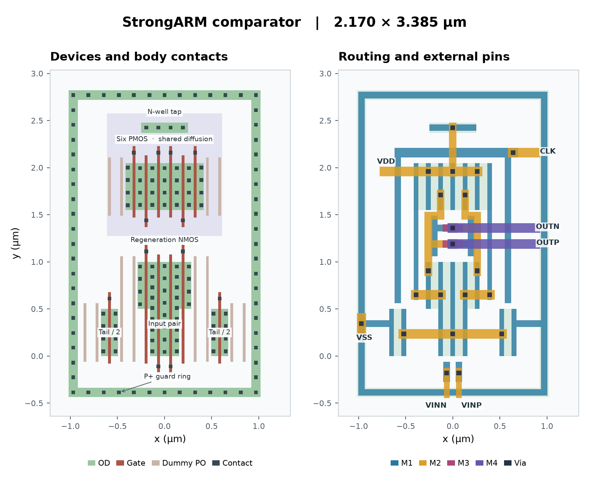
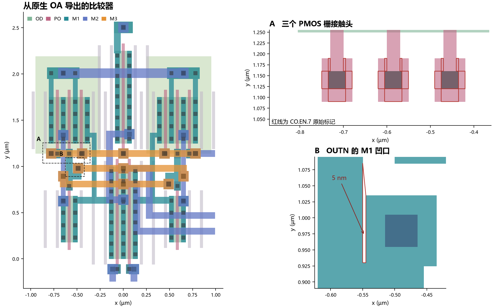
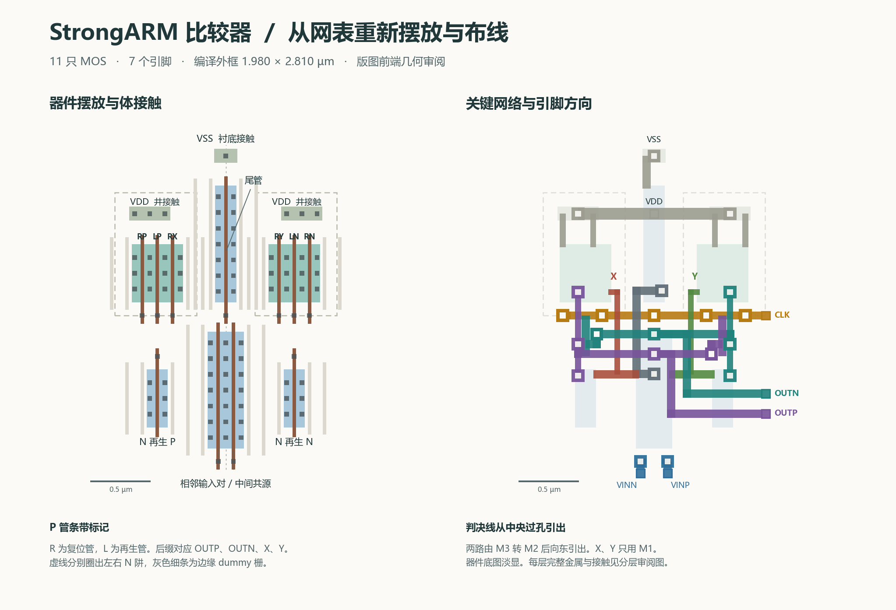
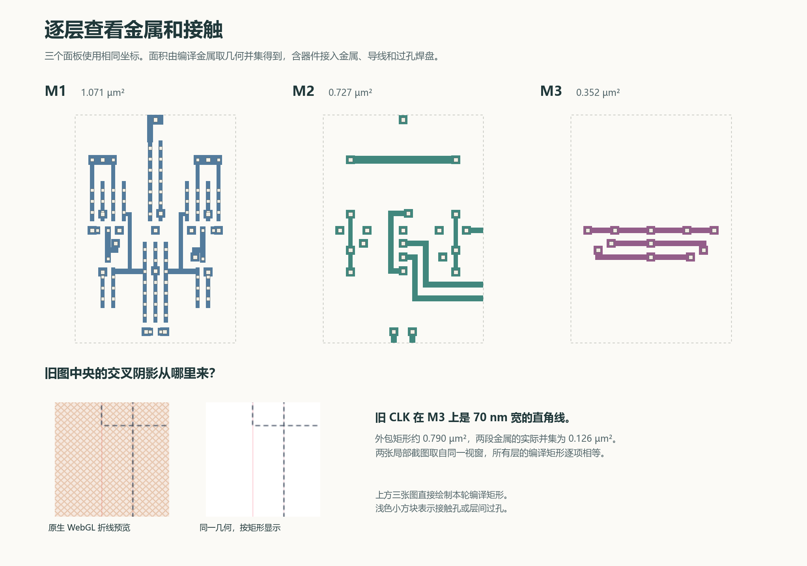

# StrongARM 比较器 · Virtuoso 原生版图

本实验的可编辑视图位于 `thu-wei` 上的 `SAR_ADC_T28_LAYOUT / sar_strongarm_lml_exp / layout`。工程使用 `llm_IO/SAR_ADC_T28_LAYOUT` 库。在同一 cellview 内修改，服务器按运行身份保留写入前的 OA 检查点。下方的 LayoutML 图与第一次交接记录保留作历史对照。

r8 整机使用的比较器及其验证记录见[版图索引](../../README.md)。

## 工作流复盘

本次 T28 从空白设计比较器的实验，支持把详细摆放和布线直接放在 Virtuoso OA 中迭代。LayoutML 的分层预览和按网查询有助于讨论布局。把完整布线做到草稿满意后才调用真实 PCell 和 Calibre，使工艺错误发现得太晚。

- 首轮从空白到可看草稿用时 15 分 55 秒。曾出现一大片金属阴影，核对后发现 WebGL 多画了折线的外包矩形。交接后 11 个沟道的位置尺寸吻合，M1–M3 和 VIA1–VIA2 逐层几何异或为零，LVS 首次就通过。
- 草稿显示 0 项诊断，首次原生 DRC 却有 251 个局部标记和 2 条全局提醒。一个栅接触模板在 11 处重复，单这一项产生 55 个标记。第一次原生检查作业约 34 秒，包含两次 Virtuoso 启动、导出与 DRC/LVS。上述两个耗时对应不同任务，无法据此计算整套流程的加速比。
- 我把左右等线长和等过孔数用作提前验收条件，在详细走线前没有充分比较不同分指和扩散链。源漏共用、再生栅对列和衬底接入会同时影响核心宽度、走线和寄生。后期在 OA 的重排、物理修正与电气结果应单独归因。项目选型还应与现有 V7 同条件比较，见下节。

本项目后续采用的优先顺序建议为：先用真实 PCell 验证一段共享扩散、栅引出和体接触，再比较包含关键线的行列候选，尽早跑正式 DRC/LVS，并用同源 PEX 与正负小差分 TT 筛选。快速审阅可直接从 OA 或同次导出的 GDS 生成分层图，标明实例、网络、共享边界和规则标记。

## 与项目现有 V7 的对照

项目后续集成沿用 V7 核心 `sar_strongarm_t28_core/layout`。下文“修改前 OA”指本实验首次交接的版图。本节另取 V7 的实际记录，与实验最终版比较。两个独立后仿运行 `comp-v7-tt-20261118` 和 `sa-oa-tt-20261118o` 的电气源、TT 激励、MOM 和接收门负载、分析脚本逐字节相同，Spectre X 设置也一致。[V7 布图源](../../design/comparator.il) · [V7 验证记录](../../results/comparator.md) · [实验测量](virtuoso_result.json)

| 指标 | 项目 V7 | 本实验最终版 |
| --- | ---: | ---: |
| 核心外框面积 | 5.738 µm² | 7.345 µm² |
| TT 十点判决正确 | 10/10 | 9/10（+0.1 mV 判负） |
| +半 LSB / −半 LSB 判决延时 | 198.8 / 203.7 ps | 227.3 / 228.7 ps |
| 最慢复位 | 33.20 ps | 34.17 ps |
| 同一十点延时拟合的输入失调 | −0.0127 mV | +0.2431 mV |
| 浮置输入的差分 / 共模回踢峰值 | 59.63 / 398.10 µV | 54.63 / 356.61 µV |

两份 xRC 网表按同一口径累加对地和网间电容后，V7 与实验版的 CLK 分别为 1.1162 和 1.2937 fF，VINP 分别为 0.3795 和 0.2856 fF。V7 原报告中的 CLK 0.3733 fF 仅为对地分量。

V7 将输入对和尾管均拆成 0.5 µm 单指，在 P、N1、N2 三行内共享扩散。上下再生管的栅列直接对准两根 M3 输出主干，时钟占中轴。实验版保留 1 µm 输入单指，尾管分别占两侧区域，输出统一经 M4 向东引出。V7 的面积小 21.9%，正负半 LSB 判决分别快 28.5 和 25.0 ps。实验版的浮置输入回踢较小。上述失调拟合只描述标称 TT。V7 已有仅比较器带 RC 的 ADC 十帧验证；实验版的电气记录覆盖独立比较器。[V7 集成及覆盖范围](../../results/comparator.md)

## 本轮物理验证

**Calibre LVS 为 CORRECT。** 版图的两只半宽尾管并联归并后，与冻结 B 版网表的 5 只 NMOS、6 只 PMOS、10 个网络和 7 个端口逐项匹配。提取还识别出一个阱结二极管，LVS 按规则过滤，xRC 网表保留。单元 DRC 从 253 个标记降至 2 个，剩下的是规则集对核心／IO 电压选项和低漏电二极管标识的全局提醒。局部几何违规为 0。XStream 保留了 `XSTRM-35`，对应层映射中的 `instance:drawing`。DRC 标记 (local archive: `work/layout/layoutml-clean-comparator/native/sa-oa-core-20261118o/drc/DRC_RES.db`) · LVS 原文 (local archive: `work/layout/layoutml-clean-comparator/native/sa-oa-core-20261118o/lvs/lvs.rep`)

| 同一 xRC 规则，显式寄生电容 | 修改前 OA | 本轮 OA |
| --- | ---: | ---: |
| OUTP / OUTN | 1.2206 / 1.2674 fF | 1.0223 / 1.0099 fF |
| 两路输出之差的绝对值 | 0.0468 fF | 0.0125 fF |
| X / Y | 0.6383 / 0.6716 fF | 0.6438 / 0.6495 fF |
| CLK / TAIL | 1.1510 / 0.8803 fF | 1.2937 / 0.6977 fF |
| VINP / VINN | 0.2564 / 0.2565 fF | 0.2856 / 0.2857 fF |
| GDS 外框 | 1.980 × 2.840 µm | 2.170 × 3.385 µm |
| 含 MOS 沟道的 OD 岛数、总面积 | 6 岛，1.110 µm² | 4 岛，1.035 µm² |

表中累加本网的对地电容和网间耦合，按其余网交流接地计算。MOS 本征电容和测试台负载另计。含完整衬底环的外框为 **7.345 µm²**，较原 OA 的 5.623 µm² 增加 30.6%。沟道所在的 OD 面积减少 6.8%。两条输出从反馈汇合处直接向东引出，顶层引脚从 M2 改为 M4，其余五个引脚在 M2。全单元 VIA1、VIA2、VIA3 数量从 18、11、0 变为 21、2、2。布局增加了时钟和输入负载，同时减轻了两路输出及 TAIL 的负载。[提取数值与几何](virtuoso_result.json)

## 器件与连接

六只 PMOS 放在同一 N 阱的一条有源区内。沿扩散从左到右依次经过 **X、VDD、OUTP、VDD、OUTN、VDD、Y**。这样四个复位管和两只再生管能共用五个源漏边界。下排四只 NMOS 依次连接 **OUTP、X、TAIL、Y、OUTN**。两个输入管在中间共用 TAIL，各自直接接到同侧的再生管。原网表 1 µm 的尾管由左右各一只 0.5 µm 单指并联实现，栅长都为 30 nm。两半就近接入所在侧的 VSS 环，共用一条 TAIL 金属线。

12 只单指 MOS 均由原生 PCell 生成栅接触和 M1 引出。等宽器件贴合处只放一列源漏接触。宽度过渡处由较宽一侧的 PCell 生成接触，另一侧共享扩散。Virtuoso 重新打开 OA 后逐一核对 48 个端子，GDS 上另核对实际沟道、共享扩散连续性及切孔数。连续 P+ 环的四边共有 64 个衬底接触，接 VSS。居中的 N+ 阱接触有 4 个孔，接 VDD。版图保留栅距和端部环境所需的 dummy，密度填充交给顶层。

再生管的漏极和对侧栅极在两排器件之间闭合反馈。各自的输出沿一条水平 M4 到东侧引脚，过孔落在反馈线上。输入在南侧直接从两个栅端引出。双尾管方案中，抽取得到的两只输入管共 58 个实例参数逐项相同。CLK 对 X、Y 的耦合分别为 0.12902 和 0.13083 fF，TAIL 对二者的耦合分别为 0.10049 和 0.10047 fF。

## TT 提取后验证

同一套 Spectre X 测试在 0.9 V、27 °C 下比较版前、首次交接的 OA 和本轮 OA。VINN 固定为 450 mV，比较时钟上升、下降时间各 100 ps。每路输出接 PDK MOM 电容及接收反相器。测试差分输入为 ±100、±30、±3.515625、±1、±0.1 mV。当前 ADC 的差分半 LSB 为 3.515625 mV。

| 测量 | 版前 | 首次 OA 提取后 | 本轮 OA 提取后 |
| --- | ---: | ---: | ---: |
| 极性正确的测试点 | 10/10 | 8/10 | 9/10 |
| 判错的输入 | 无 | +1 和 +0.1 mV | +0.1 mV |
| +半 LSB / −半 LSB 判决时间 | 231.3 / 237.8 ps | 301.9 / 270.5 ps | 227.3 / 228.7 ps |
| 十点最慢复位 | 32.83 ps | 39.16 ps | 34.17 ps |
| 浮置输入测试的差分回踢峰值 | 35.84 µV | 47.74 µV | 54.63 µV |

所有点均完成再生和复位。当前版通过半 LSB 功能筛查，十点完整验证仍有一个极性错误。另用 50 µV 步长从 −1 mV 扫到 +1 mV，再反向扫描，每次比较之间经过完整复位。两个方向均单调，+250 µV 时为负判决，+300 µV 时为正判决。本次 TT 的输入折算翻转点在 **+0.25～+0.30 mV（0.036～0.043 LSB）**。此区间量化的是标称提取电路的偏移。随机失调分布还需用这份版图做失配 Monte Carlo。TT 原始分析 (local archive: `work/output/managed_execution/runs/sa-oa-tt-20261118o/collected/derived/result.json`) · 双向扫描 (local archive: `work/output/managed_execution/runs/sa-oa-trip-20261118o/collected/derived/result.json`)

单侧尾管、居中阱接触时，翻转点在 −0.25～−0.20 mV。改为两侧并联半尾管后，第一次测得 +0.30～+0.35 mV。最后把反馈引出处收拢，将向东的输出移到 M4，得到上表结果。这些数据保留了偏移变化的方向。本次覆盖填充前的单元；顶层互连、密度填充、整机时序、PVT 和版图失配尚待验证。Spectre 原始日志保留四类警告，其中 `SFE-3031` 涉及两个测试台副本各一只浮空提取电容。Spectre 日志 (local archive: `work/output/managed_execution/runs/sa-oa-tt-20261118o/collected/spectre.out`)

改变原生参数和摆放使用 [PCell / SKILL](virtuoso_core.il) 与[布图源](virtuoso_design.py)。[测量脚本](virtuoso_metrics.py) 按导出的 GDS 和 Calibre xRC 散列核对物理结果。[TT 测试台](virtuoso_tt.py) 复用已有版前测试的激励、负载和分析器。[审阅脚本](virtuoso_review.py) 直接从 GDS 绘图并生成[数值与运行身份](virtuoso_result.json)。

## 首次交接及前端草稿（历史）

[器件摆放与关键布线](review.png) · [分层金属与旧图成因](contacts.png) · 离线交互视图 (local archive: `work/layout/layoutml-clean-comparator/layoutml-viewer.html`) · [交接时的 LML](strongarm.meso.lml) · [原始测量](measurements.json)

## 2026-11-18 · Virtuoso 和 Calibre 首次筛查

**LVS 通过，DRC 未通过。** 在 `thu-wei` 的 Virtuoso IC6.1.8 批处理会话中生成并保存了 `SAR_ADC_T28_LAYOUT / sar_strongarm_lml_exp / layout`，另起只读会话重新打开，核对 11 个原生 MOS 的 44 个端子和 7 个 M2 引脚。DRC 与 LVS 使用同一次 XStream 导出的 GDS。LVS 对冻结 B 版 CDL 匹配了 5 个 NMOS、6 个 PMOS、10 个网络和 7 个端口。原始提取多出 2 个二极管，规则过滤后未匹配项为零。原始 LVS 报告 (local archive: `work/layout/layoutml-clean-comparator/native/lml-comp-native-screen-20261118a/lvs/lvs.rep`)

| 草稿转入 OA 后的测量 | 实测结果 |
| --- | --- |
| 沟道、布线和层间孔 | 全部 11 个实际沟道的位置及长宽与草稿逐一吻合。M1、M2、M3、VIA1、VIA2 的整层几何异或面积均为零，OD、NW 和 dummy PO 也一致。 |
| 原语差异 | CO 由 89 个变为 111 个，源漏采用真实 PCell 接触阵列。PO 图形有 0.0066 µm² 差异，NP、PP 的包围也有变化。实际 GDS 外框为 1.980 × 2.840 µm。 |
| 栅接触及邻近环境 | 11 个栅接触头各产生 5 个 `CO.EN.7` 标记，共 55 个。PO 形状和栅间距、栅与 dummy 间距合计另有 90 个。40 nm 接触孔放在 70 × 100 nm 的栅接触头中，横、纵包围分别为 15、30 nm，本例不能满足相对两侧 50 nm 的规则。 |
| 金属、注入和标记层 | 金属局部间距、折角和面积共 70 个。左侧 OUTN 有 5 nm 的同网 M1 凹口，另有 7 处独立的 110 × 110 nm M2 落点仅 0.0121 µm²，低于 0.014 µm²。注入层及 PMET 共 36 个。 |
| DRC 总计 | 23 条规则共 253 个标记，含规则文件给出的 2 个全局提醒。本次未做 PEX 和后仿 TT。 |

优先修 11 个栅接触共用的几何，先验证一个真实 PCell 的栅接入和相邻 130 nm 栅距下的两个独立栅。用它实际占用的空间决定哪些栅头需要错位，以及哪一排需要放宽，再调整反馈线拐角和小面积落点。当前金属层的异或为零，继续调整预览渲染无法消除这些标记。

**运行记录。** `lml-comp-native-screen-20261118a` 从服务器登记到最终报告约 34 秒，包含两次 Virtuoso 启动、stream-out 和两套 Calibre 规则运行。这个耗时只计算原生检查作业。XStream 原始日志保留了 `XSTRM-35`，提示 `instance:drawing` 未列入流片层映射。独立原语试验中，两侧 dummy 均关闭时直接启用自动栅接入的几个参数组合触发了 PCell 求值错误。正式实验使用已复核的四端原生 MOS 与显式 `M1_PO` 栅接触，原语探针和正式运行分别留档。[逐层异或、规则计数、证据路径与散列](native_screen.json) · 原始 DRC 标记 (local archive: `work/layout/layoutml-clean-comparator/native/lml-comp-native-screen-20261118a/drc/DRC_RES.db`)

## 摆放决定

从 B 版 StrongARM 的 11 只管子重新排布。输入对在下方相邻，共用中间的 TAIL 扩散，栅中心距 130 nm。尾管竖放在对称轴上，进入两侧 PMOS 条带之间的空位。两组 PMOS 各用一个三管共享扩散条带、一个 N 阱和一个接 VDD 的井接触。尾管留在公共衬底内，11 个沟道栅均同向。VINN、VINP 朝南接 CDAC，OUTN、OUTP、CLK 朝东接 SAR。[冻结电气网表](../../../design/xtor/comparator/comparator.scs) · [顶层接口意图](../../specs/interfaces.json)

另一种独立试摆把输入管分到两侧，尾管留在下排中央。它能以 25 个层间孔走通，但输入栅中心距增至 1.560 µm，共源金属长 1.910 µm，外框面积 5.750 µm²。选中的共源摆法把这三项降到 0.130 µm、1.075 µm 和 5.564 µm²。两种试摆都接通七个引脚，也都检查了孔包围、异网间距和阱接触。面积和线长只覆盖本单元草稿。

## 走线结果

| 编译几何 | 上一稿 | 本轮 |
|---|---:|---:|
| 含井、体接触与原语 dummy 的外框 | 1.980 × 3.110 µm | 1.980 × 2.810 µm |
| 外框面积 | 6.158 µm² | 5.564 µm² |
| 显式布线中心线总长 | 18.265 µm | 16.345 µm |
| VIA1、VIA2 切孔合计 | 31 | 29 |
| CLK 线长 / 切孔 | 5.480 µm / 9 | 1.900 µm / 10 |
| X、Y 各自线长 / 切孔 | 1.480 µm / 3 | 1.170 µm / 0 |
| 两个输入各自线长 / 切孔 | 0.925 µm / 1 | 0.185 µm / 1 |
| 两个输出各自线长 / 切孔，含反馈 | 2.900 µm / 5 | 3.970 µm / 6 |

四个复位管的 CLK 栅和尾管 CLK 栅排在同一高度，一根水平 M3 从五处下接。X、Y 各用一组 M1 短线串起本侧输入漏、再生支路与复位管。两条 M3 交叉反馈线分别从中点下到 M2，再以相等的水平和垂直长度向东引出。双输出同侧接入占了更多线长，也避免把较近一侧直接引出、让另一侧独自跨过核心。

按实际编译线段、接入点和过孔重建导通路径，得到下表。起点分别取漏端接入 VIA1 的中心或再生栅的 M1 接触中心，终点取各自外部 M2 输出引脚中心。两侧每条对应路径的逐层长度和切孔数也相等。器件内扩散电阻、耦合电容和判决延迟须由原生版图提取和后仿确定。

| 到输出引脚的路径 | OUTP | OUTN | 每条路径的层间孔 |
|---|---:|---:|---:|
| NMOS 再生漏端 | 2.470 µm | 2.470 µm | 3 |
| PMOS 再生漏端 | 2.645 µm | 2.645 µm | 3 |
| NMOS 反馈栅 | 2.240 µm | 2.240 µm | 3 |
| PMOS 反馈栅 | 2.380 µm | 2.380 µm | 3 |

## 旧图的大块阴影

旧图中央偏右的交叉阴影来自 CLK 的 M3 直角线。旧版 WebGL 对多段路径既画多边形，又把外包矩形送入填充图层。该折线宽 70 nm，两段编译矩形的并集为 **0.126 µm²**，外包框为 **0.790125 µm²**。用两条精确到拐角的直线表示同一几何后，所有层的矩形逐项相同，大块阴影消失。本地审阅包现按编译线段渲染正交路径。用旧源重新打开，在相同放大区域与矩形对照截图逐像素一致。

本轮 M1、M2、M3 的金属并集分别为 **1.071、0.727、0.352 µm²**。图中的小方块显示接触孔或过孔。三个面板用同一坐标和比例尺，井和扩散可在器件图中单独查看。

## 复核与交接边界

- 11 个器件的尺寸、指数组合与端网已逐一对应冻结网表。7 个端口按网表顺序列出。10 个网络通过正面积金属接触和过孔连通检查，发现 0 开路、0 异网短接、0 悬空线端、0 同网共线重复。离线 LayoutML 浏览器显示 0 条飞线、0 项诊断。
- 89 个 CO 上下均有几何覆盖，11 个栅接触孔均居中，最小局部多晶硅包围为 15 nm。18 个 VIA1、11 个 VIA2 的上下金属包围均至少 30 nm。M1、M2、M3 的最小异网距离均为 50 nm。两侧 N 阱均含对应三只 P 管和本地井接触，两个阱都连到 VDD。异种注入层重叠、跨原语有源区重叠、dummy 栅压到有源区或体接触区均为零。
- 草稿中，最近衬底接触至两侧 NMOS 再生管有源边缘的几何距离均为 1.809 µm。上方原生筛查给出了实际 PCell 的阱、接触和走线结果。双路输出的耦合、负载及判决延迟仍待 PEX 与 TT 测量。[实验步骤](plan.md)
- 本轮记录了旧图的同几何复现、两种试摆、自空白重布线及审核出图时间。首轮实验从空白到可审阅为 15 分 55 秒。本轮计时和两种摆法的测量、源文件哈希见 [measurements.json](measurements.json)。

从项目根目录可用以下命令重新生成独立几何检查与离线交互版图。LayoutML 检出提交为 `e19fb224207147ddb531d0ea2b1812b5862fd7e4`。

~~~powershell
python Layout/experiment/layoutml-comparator/review.py --layoutml work/layout/layoutml-v3-preview/LayoutML --native
~~~

