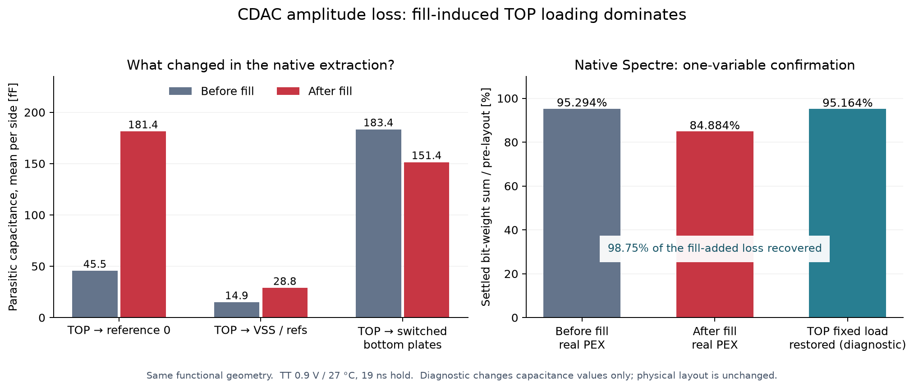

# 完整 CDAC 当前工作版

按用户确认的匹配、走线与验证原则，将冻结 B 的完整 `sar8j_r1_cdac` 实现为实际 OA 版图。范围为差分两侧 MOM 阵列及 16 组参考开关，保留 38 个原端口、原位权、栅长和总沟道宽度。参考逻辑、采样 Bootstrap、比较器仍在模块边界外。

## 当前实现

- 每侧 256 个有效单位 MOM，八个位权为 1、2、4、8、16、32、64、128，另有一个固定参考单位。单位件沿用 `cfmom_2t` 原规格。
- 32 列、8 行的有效阵列，外围 84 个边界 dummy，每个 dummy 两端接 VSS。边界 dummy 与电路中连接参考的单位电容是不同对象。
- B1–B7 按中心反演单元对分配。B0 和固定参考单位在相反的中心邻位，只有一个单位，不能宣称两者也严格共质心。左右差分侧镜像。
- 各位参考开关按原总宽度折成最多 12 指的分块，每侧每种极性合计 765 指。开关区设体接触和衬底保护环。折指后寄生变化须由 PEX 后仿判定。
- 电容内部 M1–M3，底板行线 M4、汇流 M5；开关控制行线 M6、汇流 M7，控制线留在开关区。TOP 走 M3，从两侧相对位置引出。

## 工作入口与证据

[cdac.py](../design/cdac.py) 生成当前输入至被忽略的 `work/layout/full-cdac/`。LVS 参考从现有电气网表独立构造，不由物理分配表反推。个人库为 `SAR_ADC_T28_LAYOUT`；审核和功能修改进入 `sar8j_r1_cdac_core/layout`，其重复半侧为 `sar8_cdac_half`；完整验证顶层 `sar8j_r1_cdac/layout` 引用同一核心及两组独立填充，不维护第二份功能版图。三颗 MOM 试验保留原 cell 与回滚检查点。2026-11-16 将原实验库迁至 `llm_IO`，见[迁移验证](library_migration.json)及[核心/填充管理验证](core_fill_management.json)；以下既有物理和电气证据仍绑定其原始运行身份。

沿用 `run_physical.py full <唯一证据ID>` 生成 OA、导出 GDS，并执行 DRC/LVS。修正在同一工作 cell 内完成，保留每轮失败及散列。通过后提取同一 GDS 的耦合 RC，再经现有 managed 流程执行前后仿对照。此版尚未成为生产 OA 或整机仿真基线。

## 验收

核对单位计数、原电气端口及连接、各位 MOS 总宽度和几何重心；执行 DRC、独立参考 LVS、保留耦合的 PEX；分别测有效位权、开关建立和馈通。密度、天线、填充以及整机/封装环境按实际覆盖范围报告，不能以 LVS 正确代替性能或完整流片签核。

## 2026-11-10 金属与 OD/PO 填充分组定位

从同一份 `cdac-full-filled7` GDS 分别仅去除顶层 OD/PO 或 metal fill reference，保留其他全部 stream 记录。两组都核对了功能结构散列、38 个端口和实际 LVS；工作 OA 未修改。原填充前及满填充数据作为另外两组对照。

| 填充状态 | TOP 固定负载，双侧均值 | 位权总幅度预测 / 前仿 |
| --- | ---: | ---: |
| 未填充 | 60.42 fF | 95.2940% |
| 仅金属填充 | 152.07 fF | 88.7214% |
| 仅 OD/PO 填充 | 118.87 fF | 90.9796% |
| 两类填充均有 | 210.22 fF | 84.8806% |

固定负载的总增量为 **149.80 fF/侧**。按两种加入顺序的边际增量取平均，金属贡献 **91.50 fF（61.1%）**，OD/PO 贡献 **58.30 fF（38.9%）**；非加性交互项为 −0.291 fF。这里的比例分解的是新增固定负载，不能直接当作幅度损失的百分比分解。金属更大，但 OD/PO 不能忽略。

两份诊断提取的 LVS 均为 CORRECT。仅金属组 DRC 有 7 个标记，仅 OD/PO 组有 14 个，均包含原有两条提示；其余为缺少对应填充后的密度/空白区违规，没有关闭或放宽规则。RCC 和格式化均为 0 errors，分别保留 38、5 条原始 warnings。两组物理执行约 799 秒、185 秒；后续 managed 只读分析约 5.9 秒，峰值 RSS 20 MiB。

表中的分组幅度使用已与原填充前后瞬态结果对照过的电荷守恒模型，**尚未对两份分组提取网表另跑瞬态**。它足以指明下一步应同时限制 TOP/MOM 周边的金属与 OD/PO 耦合，再验证局部填充距离、密度和真实后仿；尚不能指定某根走线或某片填充为唯一来源。工作版图仍有原 TT 两处错码，未宣称已修复。

[分组完整结果、原告警及运行身份](fill_groups.json)；分析运行 `cdac-fill-groups-audit-v1` 绑定已完成的 `cdac-full-tt-filled-hold-v1`，同时对两份已完成 PEX 的 manifest、GDS 和提取网表逐项校验散列。

## 2026-11-09 填充后的物理验证

在同一个 `sar8j_r1_cdac/layout` 中加入原生 OD/PO 和金属填充，当前外框约 **90.33 × 92.49 µm**。最终几何证据为 `cdac-full-filled7`；两次保留的填充依次为长 MOS dummy 和默认短 dummy 补隙。实际器件、功能走线和 38 个端口未改，去除两个填充 reference 后的结构散列与原布线完全一致。

**几何与密度违规已清除，LVS 为 CORRECT。** 原 DRC 输出仍保留两条说明性标记：`IO_CONNECT_CORE_NET_VOLTAGE_IS_CORE:WARNING1` 和 `DIODMY_L:WARNING`；未改 checker、未关闭规则，不宣称零告警或完整流片签核。前一条提醒核心网络的电压规则适用范围，后一条是低漏电二极管标记提示；此 CDAC 没有 IO MOS 或有意设计的低漏电二极管。

同源填充后 PEX `cdac-full-filled-pex7-flat` 已完成，提取与格式化均为 0 errors，分别保留 38、5 条原始 warning。按原生 deck 建议仅展平填充层级，功能阵列层级和全部耦合保留；RCC 实际约 794 秒、4 线程。初次 300 秒超时及后来主动停止的未展平尝试均保留。原始提示中包括按标称金属厚度提取；本轮纳入了填充几何，但未验证密度相关 CMP 厚度模型。

### 接回整机的 TT 十帧结果

整机运行 `cdac-full-adc-tt-filled-v1` 已完成，仿真到达 1.059 µs，实际耗时约 1426 秒，峰值 RSS 约 801.5 MiB。仅替换 CDAC，其他管级子电路与冻结 B 一致；保留 TT、0.9 V、27 °C、60 ns 初始低相位及十帧激励。对照为 `results/migration/original_short.json` 中冻结 B 的实际结果。

**时序流程完整，但码字未通过：第 3 帧 12→0、第 6 帧 243→255。** 十帧预期为 `[0,0,12,127,128,243,255,255,0,128]`，后仿为 `[0,0,0,127,128,255,255,255,0,128]`。首帧和随后重复的码 0 相符，中码 127/128 相符；两个饱和端点正确不能掩盖输入范围压缩。

| 测量 | 前仿 B | 填充后 CDAC PEX 接回整机 |
| --- | ---: | ---: |
| 正确码字 | 10/10 帧 | 8/10 帧 |
| 每帧比较 / 写入 / 更新 / 捕获边沿 | 8 / 8 / 8 / 16 | 8 / 8 / 8 / 16 |
| 八轮异步顺序及原生 observer 交叉核对 | 通过 | 通过 |
| SEQ_SAMPLE 关闭至最后更新 | 28.87890–29.12395 ns | 28.39838–29.19246 ns |
| 最慢 DAC 尾部进入 ¼ LSB 带 | 2.33250 ns | 2.62076 ns |
| 最小尾部静止余量 | 464.70 ps | 176.67 ps |
| 关闭前最大输入引脚跟踪误差 | 0.13673 LSB | 0.13126 LSB |

外部采样关闭沿及 SAMPLE_INT、SEQ_SAMPLE 关闭沿未见可分辨的变化；插值差远小于最大 10 ps 保存步长，不能解释为飞秒精度验证。转换时间的逐帧变化约 −490 至 +69 ps，变化还包含判决路径改变，不能把较短转换时间当作性能改善。DAC 尾部采用下一次比较前 20 ps 的实测电位作目标，静止余量也截止到该时刻；它只反映该周期的尾部收敛，不证明电位达到理想位权。

首次分析因四个 Bootstrap 内部电荷探针的保存路径大小写不符而失败，原失败与 `SPECTRE-8281/8286` 告警保留。以 `cdac-full-adc-tt-filled-measure-v1` 绑定已完成源进行只读重分析，必需的码字、采样、握手与 TOP 波形均存在，阈值未变，没有重跑仿真。四个内部电荷量仍标为缺测；首帧功能通过不等于供电爬升、POR 或内部预充电荷已验收。生成器已修正后续输入包的保存路径，未改动本次冻结输入。

本轮只有 CDAC 采用寄生提取，其他模块仍为前仿；端压原始告警保留，未做可靠性签核。此版未通过 TT 码字检查，未采用为整机基线。

### 填充后长保持诊断

在整机观察到预期码 12 输出 0、预期 243 输出 255 后，用同一份 PEX 补跑原有独立 CDAC 测试台 `cdac-full-tt-filled-hold-v1`。仍为 100 ps 理想栅控、50 Ω/4 pF 参考，命令后 19 ns 取有限保持目标，并检查 17–19 ns 平台稳定性；没有改变版图或阈值。

| 测量 | 同台前仿 | 填充后 PEX |
| --- | ---: | ---: |
| B0 有效阶跃 | 7.03121 mV | 6.00904 mV |
| B7 有效阶跃 | 899.99367 mV | 763.78725 mV |
| 十次切换中最慢的 ¼ LSB 建立 | 1.03828 ns | 1.59223 ns |
| 十个平台在 17–19 ns 的稳定性 | 通过 | 通过 |

八个位权之和的后仿/前仿比例为 **0.8488407**，共同幅度下降约 **15.116%**；填充前该比例为 0.9529385。按共同增益归一化后的单个位权最大残差约 **0.06296 LSB**，仍不是整机 INL/DNL。长保持后幅度没有恢复，结合低、高码向两端饱和的现象，当前证据指向参考电荷转换幅度下降、有效输入范围压缩。不能因平台稳定或握手完整而宣称精度通过。

该补充仿真到达 260 ns，耗时约 213 秒，0 errors、21 warnings、13 notices，分析与回收完成；端压告警和 `SPECTRE-555`（约 19.9 MiB swap、影响速度）原文均保留。后续归因见下节；尚未据此修改或采用新的整机基线。

### 15.12% 幅度损失的归因

**主因是填充引入的 TOP 固定电位负载。** 填充前后功能器件和走线的结构散列相同，原有 TOP 走线没有改变。填充前损失 4.7061%，填充后损失 15.1159%；因此新增填充带来 10.4098 个百分点的退化，约占这两个状态间总损失的 68.87%。这个比例是先布线、再填充的顺序对照，不是严格可加的电场能量分解。原有 4.7061% 包含布线、边界与其他非填充寄生，不能全部归给 TOP 走线。

从两份原生 xRC 中合并电阻连通的信号网络，分别统计参考节点电容与网间耦合。下表是两侧平均值，不包含 PDK MOM 本征电容：

| TOP 所见寄生 | 填充前 | 填充后 |
| --- | ---: | ---: |
| 至提取参考节点 0 | 45.54 fF | 181.39 fF |
| 至 VSS | 13.77 fF | 28.08 fF |
| 固定电位总计：0、VSS、VDD、VREFP/N | **60.42 fF** | **210.22 fF** |
| 至八个切换底板的寄生耦合 | 183.35 fF | 151.38 fF |

TOP 至固定电位的负载平均增加约 **149.80 fF/侧**。它增加电荷共享的分母，却不提供对应码位的参考阶跃，因此压缩有效位权。TOP 至切换底板的电容还传递参考电荷，不能把它与固定负载不加区分地相加后判为误差。

以先前独立单位 MOM 测量的 4.00347 fF 为本征单位值，建立两个 TOP 节点的稳态电荷守恒模型，没有用本次幅度结果拟合参数。预测前后幅度比例为 95.2940% 和 84.8806%，原生瞬态实测为 95.2939% 和 84.8841%；填充后八个位权预测的最大差为 0.00511 LSB。这支持损失来自稳态电容分压，而非单纯电阻导致的建立不足。

又执行了一个数值诊断 `cdac-top-fixed-load-restore-v1`：保持填充后全部电阻、MOM/MOS、TOP–底板耦合及原有 260 ns TT 激励不变，只按每侧一个比例缩放 TOP 至固定电位的寄生，使其合计恢复到填充前的约 60.4 fF。原版图、原始 PEX 及冻结输入均未修改。

| 状态 | 相对前仿的位权总幅度 |
| --- | ---: |
| 填充前真实 PEX | 95.2939% |
| 填充后真实 PEX | 84.8841% |
| 仅恢复 TOP 固定负载的诊断网表 | **95.1642%** |

该单变量对照消除了 **98.75% 的填充新增退化**。余下约 0.13 个百分点与 TOP–底板耦合减小等变化相符。诊断的最慢 ¼ LSB 建立为 1.56867 ns，原填充后为 1.59223 ns；幅度恢复远大于建立时间变化。仿真、分析与回收已完成，耗时约 195 秒，0 errors、20 warnings、13 notices，保留原始告警。

下一次物理修改应优先处理敏感 TOP/MOM 周边的填充距离与分布，并保留密度约束；然后优化原有 TOP 汇流线的面积与长度。金属与 OD/PO 的分组定位现已完成，见上方 2026-11-10 结果；具体空间区域仍待定位。这里的提取参考节点电容不意味着所有物理填充图形都接了地；数值缩放也不是可直接制造、DRC 通过的修复。当前真实版图的 TT 错码状态没有改变。

只读统计运行 `cdac-top-loading-audit-v2` 绑定两个已完成源及各提取文件散列。首次解析把显式地端 0 误计为不连通的信号端，失败记录保留在 `cdac-top-loading-audit-v1`；修正后核对非地端电阻连通和地端映射，未放宽电气阈值。完整统计、诊断修改列表、原始失败及资源身份保存在 [full_cdac_results.json](full_cdac_results.json) 的 `top_loading_diagnosis`。

## 2026-11-09 填充前诊断结果

完整布线已生成并保存，外框约 **90.33 × 92.48 µm**。共 512 个功能单位 MOM（510 个二进制位权单位、2 个固定参考单位），加 168 个边界 dummy；16 组参考开关折成 130 对 NMOS/PMOS 分块。固定工作 cell 的实际 GDS 截图见 [完整 CDAC](../../work/layout/screenshots/sar8-cdac-full.png)。

最终几何证据 `cdac-full-route3` 的 **LVS 为 CORRECT，DRC 为 NOT_CLEAN**。器件、接触及互连的宽度/间距违规已经修正；仍保留 17 个金属/OD/PO 密度或最大 OD 空白区标记，以及两条 deck 提示。没有关闭规则，没有把这些标记当作签核通过。最初两轮的失败报告保留在各自 evidence 目录。

`cdac-full-pex3` 从同一份 GDS 提取耦合 RC，采用实验室原有的 MOM 器件区电容排除设置。分布提取和格式化均为 0 errors，分别保留 38、5 条原始 warning，包括层映射、CONNECT、缺少密度窗口而采用标称厚度等信息。它是填充前诊断提取，不是最终签核提取。

前后仿使用现有独立 CDAC 测试台：TT、0.9 V、27 °C，100 ps 理想栅控边沿，参考驱动 50 Ω/4 pF。依次测八个单比特码、255 和 0；有限保持目标在命令后 19 ns 取值，并检查 17–19 ns 稳定性。差分 1 LSB 为 7.03125 mV，¼ LSB 为 1.7578125 mV。

| 测量 | 前仿 | 填充前后仿 |
| --- | ---: | ---: |
| B0 有效阶跃 | 7.03121 mV | 6.83527 mV |
| B7 有效阶跃 | 899.99367 mV | 857.37799 mV |
| 十次切换中最慢的 ¼ LSB 建立 | 1.03750 ns | 1.41750 ns |
| 八个位权方向、十个平台稳定性 | 正常 | 正常 |

八个有效位权之和的后仿/前仿比例为 **0.9529385**，即共同增益下降约 **4.706%**。仅作为寄生诊断，按此比例归一化后，各单个位权相对前仿的最大残差为 **0.04727 LSB**；这个数不是整机 INL/DNL，也不代表已经实现数字校准。完整数值、原始失败和散列见 [full_cdac_results.json](full_cdac_results.json)。

仿真运行 `cdac-full-tt-prefill-v1` 到达 260 ns，0 errors、25 warnings、13 notices；原始端压告警保留，未据此宣称电气合格。首次分析因 Python 2 列表推导变量泄漏失败；修正后以 `cdac-full-tt-prefill-measure-v1` 绑定同一完成源，分析与回收完成，没有重跑仿真。实际波形最大保存步长约 5 ps，未做网格收敛。

这些填充前数据不构成流片签核。后续的芯片上下文、天线、参考供电电流能力与端压仍需验证。B0/固定参考单元的质心例外、高阶梯度和版图失配仍属未覆盖项。
