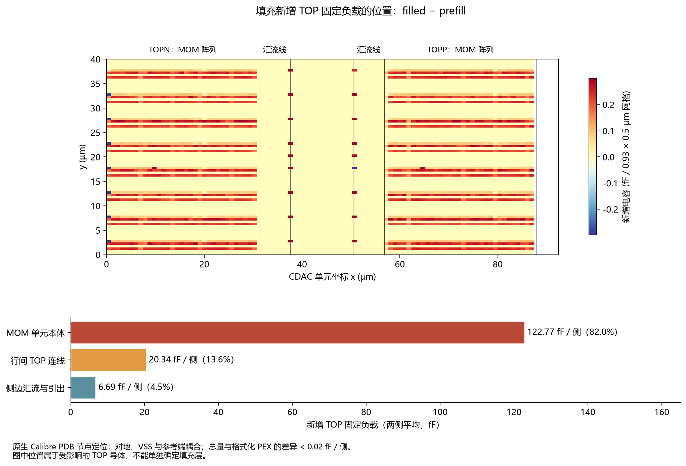
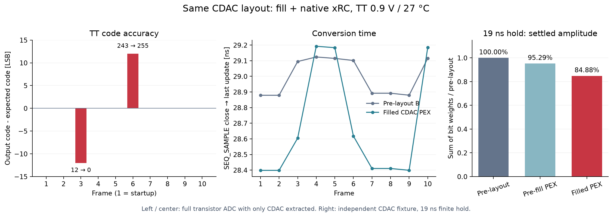

# Full Differential CDAC Layout

The OA implementation covers the two differential MOM arrays and 16 groups of reference switches in the frozen B design, `sar8j_r1_cdac`. It preserves the 38 ports, bit weights, gate lengths, and total channel widths. The reference logic, sampling Bootstrap, and comparator are outside this module.

## 2026-11-18 Placement and Routing Redesign

Open `SAR_ADC_T28_LAYOUT / sar8j_r1_cdac_core / layout_paired_balanced` in Virtuoso to review the functional core, or the same view of `sar8_cdac_half` to review one side. The verification top is the corresponding view of `sar8j_r1_cdac`. The original `layout` and the redesigned view use the same independent electrical reference. The original geometry hash was checked before and after release. [Native evidence and post-layout results](cdac_paired.json)

Each side still has a 32-column by 8-row active MOM array and 84 matching dummies. The TOP plates of adjacent rows face each other, allowing eight rows to share four horizontal M3 tracks. Bottom plates join locally on M3, and consecutive units of the same bit share M4 taps. The consecutive B7 group uses two symmetric taps. The B5–B7 trunks widen near the switches and taper at the far end. Each B1–B7 group has a unit centroid of (17.18, 11.43) µm in half-array coordinates. B0 and the fixed reference unit occupy diagonally opposite sites next to the center.

The switches occupy six rows. Each side now uses 16 folded pairs in place of 65, with up to 64 fingers per PCell. Each bit joins the NMOS and PMOS drains locally at the bottom plate. Sources at the same reference potential share a row rail. The two halves share a peripheral substrate guard ring. TOPN/P exit at the center of the north edge on M3, 1.12 µm apart. The 32 control pins are on M6 at the south edge, and the four reference and supply rails are on M5 at the same edge. [Core comparison at the same scale](figures/cdac_paired_comparison.png)

| Saved geometry | Original | Redesign |
|---|---:|---:|
| Differential core bounding box | 90.33 × 92.49 µm | 72.23 × 51.76 µm |
| Area | 8354.62 µm² | 3738.62 µm² |
| Sum of functional routing centerlines on both sides | 16.736 mm | 9.331 mm |
| TOP routing per side | 404.44 µm | 213.27 µm |
| Routing via cuts on both sides | 7924 | 5420 |

Lengths come from net-labeled metal segments in OA. Routing via cuts come from native GDS. Both metrics exclude PCell internals and density fill. With reference rails along the switch rows, total M2 length increased from 1.08 to 1.36 mm. M5 and M6 fell from 2.74 and 1.97 mm to 0.64 and 0.66 mm, respectively. M7 routing was eliminated. Calibre LVS matched 38 ports, 54 nets, and 680 MOMs. Prefill DRC retained OD.S.14, OD.DN.3, PO.DN.3, PO.DN.3.1, M5.DN.1, M6.DN.1, and two deck advisories.

The proposed top-level floorplan uses the measured outlines of the CDAC, both Bootstrap cells, and the comparator. It reserves space for the reference driver, SAR and timing logic, and a 10 µm isolation corridor. TOPN/P each share an exit segment before branching to the comparator and sampling switch. On either side the planned length is 3.64 µm to the comparator input and 15.23 µm to the sampling switch. The 156 × 120 µm top-level core is a reservation. Inter-module routes still require top-level implementation and extraction. [Placement coordinates and branches](../design/floorplan_paired.json) · [Proposed top-level floorplan](figures/cdac_paired_floorplan.png)

Native coupled PEX measured the extra TOP load to ground, supplies, and fixed references. The average fell from 60.42 fF in the original prefill view to 38.56 fF in the redesign, at 38.48 fF on N and 38.65 fF on P. Applying standard metal and OD/PO density fill to a separate GDS copy increased these values to 140.50 and 142.18 fF. Extraction followed functional geometry hash and LVS checks. The charge-conservation model predicted 89.54% of the schematic amplitude. DRC retained two OD.DN.3 markers, one M9.DN.3 marker, and the two deck advisories. This copy has only the model prediction. Final density closure takes place at top level.

The standalone TT comparison used 0.9 V and 27 °C. Summing the eight bit weights at the 19 ns plateaus and dividing by the matching schematic sum yielded **95.292%** for the original and **96.994%** for the redesign. After gain normalization, the largest single-bit residual rose from **0.049 to 0.129 LSB**, with B7 the largest in the redesign. All ten transitions reached their finite-hold targets. The slowest settling to a quarter-LSB band fell from 1.418 to 1.249 ns. Both runs used Spectre X MX, Gear2, a 5 ps maximum step, and identical stimuli. The initial conservative CX run for the redesign reported `SPECTRE-16927` during precharge. The comparison uses the paired MX reruns. Single-bit residuals and full-ADC INL/DNL are recorded separately.

Both prefill CDACs were integrated into the current transistor ADC with the same ten-frame reference and handshake stimuli. Both matched eight nominal codes. The original deviations of `12→6` and `243→249` became `12→8` and `243→247`. All ten frames passed the sample-edge, handshake sequence, and timing checks. The redesign improved module gain and settling. The two end-range codes still differed from the nominal codes by 4 LSB each. The earlier `12→0` and `243→255` came from the original filled view.

### Gain Error Assessment

With top-plate sampling, fixed TOP parasitic capacitance attenuates all bit steps by C_eff/(C_eff+Cp), while the sampled input retains its amplitude. The effective input full scale shrinks and code-domain gain increases. Pure linear gain preserves gain-normalized INL/DNL, missing-code behavior, and in-range SNDR. The design specification defines gain error as GE = 1/k − 1, where k is the measured sum of bit weights divided by the ideal sum. The limit is 6% at TT and 10% across operating conditions. A −1 dBFS sine reaches clipping at 12.2% gain error. Digital gain correction within the 8-bit output can merge or skip codes, and VREFP already equals the 0.9 V core supply. The design budget therefore assumes uncalibrated gain. The TT allocation is 4.7% for the CDAC with planned fill, 0.8% for top-level TOP routing and devices, and 0.5% for margin. The layout-induced DNL and endpoint INL limits are each 0.25 LSB. [Full scale and gain error](../../docs/specification.md#full-scale-and-gain-error)

Short ADC tests compare with the gain-adjusted code `clip(128 + floor(Vin/(LSB·k)), 0, 255)`, using standalone bit weights from the same physical CDAC view. The allowed difference is ±1 code. [Analysis tool](../tools/analysis/gain_corrected_codes.py) · [Results](gain_corrected_codes.json)

| ADC short test | Source of k | k | GE | Frames differing from nominal (nominal → measured) | Gain-adjusted check |
| --- | --- | ---: | ---: | --- | --- |
| `comp-v7-int-20261118` | Schematic CDAC | 1 | 0 | None | Pass |
| `cdac-baseline-prefill-int-20261118` | Original prefill | 0.95291 | 4.94% | 12→6, 243→249 | Pass, difference 0 |
| `cdac-balanced-int-20261118` | Redesigned prefill | 0.96994 | 3.10% | 12→8, 243→247 | Pass, difference 0 |
| `cdac-paired-int-20261118` | Redesign before balancing | 0.96925 | 3.17% | 12→7, 127→126, 243→246 | Pass, difference −1 |
| `cdac-planned-int2-20261118` | Planned fill | 0.95940 | 4.23% | 12→7, 243→248 | Pass, difference 0 |
| `cdac-stacked-int-20261118` | Planned fill, weight-ordered small bits (current) | 0.95950 | 4.22% | 12→7, 243→248 | Pass, difference 0 |

Gain explains the previously reported end-range code differences in these runs. A SAR decision model using measured bit weights predicted codes within one count of the measured codes. All six runs passed sample-edge, handshake sequence, and deadline checks, with about 31.0 ns minimum deadline margin. The analyzer’s aggregate verdict uses nominal codes, so it still reports a failure for each run with a layout CDAC.

### Planned Fill View `layout_paired_planned`

The CDAC owns TOP-related fill within its outline. Open `SAR_ADC_T28_LAYOUT / sar8j_r1_cdac / layout_paired_planned` in Virtuoso. This wrapper references the functional core and the separate `sar8_cdac_fill_plan` cell. The core and half-cell geometry hashes match `layout_paired_balanced`. The `layout` and `layout_paired_balanced` views retained their geometry through publication. [Fill policy](../specs/fill-policy.md#planned-fill-for-gain-sensitive-modules) · [Fill placement](figures/cdac_planned_fill.png)

- **Array OD/PO.** Place one 0.28 µm dummy OD stripe in every column gap and outside each edge dummy column, for 35 stripes per side. Native MOMs have bottom-plate fingers at the left edge and TOP fingers at the right edge. Shift dummy OD toward the bottom plate, 15 nm from the TOP edge fingers on both sides. Break the stripe in the gaps carrying horizontal TOP routing and leave 0.1 µm clearance to the TOP track. The 0.12 µm dummy PO runs for the full height. Array density is about 25% OD and 13% PO. Mirror N and P.
- **Array metal.** ODBLK, POBLK, and DM1EXCL–DM9EXCL exclude tool-generated OD/PO and metal fill. Mx.DN.7 requires at least 5% density on one of M5/M6/M7 in each 30 µm window. Four 1.2 µm M7 dummy stripes above the matching-dummy rows provide about 6–7% per window.
- **Bottom of the switch region.** Place 74 dummy MOS stripes between the substrate ring and the southern supply rails, with 0.5 µm OD and 0.3 µm PO. These fill the approximately one percentage point of OD density left by the default tool.
- **Outside the array.** Apply foundry OD/PO and metal fill. The acceptance copy merges both tool-generated groups into a private GDS. The OA view carries only the planned fill cell. The top-level flow regenerates tool fill outside the exclusion regions.

| Extraction state (coupled PEX, charge-conservation model) | Fixed TOP load N/P | k | GE | DNL / INL (LSB) | Module DRC excluding two deck advisories |
| --- | ---: | ---: | ---: | ---: | --- |
| Prefill `layout_paired_balanced` | 38.48 / 38.65 fF | 0.96996 | 3.10% | 0.33 / 0.29 | OD.S.14, OD.DN.3, PO.DN.3, PO.DN.3.1, M5.DN.1, M6.DN.1 |
| Full tool fill (earlier probe) | 140.50 / 142.18 fF | 0.89544 | 11.68% | — | OD.DN.3 ×2, M9.DN.3 |
| **Planned fill plus tool fill outside the array (final)** | **52.09 / 52.16 fF** | **0.95943** | **4.23%** | 0.35 / 0.31 | M8.DN.1, M9.DN.3 |
| Control with M7–M9 tool fill allowed over the array | 67.52 / 67.69 fF | 0.94775 | 5.51% | 0.64 / 0.38 | M9.DN.3 |

The prefill model gave k = 0.96996 and DNL/INL = 0.326/0.291 LSB, consistent with the standalone transient’s 0.96994 and 0.326/0.291. The final merged extraction in standalone transient `cdac-planned-mx2-20261118`, with the same MX settings as the prefill run, measured **k = 0.95940 and GE = 4.23%**. DNL/INL were 0.350/0.314 LSB. The slowest quarter-LSB settling in ten transitions rose from 1.249 to 1.289 ns. All ten passed. The final view meets the 4.7% CDAC gain allocation and the 57 fF fixed-load screen, with an N/P difference of 0.07 fF. LVS is correct. Both initial runs, `cdac-planned-mx-20261118` and `cdac-planned-int-20261118`, stopped at the recipe’s 1024 MiB limit. The filled netlist is about 5% larger, and the prefill runs already peaked at 0.82–0.96 GiB. The two failures were preserved. New runs used distinct IDs and a 2560 MiB limit. In the integrated transistor ADC run `cdac-planned-int2-20261118`, all ten measured codes matched the gain-adjusted predictions. Nominal codes 12 and 243 produced 7 and 248. The sampling, handshake, and deadline checks passed with 31.0 ns deadline margin and 0.02 LSB sampling error, equal to the prefill case. The remaining M8.DN.1 and M9.DN.3 use 125 µm windows, larger than the CDAC, and remain for top-level closure.

PDB localization placed almost all of the 13.6 fF increase on M1. TOP edge fingers gained 20.1 fF to VSS and lost 7.9 fF to ground. Interior fingers gained 5.9 fF to VSS and lost 6.0 fF to ground. The dummy OD and substrate both sit at VSS. The minimum OD width of 0.25 µm exceeds the 0.2 µm column gap, keeping OD close to TOP edge fingers and accounting for the main planned-fill cost. Floating metal fill over the array weakens coupling from the wide B7 trunk to TOP more than it does for other bits, shifting MSB-transition DNL from −0.34 to −0.64 LSB. Metal fill remains excluded over the array. The intermediate extraction with planned fill alone had 61.9/52.7 fF on N/P. The two sides agreed after adding peripheral fill. The final merged view is the basis for acceptance. DNL of 0.35 LSB is above the 0.25 LSB allocation because the lower-bit bottom-plate routing couples unevenly to TOP. Fill adds about 0.03 LSB. [Evidence and hashes](cdac_planned_fill.json)

### Weight-Ordered Small Bits `layout_paired_stacked`

This is the current CDAC view. Open `SAR_ADC_T28_LAYOUT / sar8j_r1_cdac / layout_paired_stacked`. It keeps the planned fill cell and every B4–B7 site and trunk of `layout_paired_planned`. Only the small bits in center columns 15/16 move. [Small-bit placement and trunks](figures/cdac_small_bit_center.png)

The native PDB localized TOP coupling to each bottom-plate net by conductor. Inside the MOM bodies every bit couples to TOP at the same 0.70 fF per unit. The difference came from the vertical M4 trunks between the switch bank and the cells. Each trunk couples to the adjacent TOP edge fingers and crossing TOP tracks at about 0.08 fF per array row it passes. The published center placed every small bit by central inversion. A two-unit pair then needs trunks through nearly the full array height. The trunks added 0.33, 0.69, 0.80 and 0.79 fF to B0, B1, B2 and B3, against a proportional 0.07 fF per unit like B4–B7. The small bits were heavy by +0.06, +0.12, +0.11 and +0.03 LSB, which set the −0.35 LSB DNL at the B4 transitions such as 47→48.

The stacked center orders the small bits by weight from the switch side: B0 and TERM in row 0, B1 in row 1, B2 in rows 2–3, and B3 in rows 4–7 with one shared trunk. Trunk length then follows the unit count. Removing small-bit trunk coupling entirely would leave DNL at about 0.27 LSB, so proportionality matters, not minimum length. The major bits keep central inversion. Moving the small-bit centroids by up to two rows costs well under 0.01 LSB for a linear gradient. `python -m Layout generate --module cdac-paired --planned-fill --center stacked` reproduces the view. Without `--center`, the generator still reproduces the published `layout_paired_balanced` and `layout_paired_planned` byte for byte.

| Final merged extraction (planned fill plus tool fill outside the array) | Trunk coupling B0/B1/B2/B3 | Fixed TOP load N/P | k | GE | DNL / INL (LSB) | Module DRC excluding two deck advisories |
| --- | ---: | ---: | ---: | ---: | ---: | --- |
| Central-inversion center `layout_paired_planned` | 0.33 / 0.69 / 0.80 / 0.79 fF | 52.09 / 52.16 fF | 0.95943 | 4.23% | 0.35 / 0.31 | M8.DN.1, M9.DN.3 |
| **Stacked center `layout_paired_stacked`** | **0.00 / 0.17 / 0.34 / 0.55 fF** | **51.94 / 51.97 fF** | **0.95952** | **4.22%** | **0.12 / 0.08** | M8.DN.1, M9.DN.3 |

LVS is correct. Publication checked that `layout` and `layout_paired_balanced` kept their geometry and that the new view streams to the checked hierarchy. Evidence: trial `cdac-paired-plan-d-20261118`, merged acceptance copy `cdac-paired-plan-d-20261118-combined`.

The standalone transient `cdac-stacked-mx-20261118` of the merged extraction, with the same MX settings as the earlier runs, measured **k = 0.95950, GE = 4.22%, and DNL/INL = 0.123/0.084 LSB**, matching the charge model. Normalized weights are 0.982, 1.999, 3.997, 7.988, 15.976, 31.975, 64.039 and 128.045 LSB. The slowest quarter-LSB settling was 1.283 ns, and no check failed. In the integrated transistor ADC run `cdac-stacked-int-20261118`, all ten codes matched the gain-adjusted predictions; nominal 12 and 243 gave 7 and 248. Sampling, handshake and deadline checks passed with 31.08 ns minimum margin and 0.02 LSB sampling error. Both runs used the 2560 MiB memory limit and passed on their first submission.

### PVT Corners of `layout_paired_stacked`

The same merged extraction ran at the four corners of `specs/corners.json` in both fixtures. The MOS model section, temperature and VDD follow the corner. Gate commands swing to VDD, and the references stay at 0.9 V as specified. MOM, other passive sections and the extraction stay typical, so MOM and RC-extraction corners are not covered. Integrated codes use k from the standalone run of the same corner. [Corner results](cdac_planned_fill.json) · [Gain-adjusted code checks](gain_corrected_codes.json)

| Corner | k | GE | DNL / INL (LSB) | Slowest ¼ LSB settling (schematic) | Integrated codes after gain removal | Deadline margin | Max sampling residual |
| --- | ---: | ---: | ---: | ---: | --- | ---: | ---: |
| TT 0.90 V 27 °C | 0.95950 | 4.22% | 0.123 / 0.084 | 1.283 ns (1.033) | 10/10 | 31.08 ns | 0.020 LSB |
| SS 0.81 V −40 °C | 0.95936 | 4.24% | 0.123 / 0.084 | 1.297 ns (1.047) | 10/10 | 20.45 ns | **0.351 LSB** |
| SS 0.81 V 125 °C | 0.95942 | 4.23% | 0.122 / 0.083 | 1.297 ns (1.052) | 10/10 | 26.00 ns | 0.008 LSB |
| FF 0.99 V −40 °C | 0.95935 | 4.24% | 0.123 / 0.084 | 1.272 ns (1.022) | 10/10 | 34.29 ns | 0.041 LSB |
| FF 0.99 V 125 °C | 0.95917 | 4.26% | 0.121 / 0.083 | 1.281 ns (1.031) | 10/10 | 32.45 ns | 0.024 LSB |

The CDAC's own figures barely move across corners. GE stays within 4.22–4.26% against the 10% any-corner limit and the 4.7% TT allocation. DNL/INL stay at 0.12/0.08 LSB against 0.25 LSB, and settling within 0.03 ns. All standalone checks pass. Gain comes from capacitance, which these corners hold at typical values; MOM and RC corners would move it.

In the integrated runs, every frame matches its gain-adjusted code, and sampling, handshake and deadline checks pass at every corner. At SS 0.81 V −40 °C, one frame fails the analyzer's 0.25 LSB sampling-residual screen: frame 9, mid-scale after a code-0 conversion, measures −0.351 LSB. Frame 3, mid-scale after code 12, measures −0.222 LSB. The residual is TOP minus input at sample close. With the schematic CDAC at the same corner (`sar-timing-schematic-ssc-20261118`), the largest residual is 0.038 LSB, and the deadline margin is unchanged at 20.50 ns. The extracted CDAC therefore slows tracking within the fixed 40 ns acquisition window at the slowest corner.

The cause is the extra TOP capacitance; the extracted resistance does not contribute. Waveform traces of every sampling window show that each TOP still holds the previous input when sampling opens and must swing through the bootstrap switch. Discharging toward a mid-scale input is the weak direction. In frame 9, TOPN must fall from 0.9 V to 0.45 V. With body effect on the thick-oxide switch at 0.81 V and −40 °C, little overdrive remains. The swing is current-limited at about 24 µA, or 19 mV/ns, and then decays with a 4–5 ns tail. The extraction adds about 0.25 pF per side to the roughly 1.03 pF sampled capacitance. About 0.2 pF of that is TOP coupling to the driven bottom plates, and about 52 fF is fixed load, of which the planned fill contributes about 14 fF. The same trajectory then takes about 25% longer, which leaves the tail two time constants short at close. Two one-variable counterfactuals of the extracted netlist confirm this; every other input stayed byte-identical:

| SS 0.81 V −40 °C | Frame 9 residual | Worst residual |
| --- | ---: | ---: |
| Schematic CDAC | −0.038 LSB | 0.038 LSB |
| Extracted `layout_paired_stacked` | −0.351 LSB | 0.351 LSB |
| Extracted, every parasitic resistor ×0.01 | −0.336 LSB | 0.336 LSB |
| Extracted, TOP parasitic capacitance removed | −0.042 LSB | 0.042 LSB |

At TT the same swing settles about 25 ns before close, and at SS 125 °C the residual is ≤0.008 LSB. The fix therefore belongs to the sampler or the timing, not to CDAC routing. One option is to strengthen the bootstrap main switch for this case, through more width or bulk bootstrapping. Another is to lengthen acquisition into the conversion slack. Reducing the TOP-to-bottom-plate coupling would require a CDAC redesign. [Diagnosis record](cdac_ssc_sampling_diagnosis.json) · [Trace analyzer](../tools/analysis/sampling_trace.py)

The integrated results in this section use the electrical design `sar8_l90_mmain2_stdcell_minref_msbd2_resetor_v1`. At 20:02 on 2026-11-18, the front-end design moved to `…_resetor_quiet8p5_v2` with a new clock delay chain. With the schematic CDAC at SS −40 °C, the new design has a 30.26 ns minimum deadline margin, against 20.5 ns before. Its sampling residual stays the same at 0.038 LSB. The deadline margins above therefore describe the earlier design. The CDAC's standalone figures and the sampling diagnosis do not depend on the clock change.

## Original `layout` Implementation

- Each side uses 256 active unit MOMs. The eight weights are 1, 2, 4, 8, 16, 32, 64, and 128, with one further unit tied to a fixed reference. The unit remains the original `cfmom_2t`.
- The 32-column by 8-row active array has 84 edge dummies, each with both terminals tied to VSS. The schematic’s reference-connected unit has a separate electrical role.
- B1–B7 use pairs placed by inversion about the array center. B0 and the fixed reference unit each occupy one of the opposite sites next to the center, so those two are a centroid exception. The differential sides mirror each other.
- The original total switch widths are folded into blocks of up to 12 fingers, with 765 fingers of each polarity per side. The switch region has body contacts and a substrate guard ring. PEX and post-layout simulation quantify the parasitic effects of folding.
- The capacitors use M1–M3 internally. Bottom plates route along M4 rows and M5 trunks. Switch control uses M6 row routes and M7 trunks within the switch region. TOP exits at corresponding points on M3.

## Workflow and Evidence

The CDAC generator writes inputs to ignored `work/layout/full-cdac/`. The LVS reference is built independently from the electrical netlist. The project library is `SAR_ADC_T28_LAYOUT`. Review and functional edits to the original view use `sar8j_r1_cdac_core/layout`, with `sar8_cdac_half` as the repeated half. The complete verification top `sar8j_r1_cdac/layout` references that core and two independent fill groups. The three-MOM pilot retains its original cell and rollback checkpoint. On 2026-11-16 the original experiment library moved to `llm_IO`. Each physical and electrical result below retains its original run identity. [CDAC generator](../design/cdac.py) · [Library migration](library_migration.json) · [Core and fill management](core_fill_management.json)

Run `run_physical.py full <unique-evidence-id>` to generate OA, stream GDS, and run DRC/LVS. Apply fixes to the same work cell and retain each failure and hash. Extract coupled RC from the verified GDS and use the existing managed workflow for schematic and post-layout comparison. This layout is still a verification candidate.

## Acceptance

Check unit counts, original ports and connectivity, MOS total width per bit, and placement centroids. Run DRC, LVS against an independent reference, and coupled PEX. Measure effective bit weights, switch settling, and feedthrough separately. Report the scope of density, antenna, fill, and full-chip or package verification alongside the LVS and performance results.

## 2026-11-16 TOP 填充层与空间定位

当前读回 GDS 与 `cdac-org-native` 的完整层级几何散列一致，包括功能核心、金属填充及 OD/PO 填充。通过 Calibre 自带 `pdb_dump` 读取原生 PDB 的未约简节点坐标、导体层及电容，把 TOP 至 0、VSS、VREFP/N 的固定负载按位置归集；不从截图或生成脚本估算电容。四组 PDB 的 M1/M2/M3 层号分别核对，归集总量与格式化 PEX 的差异均小于 0.02 fF/侧。

| 新增固定负载落在何处 | 两侧平均增量 | 占填充新增负载 |
| --- | ---: | ---: |
| 八行有效 MOM 单元本体 | 122.77 fF/侧 | 82.0% |
| 行间 TOP 连线 | 20.34 fF/侧 | 13.6% |
| 侧边 TOP 汇流与引出 | 6.69 fF/侧 | 4.5% |

坐标相对 `sar8j_r1_cdac`：左侧本体统计窗口为 x=0–31.2 µm、y=5r 至 5r+2.49 µm（r=0…7），右侧按 x→88−x 镜像。TOP 行线位于 y≈5r+2.70 µm，侧边竖直汇流线位于 x≈37.6、50.4 µm。八行各增加约 18–19 fF/侧，热点遍布有效阵列，不能归结为最上、最下两行匹配 dummy。这里的空间归集定位受扰 TOP 导体，不能单独证明某片填充的贡献。

按受扰导体分层，M3、M1、M2 分别增加 94.56、53.60、1.64 fF/侧。结合四组填充对照，金属填充主要加载 TOP 的 M3，OD/PO 主要加载 M1。实际 GDS 区域相交检查显示：上述有效 MOM 本体窗口内没有额外 M1–M3 金属填充，覆盖填充从 M4 开始，其上还有 M5–M9；不能把受扰 M3 当成致因填充层。

为确认致因，仅改运行副本的独立金属填充 cell，其他所有 GDS structure 的字节保持不变，并重新执行原生 DRC、LVS、完整耦合 PEX。工作 OA、功能电容、边界匹配 dummy、井/体接触及功能布线均未修改。

| 从满填充状态移除的内容 | 剩余固定负载 | 固定负载变化 |
| --- | ---: | ---: |
| OD/PO 密度填充整组（既有对照） | 152.07 fF/侧 | −58.15 fF/侧 |
| M4 填充及相邻 dummy via | 166.27 fF/侧 | −43.96 fF/侧 |
| M3 填充及相邻 dummy via | 217.89 fF/侧 | **+7.67 fF/侧** |

M4 对照中减少的负载约 40.18 fF 位于有效 MOM 本体，3.39 fF 位于行间，0.39 fF 位于侧边汇流；约 91% 的收益来自本体区域。OD/PO 整组移除的减少量中，本体占 56.39 fF、约 97%。因此优先评估有效电容正上方的 M4 密度填充和下方的 OD/PO 密度填充。

M3 移除则使行间与侧边汇流的固定负载分别增加约 3.42、3.97 fF，本体仅增加约 0.28 fF。在当前多层填充组合下，该移除组表现为净屏蔽作用被削弱，不能因 TOP 走 M3 就删除附近的 M3 填充；具体电场路径及 dummy via 的独立作用尚未拆分。电荷守恒模型的幅度比由基准 84.8806% 变为去 M4 的 87.6925%、去 M3 的 84.4159%，均为模型预测，未运行这两份移除版的瞬态后仿。

两组 LVS 均为 CORRECT，完整 RCC 均为 0 errors、38 warnings，分别耗时约 758、880 秒。去 M4 的 DRC 新增 M4 密度不足项，去 M3 没有新增标记，两组均保留原两条提示。这是敏感性评估，不是最终密度及整机签核。表中为相同满填充基准下的条件边际变化，各项不能直接相加。M5–M9 以及 OD、PO 各自的贡献尚未逐层拆分，不把当前结果宣称为全部层的完整排名。

完整数值、输入散列、原生运行及层/区域定义见 [定位结果](cdac_fill_localization.json)。曾尝试 `-cselect` 选择性提取，基准运行二十多分钟后主动停止，未使用未完成结果；后改用已验证的完整 PEX 路径，复核了复用基准的完整几何身份。后续填充处理遵守[统一填充规则](../specs/fill-policy.md)：重点评估有效阵列上方 M4 与下方 OD/PO 的影响，保留必要匹配 dummy，由顶层在真实环境中闭合密度与最终 filled 验证。

## 2026-11-10 金属与 OD/PO 填充分组定位

从同一份 `cdac-full-filled7` GDS 分别仅去除顶层 OD/PO 或 metal fill reference，保留其他全部 stream 记录。两组都核对了功能结构散列、38 个端口和实际 LVS；工作 OA 未修改。原填充前及满填充数据作为另外两组对照。

| 填充状态 | TOP 固定负载，双侧均值 | 位权总幅度预测 / 前仿 |
| --- | ---: | ---: |
| 未填充 | 60.42 fF | 95.2940% |
| 仅金属填充 | 152.07 fF | 88.7214% |
| 仅 OD/PO 填充 | 118.87 fF | 90.9796% |
| 两类填充均有 | 210.22 fF | 84.8806% |

固定负载的总增量为 **149.80 fF/侧**。按两种加入顺序的边际增量取平均，金属贡献 **91.50 fF（61.1%）**，OD/PO 贡献 **58.30 fF（38.9%）**；非加性交互项为 −0.291 fF。这里的比例分解的是新增固定负载，不能直接当作幅度损失的百分比分解。金属更大，但 OD/PO 不能忽略。

两份诊断提取的 LVS 均为 CORRECT。仅金属组 DRC 有 7 个标记，仅 OD/PO 组有 14 个，均包含原有两条提示；其余为缺少对应填充后的密度/空白区违规，没有关闭或放宽规则。RCC 和格式化均为 0 errors，分别保留 38、5 条原始 warnings。两组物理执行约 799 秒、185 秒；后续 managed 只读分析约 5.9 秒，峰值 RSS 20 MiB。

表中的分组幅度使用已与原填充前后瞬态结果对照过的电荷守恒模型，**尚未对两份分组提取网表另跑瞬态**。它足以指明下一步应同时限制 TOP/MOM 周边的金属与 OD/PO 耦合，再验证局部填充距离、密度和真实后仿；尚不能指定某根走线或某片填充为唯一来源。工作版图仍有原 TT 两处错码，未宣称已修复。

[分组完整结果、原告警及运行身份](fill_groups.json)；分析运行 `cdac-fill-groups-audit-v1` 绑定已完成的 `cdac-full-tt-filled-hold-v1`，同时对两份已完成 PEX 的 manifest、GDS 和提取网表逐项校验散列。

## 2026-11-09 填充后的物理验证

在同一个 `sar8j_r1_cdac/layout` 中加入原生 OD/PO 和金属填充，当前外框约 **90.33 × 92.49 µm**。最终几何证据为 `cdac-full-filled7`；两次保留的填充依次为长 MOS dummy 和默认短 dummy 补隙。实际器件、功能走线和 38 个端口未改，去除两个填充 reference 后的结构散列与原布线完全一致。

**几何与密度违规已清除，LVS 为 CORRECT。** 原 DRC 输出仍保留两条说明性标记：`IO_CONNECT_CORE_NET_VOLTAGE_IS_CORE:WARNING1` 和 `DIODMY_L:WARNING`；未改 checker、未关闭规则，不宣称零告警或完整流片签核。前一条提醒核心网络的电压规则适用范围，后一条是低漏电二极管标记提示；此 CDAC 没有 IO MOS 或有意设计的低漏电二极管。

同源填充后 PEX `cdac-full-filled-pex7-flat` 已完成，提取与格式化均为 0 errors，分别保留 38、5 条原始 warning。按原生 deck 建议仅展平填充层级，功能阵列层级和全部耦合保留；RCC 实际约 794 秒、4 线程。初次 300 秒超时及后来主动停止的未展平尝试均保留。原始提示中包括按标称金属厚度提取；本轮纳入了填充几何，但未验证密度相关 CMP 厚度模型。

### 接回整机的 TT 十帧结果

整机运行 `cdac-full-adc-tt-filled-v1` 已完成，仿真到达 1.059 µs，实际耗时约 1426 秒，峰值 RSS 约 801.5 MiB。仅替换 CDAC，其他管级子电路与冻结 B 一致；保留 TT、0.9 V、27 °C、60 ns 初始低相位及十帧激励。对照为 `results/migration/original_short.json` 中冻结 B 的实际结果。

**时序流程完整，但码字未通过：第 3 帧 12→0、第 6 帧 243→255。** 十帧预期为 `[0,0,12,127,128,243,255,255,0,128]`，后仿为 `[0,0,0,127,128,255,255,255,0,128]`。首帧和随后重复的码 0 相符，中码 127/128 相符；两个饱和端点正确不能掩盖输入范围压缩。

| 测量 | 前仿 B | 填充后 CDAC PEX 接回整机 |
| --- | ---: | ---: |
| 正确码字 | 10/10 帧 | 8/10 帧 |
| 每帧比较 / 写入 / 更新 / 捕获边沿 | 8 / 8 / 8 / 16 | 8 / 8 / 8 / 16 |
| 八轮异步顺序及原生 observer 交叉核对 | 通过 | 通过 |
| SEQ_SAMPLE 关闭至最后更新 | 28.87890–29.12395 ns | 28.39838–29.19246 ns |
| 最慢 DAC 尾部进入 ¼ LSB 带 | 2.33250 ns | 2.62076 ns |
| 最小尾部静止余量 | 464.70 ps | 176.67 ps |
| 关闭前最大输入引脚跟踪误差 | 0.13673 LSB | 0.13126 LSB |

外部采样关闭沿及 SAMPLE_INT、SEQ_SAMPLE 关闭沿未见可分辨的变化；插值差远小于最大 10 ps 保存步长，不能解释为飞秒精度验证。转换时间的逐帧变化约 −490 至 +69 ps，变化还包含判决路径改变，不能把较短转换时间当作性能改善。DAC 尾部采用下一次比较前 20 ps 的实测电位作目标，静止余量也截止到该时刻；它只反映该周期的尾部收敛，不证明电位达到理想位权。

首次分析因四个 Bootstrap 内部电荷探针的保存路径大小写不符而失败，原失败与 `SPECTRE-8281/8286` 告警保留。以 `cdac-full-adc-tt-filled-measure-v1` 绑定已完成源进行只读重分析，必需的码字、采样、握手与 TOP 波形均存在，阈值未变，没有重跑仿真。四个内部电荷量仍标为缺测；首帧功能通过不等于供电爬升、POR 或内部预充电荷已验收。生成器已修正后续输入包的保存路径，未改动本次冻结输入。

本轮只有 CDAC 采用寄生提取，其他模块仍为前仿；端压原始告警保留，未做可靠性签核。此版未通过 TT 码字检查，未采用为整机基线。

### 填充后长保持诊断

在整机观察到预期码 12 输出 0、预期 243 输出 255 后，用同一份 PEX 补跑原有独立 CDAC 测试台 `cdac-full-tt-filled-hold-v1`。仍为 100 ps 理想栅控、50 Ω/4 pF 参考，命令后 19 ns 取有限保持目标，并检查 17–19 ns 平台稳定性；没有改变版图或阈值。

| 测量 | 同台前仿 | 填充后 PEX |
| --- | ---: | ---: |
| B0 有效阶跃 | 7.03121 mV | 6.00904 mV |
| B7 有效阶跃 | 899.99367 mV | 763.78725 mV |
| 十次切换中最慢的 ¼ LSB 建立 | 1.03828 ns | 1.59223 ns |
| 十个平台在 17–19 ns 的稳定性 | 通过 | 通过 |

八个位权之和的后仿/前仿比例为 **0.8488407**，共同幅度下降约 **15.116%**；填充前该比例为 0.9529385。按共同增益归一化后的单个位权最大残差约 **0.06296 LSB**，仍不是整机 INL/DNL。长保持后幅度没有恢复，结合低、高码向两端饱和的现象，当前证据指向参考电荷转换幅度下降、有效输入范围压缩。不能因平台稳定或握手完整而宣称精度通过。

该补充仿真到达 260 ns，耗时约 213 秒，0 errors、21 warnings、13 notices，分析与回收完成；端压告警和 `SPECTRE-555`（约 19.9 MiB swap、影响速度）原文均保留。后续归因见下节；尚未据此修改或采用新的整机基线。

### 15.12% 幅度损失的归因

**主因是填充引入的 TOP 固定电位负载。** 填充前后功能器件和走线的结构散列相同，原有 TOP 走线没有改变。填充前损失 4.7061%，填充后损失 15.1159%；因此新增填充带来 10.4098 个百分点的退化，约占这两个状态间总损失的 68.87%。这个比例是先布线、再填充的顺序对照，不是严格可加的电场能量分解。原有 4.7061% 包含布线、边界与其他非填充寄生，不能全部归给 TOP 走线。

从两份原生 xRC 中合并电阻连通的信号网络，分别统计参考节点电容与网间耦合。下表是两侧平均值，不包含 PDK MOM 本征电容：

| TOP 所见寄生 | 填充前 | 填充后 |
| --- | ---: | ---: |
| 至提取参考节点 0 | 45.54 fF | 181.39 fF |
| 至 VSS | 13.77 fF | 28.08 fF |
| 固定电位总计：0、VSS、VDD、VREFP/N | **60.42 fF** | **210.22 fF** |
| 至八个切换底板的寄生耦合 | 183.35 fF | 151.38 fF |

TOP 至固定电位的负载平均增加约 **149.80 fF/侧**。它增加电荷共享的分母，却不提供对应码位的参考阶跃，因此压缩有效位权。TOP 至切换底板的电容还传递参考电荷，不能把它与固定负载不加区分地相加后判为误差。

以先前独立单位 MOM 测量的 4.00347 fF 为本征单位值，建立两个 TOP 节点的稳态电荷守恒模型，没有用本次幅度结果拟合参数。预测前后幅度比例为 95.2940% 和 84.8806%，原生瞬态实测为 95.2939% 和 84.8841%；填充后八个位权预测的最大差为 0.00511 LSB。这支持损失来自稳态电容分压，而非单纯电阻导致的建立不足。

又执行了一个数值诊断 `cdac-top-fixed-load-restore-v1`：保持填充后全部电阻、MOM/MOS、TOP–底板耦合及原有 260 ns TT 激励不变，只按每侧一个比例缩放 TOP 至固定电位的寄生，使其合计恢复到填充前的约 60.4 fF。原版图、原始 PEX 及冻结输入均未修改。

| 状态 | 相对前仿的位权总幅度 |
| --- | ---: |
| 填充前真实 PEX | 95.2939% |
| 填充后真实 PEX | 84.8841% |
| 仅恢复 TOP 固定负载的诊断网表 | **95.1642%** |

该单变量对照消除了 **98.75% 的填充新增退化**。余下约 0.13 个百分点与 TOP–底板耦合减小等变化相符。诊断的最慢 ¼ LSB 建立为 1.56867 ns，原填充后为 1.59223 ns；幅度恢复远大于建立时间变化。仿真、分析与回收已完成，耗时约 195 秒，0 errors、20 warnings、13 notices，保留原始告警。

下一次物理修改应优先处理敏感 TOP/MOM 周边的填充距离与分布，并保留密度约束；然后优化原有 TOP 汇流线的面积与长度。金属与 OD/PO 的分组定位见上方 2026-11-10 结果，空间热点及 M3/M4 移除对照见 2026-11-16 结果。这里的提取参考节点电容不意味着所有物理填充图形都接了地；数值缩放也不是可直接制造、DRC 通过的修复。当前真实版图的 TT 错码状态没有改变。

只读统计运行 `cdac-top-loading-audit-v2` 绑定两个已完成源及各提取文件散列。首次解析把显式地端 0 误计为不连通的信号端，失败记录保留在 `cdac-top-loading-audit-v1`；修正后核对非地端电阻连通和地端映射，未放宽电气阈值。完整统计、诊断修改列表、原始失败及资源身份保存在 [full_cdac_results.json](full_cdac_results.json) 的 `top_loading_diagnosis`。

## 2026-11-09 填充前诊断结果

完整布线已生成并保存，外框约 **90.33 × 92.48 µm**。共 512 个功能单位 MOM（510 个二进制位权单位、2 个固定参考单位），加 168 个边界 dummy；16 组参考开关折成 130 对 NMOS/PMOS 分块。固定工作 cell 的实际 GDS 截图见 [完整 CDAC](../../work/layout/screenshots/sar8-cdac-full.png)。

最终几何证据 `cdac-full-route3` 的 **LVS 为 CORRECT，DRC 为 NOT_CLEAN**。器件、接触及互连的宽度/间距违规已经修正；仍保留 17 个金属/OD/PO 密度或最大 OD 空白区标记，以及两条 deck 提示。没有关闭规则，没有把这些标记当作签核通过。最初两轮的失败报告保留在各自 evidence 目录。

`cdac-full-pex3` 从同一份 GDS 提取耦合 RC，采用实验室原有的 MOM 器件区电容排除设置。分布提取和格式化均为 0 errors，分别保留 38、5 条原始 warning，包括层映射、CONNECT、缺少密度窗口而采用标称厚度等信息。它是填充前诊断提取，不是最终签核提取。

前后仿使用现有独立 CDAC 测试台：TT、0.9 V、27 °C，100 ps 理想栅控边沿，参考驱动 50 Ω/4 pF。依次测八个单比特码、255 和 0；有限保持目标在命令后 19 ns 取值，并检查 17–19 ns 稳定性。差分 1 LSB 为 7.03125 mV，¼ LSB 为 1.7578125 mV。

| 测量 | 前仿 | 填充前后仿 |
| --- | ---: | ---: |
| B0 有效阶跃 | 7.03121 mV | 6.83527 mV |
| B7 有效阶跃 | 899.99367 mV | 857.37799 mV |
| 十次切换中最慢的 ¼ LSB 建立 | 1.03750 ns | 1.41750 ns |
| 八个位权方向、十个平台稳定性 | 正常 | 正常 |

八个有效位权之和的后仿/前仿比例为 **0.9529385**，即共同增益下降约 **4.706%**。仅作为寄生诊断，按此比例归一化后，各单个位权相对前仿的最大残差为 **0.04727 LSB**；这个数不是整机 INL/DNL，也不代表已经实现数字校准。完整数值、原始失败和散列见 [full_cdac_results.json](full_cdac_results.json)。

仿真运行 `cdac-full-tt-prefill-v1` 到达 260 ns，0 errors、25 warnings、13 notices；原始端压告警保留，未据此宣称电气合格。首次分析因 Python 2 列表推导变量泄漏失败；修正后以 `cdac-full-tt-prefill-measure-v1` 绑定同一完成源，分析与回收完成，没有重跑仿真。实际波形最大保存步长约 5 ps，未做网格收敛。

这些填充前数据不构成流片签核。后续的芯片上下文、天线、参考供电电流能力与端压仍需验证。B0/固定参考单元的质心例外、高阶梯度和版图失配仍属未覆盖项。
