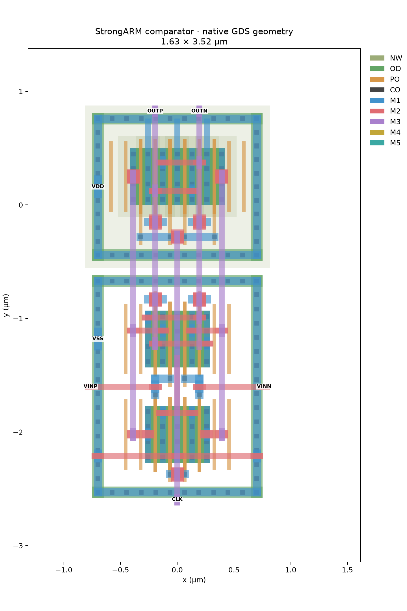

# Comparator Layout and Verification

On 2026-11-18, v7 replaced the core at `SAR_ADC_T28_LAYOUT/sar_strongarm_t28_core/layout`. It uses V4's three shared-diffusion rows, with one nf=1 PCell instance per finger. Each D/G/S/B terminal connects to its schematic net and follows the schematic drain/source orientation. N+ and P+ guard rings surround the device rows. Native LVS is **CORRECT**. DRC retains two original fixture warnings. Prefill RC extraction, standalone TT post-layout simulation, and ten-frame integration with the current ADC completed. These checks qualify the stated scope. [Hashes and per-point results](comparator.json)

## Floorplan

The electrical source is `design/xtor/comparator/comparator.scs`. The layout uses its connectivity and device widths. Each layout finger has W=0.5 µm, L=30 nm, and a 0.13 µm gate pitch.

| Row | Diffusion order | Instances |
| --- | --- | --- |
| P (N-well, N+ ring to VDD) | `Y\|RSTY\|VDD\|PLATN\|OUTN\|RSTN\|VDD\|RSTP\|OUTP\|PLATP\|VDD\|RSTX\|X` | MPRSTY, MPLATN, MPRSTN, MPRSTP, MPLATP, MPRSTX |
| N1 (P+ ring to VSS) | `OUTN\|LATN\|Y\|INP\|TAIL\|INN\|X\|LATP\|OUTP` | MNLATN, MNINP_1, MNINN_1, MNLATP |
| N2 (same P+ ring) | `Y\|INP\|TAIL\|TL\|VSS\|TL\|TAIL\|INN\|X` | MNINP_2, MNTAIL_1, MNTAIL_2, MNINN_2 |

- MNINP, MNINN, and MNTAIL are schematic single-finger devices with W=1 µm. Each uses two parallel 0.5 µm instances in layout (`_1` and `_2`). Each input device has one finger in N1 and one in N2, mirrored left to right.
- Adjacent instances share diffusion through the PDK's `same` abutment shape. The generator adds the shared-diffusion contacts using the same row count and M1 width as the native PCell ends.
- The PLATN/LATN gates align at x=−0.195 and PLATP/LATP at x=+0.195. Each output has one M3 trunk.
- The two guard rings align at x=±0.70.

## Routing

- M1 carries contacts, source and drain columns, and guard rings. M2 carries horizontal tracks. M3 has five vertical trunks at x=0 (CLK), ∓0.195 (OUTP/OUTN), and ∓0.39 (Y/X). Via enclosures match the route width. Gate contact pads are 0.20 × 0.07 µm horizontal M1 strips.
- Input gates contact in the channel between N1 and N2. An L-shaped M1 segment joins each pair of fingers. One via leads to a horizontal M2 escape, west for VINP and east for VINN, clear of device rows.
- The four reset gates share an M1 bus below P. The tail gates share an M1 strip below N2. The central M3 trunk joins them and exits south, ending before the P row.
- The P-row VDD source and drain columns connect directly to the N+ ring in M1. The tail VSS source connects to both sides of the P+ ring through a horizontal M2 strip. TAIL uses central M2 from the shared N1 diffusion to both N2 TAIL diffusions.
- Each row's Y/X cross-connection or stacked via lies between its output cross-connections. The P-row OUTP cross-connection lies near the CLK bus. In N1, OUTP is closest to the input channel.

## Iteration History

- v3 and v4 grouped devices into three multifinger PCells. Virtuoso labels, S/D names, and gate assignments differed from the circuit. The v4 input route also passed over its own devices, parallel to the CLK trunk.
- v6 used one instance per schematic device and changed the inputs to single 1 µm fingers. This produced a 0.5/1 µm diffusion step, longer dummy poly, and a separate tail row.
- v7 restored the V4 floorplan with one instance per finger and redid the routing as described above.
- In the scratch library, v7b to v7c moved three N1 tracks up by 0.005–0.01 µm to meet M2.S.7. The official run's geometry digest matches scratch v7c.

## Interface and Area

The native core bounding box is `(-0.815,-2.645) → (0.815,0.875) µm`, measuring **1.63 × 3.52 µm** and **5.74 µm²**. The old core measured 7.96 × 12.46 µm and v4 measured 1.66 × 3.44 µm.

| Port | Layer | Center (µm) | Size (µm) |
| --- | --- | --- | --- |
| VINP / VINN | M2 | (−0.765,−1.60) / (0.765,−1.60), west/east | 0.10 × 0.05 |
| OUTP / OUTN | M3 | (−0.195,0.825) / (0.195,0.825), north | 0.05 × 0.10 |
| CLK | M3 | (0,−2.595), south | 0.05 × 0.10 |
| VDD | M1, west side of the N+ ring | (−0.70,0.16) | 0.07 × 0.20 |
| VSS | M1, west side of the P+ ring | (−0.70,−1.18) | 0.07 × 0.20 |

The inputs now enter from the sides and CLK from the south. Reinforce the M1 guard-ring VDD and VSS connections nearby at the top level. The core uses M1–M3. Keep top-level digital crossings away from the area above it on M4 and higher and check coupling with top-level extraction. The comparator group has a 16 × 14 µm interface-routing reservation pending actual placement. The three comparator output and clock MOM loads in the top-level netlist are pre-layout model loads, per the 2026-11-18 decision and load diagnostic below. Use top-level extraction for actual loads. [Pin access coordinates](../specs/interfaces.json)

## Verification Results

Physical evidence is `comp-v7-20261118-pex`. The executor checkpointed the v6 OA core before the rebuild. Earlier checkpoints are in `comp-v6-20261118-pex`, `comp-v4-20261117-pex`, and `comp-v3-20261117-pex`.

- LVS returned CORRECT. The initial layout has eight NMOS and six PMOS. Parallel reduction maps to five NMOS and six PMOS in the schematic. PEX completed.
- DRC retained one `DIODMY_L:WARNING` and one `IO_CONNECT_CORE_NET_VOLTAGE_IS_CORE:WARNING1`. Close density at the top level. [Fill policy](../specs/fill-policy.md)

Extracted interconnect capacitance to ground in fF, excluding device capacitance and inter-net coupling.

| Node | Old sym2 core | v4 | v6 | **v7** |
| --- | ---: | ---: | ---: | ---: |
| VINP / VINN | 0.319 / 0.319 | 0.050 / 0.050 | 0.026 / 0.026 | **0.055 / 0.055** |
| OUTP / OUTN | 1.301 / 1.293 | 0.331 / 0.334 | 0.322 / 0.327 | **0.291 / 0.300** |
| Y / X | 0.751 / 0.751 | 0.243 / 0.244 | 0.170 / 0.170 | **0.209 / 0.209** |
| TAIL | 0.628 | 0.009 | 0.005 | **0.013** |
| CLK | 1.093 | 0.377 | 0.378 | **0.373** |

Inter-net coupling in fF.

- CLK to each input is 0.0137, equal on both sides. v4 was 0.058 and v6 was 0.0027. The symmetric central CLK trunk passes between the N1 input gates.
- Output to input coupling is OUTP–VINP 0.0215, OUTN–VINN 0.0163, OUTP–VINN 0.0094, and OUTN–VINP 0.0027.
- The largest mirror differences are 0.0068 for output to opposite input, 0.0067 for output to TAIL, and 0.0053 for output to same-side input. In N1 the OUTP cross-connection is closest to the input channel. Other mirror differences are ≤0.003.

The standalone fixture uses TT, 0.9 V, 27 °C, a 2 ps maximum step, the same MOM and receiving-gate loads, and inputs of ±100, ±30, ±3.515625, ±1, and ±0.1 mV. The 750 ps diagnostic applies to this measurement scope.

| Measurement | Schematic | Old sym2 core | v4 | v6 | **v7** |
| --- | ---: | ---: | ---: | ---: | ---: |
| Correct decisions | 10/10 | 10/10 | 10/10 | 10/10 | **10/10** |
| Test and screen | Pass | Pass | Pass | Pass | **Pass** |
| Maximum decision delay (ps) | 364.73 | 517.30 | 310.95 | 342.34 | **301.72** |
| Maximum reset time (ps) | 32.83 | 37.49 | 33.12 | 33.22 | **33.20** |
| Peak differential kickback (µV) | 35.84 | 52.18 | 67.03 | 55.52 | **59.63** |
| Peak common-mode kickback (µV) | 236.49 | 409.15 | 409.72 | 359.32 | **398.10** |
| Delay-fit offset diagnostic (mV) | −0.002 | −0.041 | −0.019 | −0.037 | **−0.013** |

Among these tests, v7 had the shortest decision delay and the smallest fitted offset magnitude. Its differential kickback lies between v6 and v4. Common-mode kickback was about 11% higher than v6, consistent with CLK coupling between the input gates. These kickback values are from the floating-input fixture. The ±0.1 mV decisions cover the tested points. Use the actual ADC load for CDAC-node error and statistics for mismatch offset.

`comp-v7-int-20261118` substitutes the comparator RC netlist into the current ADC. All other modules use pre-layout views. The ten expected codes `0,0,12,127,128,243,255,255,0,128` matched. Every frame had eight compares, writes, and updates. Sampling edges and event order passed. Maximum conversion time was **28.7848 ns** versus 29.5023 ns for the old core and 28.8612 ns for v6.

**Load diagnostic.** `comp-v7-int-noload-20261118` removes `CL_COMP_N`, `CL_COMP_P`, and `CL_CMP_CLK` from the same ADC fixture, each estimated at about 10 fF. The other inputs match byte for byte. All ten frames passed codes, handshake counts, event order, and sampling edges. Maximum conversion time dropped from 28.78 to 27.71 ns. The median cmp↑→write↑ dropped from 366 to 271 ps and its range narrowed from 273–469 to 242–300 ps. Two additional `SPECTRE-16780` warnings reported temporary LTE relaxation across steep SAR-node transitions. Both affected frames passed.

The FF-cold pair used ffc (FF, 0.99 V, −40 °C, passives at TT). All ten frames passed in each run, `comp-v7-int-ffc-20261118` with loads and `comp-v7-int-ffc-noload-20261118` without them. Removing the loads reduced maximum conversion time from 25.56 to 24.70 ns and median cmp↑→write↑ from 299 to 222 ps, with its range narrowing from 219–381 to 197–244 ps. Minimum update↑→cmp↓ spacing fell from 46.6 to 35.1 ps and minimum cmp↓→write↓ from 25.5 to 23.0 ps. Event order was preserved. One additional `SPECTRE-16881` warning flagged possible Verilog-A-related convergence difficulty in frame 2, which passed.

TT and ffc passed function and handshake timing with both load settings. Open coverage includes ssc, ssh, ffh, mismatch, and the actual top-level load.

PVT, mismatch and noise, statistical offset, full per-device terminal voltage, final fill, and full top-level parasitics still need qualification. The layout splits the 1 µm input and tail devices into two fingers, with input fingers in separate rows. Include these layout-dependent effects in subsequent MC and PVT.

## Maintenance and Handoff

`design/comparator.il` defines functional geometry. `design/comparator.py` generates the independent CDL from the electrical source. `tools/simulation/prepare_comparator.py` packages pre- and post-layout tests and the ADC interface case. Use the existing native and managed entry points. `tests/test_comparator_layout.py` verifies that each schematic device uses same-named 0.5 µm fingers, optionally with `_k` suffixes, and matches its schematic total width. [Comparator workflow](../docs/workflow.md#comparator-module)

The fixed wrapper `sar_strongarm_t28/layout` references the core through XCORE. Use the core for review and integration. Refresh and reverify the wrapper fill before qualifying it for the current core.

In `comparator.json`, see `superseded_core` (sym2), `superseded_v4`, `superseded_v6`, and `independent` for earlier results. The `SCRATCH_COMP` library and `comp-scr-*` runs document candidate exploration. Use the official physical run for layout evidence.
