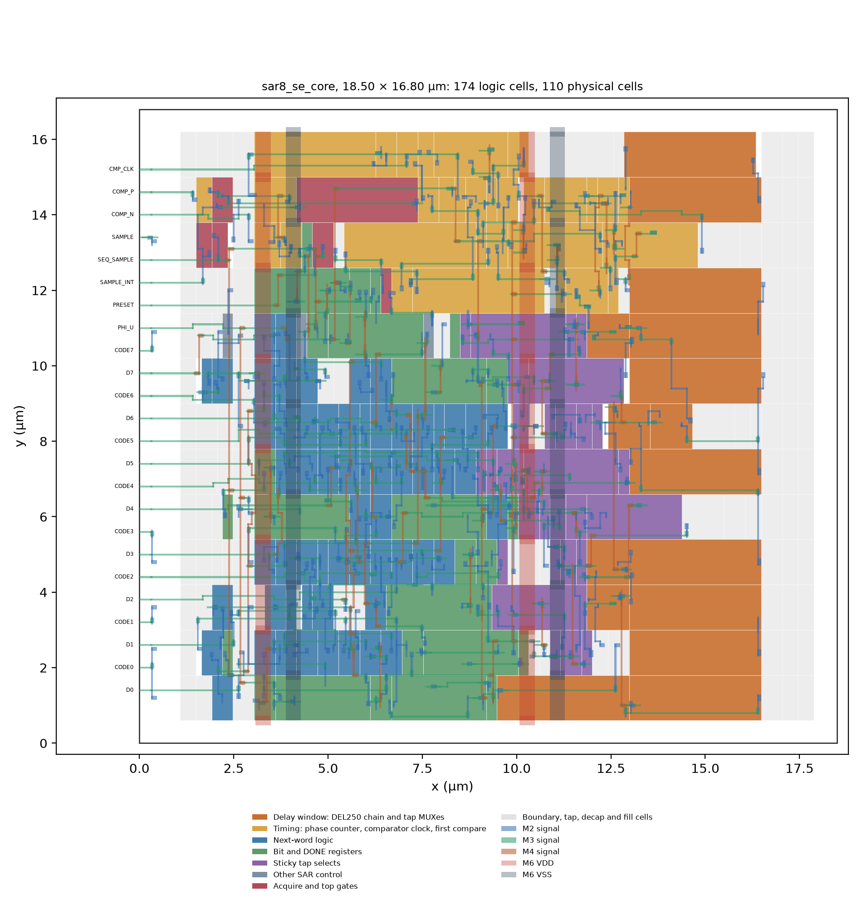

# Single-Edge SAR Macro Layout

`SAR_ADC_T28_LAYOUT / sar8_se_core / layout_r3` is the layout of the current single-edge SAR. It holds the five top-level instances of the floorplan's SAR block: `XCTRL`, `XSEQ`, `XDONE`, `XPRESET` and `XSAMPLE`, 174 native standard cells. The 26 ports match the top-level connections. Calibre LVS is CORRECT and DRC reports only the two standard fixture advisories. [Record with hashes, run identities and measurements](sar_se_core.json)

## Flow

1. `python -m Layout.design.sar_single_edge REV --rows N --utilization U` flattens the SAR group of `design/dut.scs` to native cells and writes the Innovus netlist and script under `work/layout/sar-se/REV/`.
2. `python -m Layout.tools.physical.sar_se_route REV` runs Innovus on thu-wei: rows with boundary and tap cells, pins on the left edge in M3, placement, M6 supply stripes, NanoRoute on M1–M4 and decap/fill cells. No timing library is loaded.
3. `python -m Layout.tools.physical.sar_se_def REV` converts the routed DEF into net-bound OA records and the transistor LVS reference. The rendered metal and cuts are compared with the Innovus routing stream on M1–M6 and VIA1–VIA5; any XOR difference stops the conversion.
4. Upload `build.txt` and `sar-se-leaves.cdl` to `state/sar-se-REV` and run `python -m Layout physical ID --module sar-se --staging sar-se-REV --view layout_rN --rebuild`. The view is created in `SAR_ADC_T28_LAYOUT`; an existing view or an edit lock stops the build. Later runs without `--rebuild` verify the saved view. Extraction runs an LVS comparison first, so the xRC netlist keeps the source net names.
5. `python -m Layout.tools.simulation.prepare_sar_se ID CORNER KIND --cdac nominal|cworst --revision REV` replaces the five instances in the `single_edge_lpe` deck with the extracted macro. Internal SAR probes are saved at the gate of a receiving cell and read back under their schematic names.

## Views

| View | Boundary (µm) | Rows | Physical cells | DRC | LVS | DEF to OA XOR |
| --- | --- | ---: | ---: | --- | --- | --- |
| `layout_r2` | 21.195 × 18.0 | 14 | 179 | 2 advisories | CORRECT | 0 on all 11 layers |
| **`layout_r3`** | **18.495 × 16.8** | 13 | 110 | 2 advisories | CORRECT | 0 on all 11 layers |

The OA bounding box is wider than the boundary because the standard-cell text extends past the cell outlines. `layout_r3` uses 13 % less area and is the selected view; it fits well inside the 41 × 56 µm reservation of the floorplan. Innovus `verifyGeometry` lists two (r2) and five (r3) M2 via-enclosure markers that the foundry Calibre DRC of the same geometry does not report.

## Post-layout ADC runs with layout_r3

The extracted macro replaces the SAR group. The CDAC is extracted, the reference word uses cell LPE, the comparator and bootstrap are schematic, and top-level wiring and supplies are ideal. The SAR macro was extracted with the default typical interconnect rules.

| Run | Condition | Codes | Read margin (pre-layout) | Settling | Setup / hold |
| --- | --- | --- | --- | --- | --- |
| `sar8-sepl-ssc-cw-verify-r3a` | SS, −40 °C, 0.81 V, CWORST_T CDAC | 8/8 | 7.60 ns (7.59) | 0.001 LSB | 433 / 97 ps |
| `sar8-sepl-ffc-cw-scan-r3a` | FF, −40 °C, 0.99 V, CWORST_T CDAC | 4/4 | 30.23 ns (30.70) | 0.107 LSB | 169 / 39 ps |
| `sar8-sepl-tt-nom-verify-r3a` | TT, 27 °C, 0.9 V, nominal CDAC | 8/8 | 24.42 ns (24.92) | 0.026 LSB | 246 / 57 ps |

TT and FF cold pass every check; routing costs about 0.5 ns of read margin. The SS-cold verdict fails on frame 0 only:

- At t = 0 the DC solution leaves the comparator latch balanced with its clock high: COMP_P and COMP_N sit at 0.42 and 0.70 V with 256 mV of input and do not change for 60 ns. CMP_CLK is still high 0.2 ns after the first tracking opening. This initial state is not physical. Frame 0 reads its code and frame 1, with the same input, passes.
- The same overlap occurs in operation when a sample aborts a comparison: 71–72 ps in the pre-layout FF-cold restart runs, none at TT. The restart analyzer does not check a clock that is already high when tracking opens. Tracking overwrites the kickback, and no write occurs.
- The SS margin equals the pre-layout value because the macro extraction uses typical interconnect, while the pre-layout SS run used CWORST_T cell LPE. SS and FF need a CWORST_T and CBEST_T extraction before their margins count as worst-case.

## Open items

- Re-extract the macro at CWORST_T and CBEST_T and rerun SS and FF cold.
- Treat frame 0 as warm-up and report the clock/tracking overlap as a measured value.
- Top-level placement and routing, fill, extraction and the terminal-voltage scan.
