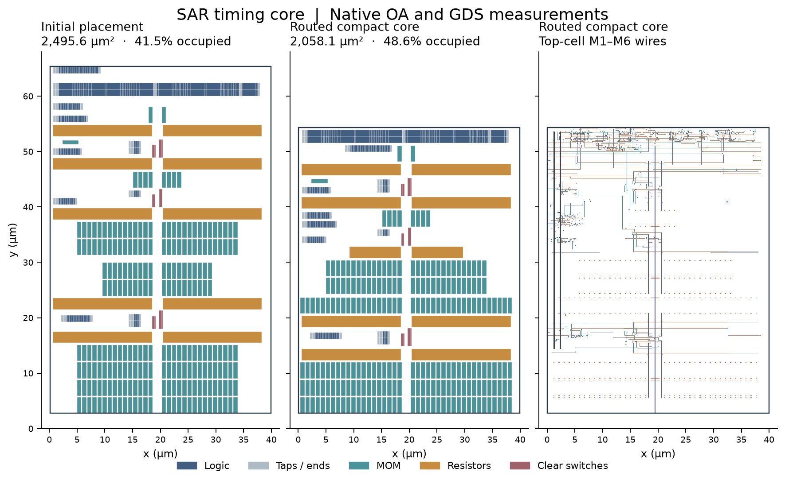

# SAR timing layout and closed-loop measurements

The integration view is `SAR_ADC_T28_LAYOUT/sar8_sar_timing/layout_eco`. Open `SAR_ADC_T28_LAYOUT/sar8_sar_timing_core/layout_compact_eco` to inspect the devices and signal routes. Both refer to the adopted 8.5 µm quiet-delay circuit. [Machine-readable results](sar_timing.json) · [Electrical adoption](../../results/design/sar_timing_quiet8p5_20261118.json)

## Placement and routing

| Native measurement | Initial placement | Routed core |
| --- | ---: | ---: |
| Core outline (µm) | 39.853 × 62.620 | 39.885 × 51.600 |
| Outline area (µm²) | 2,495.59 | 2,058.07 |
| Device area / outline | 41.54% | 48.65% |
| Connected nets | 106/208 | 208/208 |
| Top-level reservation (µm) | 40 × 70 | 41 × 56 |

The macro area fell by 17.53%. The occupancy calculation uses the union of the legal standard-cell sites and native PCell bounds. The 231 MOM capacitors occupy 512.64 µm² and the ten resistors occupy 332.57 µm². Density fill and signal metal contribute zero device area. The filled outline is 40.135 × 51.600 µm. A 0.5 µm horizontal placement offset keeps its leftmost dummy inside the reservation. This releases 504 µm² in the preliminary ADC floorplan.

Virtuoso readback and the streamed GDS agree on 487 instances, 26 ports, ten fully joined RC nets and four shared-source pairs. COMP_P and COMP_N each use a 1.47 µm M2 escape with one via cut. The M6 supply trunks sit above the M1–M5 signal network.

## Five-corner results with ideal VDD

The follow-up reran the released geometry with VDD and VSS extracted and measured both rails inside the bit registers and all six timing detectors. [Distributed-supply comparison](sar_timing_refinement.md)

Each run includes the complete first conversion and nine more frames at 10 MS/s. The sampling clock is high for 40 ns and low for 60 ns. Slack is measured from the last update to the 90 ns read point in each frame. The separate hold check extends to 98 ns. The original coupled xRC deck extracted VSS and excluded VDD. Every transistor therefore saw an ideal VDD network in these runs. The other ADC blocks use transistor-level schematics, including the switched CDAC load. MOS, temperature and supply vary across the five conditions. Passive model sections use TT. The receiver skew uses interpolated crossings at half the nominal supply voltage from a transient run with 10 ps maximum step.

| MOS | Supply (V) | Temperature (°C) | Longest conversion (ns) | Minimum read slack (ns) | Maximum bit-clock skew (ps) | Weighted CDAC error (LSB) |
| --- | ---: | ---: | ---: | ---: | ---: | ---: |
| TT | 0.90 | 27 | 30.674 | 18.276 | 0.63 | 0.00785 |
| SS | 0.81 | -40 | 46.362 | 2.588 | 0.49 | 0.00052 |
| SS | 0.81 | 125 | 38.179 | 10.771 | 0.61 | 0.00687 |
| FF | 0.99 | -40 | 25.773 | 23.177 | 0.66 | 0.01133 |
| FF | 0.99 | 125 | 27.166 | 21.784 | 0.67 | 0.02174 |

All 50 codes and 400 decisions passed, including the per-bit write checks at eight native clock receivers. The shortest update-to-next-compare interval was 2.140 ns. Comparator receiver validity preceded the write edge by at least 328.74 ps. The weighted CDAC bottom-plate error limit was 0.25 LSB.

The original 17.13 µm source passed the slow-cold schematic control, with a longest conversion of 39.50 ns. The routed 17.13 µm core missed the 90 ns aperture by 6.11 ns. The filled 11 µm trial missed it by 1.25 ns. The adopted 8.5 µm filled macro has 2.59 ns of slow-cold slack. Both ECO resistors retain their 1 µm width.

## Physical checks and scope

Calibre reports CORRECT for transistor-level LVS of both views. The integration view has zero geometry or density violations and two advisory markers, `DIODMY_L:WARNING` and `IO_CONNECT_CORE_NET_VOLTAGE_IS_CORE:WARNING1`. Five 3 × 3 µm M9 dummy tiles complete the standalone density window. The core-only DRC inventory remains separately recorded. Native stream comparison found empty mask XOR on every layer. The two filled extractions have identical device and parasitic connectivity. They differ in 3 printed capacitance values by up to 1e-07 fF. The table uses five direct simulations of the public extraction. The testbench exposes existing internal nodes as observation ports without adding loads.

The JSON record retains native Spectre model and numerical warnings by corner. Full-chip routing and extraction, all-device terminal-voltage qualification, Monte Carlo and FFT require their own runs. [Run IDs, metrics and warning codes](sar_timing.json) · [Compact waveform archive](../../results/storage/sar_timing_20261118.json)
