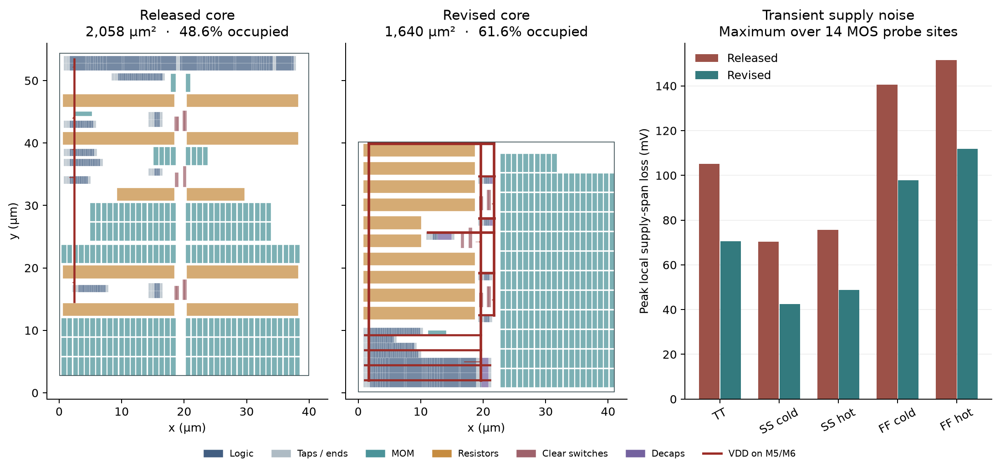

# SAR timing layout and local supply measurements

The revised SAR macro contains the controller, sequencer, idle logic and sample logic. The 8.5 µm QUIET resistors and the signal interface are common to both designs. The comparator, CDAC, sampling switch and the ADC top-level interconnect are outside the routed macro.

Open `SAR_ADC_T28_LAYOUT/sar8_sar_timing_core/layout_array_review` to inspect placement and routing, or `SAR_ADC_T28_LAYOUT/sar8_sar_timing/layout_array_review` for the fill and top-level pins. Both project views passed native transistor LVS. The project fill has the same full hierarchy geometry digest, an empty mask XOR on every streamed layer/datatype, and the same distributed rail resistor counts as the private five-corner extraction. [Native identities and measurements](sar_timing_refinement.json)

## Physical reference

Virtuoso readback of `LU_SAR_28/SAR_8B_BI_MD/layout` identifies `SAR_LOGIC_FT_8B` as its logic instance. Its eight `SAR_DATA_LATCH_V2` instances have the same orientation and a 1.54 µm pitch. Digital supply and ground enter the reference ADC on M9. On the reference logic VDD conductor, the GDS contains 71 V1 cuts, 44 cuts on each of V2 through V6, 11 on V7 and 8 on V8. These observations guided bit repetition and multiple supply drops. The revised macro also contains 231 MOM units and ten delay resistors, so the two bounding boxes cover different circuits.

## Floorplan and routes

| Native core measurement | Released | Revised |
| --- | ---: | ---: |
| Width × height (µm) | 39.885 × 51.600 | 40.961 × 40.030 |
| Bounding area (µm²) | 2,058.07 | 1,639.67 |
| Device occupancy | 48.65% | 61.63% |
| Ports / fully connected nets | 26 / 208 | 26 / 208 |
| Shared source pairs | 4 | 4 |
| Decoupling cells | 0 | 7 |
| COMP_P and COMP_N M2 escapes | 1.47 µm each | 1.61 µm each |
| Signal metal half-perimeter (µm) | 1,925.78 | 1,682.43 |
| Signal metal half-perimeter on port nets (µm) | 694.53 | 395.51 |

Occupancy divides the union of native PCell bounds and legal standard-cell sites by the native core bounding area. The revised decaps occupy 9.41 µm². Signal metal and density fill contribute zero occupied device area. The previous 41 × 56 µm top reservation remains the denominator for a separate reservation metric.

The filled wrapper measures 41.211 × 40.030 µm. Its width exceeds the previous reservation by 0.211 µm. A 42 × 41 µm reservation at the existing block origin (123, 30) µm, with the wrapper shifted 0.30 µm east, passed the project's block-fit and overlap checks. This option releases 574 µm² of reserved area. The production top plan still uses the previous reservation.

Four bit rows each contain two neighboring bit slices. The D pins face the CDAC. The QUIET resistor bank, reset switches and detector use the space at the ends of the shorter resistors. Cell pin transforms determine clock accesses. Both banks of eight flip-flops have a single-cut M1–M2 clock entrance at the same physical location in their respective masters. Innovus connects the remaining conductors from the native seed, with MOM fingers blocked on lower metal. The revised route uses zero archived coordinate repairs.

The signal metal metric sums half the perimeter of merged top-cell M1–M6 metal on each source-bound signal net. This includes endcaps and branches. SAMPLE drops from 39.86 to 10.55 µm on this metric, D0 from 46.72 to 12.80 µm, and CODE4 from 40.10 to 15.85 µm. Two sensitive internal nets grow. QUIET RC0 changes from 24.73 to 32.51 µm and RC1 from 26.72 to 43.37 µm. The filled xRC simulations include their parasitics.

## Supply distribution

Both revised rails have two digital M6 feeds and a separate M6 feed for the detectors. M5 cross-straps connect both ends of each M1 cell row and intermediate taps. The primary cell-row ladders use 2 × 2 cuts. Each rail exposes a 20.42 × 0.40 µm M5 access rectangle at the integration boundary. Four DCAP8 cells sit in the bit rows. One DCAP16 serves the QUIET detector row and one DCAP4 sits in each of the WRITE and RAW detector rows. All seven use the installed transistor-level standard-cell reference for LVS.

| Connected VDD cuts from GDS | V1 | V2 | V3 | V4 | V5 |
| --- | ---: | ---: | ---: | ---: | ---: |
| Released | 22 | 13 | 7 | 5 | 5 |
| Revised | 131 | 128 | 128 | 128 | 68 |

The released five-corner report used distributed VSS and ideal VDD. For this comparison both supplies are distributed for both layouts. DC rail resistance comes from a nodal solution with a one-ampere test current between the macro pin and one MOS diffusion, including parallel metal, vias and contacts. The same cell-relative PMOS and NMOS terminals are observed in every bit register and in both detector stages of each delay chain. Dynamic rail loss is evaluated on the transient samples as the drop in local VDD plus the simultaneous rise in local VSS.

| Effective rail resistance from macro pin (Ω) | Released, filled | Revised, filled |
| --- | ---: | ---: |
| VDD to eight bit registers | 82.59–98.48 | 76.21–78.24 |
| VDD to six timing detectors | 148.12–191.75 | 58.54–73.12 |
| VSS to eight bit registers | 66.58–79.89 | 64.40–67.58 |
| VSS to six timing detectors | 63.07–69.32 | 49.14–54.18 |

The revised filled xRC contains 3,894 VDD and 19,457 VSS resistors. The route-import replay reproduced the original core's hierarchical GDS geometry digest. In the filled wrapper, Calibre reported transistor LVS CORRECT, one M9.DN.3 global density marker and the two recorded process advisories. The M9 mask comes directly from the foundry fill utility. The separate diffusion fill hierarchy reserves legal channels between the resistor rows and leaves functional PCells intact.

## Five-corner closed-loop measurements

| MOS and temperature | Pad VDD (V) | Released 90 ns margin (ns) | Revised margin (ns) | Released peak VDD drop (mV) | Revised peak VDD drop (mV) | Released peak span loss (mV) | Revised peak span loss (mV) |
| --- | ---: | ---: | ---: | ---: | ---: | ---: | ---: |
| TT, 27 °C | 0.90 | 18.122 | 17.790 | 87.9 | 35.4 | 105.2 | 70.6 |
| SS, −40 °C | 0.81 | 2.155 | 1.651 | 58.9 | 22.0 | 70.4 | 42.5 |
| SS, 125 °C | 0.81 | 10.514 | 10.112 | 63.4 | 24.8 | 75.6 | 48.8 |
| FF, −40 °C | 0.99 | 23.077 | 22.839 | 117.4 | 48.1 | 140.5 | 97.8 |
| FF, 125 °C | 0.99 | 21.788 | 21.410 | 121.0 | 56.8 | 151.6 | 111.9 |

Released passed 5/5 corners across 400 bit decisions. Maximum write-clock skew was 0.69 ps. Minimum comparator-valid-to-write time was 328.4 ps. Peak local ground bounce was 73.1 mV.

Revised passed 5/5 corners across 400 bit decisions. Maximum write-clock skew was 0.19 ps. Minimum comparator-valid-to-write time was 366.8 ps. Peak local ground bounce was 55.6 mV.

At the FF hot corner, peak VDD drop at the first QUIET detector changes from 121.0 to 39.5 mV. The largest revised supply-span loss at this corner is 111.9 mV at BIT3. SS cold remains the limiting read corner. Its revised margin changes by -0.505 ns relative to the matched released run.

The read margin is the interval from the eighth update to the 90 ns read in that frame. The regression also checks the held code at 98 ns. Peak VDD drop, ground bounce and span loss are separate waveform measurements. Each can occur at a different time and site. [Run IDs, per-site maxima and times, and mask identities](sar_timing_refinement.json)

## Scope of verification

The ten-frame ADC test supplies the actual switching load of each conversion. MOS corner, voltage and temperature vary. Passive models use TT. The SAR macro and fill use coupled xRC, the other ADC blocks retain their transistor schematics, and board, package and chip-level grid impedance are outside the boundary. The results characterize these switching vectors and 14 local probe sites. Top-level density, extracted chip supply performance and electromigration require the assembled design.
