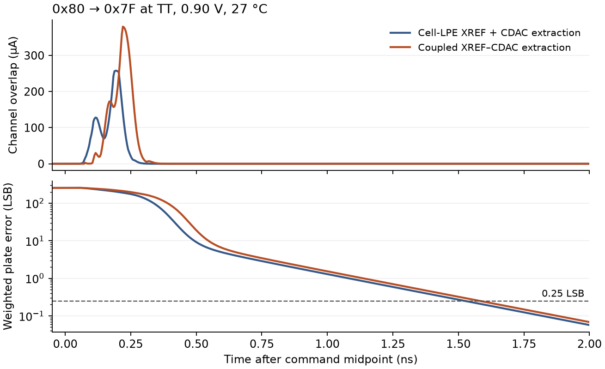
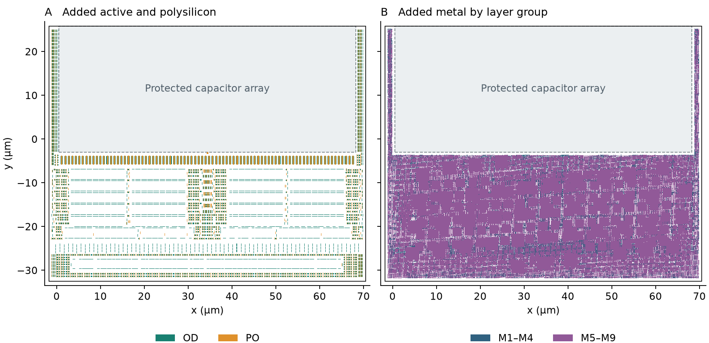

# Single-edge D2 reference driver

Open `SAR_ADC_T28_LAYOUT/sar8i_refword/layout_se_d2_r2` for the 28-cell XREF or `SAR_ADC_T28_LAYOUT/sar8_cdac_with_xref/layout_se_d2_r2` for the routed pair. The CDAC child is `sar8j_r1_cdac/layout_paired_stacked`. Its recursive GDS geometry digest matches the original CDAC stream. The B7 pilot in both cells is `layout_se_b7_e`. [Electrical source](../../design/xtor/reference/single_edge_d2.scs) · [OA readback and measurements](single_edge_xref.json) · [Routing view](figures/single_edge_xref.png)

## Placement and routing

The final inverter and buffer of each bit face their respective switch bank. B0–B6 use INVD1/BUFFD1 and B7 uses INVD2/BUFFD2. The bit decode sits near the P-side driver and the SAR-facing east edge. M2 drops meet short M3 tracks, and disjoint M3 segments share tracks. The nine east-edge M3 ports follow the measured order on the SAR macro's west edge, CODE0 through CODE7 followed by PRESET from bottom to top. The remaining long internal signal is QN5. Its widest M3 rectangle spans 58.99 µm between widely separated banks, with the final drive cells at the loads. The SAR-to-XREF bus is a future top-level connection.

| Measured or generated quantity | Previous 36-cell implementation | Single-edge D2 |
| --- | ---: | ---: |
| XREF bounding box including pin shapes (µm) | 63.494 × 10.425 | 63.354 × 5.285 |
| XREF and CDAC bounding box (µm) | 72.230 × 68.315 | 72.230 × 58.325 |
| Driver signal centerline sum from the generator (µm) | 869.02 | 528.30 |
| Driver via placements, including supplies | 280 | 248 |
| Gate M6 centerline sum, common stems counted once (µm) | 212.64 | 71.54 |
| Output-pin center to one CDAC gate landing (µm) | 8.62–8.94 | 3.77–4.09 |

The full-design comparison includes the circuit change from 36 to 28 cells. For the M6 measurement, the OA review reconstructs each tree from the saved rectangles, checks both child terminal locations, and compares all 32 distances with the routing intent. B1–B7 share a vertical stem up to the gate pins. B0's gate pair straddles the native VREFN and VREFP M6 drops on each side. The first full build passed local spacing DRC but failed LVS at those reference trunks. In the accepted view the two B0 trees split at Y = −26.20 µm, south of the reference drops. The smallest measured B0 metal edge separation from either trunk is 0.10 µm on each side. The rejected integrated view `layout_single_edge_d2` is retained as diagnostic evidence.

## B7 validation before expansion

The B7 pilot has six native logic cells and drives the real B7 switch bank. A two-site gap after the NAND resolves the VIA2 spacing at the following inverter. With placement and drive strength fixed, moving the fork to the two gate landings reduced the combined N/P tree length from 13.18 to 8.18 µm. The total extracted interconnect capacitance with quiet neighbors changed from 63.24 to 63.07 fF on N and from 63.59 to 63.42 fF on P. The latest gate crossing improved by about 0.25 ps. The wire saving has only a small timing effect at this load.

| TT, 0.90 V, 27 °C | CODE7 rising | CODE7 falling |
| --- | ---: | ---: |
| Cell-LPE driver plus CDAC extraction, last 50% gate crossing | 209.41 ps | 219.69 ps |
| Accepted coupled XREF/CDAC pilot, last 50% gate crossing | 224.44 ps | 240.32 ps |
| Accepted pilot, settling to 0.25 LSB | 1.189 ns | 0.733 ns |
| Accepted pilot, weighted bottom-plate residual at 2 ns | 0.01983 LSB | 0.00108 LSB |

The pilot passed preset and both transitions before the full-row build. Each direction is measured at extracted switch-gate contacts and selected physical MOM plate terminals, with a 50 Ω / 4 pF reference fixture.

## Physical checks

| Native stream | Evidence | LVS ports / nets | DRC markers |
| --- | --- | ---: | --- |
| B7 with CDAC | `se-xref-b7-e` | 36 / 60 | Seven density and two advisories |
| Standalone eight-bit XREF | `se-xref-standalone` | 27 / 55 | Three density and two advisories |
| Eight-bit XREF with CDAC | `se-xref-full-b` | 15 / 75 | Eight density and two advisories |

All three passed LVS. Each completed Calibre xRC with zero RCC and formatter errors. The full integration had 38 RCC warnings and five formatter warnings. Its density markers are OD.DN.3 (one), PO.DN.3 (two), PO.DN.3.1 (one), M5.DN.1, M6.DN.1, M7.DN.1 and Mx.DN.7:M5_M6_M7 (one each). The two advisories are DIODMY_L and IO_CONNECT_CORE_NET_VOLTAGE_IS_CORE. Utility density fill in the final surroundings remains open. The combination retains the planned CDAC fill and the XREF's row taps and fillers. [Fill ownership](../specs/fill-policy.md)

The 54 schematic formals reduce to 27 standalone physical ports. Each same-side gate pair is tied by its schematic probe, RST_DONE is tied to VSS, and D0–D7, PHI_U and SAMPLE have no connection inside this cell. The integrated fixture preserves these bindings. [Interface map](../specs/interfaces.json)

## Eight-bit short tests

A second extraction of the identical combined GDS includes distributed VDD and VSS (`se-xref-full-b-rails`). In `se-xref-drive-rails`, all eight bits switch together in each direction. The worst observed gate delay was 281.6 ps, settling to 0.25 LSB took 0.9791 ns, and the largest residual at 2 ns was 0.00428 LSB. The peak external reference and supply currents were 1.256 mA and 1.789 mA. These are feed currents, including charging current.

The longest M3 span belongs to B5. In the eight-bit transition test its last observed gate crossings were 171.3 ps on the rising command and 158.6 ps on the falling command. B7 was slowest in both directions at 265.0 and 281.6 ps.

The four-frame TT ADC test uses the current single-edge SAR, 45 ns external acquisition, the same 50 Ω / 4 pF reference fixture and an unchanged CDAC layout. Other digital cells use the typical foundry cell LPE library. Both sides use default supply extraction, Spectre X MX, requested reltol 1e-4, and 10 ps saved samples. The control retains the cell-LPE XREF and attaches a standalone CDAC extraction. The post-layout run replaces both with the coupled extraction.

| Input at nominal code center | 12 | 127 | 128 | 243 |
| --- | ---: | ---: | ---: | ---: |
| Cell-LPE XREF / extracted CDAC | 7 | 127 | 128 | 249 |
| Coupled XREF and CDAC | 6 | 127 | 128 | 249 |
| Independent CDAC gain-corrected target | 7 | 127 | 128 | 248 |

The first output moves by one code relative to the matched control. Both endpoint outputs differ from the nominal input centers. All four outputs meet the project's gain-corrected ±1-code check using the independent CDAC weights (k = 0.959503). Each frame has eight comparisons, eight updates, valid receiving data and agreement with the native pin observer. The smallest margin between the last update and the 90 ns read is 25.074 ns. The worst sampled weighted plate residual at a bit decision is 0.03252 LSB, and the largest sample-close error is 0.00266 LSB.

Both ADC simulations completed with zero errors and 52 warnings. Spectre reported terminal-voltage model warnings on the SAR timing and sequencing hierarchy in both runs. These four deterministic TT frames qualify the stated functional and settling checks. Device SOA, full PVT and mismatch, and final top-level density closure remain open.

## Targeted switching and four-finger sampler checks, 2026-11-21

The coupled pair passed the 0.25 LSB plate-error screen at all 32 tested TT decisions and all 16 tested SS-cold decisions. Keep the south-side placement and M6 gate trees for integration. The matched TT control shows an increase in overlap charge with the coupled layout. A targeted driver and gate-path comparison is warranted before routing freeze. [Measurements and frozen run identities](single_edge_xref_short.json)

| Direct command | TT control settling (ns) | TT coupled settling (ns) | SS cold + CWORST coupled settling (ns) | TT control / coupled overlap charge (fC) |
| --- | ---: | ---: | ---: | ---: |
| B7 rising with B0–B6 low | 1.352 | 1.400 | 1.612 | 30.2 / 35.7 |
| B7 falling with B0–B6 low | 0.792 | 0.876 | 1.084 | 35.8 / 41.6 |
| 0x7F → 0x80 | 1.520 | 1.576 | 1.812 | 20.1 / 29.3 |
| 0x80 → 0x7F | 1.528 | 1.584 | 1.828 | 21.5 / 31.0 |

Settling uses the weighted error of selected physical MOM plates relative to the instantaneous reference rails. The reference fixture has 50 Ω and 4 pF per rail. At TT the worst coupled reference excursion was 126 mV. The slowest gate crossed at 275 ps at TT and 411 ps at SS cold. Replaying a full reverse carry at the shortest TT inter-bit interval of 1.269 ns left 0.654 LSB of plate error in the coupled pair and 0.550 LSB in the control. The measured TT interval after the B7 update was at least 3.225 ns. A full-word reversal needs a longer window than a single late-bit update.

The current measurement uses signed native channel currents from all 3,060 CDAC switch devices. For each side and bit, it takes the simultaneous forward current through the high- and low-reference branches, then sums across banks. Peaks and trapezoidal charge use 4 ps samples. B7 falling produced the largest coupled pulse, 598 µA and 41.6 fC, compared with 540 µA and 35.8 fC in the control. On the reverse major carry the coupled extraction added 44% charge and 56 ps settling time. The control uses cell-LPE drivers with the standalone CDAC. This difference includes driver extraction and interconnect. The first TT reduction rejected the model's internal VDS orientation for reversed fingers. A second reduction used signed IDS on the same waveform and cross-checked its direction against physical drain and source voltages. The design currently has no peak or charge limit for this pulse.

| ADC fixture, four-finger schematic sampler | Nominal centers | Measured codes | Gain-corrected targets | Worst plate error at comparison (LSB) | Minimum margin to 90 ns read (ns) |
| --- | --- | --- | --- | ---: | ---: |
| TT cell-LPE XREF + standalone CDAC PEX | 12, 127, 128, 243 | 7, 127, 128, 249 | 7, 127, 128, 248 | 0.03241 | 25.031 |
| TT coupled XREF + CDAC | 12, 127, 128, 243 | 6, 127, 128, 249 | 7, 127, 128, 248 | 0.03263 | 25.066 |
| SS, 0.81 V, −40 °C, coupled CWORST with distributed rails | 12, 243 | 6, 249 | 7, 248 | 0.00276 | 8.024 |

All frames met the gain-corrected ±1-code check, had eight compares, writes and updates, and agreed with the pin observer. At nominal 12 the two TT cases reached the same final trial word. TOPP − TOPN at the last comparator edge moved from +0.443 mV in the control to −1.243 mV in the coupled case. The one-code change persists with the adopted sampler. The SS test used a fresh CWORST extraction of the identical combined GDS and inherited its matched LVS. The RCC and formatter passes reported zero errors, with 86 and five warnings respectively.

The TT coupled extraction gives 60.23 fF fixed load on TOPP and 58.82 fF on TOPN. Both exceed the 57 fF screening proxy, and their 1.41 fF imbalance exceeds the 1 fF proxy. The same-geometry standalone control gives 52.44 and 61.68 fF. The standalone CDAC's separately qualified utility-filled extraction gives 51.97 and 51.94 fF. Recheck the assembled pair with final fill and verify its gain and side balance before assigning a change to a specific metal route. FF-hot/CBEST and terminal stress also remain open. [Electrical budgets](../specs/constraints.json) · [CDAC extraction comparisons](cdac_planned_fill.json)

## Module-boundary peripheral fill, 2026-11-21

The source is the accepted `sar8_cdac_with_xref/layout_se_d2_r2` OA stream. The verified filled copy is GDS evidence `se-xref-peripheral-dense`. The OA view continues to contain its planned CDAC fill. Removing only the new fill hierarchy recovers the source's recursive geometry hash. The measured intersection of the new fill with the protected array rectangle was zero on every added layer. The final fill adds 84 pairs of dummy active and polysilicon bars in the clear strip between the switch bank and capacitor array. The added bars follow the existing 0.50 µm active / 0.30 µm poly shape, on 0.80 µm centers. The foundry utilities filled the rest of the periphery. [Fill geometry, run identities and per-frame data](single_edge_xref_filled.json)

| TT coupled pair | Fixed TOPP / TOPN (fF) | Imbalance (fF) | Gain error | Max DNL / INL (LSB) | Codes at 12, 127, 128, 243 | Worst plate error at decision (LSB) |
| --- | ---: | ---: | ---: | ---: | --- | ---: |
| Planned fill only | 60.226 / 58.818 | 1.408 | 4.831% | 0.132 / 0.104 | 6, 127, 128, 249 | 0.0326 |
| Verified peripheral fill | 52.115 / 52.095 | 0.020 | 4.231% | 0.098 / 0.077 | 7, 127, 128, 248 | 0.0307 |

The project screens fixed TOP load at 57 fF per side, side imbalance at 1 fF, CDAC gain error at 4.7%, and gain-normalized DNL and INL at 0.25 LSB each. The ADC criterion allows one code either side of the gain-corrected target. [Electrical budgets](../specs/constraints.json)

The foundry's default insertion left five 20 × 20 µm active-density windows below 20%, with a minimum of 19.0354%. Widening utility dummy OD and trying core-only clearance separately also left five deficient windows. The final native DRC output contains M9.DN.3 ×1, M8.DN.1 ×1, IO_CONNECT_CORE_NET_VOLTAGE_IS_CORE:WARNING1 ×1, DIODMY_L:WARNING ×1. The 125 µm M8/M9 windows require the assembled ADC floorplan. Calibre LVS matched, and coupled xRC completed with 0 RCC errors and 0 formatter errors (38 and 5 warnings). Both fill states used the same verification rules and supply-extraction settings. The filled PEX deck additionally flattens the inserted dummy hierarchy.

The gain measurements drove all eight one-hot commands through the physical XREF with the same 50 Ω / 4 pF per-rail reference fixture. Gain error is 1/k − 1, where k is the measured sum of the differential bit weights divided by the ideal sum. DNL and INL use those weights and endpoint normalization. The four-frame ADC comparison used the same four-finger sampler, 45 ns acquisition window, TT 0.90 V / 27 °C, and a 10 ps saved step. Each fill state's independent bit weights set its gain-corrected targets. At nominal code 12, TOPP − TOPN at the last compare moved from -1.243 to +3.293 mV. The minimum filled margin to the 90 ns read was 25.065 ns. No signal route was edited. Full-chip fill, fast/hot extraction and switch stress remain outside these TT checks.

**Passed for integration.** Use `se-xref-peripheral-dense` with the existing south-side XREF placement and M6 routing. All four ADC codes matched their gain-corrected targets at both read times, with eight compares, writes and updates per frame. The earlier 44% reverse major-carry overlap-charge increase was measured on the planned-fill pair. At top level, check reference recovery and plate settling at the actual comparator edges using extracted rail impedance and decoupling. Revisit the driver and gate routes if decision-time settling or the system reference-current budget fails. [Top-level signoff tracking](https://github.com/chenzc24/sar-adc-t28/issues/4)

