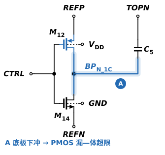
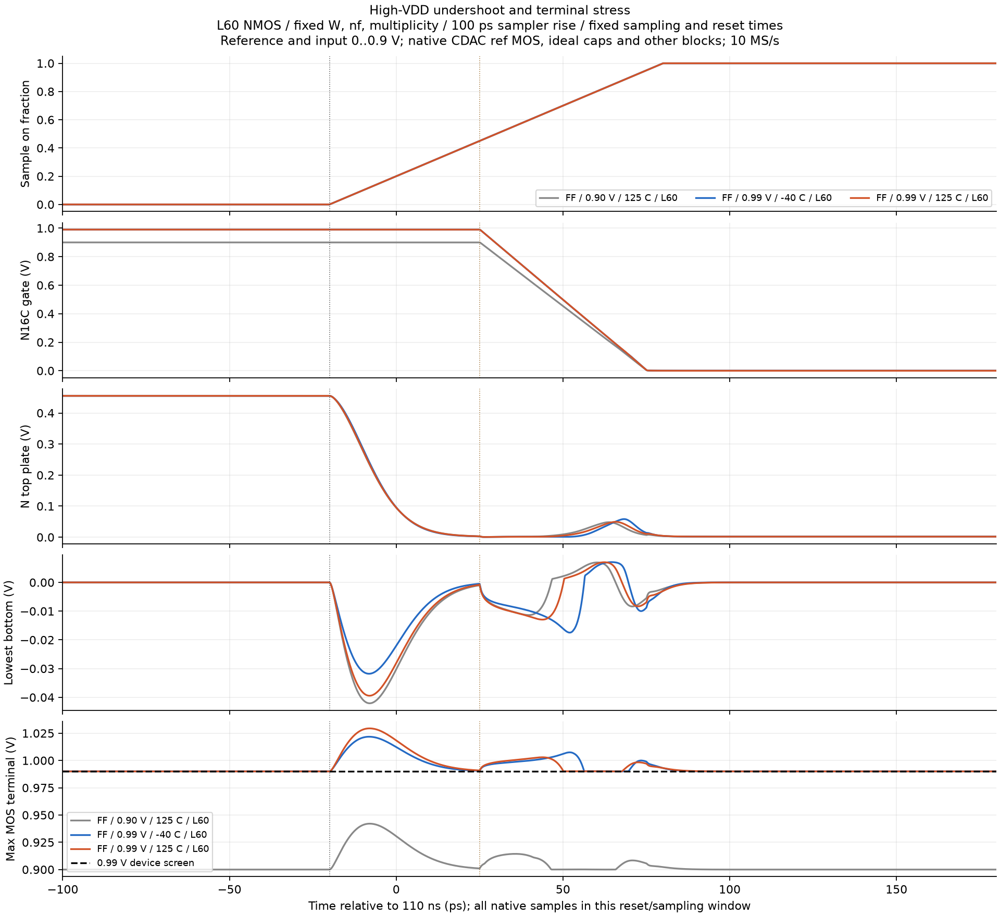
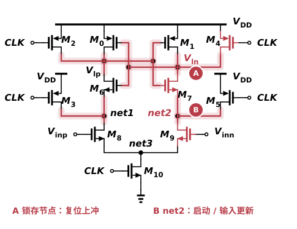
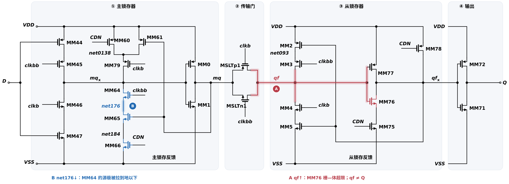
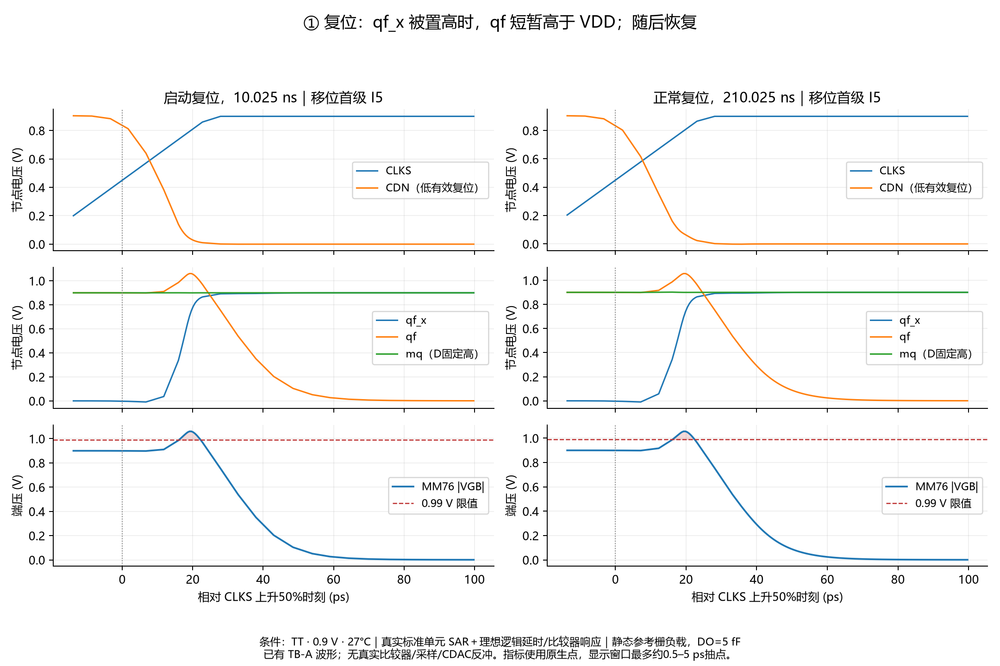
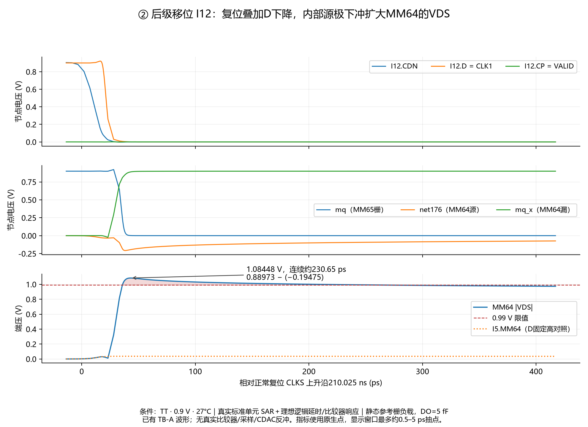
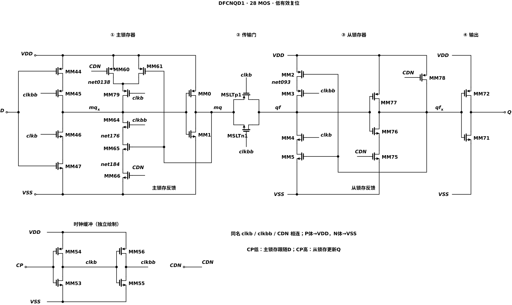
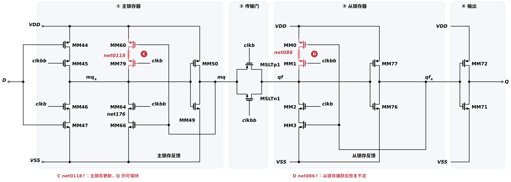
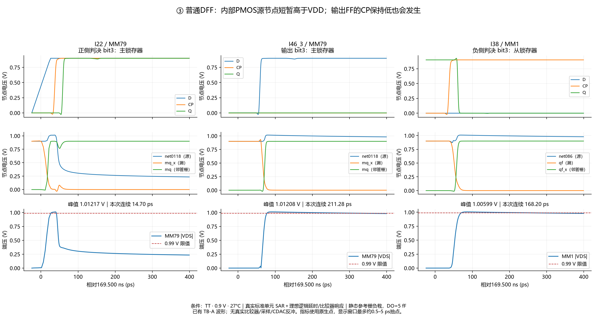
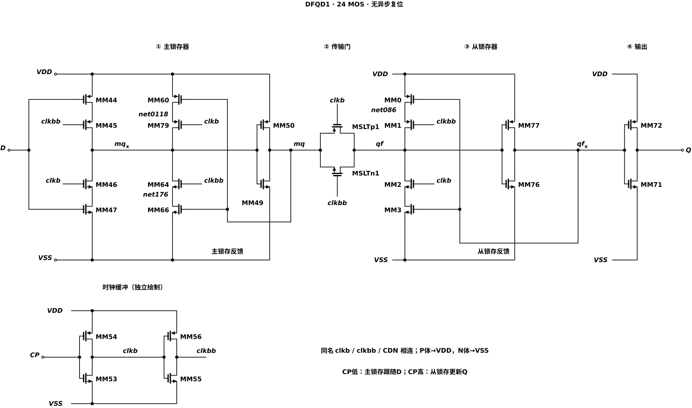

**概况：** 功能通过， 当前未解决的是切换瞬间的端压超限
- CDAC 在采样重接通时底板下冲（0.99V FF -40°/125°）；
- 比较器经尺寸与时钟优化后，高供电（0.99V FF 125°）下仍有小幅上冲；
- SAR 标准单元内部在标称 TT 下也会超限。
（0.9V VDD，端差按 **0.99 V** 筛查）
## CDAC｜采样重接通 → 底板下冲

**尺寸：** PMOS＝3 µm/100 nm，NMOS＝1 µm/60 nm，均 nf=10；m（multi）＝2×电容权重，图中1C的M12/M14为m=2。

**A：TOPN 转向新输入 → C5 拖低底板 → 下管经有限导通阻抗恢复。** ==🟡高供电冷角的漏—体端差超限==。

| 测试条件 / 位置                        |        峰值时刻 |      底板电压 | 超限端差 / 时长                    |
| -------------------------------- | ----------: | --------: | ---------------------------- |
| FF，0.99 V，−40°C；接通 100 ps；16C/M5 | 109.9918 ns | −31.79 mV | 漏—体 **1.02179 V / 76.24 ps** |
| FF，0.99 V，125°C；16C/M5           | 109.9920 ns | −39.44 mV | 漏—体 **1.02944 V / 70.03 ps** |
（M14加宽有改善，但极端工况会漏电）

> [!example]- 波形与测试边界
> 
> 图示 N 侧 1C：M12/M14/C5，`BP_N_1C` = `net1`；16C 的 M5 漏端为 `net5`，与 M12 同类，尺寸随电容权重变化。
> 参考开关为晶体管，电容每侧 1.28 pF；采样器、SAR、比较器、外部源理想。8 帧码字与建立通过，尚非全码或整机 PVT 验收。

## 比较器

*FF / 0.99 V / 125°C；理想外部源，CLK 上升200 ps / 下降500 ps，输入保持1.28 pF/侧、输出6.1 fF/侧。未接真实SAR，无噪声、失配、PEX。*

**尺寸：** 全部100 nm/30 nm、nf=1；M2/M4：m=8，M3/M5及M8/M9：m=2，其余m=1。

| 时刻 / 位置                 | 结果                                                     | 原因判断                     |
| ----------------------- | ------------------------------------------------------ | ------------------------ |
| CLK↑开始比较，B：net1/net2    | **354.0588 ns，0.992865 V**；M7源—体、M9漏—体超限，主峰持续150.33 ps | 预充退出与放电开始交接时上冲，具体支路贡献待分解 |
| CLK↓复位，A：LP/LN          | 上冲 **2.192 mV**                                        | 邻近节点回升经寄生耦合推高节点，复位管负责回拉  |
| CLK保持低、输入更新，B：net1/net2 | 上冲约 **0.901 mV**                                       | 输入跳变经输入管耦合到漏端，恢复不够及时     |

**三次权衡：**
1. **加强复位管 M2/M4。** 从小尺寸逐步加到8份，复位上冲减小；代价是启动上冲增大、判决变慢、功耗增加。
2. **放缓时钟边沿。** 采用200/500 ps，降低峰值；代价是扰动变宽，且不能解决时钟静止时的输入更新上冲。
3. **减小输入对、加强内部预充。** M8/M9减至2份、M3/M5增至2份，减轻net1/net2的输入馈通；但LP/LN复位上冲反而加重，随后再加强M2/M4形成A8。

## SAR｜内部节点超限

*TT / 0.9 V / 27°C，100 ns 帧周期；原生标准单元，VA 比较器与 VA 传输延时（非 RC）；静态 MOS 栅复制负载，输出 5 fF/位，无真实比较器/CDAC 反冲。*

### DFCNQD1（移位寄存器DFF）：复位上冲 / 内部源极下冲

| 位置                         | 时刻；端差 / 时长                                | 状态变化与原因推测                                                        |
| -------------------------- | ----------------------------------------- | ---------------------------------------------------------------- |
| **A · qf 上冲**，I5.MM76      | 10.0443 ns；栅—体 **1.06112 V / 6.13 ps**    | CDN↓ → MM78 开、MM75 关 → qf_x↑；qf 在反馈拉低前短暂上冲。连接与波形支持内部寄生耦合         |
| **B · net176 下冲**，I12.MM64 | 210.0681 ns；漏—源 **1.08448 V / 230.65 ps** | CDN↓先关 MM66 对地通路；随后 D↓、mq↓、mq_x↑。MM65 栅下降与 net176 下冲同步，高漏压与负源压叠加 |

> [!example]- 复位波形与完整28管电路
> 
> 
> 
> 主图省略下方时钟缓冲；完整图保留全部 28 管。同名 `clkb/clkbb/CDN` 相连，`mq/mq_x` 属主锁存，`qf/qf_x` 属从锁存。

### DFQD1（比较结果锁存DFF）：主、从锁存内部节点上冲

| 位置                            | 时刻；端差 / 时长                                | 状态变化与原因推测                                       |
| ----------------------------- | ----------------------------------------- | ----------------------------------------------- |
| **C · net0118**，输出 I46_3.MM79 | 169.5909 ns；漏—源 **1.01208 V / 211.28 ps** | CP 仍低，Q 保持；主锁存跟随 D，mq↑使 MM60 关断，net0118 上冲且恢复较弱 |
| **D · net086**，判决 I38.MM1     | 169.5861 ns；漏—源 **1.00599 V / 168.20 ps** | 捕获后 qf↓、qf_x↑，MM0 关断；MM0—MM1 中间节点上冲。属于从锁存更新     |

**已试优化仍未解决 B 类下冲。** CDN 放缓改善 A 类短尖峰；替换 DFF 也未恢复 B 类内部节点。

> [!example]- 波形、完整24管电路与优化读数
> 
> 
> C 类在判决 I22.MM79 的同类峰值为 1.01217 V，但其 CP 已开始上升，不能称为时钟静止。
> 独立双 DFF、各 5 fF：CDN 边沿 16.83→67.30 ps，MM76 峰值 1.05736→1.00058 V；MM64 仍为 **1.07268 V**。换成 SDFSYNCNQD1/GDFCNQMCOD1 后为 **1.08946/1.09625 V**，尚未推广替换。
> SAR 机制目前由波形与连接支持。后续小台已保存总端流并检查 KCL，但沟道电流、寄生电荷尚未逐项分解，不能归结为整个标准库缺陷。

> [!info]- 图与结论的边界
> 手搭版本的模块隔离结果；Bootstrap 暂不展开。CMI 为模型接口告警，不等于已经损坏，码字正确也不能替代端压验收。
> 高亮是原生 Analog Canvas SVG 的报告标注层；完整可编辑电路留在 Canvas，器件编号对应仿真网表，尺寸隐藏。CDAC、比较器沿用用户布局。未改变连接、OA、PDK、标准库或已有结果；这些图不是新仿真模型或签核结论。

> [!info]- 来源与完整报告
> [原始定位](../../verification/manual_adc/cdac_isolation_v1/README.md) · [高供电结果](../../verification/manual_adc/cdac_l60pvt_v1/README.md)
> [完整A8结果与波形](../../comparator_design/COMBO_A8.md)
> [SAR 事件与设置](../../verification/manual_adc/sar_isolation_v1/stress_windows/report.md) · [CDN 对照](../../verification/manual_adc/sar_isolation_v1/cdn_slew_v1/README.md) · [单元替换](../../verification/manual_adc/sar_isolation_v1/dff_candidates_v1/README.md)
