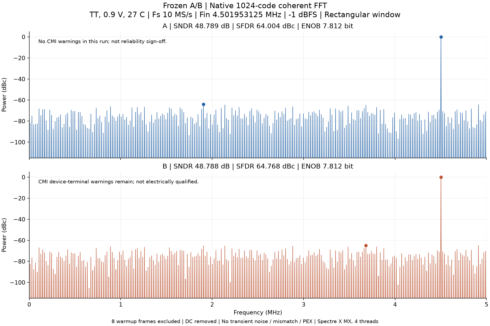
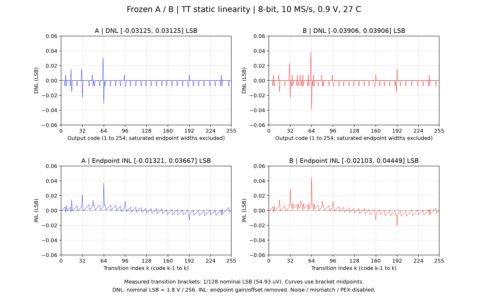
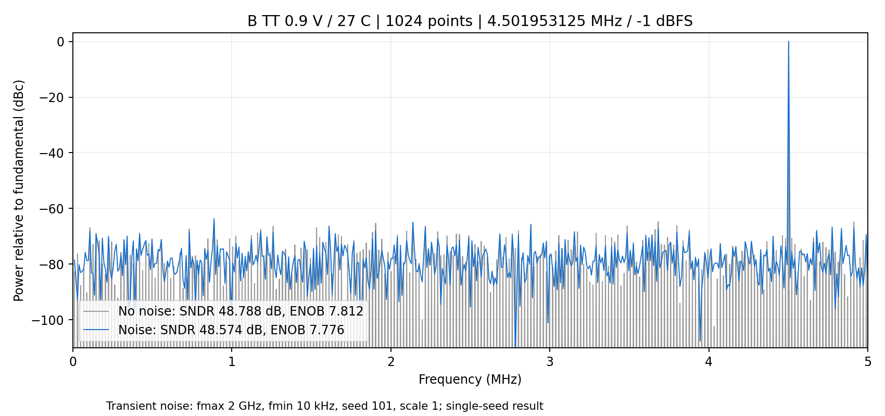

**概况：A/B 两版（A使用自建门，B使用数字单元库）五点 PVT 关键码短测均通过；TT 无噪声全码扫描无缺码，1024 点 FFT 均达到 ENOB≈7.812 bit；B 加瞬态噪声后 ENOB=7.776 bit。端压问题尚未全部解决。**

## 五点 PVT｜关键码与启动

**每版每角 10 帧，首帧和后续码字全部正确：**
`0 → 0 → 12 → 127 → 128 → 243 → 255 → 255 → 0 → 128`。

| 工况   | 供电 / 温度        | A/B 码字与握手 |    A 最长转换 |    B 最长转换 |       A/B 最大采样误差 |
| ---- | -------------- | --------- | --------: | --------: | ---------------: |
| TT   | 0.90 V / 27°C  | 均通过       | 29.904 ns | 29.124 ns | 0.058 / 0.041 mV |
| SS 冷 | 0.81 V / −40°C | 均通过       | 40.531 ns | 39.797 ns | 0.263 / 0.268 mV |
| SS 热 | 0.81 V / 125°C | 均通过       | 34.899 ns | 34.293 ns | 0.040 / 0.024 mV |
| FF 冷 | 0.99 V / −40°C | 均通过       | 26.630 ns | 25.873 ns | 0.079 / 0.067 mV |
| FF 热 | 0.99 V / 125°C | 均通过       | 28.515 ns | 27.741 ns | 0.070 / 0.050 mV |

## 无噪声频谱

条件：**TT、0.9 V、27°C，10 MS/s；4.501953125 MHz、−1 dBFS，8 帧预热＋1024 点**。A 为自建数字门，B 为标准单元版本，模拟核心相同。

| 指标 | A | B |
| --- | ---: | ---: |
| SNDR | 48.789 dB | 48.788 dB |
| SFDR | 64.004 dBc | 64.768 dBc |
| ENOB | 7.812 bit | 7.812 bit |
| 核心＋参考功耗估计 | 138.62 µW | 86.53 µW |

本次长 FFT：**A 日志未见 CMI，B 仍有端压告警**。未包含瞬态噪声、失配和 PEX；功耗未做积分网格收敛验证，且不含理想输入源和时钟驱动。

> [!info]- ADCtoolbox 诊断与完整结果
> [A 版12图](../assets/sar8_campaign_fft/a_toolbox_panel.png) · [B 版12图](../assets/sar8_campaign_fft/b_toolbox_panel.png)
> 两版拟合残差 RMS 均约 0.293 LSB，接近理想量化误差的 0.289 LSB；残差图不代替静态 DNL/INL。
> [完整频谱报告](../../verification/sar8_campaign/fft_final/README.md) · [数值与验证](../../verification/sar8_campaign/fft_final/results.json)
## 端压问题

以下为**五点 PVT 关键码短测**的告警，与上述长 FFT 分开记录。

| 工况 | A 的 CMI 端压告警 | B 的 CMI 端压告警 |
| --- | --- | --- |
| TT | 有 | 有 |
| SS 冷 | 日志未见 | 有 |
| SS 热 | 日志未见 | 日志未见 |
| FF 冷 / FF 热 | 有 | 有 |

> [!info]- 测试边界与来源
> 五角采用 Spectre X MX；MOS 对应 PVT，passive 为 nominal TT，未包含瞬态噪声、失配和 PEX。MX 与严格 CX 的短测一致性已检查，但不能替代全码或频谱的精度收敛验证；原始数值警告保留。
> [A/B 五点完整对比](../../verification/sar8_campaign/ab_pvt/README.md) · [数值与告警](../../verification/sar8_campaign/ab_pvt/comparison.json)
> [A 版 TT MX 验证](../../verification/sar8_campaign/recovery/a_mx/README.md) · [B 版各角回收](../../verification/sar8_campaign/pvt_recovery/README.md)（较早记录，A 版状态以本页及 A/B 对比为准）
> [低端全码检查](../../verification/sar8_campaign/ab_static/low_complete.md)
> FFT 运行身份：`sar8camp-a-tt-fft1024-mm-v1`、`sar8camp-b-tt-fft1024-mm-v1`。A 冻结网表 `sar8_l90_mmain2_frozen`；B 为 `sar8_l90_mmain2_stdcell_v1`，均未宣称同步 OA。

## TT 全码｜转换边界扫描法

**逐个搜索 255 个转换边界，再由相邻边界计算码宽。** 边界搜索分辨率为 1/128 LSB。

| 指标 | A | B |
| --- | ---: | ---: |
| 转换边界 / 正确码中心 | 255 / 256 | 255 / 256 |
| DNL 范围 | ±0.03125 LSB | ±0.03906 LSB |
| 最大绝对端点 INL | 0.03667 LSB | 0.04449 LSB |

**结论：两版均无缺码、边界单调，标准单元替换未造成明显静态精度退化。** DNL 按标称 LSB 计算并排除两端饱和码宽度；INL 按端点法去除偏置与增益。此项为无噪声 TT，未含失配、PEX。

> [!info]- 全码图与数据
> [±1 LSB 总览](../assets/sar8_campaign_fft/static_dnl_inl_overview.png) · [完整结果](../../verification/sar8_campaign/ab_static/fullstatic_recovered.json)

## B 版含噪声频谱

与上述 B 无噪声 FFT 保持相同激励及采样条件，启用器件瞬态噪声：**noisefmax=2 GHz、noisefmin=10 kHz、seed=101**，含四个外部 50 Ω 电阻噪声；理想外部电源与时钟未另加噪声或抖动。

| 指标 | B 无噪声 | B 含噪声 |
| --- | ---: | ---: |
| SNDR | 48.788 dB | 48.574 dB |
| SFDR | 64.768 dBc | 63.629 dBc |
| ENOB | 7.812 bit | 7.776 bit |
| 拟合残差 RMS | 0.2935 LSB | 0.3008 LSB |

**结论：SNDR 下降 0.214 dB、ENOB 下降 0.036 bit，噪声影响较小。** 1024 点中 53 个输出变化，均仅差 1 LSB；全部帧握手有效。最大杂散从 bin 377 转到 bin 91，单 seed 尚不能认定新增固定杂散。残差包含量化、失真和噪声，不能视为纯器件噪声。

> [!info]- 含噪声诊断与限制
> [含噪声 ADCtoolbox 12 图](../assets/sar8_campaign_fft/b_noise_toolbox_panel.png) · [对比数值](../../verification/sar8_noise/fft_final/comparison.json)
> 单 seed，尚未完成多 seed、噪声带宽及低频收敛验证；模型使用 noise_worst，未含失配和 PEX。CMI 端压及数值告警仍保留，性能结果不代表可靠性通过。
> 运行：`sar8noise-b-tt-fft1024-g2-s101-v1`。

