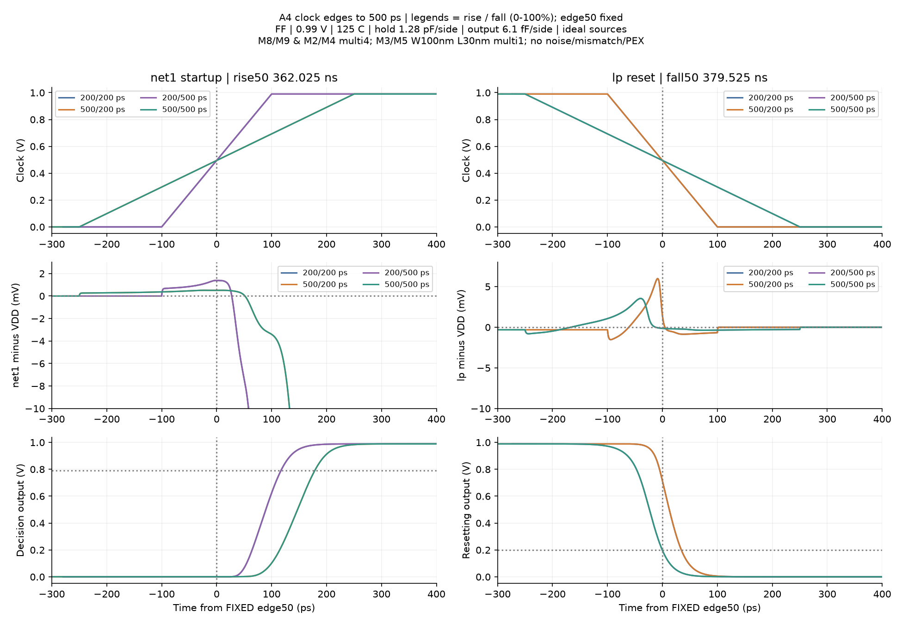
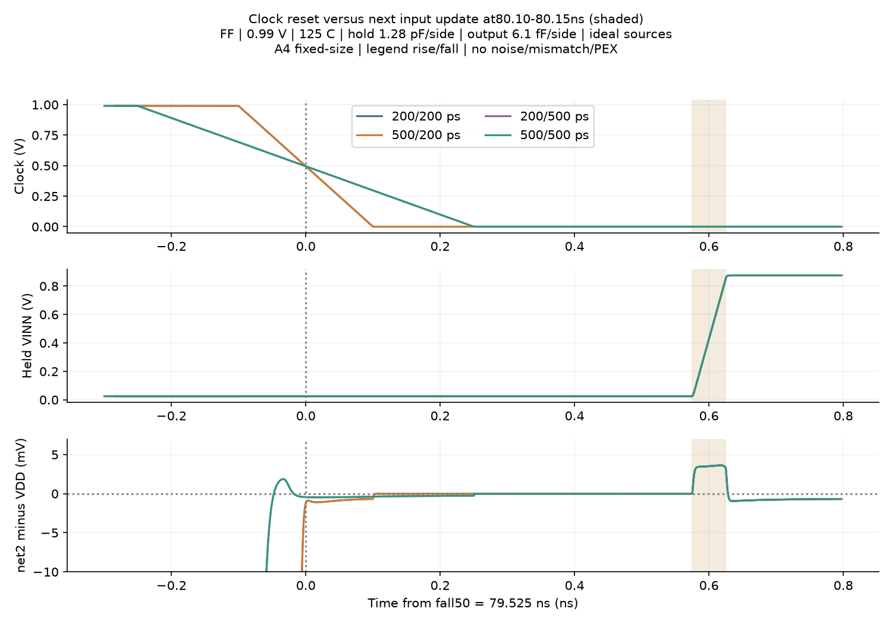

# 比较器时钟扩展至500 ps

三组新实验完成。500 ps继续削峰，但脉冲展宽，全部仍有端压超限。下降沿500 ps后，全程最坏点转为下一输入更新时的net2上冲；不能仅看复位峰值就判定修复。

## 条件与单变量

FF、0.99 V、125°C，400 ns。A4尺寸固定：M8/M9输入对和M2/M4各4倍并联；M3/M5及其他管各1倍，单份W=100 nm、L=30 nm、nf=1。拓扑、模型、输入、保持开关和输出负载均不变。

供电、输入与时钟为理想源。低阻输入和1.28 pF/侧保持输入各32次判决，输出6.1 fF/侧等效接收负载；没有真实SAR接收器、噪声、失配或版图寄生。本次只测FF热角，不代表完整PVT。

边沿数值为0–100%斜坡时间。所有上升/下降50%时刻固定；500 ps边沿从该时刻前250 ps开始、后250 ps结束，10–90%为400 ps。两交叉时刻间隔仍为1.5 ns，完整高电平平台随边沿放缓而缩短。

## 实测对比

下表为保持输入模式。上冲列为超出0.99 V的幅值；脉宽为最大峰值所在的单个连续越限脉冲，非累计时间，也不混用其他事件的最长尾波。

| 指标 | 200/200 ps | 500/200 ps | 200/500 ps | 500/500 ps |
|---|---:|---:|---:|---:|
| net1/net2启动上冲，mV | 1.389 | 0.511 | 1.389 | 0.511 |
| 对应越限脉宽，ps | 127.57 | 301.51 | 127.57 | 301.51 |
| LP/LN复位上冲，mV | 5.990 | 5.990 | 3.548 | 3.548 |
| 对应越限脉宽，ps | 65.83 | 65.83 | 155.30 | 155.30 |
| 最慢判决：从上升50%起，ps | 147.98 | 223.99 | 147.99 | 223.99 |
| 最慢输出复位：从下降开始起，ps | 134.76 | 134.76 | 250.69 | 250.69 |
| 全程最大器件端差，V | 0.995990 | 0.995990 | 0.993623 | 0.993623 |
| 比较器平均供电功率，µW | 1.828 | 2.187 | 2.210 | 2.569 |

每组低阻/保持输入共64次判决和输出复位均通过，电气端压检查均失败。输入差模反冲约0.143→0.140 mV，共模约0.168 mV，变化很小。

下降500 ps时，最慢输出复位发生在下降50%附近（报告值约+0.69 ps，原生采样括区约0.96 ps）；从实际下降开始计算仍需约251 ps。因此不能解释成“复位只需0.69 ps”或复位更快。下降200 ps的对应两个口径为34.76 ps和134.76 ps。

图中使用相同事件和相同50%时刻对齐。左列为启动，右列为复位，分别列出时钟、内部节点和输出；只改变另一条边沿的曲线重合属于预期。全程极值见表及JSON，不能由单一展示事件代替。

## 剩余问题及新副作用

1. **既有输入更新扰动成为最坏点。** 两组下降500 ps的全程最大端差均为0.9936225 V，发生于80.142077 ns的net2，涉及M5的DG、M7的SB和M9的DB。此时时钟已低，VINN在80.10–80.15 ns从0.025 V更新到0.875 V。约3.623 mV的上冲此前就存在，下降沿放缓没有消除它；只是LP/LN复位峰值降到3.548 mV后，它成为最大值。
2. **下降500 ps引出小幅复位上冲。** net1/net2在复位边沿出现约1.865 mV上冲、约29.53 ps连续越限；例如net1在83.49117 ns，早于83.525 ns下降50%约33.8 ps。下降200 ps没有这一类超过0.99 V的复位脉冲。时序相关性已确认，具体支路电流分解尚未完成。
3. **放慢边沿不能单独解决端压。** 上升500 ps降低启动峰值约63%，但主越限从128 ps延长到302 ps，判决增加约76 ps；下降500 ps降低复位峰值约41%，但主脉冲从66 ps延长到155 ps。峰值下降不等于可靠性通过。

若仅比较这组试验，200/500与500/500的全程最坏端差相同，而200/500判决更快、功耗更低；500/500的优势是启动峰值更低。两者均未合格，不采用新基线。下一项定位应针对net2输入更新扰动，并补充下降500 ps复位时net1/net2的支路电流，避免继续只用边沿削峰。

## 证据与验证

- 200/200复用`cmpdesign-rise200-fall200-a4-ff-hot-v1`，未重跑。
- 新运行：`cmpdesign-r500-f200-a4-ff-hot-v1`、`cmpdesign-r200-f500-a4-ff-hot-v1`、`cmpdesign-r500-f500-a4-ff-hot-v1`，均完成仿真、分析、回收。
- [汇总数值](results/edge500_comparison.json)、[独立核验](results/edge500_validation.json)。各运行目录保留原生Spectre日志、结果和执行证据。
- Spectre21.1.0.509.isr12，X CX，申请1线程；实际reltol=1e-7、vabstol=10 nV、iabstol=10 fA、maxstep=20 ps、gear2only。各400 ns原生零错误，保留CMI-2752/2753/2754/2755/2756与SFE-1131；三组无SPECTRE-16780。
- 独立核对DUT/模型一致、网表仅VCK变化、32对实际50%交叉时刻、64次功能，以及四类原生脉冲峰值/持续时间。500 ps测量覆盖完整边沿；稳定复位从真实下降开始检查。图像已目视检查。
- 新仿真约23.7 s/组，RSS最高290.4 MiB，分析RSS低于9.2 MiB，单组回收低于9.4 MB，符合managed资源限制。无在途任务，未修改OA、PDK或其他实验，未commit/push。
