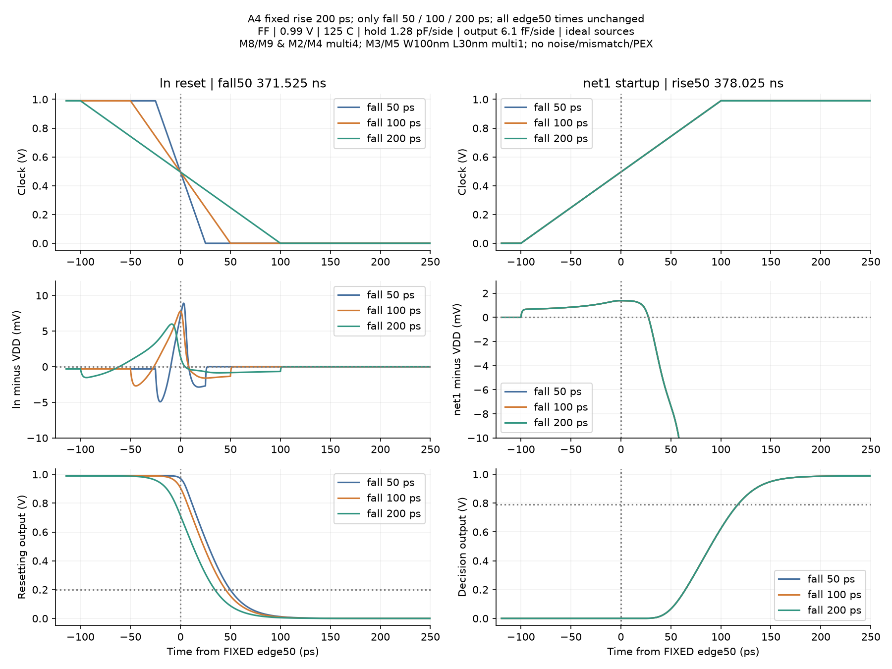
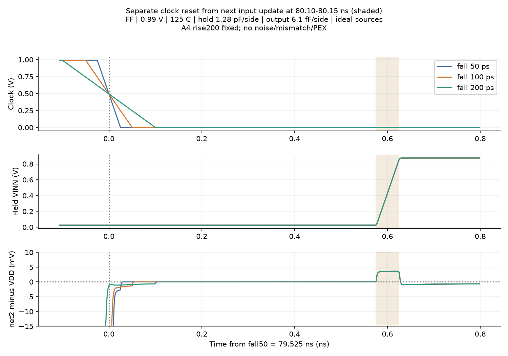

# 固定上升200ps，下降沿50/100/200ps

**下降沿放慢能降低复位峰值，但主要越限脉冲变宽；判决速度不变，端压仍未通过。** 200ps下降沿将复位上冲降低约33%，尚不是完整修复。

## 条件与唯一变量

保持A4：M8/M9输入对multi4，M2/M4 multi4，M3/M5 W100nm/L30nm/multi1，其余器件不变。FF、0.99V、125°C，400ns；每100ns安排8次比较。理想外部供电、输入和时钟，输出6.1fF/侧。低阻输入与断源保持1.28pF/侧各32次；无噪声、失配、PEX或真实SAR接收接口。

上升沿固定200ps；下降沿0–100%分别为50/100/200ps（90–10%为40/80/160ps），围绕原下降50%时刻对称展开。所有上升段、上下沿50%交叉、输入及保持控制均不变。新测试台仅VCK一行改变，DUT和模型文件逐字节一致。

50ps复用`cmpdesign-rise200-a4-ff-hot-v1`，仅绑定原波形补复位脉冲分析；新仿真为`cmpdesign-rise200-fall100-a4-ff-hot-v1`和`cmpdesign-rise200-fall200-a4-ff-hot-v1`。

## 实测对比

下表为保持输入模式，取32次比较中的最坏值。复位峰值统计窗口从实际下降开始到下降50%后0.5ns，避开后续输入更新；全器件端压仍覆盖完整400ns。

| 指标 | 下降50ps | 下降100ps | 下降200ps |
|---|---:|---:|---:|
| LP/LN复位上冲，相对0.99V | 8.908mV | 7.800mV | 5.990mV |
| 最大峰值所在单次连续超限 | 18.07ps | 34.84ps | 65.83ps |
| 输出复位：从下降50%开始 | 50.72ps | 45.45ps | 34.76ps |
| 输出复位：从下降沿开始 | 75.72ps | 95.45ps | 134.76ps |
| 最慢稳定判决：从上升50%开始 | 147.98ps | 147.98ps | 147.98ps |
| 下降50%后0.5ns内部最大残差 | 0.6426mV | 0.6434mV | 0.6459mV |
| net1/net2启动上冲 | 1.389mV | 1.389mV | 1.389mV |
| 下一输入更新引起的net2上冲 | 3.623mV | 3.623mV | 3.623mV |
| 全程最大器件端差 | 0.998908V | 0.997800V | 0.995990V |
| 比较器供电平均功耗 | 1.654µW | 1.708µW | 1.828µW |

输出复位定义为两个输出均降至0.2VDD以下并保持；判决要求正确输出满足0.8/0.2VDD且稳定至实际下降沿开始前。时间使用原生样点稳定通过上界。内部固定时刻残差单独报告，不能把输出复位当作所有内部节点已经完全建立。功耗不包含理想输入/时钟源或接收电路。

**从50%开始计时变短，是因为慢下降沿更早开始作用；从边沿开始到输出复位的时间反而增加。** 因此不能把34.76ps解读成复位驱动能力增强。比较时钟50%之间的间隔不变，但0–100%的斜坡占用更多时间。

每点driven/held各32次，共64次确定性判决和输出复位均通过；三点端压筛查均失败。输入差模/共模反冲约0.14281/0.16840mV，基本不变。

## 波形及事件位置

左列为同一371.525ns下降50%事件，从上到下为时钟、LN相对VDD、复位输出；右列为同一378.025ns上升50%事件，显示固定上升沿后的启动波形及判决几乎重合。节点图纵轴为过冲放大显示，未展示全部低电位放电范围。

各条件全程最大复位峰值的位置不同：

| 下降沿 | 节点 | 峰值时刻 | 峰值 |
|---|---|---:|---:|
| 50ps | LN | 371.528228ns | 0.998908V |
| 100ps | LN | 355.525057ns | 0.997800V |
| 200ps | LP | 379.516273ns | 0.995990V |

LN上冲对应输出反相器M14的GS/GB、交叉耦合M6的GB及M7的DB等端差；LP上冲时为对称一侧M12、M7、M6的对应端差。同一节点的多个端压告警不代表多个独立原因。

既有支路电流证据指出：复位时另一侧低电位节点回升，经交叉耦合管栅端推高已在高电位的节点。本次降低时钟下降斜率后峰值下降、脉冲展宽，与该动态耦合解释一致；本轮未重新分解各支路的沟道/位移电流，因此不把削峰全部归给某一个Cgd。

**最长脉冲与最大峰值脉冲不是同一个量。** 复位后还有很小的独立正向尾波：按严格0.99V阈值计，三点最长连续区间为142.25/131.82/120.06ps，其峰值仅比0.99V高11.736/4.808/1.801µV。表中18.07/34.84/65.83ps对应主要峰值所在区间。两类均保存，不用尾波长度替换主要尖峰脉宽，也不据此作寿命判断。

在80.10–80.15ns，输入更新使net2上冲约3.623mV；此时时钟已经保持低电平。三条曲线几乎重合，说明本轮下降沿整形没有消除这类扰动。它未混入复位边沿的0.5ns统计窗口，但一直包含在完整端压检查中；当前仍小于5.990mV的最坏复位上冲。

## 结论与边界

上升/下降都采用200ps时，启动上冲已降至约1.4mV，复位上冲仍约6.0mV。边沿整形有作用，但在本轮范围内，不能单靠它达到所有端差≤0.99V。保留该点为后续诊断候选，不采用整机/OA基线，也不自动扩大边沿或改变尺寸。

三个条件都只有FF热角及当前输入历史覆盖，未完成SS/PVT、噪声、失配或实际接收接口验证；降低峰值伴随越限时间延长，不等同可靠性通过。

## 验证与证据

- 两个新仿真原生零错误完成400ns，耗时23.67/24.35s，仿真RSS284.11/286.09MiB、分析约9.1MiB，回收各约9.3MB。所有结果已回收，无本轮在途任务。
- Spectre21.1.0.509、X CX、请求1线程；实际reltol1e-7、vabstol10nV、iabstol10fA、maxstep20ps、gear2only。保留CMI-2752至2756和SFE-1131，没有新增SPECTRE-16780。
- `cmpdesign-fall50-a4-review-v1`只读重分析原rise200结果；原判决、复位、所有器件端差、供电能量等字段完全一致。复位主峰和独立尾波用原生事件CSV分别核对阈值交点；避免整窗只找最大峰而误验证最长尾波。
- 32次实际上下沿50%时刻、冻结DUT/模型/源差异、原生完整性、功能和脚本语法均已检查；两张图已目视查看。未改OA/PDK/其他任务，不commit/push。

[完整比较数据](results/fall_sweep_comparison.json) · [独立验证](results/fall_sweep_validation.json)
