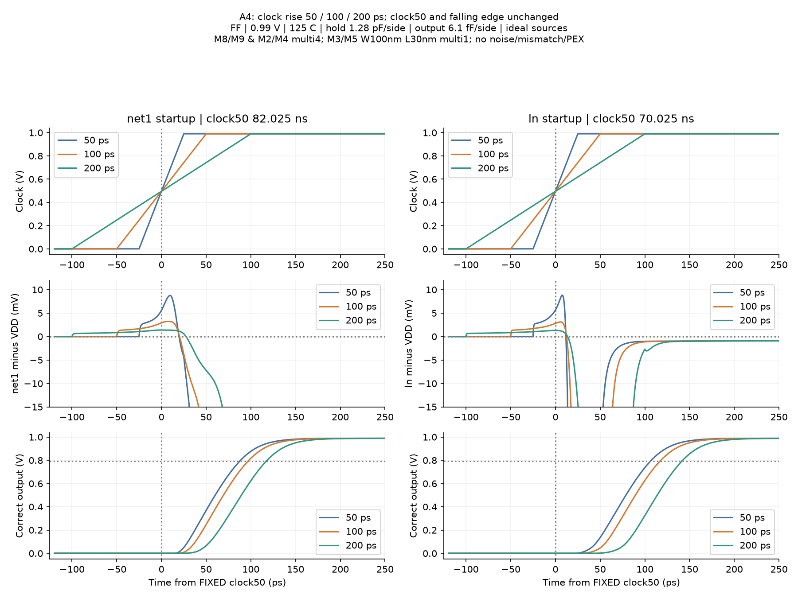
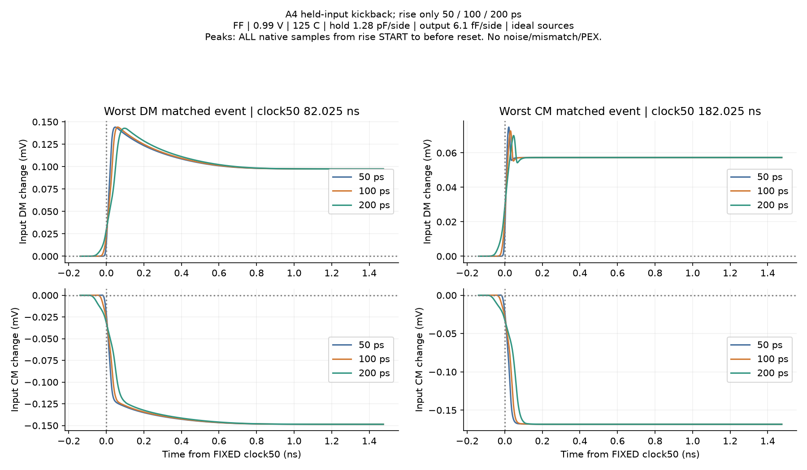

# 比较器时钟上升沿50/100/200ps

**放慢上升沿能显著降低启动过冲，但越限脉冲变宽、判决变慢；输入反冲基本不变。下降沿复位仍是全程最坏端压，因此三点均未通过端压筛查。**

## 唯一变量与测试条件

固定A4：M8/M9输入对multi4，M2/M4 multi4，M3/M5 W100nm/L30nm/multi1，其余尺寸不变。FF、0.99V、125°C，400ns、每100ns安排8次比较。理想外部电源、输入及比较时钟，输出6.1fF/侧；低阻输入与1.28pF/侧断源保持模式各32次。无噪声、失配、PEX、真实SAR接收电路。

上升沿为**0–100%时间**50/100/200ps；对应10–90%为40/80/160ps。围绕原50%时刻对称展开，三个上升段分别为交叉时刻前后25/50/100ps。全部下降沿起止、下降50%时刻、输入与采样控制均不变。仍是理想源的斜率实验，没有加入输出电阻或真实时钟缓冲器。

100/200ps只修改冻结测试台中的VCK一行；DUT和模型文件逐字节一致。50ps只重分析既有原始波形，不重跑仿真。32次上升/下降50%时刻均经实际波形插值核对。

## 结果

下表为保持输入模式，取全程32次比较中的最坏指标。过冲相对0.99V；“脉宽”是**该组最大峰值所在单次连续超过0.99V的区间**，不是全程累计时长。

| 指标 | 50ps | 100ps | 200ps |
|---|---:|---:|---:|
| net1/net2启动上冲 | 8.753mV | 3.235mV | 1.389mV |
| 上述峰值对应越限脉宽 | 44.70ps | 70.28ps | 127.57ps |
| LP/LN启动上冲 | 8.817mV | 3.113mV | 1.301mV |
| 上述峰值对应越限脉宽 | 36.73ps | 62.44ps | 113.57ps |
| 最慢稳定判决，从上升50%起算 | 112.98ps | 123.60ps | 147.98ps |
| 最慢输出复位，从下降50%起算 | 50.87ps | 50.72ps | 50.72ps |
| 输入差模反冲峰值 | 0.14404mV | 0.14410mV | 0.14281mV |
| 输入共模反冲峰值 | 0.16840mV | 0.16840mV | 0.16840mV |
| 复位前输入差模残差 | 0.09745mV | 0.09745mV | 0.09745mV |
| LP/LN复位上冲 | 8.9075mV | 8.9078mV | 8.9078mV |
| 全程最大器件端差 | 0.998908V | 0.998908V | 0.998908V |
| 比较器供电平均功耗 | 1.503µW | 1.547µW | 1.654µW |

按“最长脉冲”而非“最大峰值脉冲”统计，net1/net2三点仍为44.70/70.28/127.57ps；LP/LN为36.73/62.89/117.96ps。两种口径单独保存在JSON中。

每点低阻/保持各32次判决和输出复位均正确，当前速度、残余扰动和功耗筛查通过；**全部15只MOS六类端差筛查仍失败**。计时是原生样点稳定通过上界，最坏点采样区间约0.91ps。功耗只计比较器供电，未包含理想时钟/输入源及真实接收电路。

## 波形与解释

横轴零点为固定的时钟50%交叉。左列为82.025ns对应的net1事件，右列为70.025ns对应的LN事件，各列从上到下是时钟、节点相对VDD的电压、正确判决输出；三条件按同一事件叠加。图中节点纵轴放大用于观察上冲，后续大幅放电超出该纵轴范围。

200ps使net1/net2最坏上冲下降约84%，LP/LN下降约85%；但电压在0.99V以上停留更久。这个结果符合“耦合注入变缓，恢复可以在切换过程中发生”的解释；不能仅凭电压波形定量分解每项电容和沟道电流，也不能把峰值下降等同于可靠性已经通过。

最坏事件会随边沿改变：net1/net2的50ps峰值位于82.034693ns、net1；100ps为78.033012ns、net2（对称82ns事件几乎相同）；200ps为378.024195ns、net1。LP/LN启动峰值分别位于70.032663ns LN、70.030619ns LN、74.025263ns LP。表中均使用各条件全程最坏值，没有只看固定帧。

全程最坏端压仍在371.528ns附近的LN复位阶段，M14的GS/GB、M6的GB和M7的DB等端差约0.998908V。下降沿未改，复位峰值也基本不变；本次不能称为完整过压修复。较低峰值伴随较长越限时间，可靠性优劣不能仅靠两者中的任意一项判定。

反冲峰值使用**上升沿开始到固定下降沿开始前的全部原生样点**；差模相对实际上升前值，共模相对名义共模。另保留旧的上升50%之后口径，本次两种窗口所得峰值相同，说明没有因为窗口遗漏早期扰动而虚假改善。慢边沿改变了扰动形成的速度，但保持节点最终扰动和峰值基本不变。不能用降低内部过冲推导输入反冲同步下降。

## 结论与后续

保留100/200ps作为上升沿整形候选，尚不采用整机基线。200ps在本FF热角削峰更强，判决代价约35ps，仍在本台1ns目标内；它仍有约1.4mV启动上冲和未改善的复位上冲。下一项有辨识力的实验是固定一个上升沿后，单独扫描下降沿，检查复位峰值与复位时间；本轮未执行，也未扩展SS/PVT。

## 运行与核对

- 新仿真：`cmpdesign-rise100-a4-ff-hot-v1`、`cmpdesign-rise200-a4-ff-hot-v1`，均原生零错误完成400ns，全部结果回收。
- 50ps分析：`cmpdesign-rise50-a4-review-v1`绑定已完成`cmpdesign-precharge-a4-ff-hot-v1`；旧判决/复位/全端差/功耗等指标逐字段相同。
- Spectre21.1.0.509、X CX、1线程请求；实际reltol1e-7、vabstol10nV、iabstol10fA、maxstep20ps、gear2only。100/200ps均保留CMI-2752至2756及SFE-1131，无新增SPECTRE-16780。
- 新仿真分别24.91/24.36s，流式回收各约8.2/8.3MiB，资源回执见验证JSON。连续越限时长使用原生阈值交点插值，并独立用导出的原生事件窗口核对峰值和脉宽；两图已查看。
- 未改OA/PDK/器件/其他任务；不commit/push，不宣称PVT、失配、噪声或可靠性签核完成。

[完整比较数据](results/rise_sweep_comparison.json) · [独立验证与资源记录](results/rise_sweep_validation.json)
