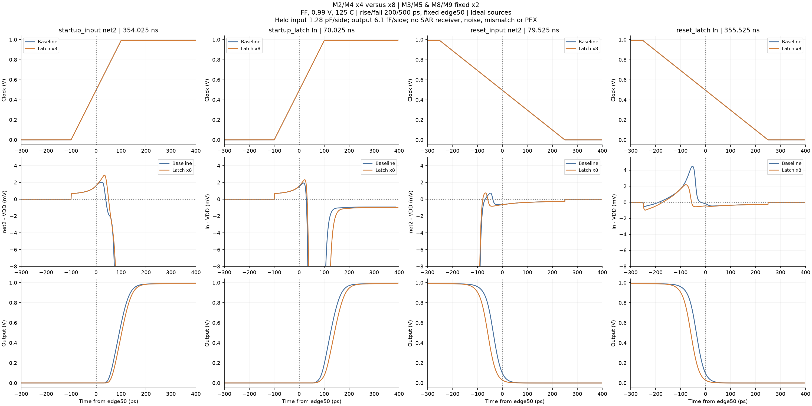

# 组合版M2/M4：4倍与8倍对比

**8倍使LP/LN复位上冲降低51.2%、输出复位加快，但启动上冲增大，判决变慢、功耗上升。全程最坏端差从0.994494V降至0.992865V，仍未通过0.99V端压筛查。**

本轮唯一变化为M2/M4 multi4→8。M3/M5和M8/M9保持multi2，其余multi1；每份W100nm、L30nm、nf1，原junction/LDE参数不变。上升200ps/下降500ps及50%时刻、FF/0.99V/125°C、全部输入与负载保持一致。理想外部源，输入保持1.28pF/侧、输出6.1fF/侧；未接真实SAR接收器，无噪声、失配、PEX。4倍原结果只读复用，8倍新增400ns仿真。

## 过冲

保持输入模式，峰值取每类事件全程最坏；括号内为该峰所在单次连续超过VDD的时长，不是累计时长。

| 事件 | M2/M4×4：上冲mV（ps） | M2/M4×8：上冲mV（ps） | 峰值变化 |
|---|---:|---:|---|
| net1/net2启动 |2.024（138.95）|2.865（150.33）|增加41.5%|
| LP/LN启动 |1.931（128.42）|2.324（131.83）|增加20.3%|
| net1/net2复位 |0.731（29.94）|0.749（19.85）|增加2.5%，持续时间缩短|
| LP/LN复位 |4.494（168.86）|2.192（115.79）|降低51.2%，持续时间缩短|

全程最长独立脉冲另列于JSON：8倍的LP/LN启动最长143.10ps，并非上表最大峰脉冲的131.83ps。没有把主峰脉宽当成所有事件的最长脉宽。

从左到右是net1/net2启动、LP/LN启动、net1/net2复位、LP/LN复位；每列依次为时钟、内部节点相对VDD的电压、输出。蓝色Baseline是组合版4倍，橙色Latch x8是本次8倍。每列用相同事件对齐，上表则统计全程最坏值。

4倍全程最坏为355.472714ns的LN复位上冲。8倍该类上冲已削弱，**新的全程最坏是354.058845ns的net2启动上冲**：0.9928645V，对应M7.SB、M9.DB；net1有对称事件。LP/LN本身的最坏也从复位转为启动，LN在70.046939ns达到0.9923235V。这是不同事件的极值次序改变，不是测量遗漏了原事件。

## 速度与功耗

| 指标 | 4倍 | 8倍 | 变化 |
|---|---:|---:|---|
| 最慢判决，自上升50%起 |161.23ps|179.56ps|慢18.33ps|
| 最慢输出复位，自下降开始起 |237.07ps|215.58ps|快21.49ps|
| 比较器平均供电功率 |2.238µW|2.414µW|增加7.9%|
| 输入差模反冲 |0.07282mV|0.07242mV|基本不变|
| 输入共模反冲 |0.08319mV|0.08287mV|基本不变|
| 下降50%后0.5ns内部最大残差 |0.3062mV|0.3060mV|基本不变|

判决要求输出越过0.8VDD/低于0.2VDD并持续到评估结束；输出复位要求两路均低于0.2VDD并持续满足。复位时间这里从实际下降开始计算；若以50%下降沿为零点，两组分别为−12.93ps和−34.42ps，负值表示已提前完成输出复位。输出复位完成不等于所有内部节点已无过冲或残差。

功率为相同400ns窗口内比较器供电积分平均，未包含理想输入/时钟源或真实驱动器，不是整机ADC功率。TB共同驱动两套比较器的理想CLK源净平均功率从2.850nW增至4.249nW；此数不可当成单个真实时钟驱动器功耗，也没有混入上表。

低阻输入与保持输入各32次判决/输出复位均正确；低阻模式速度与保持模式相同到表中精度，供电功率分别约2.238/2.414µW。功能、当前速度/功耗筛查通过，端压筛查两组仍失败。

## 判断

本次结果支持上一轮“加强LP/LN回拉能降低复位上冲”的方向，同时验证了代价：启动上冲和判决延迟增加。更大的预充器件会同时改变时钟耦合、节点负载与恢复进程，不能仅用Ron减小解释全部变化；本轮没有重新做所有支路电荷分解，不定量指定新增启动上冲由哪一项寄生贡献。

**8倍是复位改善候选，尚不能宣布修好或直接采用。** 不建议继续盲目增大M2/M4；如果继续，先针对新的net1/net2启动最坏事件检查注入和放电重叠，再决定是否取中间尺寸或改变内部复位方法。本轮未追加其他尺寸/PVT，保留4倍与8倍全部结果。

输入更新上冲仍约0.901mV/51.44ps，[两组波形几乎重合](figures/combo_a8_input_update.png)。该问题没有因锁存节点复位管加倍而改善。

## 核验

新run `cmpdesign-combo-a8-ff-hot-v1`，对照`cmpdesign-edge-b2i2-ff-hot-v1`。test.scs/models.scs字节一致，DUT唯一两条multi改变；事件表与所有实际50%时刻一致。全程原生端压、主峰及最长脉冲、稳定复位、64次功能、旧组合汇总逐字段一致已独立核对，两个图已目视。

Spectre21.1X CX，实际单线程、reltol1e−7/vabstol10nV/iabstol10fA/maxstep20ps/gear2only。400ns原生零错误；CMI2752–2756及SFE1131保留，无SPECTRE16780。仿真24.24s、RSS286.80MiB，分析RSS9.24MiB，回收9.25MB，均在managed预算内。

[比较数据](results/combo_a8_comparison.json) · [核验与运行设置](results/combo_a8_validation.json) · [新运行原始结果](results/cmpdesign-combo-a8-ff-hot-v1/result.json)。无在途任务；未修改OA、PDK、旧运行、用户笔记或其他任务，未采用基线、commit或push。
