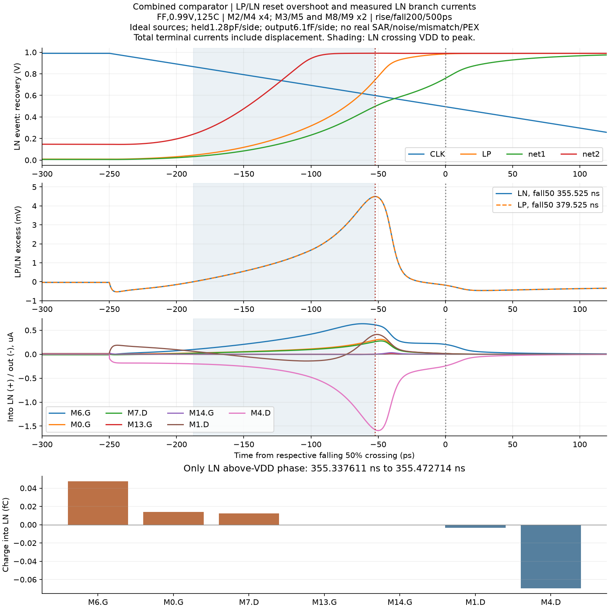

# 组合版LP/LN复位上冲：支路电流定位

**LN的主要注入来自交叉耦合支路M6的栅端，其次是M0栅端和M7漏端；M4复位管在越轨阶段主要抽取电荷。** LP的对称事件已补齐实测，分别对应M7.G、M1.G、M6.D注入和M2.D回拉。端电荷核对确认三条主要注入路径由动态耦合主导。

固定M2/M4×4、M3/M5×2、M8/M9×2，其余×1；每份W100nm/L30nm/nf1。上升200ps、下降500ps，50%时刻不变。FF、0.99V、125°C，理想供电/输入/时钟、保持电容1.28pF/侧、输出负载6.1fF/侧；未接真实SAR接收器，无噪声、失配和PEX。本轮未调整电路。

## 在什么时候发生

| 节点 | 下降沿开始/ns | 超过VDD区间/ns | 峰值时刻/ns | 峰值 | 连续越限 |
|---|---:|---|---:|---:|---:|
| LN |355.275|355.337611–355.506475|355.472714|0.994494V|168.86ps|
| LP |379.275|379.337611–379.506475|379.472714|0.994494V|168.86ps|

两次峰值都在下降沿50%交叉前52.29ps，属于**复位尚在进行时**，不是下一输入更新。LN事件中，VINP约0.850V、VINN约0.050V，输入基本不变。

从LN刚越过VDD到峰值，另一侧LP从0.0456升至0.7439V；net1从0.0323升至0.4983V，net2从0.2404升至0.9907V。LN已经接近电源轨，而与它耦合的三个节点还在大幅恢复。

## 哪些支路在注入

仅积分LN越过VDD→峰值的135.10ps，正号为流入LN。端口电流包含位移电流；表中不是纯沟道电流。

| LN端口 | LP对称端口（已实测） | 净流入电荷/fC | 含义 |
|---|---|---:|---|
| M6.G |M7.G|+0.047345|最大净注入；M6的D=LP、S=net1均在回升，G接LN |
| M0.G |M1.G|+0.013976|M0的D=LP回升，G接LN，S/B固定VDD |
| M7.D |M6.D|+0.012338|M7的G=LP、S=net2回升，D接LN |
| M1.D |M0.D|−0.003453|整个积分阶段净抽取，但接近峰值时曾转为注入 |
| M4.D |M2.D|−0.069578|主要回拉支路；从过高的LN抽取电荷 |
| M13.G、M14.G |M11.G、M12.G|−0.000627合计|输出反相器输入端的少量净抽取 |

M6.G占三个净正注入端口电荷之和约64%。其−ΔQg=0.047379fC，与端流积分相差0.072%；栅漏电峰值仅0.83pA，而总栅端注入峰值0.636µA。M0.G的−ΔQg=0.013976fC，重建差0.0043%。这直接支持动态耦合主导，不能解释成栅漏电充电。但M6漏端LP和源端net1都在上升，当前不把它全部归为Cgd。

M7.D的−ΔQd=+0.012373fC，−∫id dt=−0.0000346fC，两者合成与总端流只差0.00000055fC。此支路也是动态注入，导电项反而少量抽取。LP三条对应路径得到相同结论。

M4的回拉也并非纯Ron作用：测得导电项约−0.03204fC、动态电荷项约−0.03765fC，合计重建差约0.16%。M1漏端重建仍有0.0010fC差异，相对其很小的净积分不可忽略，因此不赋予它精确导电/位移占比，采用直接端流的时变方向。

图中M1.D在峰值附近有正脉冲，不能因为其全段净电荷为负就称其全程回拉。M4.D则在主上冲阶段明显为负，最大抽取约1.6µA。因此“预充管仍在把LN往上充”并不是这个越轨阶段的主要解释。

新观测两节点各645个原生点，全部七端流之和的最大残差小于7.5e−22A。KCL接近零并不否定电压变化：器件端流已包含电容储能，不能再将七端流和除以外加电容解释dv/dt。

[LN完整电流图](figures/combo_latch_current_ln.png) · [LP完整电流图](figures/combo_latch_current_lp.png)。图中蓝色阴影只覆盖越过VDD→峰值；末行分别积分“下降开始→峰值”和“越过VDD→峰值”，以免混淆正常复位与过冲阶段。

## 针对性的调整顺序

1. **优先独立验证M2/M4：multi4→8，其他保持组合版。** 它们直接连接LP/LN，是已测得的回拉路径。目的是增强越轨后的抽取能力，观察峰值和持续时间能否同时改善，不预先保证通过。
2. 同时检查代价：M2/M4增大也会加快另一侧锁存节点的复位、增加时钟耦合和LP/LN负载，可能增强新的注入或拖慢判决。必须一起看LP/LN及net1/net2的启动/复位过冲、判决/复位时间和功耗，不能只看一个峰值。
3. 暂不继续放大M3/M5。它们连接net1/net2，上一轮已证明加倍能改善这两个节点，却使LP/LN复位上冲从约3.55升到4.46mV。现在需要处理的是锁存节点的回拉与交叉耦合，不宜继续沿同一尺寸方向盲扫。

M6/M7、M0/M1现为最小W100nm、multi1，不能直接继续缩宽。增加L也不等于降低耦合，因为栅面积、导通能力和再生时间一起改变。若加强M2/M4的代价抵消收益，下一步才考虑分阶段内部复位；那属于拓扑/时序方案，需单独讨论。本轮只给建议，没有执行尺寸扫描。

## 证据与核验

已完成源：`cmpdesign-edge-b2i2-ff-hot-v1`。两节点原生峰值、脉宽及LN七条电流来自同一次400ns运行，功能通过不代表端压通过。[数值](results/combo_latch_source_attribution.json)；可复现脚本`scripts/review_combo_latch_source.py`。图已目视检查。

追加全管电流/电荷的`cmpdesign-combo-latch-current-ff-hot-v1`明确因输出超过512MiB停止，峰值RSS约291MiB；失败保留，未当作完成数据。`v2`取消无关观测量，仅保存两节点14条连接端流及所需OP，共68个信号，保留0起381.025ns历史。排队后已完成托管仿真、分析和回收，资源限额未放宽。

DUT/模型字节相同，TB去除save/stop后完全一致；所有新增OP存在，两节点峰值相对原生源汇总差小于1.2e−14V，脉宽/接线/KCL独立核验通过。仿真29.14s、峰值RSS284.31MiB，分析6.21s/RSS8.77MiB，回收0.84MB。原生零错误；Spectre21.1X CX，实际单线程、reltol1e−7、gear2only、maxstep20ps。CMI2752–2756和SFE1131保留，无SPECTRE16780，端压仍未合格。

三图均已目视检查。[端电荷及分段积分](results/combo_latch_attribution.json) · [独立核验与资源](results/combo_latch_validation.json) · [新观测原始结果](results/cmpdesign-combo-latch-current-ff-hot-v2/result.json)。本轮是定向复位归因，不替代原400ns全部事件和后续PVT验证；无在途任务。

无OA、PDK、旧实验或其他任务修改，不采用新基线、不commit/push。
