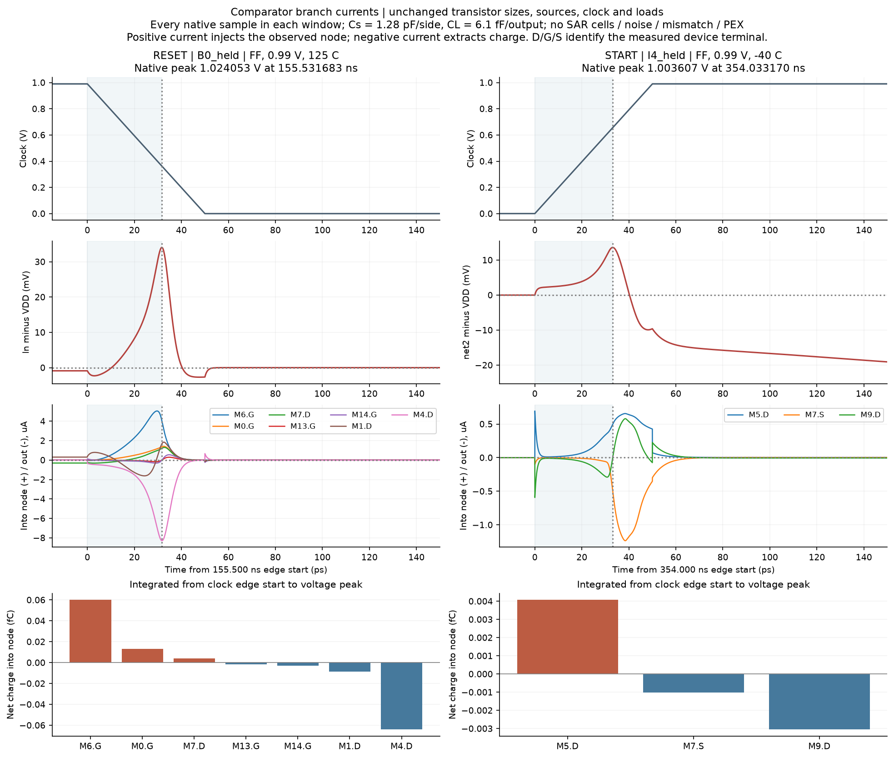

# 比较器过冲：支路电流与尺寸方案

2026-10-27。两组电流观测完成；原尺寸、激励、模型和此前历史保持不变，只增加保存项并在目标事件后结束。没有改电路或OA。

**复位时LN上冲主要经交叉耦合管M6、M0栅端注入；比较启动时net2上冲主要由预充PMOS M5动态电荷注入。不能统一解释成“输入管太慢、复位管太强”。**

正电流表示流入观察节点，负值表示流出；D/G/S指漏/栅/源端。端口总电流含位移电流。柱状图积分从时钟边沿开始至电压峰值，各端口之和约零；器件端口电荷已包含节点储能，不能把这些总电流再次求和除以额外电容计算dv/dt。

## 复位：低电位支路回升，经交叉耦合推高LN

B0原尺寸，FF、0.99V、125°C、保持输入。CLK于155.500ns开始下降，边沿50ps；LN在155.531683ns达到1.024053V，高于供电34.053mV，单次越限约30.08ps。

LN连接M4/M1/M7漏极、M0/M6栅极和输出反相器M13/M14栅极。M6漏/源为LP/net1，M0漏极为LP；复位时这些原先较低的节点升高。峰值时LP=0.7453V、net1=0.7863V、net2=0.8343V。

| LN端口 | 边沿开始→峰值净流入电荷 | 作用 |
|---|---:|---|
| M6.G | +0.060146 fC | 最大注入路径 |
| M0.G | +0.013268 fC | 第二条主要栅端注入路径 |
| M7.D | +0.004000 fC | 较小净注入 |
| M1.D | −0.008522 fC | 此区间总体抽取 |
| M4.D | −0.064064 fC | 最大净抽取路径，帮助恢复 |
| M13.G、M14.G合计 | −0.004828 fC | 输出级栅负载总体吸收 |

M6.G峰值注入约5.05µA，M0.G约1.42µA；相应模型栅漏电之和峰值仅约0.93pA、0.29pA。M6积分栅流−0.060146fC与模型ΔQg=−0.060149fC吻合，M0也吻合，支持动态电荷/电容耦合归因。

M4并非该区间的主要注入源：模型id积分抽取0.038610fC，ΔQd再吸收约0.025477fC，重建端流积分误差约0.000023fC。它参与复位，也在LN超过VDD时帮助恢复。尚未唯一分解M6的Cgs/Cgd等占比，不能由端口归因直接断言哪个几何电容应改变。

## 启动：M5关断期间注入，低输入支路缺少导电恢复

I4输入对4倍并联，FF、0.99V、−40°C，VINP=0.85V/VINN=0.05V。CLK于354.000ns开始上升，边沿50ps；net2在354.033170ns达到1.003607V，高于供电13.607mV，单次越限约40.27ps。

net2只连接M5漏极、M7源极、M9漏极。M5门接CLK，正在关断；峰值时M9源net3约0.383V、栅输入约0.05V，缺少有效导电放电条件。

| net2端口 | 边沿开始→峰值净流入电荷 |
|---|---:|
| M5.D | +0.004079 fC |
| M9.D | −0.003052 fC |
| M7.S | −0.001027 fC |

M5的净注入不代表沟道仍在向上充电：原生id/qd局部积分重建表明，动态项注入约0.027784fC，id项反向抽取约0.023702fC，相抵后约0.00408fC；重建残差约0.000003fC。

M9在该区间的id积分仅约0.000000058fC，漏端总电流主要为动态分量。因此单纯放大输入管不能保证解决该事件；原B0→I4已显示启动峰值由约1.001374V升到1.003607V。峰值后M7.S端流成为主要抽取路径，但其id仍极小；恢复包含相邻节点翻转造成的动态耦合，不能把µA级端流误读为沟道电流。

## 下一轮尺寸方案（未仿真、未采用）

固定I4对照：M8/M9保持multi=4，其余multi=1。单份W=100nm、L=30nm、nf=1及原生几何保持，通过并联数改变有效宽度。时钟、输入和拓扑不变。

| 实验 | 唯一改变的对称组 | 测试值 | 目的和代价 |
|---|---|---|---|
| A：锁存节点预充/回拉 | M2、M4 | multi=2、4，有效W=0.2、0.4µm | 加强LN/LP越过VDD时恢复；同时观察更快复位引起的耦合、附加电容、判决速度和能量 |
| B：输入漏端预充 | M3、M5 | multi=2、4，有效W=0.2、0.4µm | 分开检验关断前恢复能力与馈通电荷的竞争；同时量id和ΔQd，不能预言变大一定改善 |

A/B各自相对同一I4对照独立改变，不一起放大。先保持再生M6/M7、尾管和输出级，也不把原100nm器件缩到未经核实的更小W。

先在FF冷热观察两个事件、15MOS全部六类端压、越限时间、判决/复位和能量；明确有利的候选再检查SS冷角1ns判决、0.5ns输出复位及短复位内部建立。如果尺寸无法兼顾馈通和恢复，应保留失败，再讨论局部边沿/钳位方案；本轮没有更改时序或增加器件。

## 证据与边界

- `cmpdesign-current-reset-v1`、`cmpdesign-current-start-v1`原生成功并完成回收；窗口611、770个原生点，未抽点。
- 峰值相对原仿真差异分别−0.413nV、+0.0021nV；全节点端口KCL最大残差2.96e−21A、6.35e−22A。
- id和ΔQd只在此局部区间检验重建；未声称所有模型OP量在任意状态都具有相同分解精度。
- 外部供电/输入/时钟理想；保持1.28pF/侧、输出代理负载6.1fF/侧，无SAR接收单元、噪声、失配或PEX。
- CMI-2751…2756、SFE-1131保留，越限尚未修复。两组选择不同候选/温度用于定位各自事件，不构成公平性能对比。
- 数值：[current_attribution.json](results/current_attribution.json)；原始回收位置见对应run的evidence.json。

## 并行策略

按用户要求，仓库与远端统一为最多2个managed重任务，仿真/分析合计，单任务预算不变。20项管理测试通过；Linux实际锁测试证明旧slot0与新slot1可同时占用、第三个阻塞、释放后复用。证据：`results/concurrency/`。

两组电流仿真在新策略部署前已顺序完成，没有为了展示并行重复跑，不能宣称它们是双并行实测。后续新任务使用已部署双槽策略。
