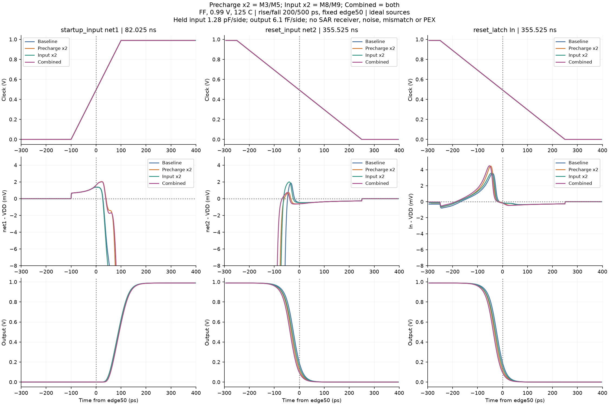
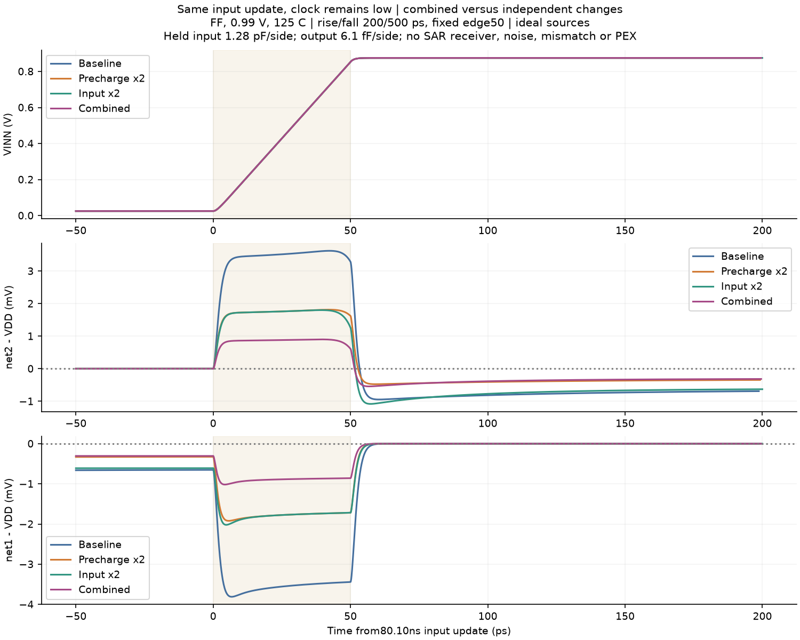

# M3/M5×2与M8/M9×2组合验证

组合实验完成。输入更新上冲由3.623 mV降到0.901 mV，约降低75%；net1/net2复位上冲也下降。**但启动上冲和LP/LN复位上冲仍比基线高，整段最大端差0.994494 V，未解决电气超限。**

固定FF、0.99 V、125°C、400 ns，上升200 ps/下降500 ps和全部50%时刻不变；M2/M4仍4倍，其余未列器件1倍，每份W100 nm/L30 nm/nf1。理想外部源，保持1.28 pF/侧，输出6.1 fF/侧，无真实SAR接收器、噪声、失配、PEX。本轮只新增组合run，其他三组只读复用。

## 四组结果

保持输入模式；上冲表示超出0.99 V，取各类事件的全程最大峰。

| 指标 | 基线：预充1/输入4 | 仅预充2 | 仅输入2 | 组合：预充2/输入2 |
|---|---:|---:|---:|---:|
| 输入更新net1/net2上冲，mV | 3.623 | 1.814 | 1.800 | **0.901** |
| 启动net1/net2上冲，mV | 1.389 | 2.034 | 1.361 | **2.024** |
| 启动LP/LN上冲，mV | 1.301 | 1.844 | 1.321 | 1.931 |
| 复位net1/net2上冲，mV | 1.865 | 0.742 | 2.000 | **0.731** |
| 复位LP/LN上冲，mV | 3.548 | 4.457 | 3.575 | **4.494** |
| 最慢判决，自上升50%起，ps | 147.99 | 152.52 | 156.94 | **161.23** |
| 最慢输出复位，自下降开始起，ps | 250.69 | 241.72 | 246.47 | 237.07 |
| 输入差模反冲，mV | 0.14281 | 0.14442 | 0.07186 | 0.07282 |
| 输入共模反冲，mV | 0.16839 | 0.16809 | 0.08335 | 0.08319 |
| 比较器平均供电功率，µW | 2.210 | 2.310 | 2.147 | 2.238 |
| 全程最大端差，V | 0.993623 | 0.994457 | 0.993575 | **0.994494** |

组合版主峰对应的连续越限时长：输入更新51.44 ps、启动net1/net2为138.95 ps、复位net1/net2为29.94 ps、LP/LN复位168.86 ps。仅削峰未令脉冲消失。最长独立尾波、其他器件端差和累计时间单独保存在JSON，不与主脉宽混用。

组合最坏发生在355.472714 ns，LN=0.9944943 V，相关端差为M14.GB/GS、M6.GB、M7.DB。相对基线全程最坏增大约0.872 mV；相对单独预充加倍也略大约0.0375 mV。

## 波形与判断

每列使用相同事件对齐，紫色Combined为组合版。左列启动、中列net2复位、右列LN复位。上表为全程极值，各组最大值可以在不同帧出现，不只来自图示事件。

输入更新时两项作用可以叠加：减少输入对的动态注入，同时增强预充回拉，net2上冲降至约原来的四分之一。这与上一轮电流归因一致，但本轮没有新增支路电流分解，不能把组合效果定量分摊给各电容项。

LP/LN复位的副作用没有抵消，启动也仍保留预充加倍带来的恶化。判决比基线慢约13.24 ps，当前单角确定性功能仍通过。组合版的低阻和保持输入各32次判决/输出复位全部正确，但全器件端压筛查失败，不能用功能正确认可可靠性。

本轮不采用组合为新基线、不扩展更多尺寸或PVT。若继续定位，重点仍是LP/LN复位耦合及电压余量，而不是继续追逐已降到0.9 mV的输入更新峰值。输入对减半后的噪声、失调/失配和SS速度还未验证。

## 证据

- 新run：`cmpdesign-edge-b2i2-ff-hot-v1`；对照身份见[独立尺寸报告](EDGE_SIZES.md)。所有四组对照原有数值逐字段一致，未覆盖旧图或旧汇总。
- [四组完整数值](results/edge_combo_comparison.json) · [独立核验](results/edge_combo_validation.json) · [组合原生结果](results/cmpdesign-edge-b2i2-ff-hot-v1/result.json)。
- test.scs/models.scs字节一致，仅DUT的M3/M5及M8/M9四条multi改变；组合相对任一独立候选仅另外两条multi不同。实际50%时刻、原生主峰/最长脉冲、全程最坏端差、稳定复位及64次功能核验通过，图像已检查。
- Spectre21.1 X CX，申请1线程，实际reltol1e-7/vabstol10 nV/iabstol10 fA/maxstep20 ps/gear2only；400 ns原生零错误，CMI-2752…2756/SFE-1131保留，无SPECTRE-16780。
- 仿真23.63 s、RSS288.61 MiB，分析RSS9.19 MiB、回收9.22 MB，符合managed预算。平均功耗只统计比较器供电，不含外部理想源，不是ADC总功耗。
- 无在途任务。未改OA、PDK、历史运行或其他任务，未commit/push。
