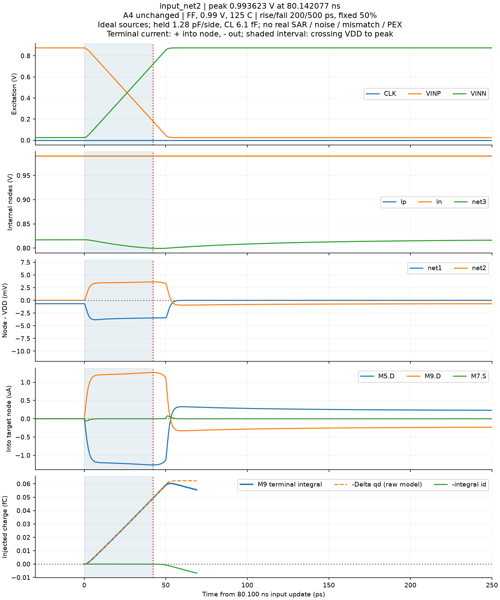
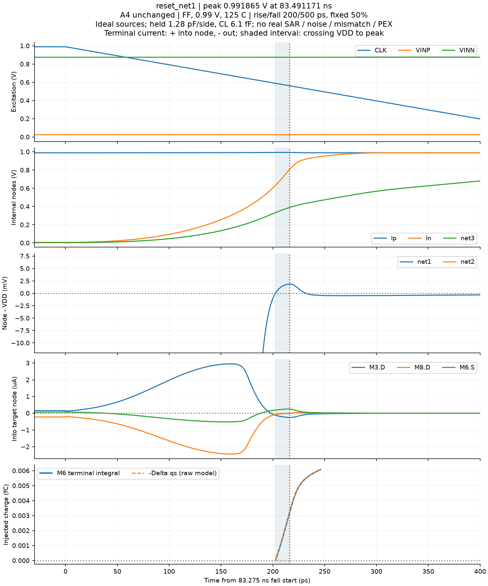

# 固定200/500 ps：输入更新与复位过冲的支路归因

两类过冲已分开复现。**输入更新由输入管M9漏端的动态电荷注入主导；复位新过冲由交叉耦合M6/M7的源端动态耦合主导。观察节点越过VDD后，预充M3/M5均在帮助回拉。** 继续放慢比较时钟不是当前主线：输入更新事件发生时CLK已经恒为0。

## 测试边界

固定A4：M8/M9、M2/M4各multi4；M3/M5及其他管multi1；单份W100 nm、L30 nm、nf1。FF、0.99 V、125°C，上升200 ps/下降500 ps，50%时刻不变。理想供电/输入/时钟，保持电容1.28 pF/侧、输出6.1 fF/侧，无真实SAR接收器、噪声、失配或PEX。

从原400 ns案例复制观测TB，保持0起的全部历史，85 ns结束，只增加保存项。15管全部D/G/S/B电流及id、端电荷等OP量齐备。此轮没有调尺寸、拓扑、时钟或输入边沿，也没有重新完成整套400 ns性能验收。

| 事件 | 超过0.99 V的区间，ns | 峰值时刻，ns | 上冲 | 连续越限 |
|---|---|---:|---:|---:|
| 输入更新，net2 | 80.100015–80.153330 | 80.142077 | 3.6225 mV | 53.32 ps |
| 复位，net2 | 79.477456–79.506985 | 79.491171 | 1.8650 mV | 29.53 ps |
| 对称复位，net1 | 83.477456–83.506985 | 83.491171 | 1.8650 mV | 29.53 ps |

## 输入更新：VINN通过M9的动态电荷耦合到net2

80.10–80.15 ns，VINN由0.025升至0.875 V，同时VINP反向变化；保持输入的跟踪开关已接通。CLK全程为0，M10尾管处于关断状态但并非零漏电，net3停在约0.8 V。net2只接M5.D、M7.S、M9.D，三个端口已经全部测量。

峰值时VINN≈0.71855 V、net3≈0.79965 V，M9的VGS≈−81 mV，尚无强沟道导通。此时不能把M9漏端约µA级电流解释成沟道充电。

从80.10 ns输入开始变化到峰值，正号表示流入net2：

| 端口 | 净流入电荷 | 作用 |
|---|---:|---|
| M9.D | +0.049185 fC | 主要注入，峰值注入约1.264 µA |
| M5.D | −0.048946 fC | 主要抽取，回拉到VDD |
| M7.S | −0.000240 fC | 较小抽取 |

M9的−ΔQd=+0.049232 fC，−∫id dt=−0.0000446 fC，两者之和与总漏端注入仅差约0.00000188 fC。说明注入主要为动态电荷而非导电电流。输入门极变化远大于漏/源电位变化，支持**以栅漏耦合为主的输入馈通**；尚未逐项提取模型内Cgd/Cdb等分量，不把这次积分当成独立Cgd测量。

M5已经导通并抽取注入电荷，但有限导通能力允许节点升高约3.62 mV。M5原生id+ΔQd在这个反向小VDS区间重建存在约0.00229 fC差异（约总量4.7%），因此对M5只采用直接测得的总端流判断抽取方向，不给其导电/位移的精确比例。

图的最后一行：M9总端流积分与−ΔQd在峰值前几乎重合；后续输入升高、M9逐渐有导电电流后，两条曲线分离。电荷和电流的极性定义一致。

## 复位：另一侧锁存节点回升，经M6/M7栅源耦合推高输入漏端

以83.491171 ns的net1峰值为例：M6的D接LP、G接LN、S接net1；M3.D和M8.D是net1的另外两条支路。

复位下降沿开始时，net1仅约0.075 V，M3先将它充回高电位。**正常充电阶段与已经越过VDD后的阶段必须分开。** 从net1首次到0.99 V到峰值的13.72 ps内，LN由0.632升至0.808 V，LP仅变化约19 µV。M6的栅源电压为负，漏极导电id积分约0.000000386 fC，不能解释源端注入。

| net1端口 | 越过VDD→峰值净流入电荷 | 作用 |
|---|---:|---|
| M6.S | +0.003204 fC | 唯一净注入支路 |
| M3.D | −0.002773 fC | 向VDD回拉 |
| M8.D | −0.000431 fC | 总端流抽取，主要是动态吸收 |

M6的−ΔQs=+0.003203 fC，与源端注入相差约0.000000571 fC（0.018%）。结合LN快速回升而LP近乎不动，支持**LN经M6栅源动态耦合推高net1**。低输入侧M8在峰值时VGS≈−0.365 V，无法提供强导电恢复。

79.491171 ns的net2事件为严格对称情形：LP回升，经M7.S注入net2，M5.D与M9.D抽取；峰值、电荷与脉宽一致。[net2复位电流图](figures/edge_current_reset_net2.png)。

下降沿500 ps改变了各支路恢复的相对进程：输入漏端已到轨时，另一侧LP/LN仍在快速回升。峰值处CLK≈0.562 V，尾管id仍约39.6 µA，高输入侧输入管约42.1 µA；预充与放电尚有重叠。这解释了为什么慢边沿不意味着所有内部变化都同比放慢。此轮确认了直接注入路径；没有额外单变量实验去量化尾管重叠对峰值的贡献。

## 尺寸方案：固定200/500 ps，不同时改变多组

不再将继续放缓时钟作为主要手段，但500 ps不是已证明的硬性上限。下面是待验证候选，本轮未执行：

| 顺序 | 唯一变化 | 目的 | 必须检查的代价 |
|---|---|---|---|
| A，优先测试 | M3/M5 multi1→2，W/L/nf不变 | 增强两节点超过VDD时的回拉，针对两类注入共同的恢复路径 | 自身时钟馈通增加，启动过冲可能反弹，输入/再生负载增加 |
| B，独立对照 | M8/M9 multi4→2；M3/M5回到1倍 | 直接减少输入更新的动态注入源及输入负载 | 判决速度、精度/失配裕量及SS建立可能变差；复位时的动态吸收也减少，不保证复位峰值改善 |
| C，仅在需要时 | M2/M4 multi4→2；其余回到基线 | 降低LP/LN复位斜率，减少M6/M7源端耦合的激励 | 已有历史表明可能恶化LP/LN自身上冲和复位时间，故不作为首选 |

M6/M7现为单份W100 nm、L30 nm的最小宽度配置，不建议未经PDK支持继续缩W，也不把增加L当成降低栅源耦合的可靠方法。M3/M5此前在50 ps边沿下加宽导致启动恶化，这个失败仍成立；A是检验**当前200/500 ps条件**下回拉与馈通的权衡，不预先声称变大就能解决。

每个候选先对比三类事件（启动、复位、下一输入更新），同时保留全管端压、峰值与持续时间、判决、复位、输入反冲和功耗；有效者再验SS及其他角。只在两个单变量结果均有益时才组合，不能只以net2一个峰值降低决定采用。

## 核验与原始证据

`cmpdesign-edge-current-a4-ff-hot-v1`已完成托管仿真、分析和回收。原生85 ns零错误；三个窗口618/253/618个点全部保留。与原400 ns运行相应峰值最大差约5.54 pV；节点总端流KCL最大残差1.12e−21 A。原生电荷重建使用实际multi对应数据，没有擅自除以并联数。

全部端口总电流包含位移电流；节点端流和接近零是KCL，不可再把它除以外加电容推算dv/dt。表内正负电荷是对端口总电流的积分，节点储能已包含在器件端电荷里。

原CMI-2752…2756、SFE-1131保留，无SPECTRE-16780；仍未电气合格。Spectre CX及容差继承原例，唯一网表差异为save与stop。仿真19.27 s、RSS约286.8 MiB，分析约9.13 MiB，回收3.44 MB。三图均已目视核对，脚本语法、冻结身份、连接表、峰值/脉宽/KCL独立核验完成。

[测量数值与OP诊断](results/edge_current_attribution.json) · [独立核验及运行状态](results/edge_current_validation.json) · [运行原始结果](results/cmpdesign-edge-current-a4-ff-hot-v1/result.json)

本轮没有改OA、PDK、历史运行或其他任务，没有采用候选、commit/push；无在途任务。
