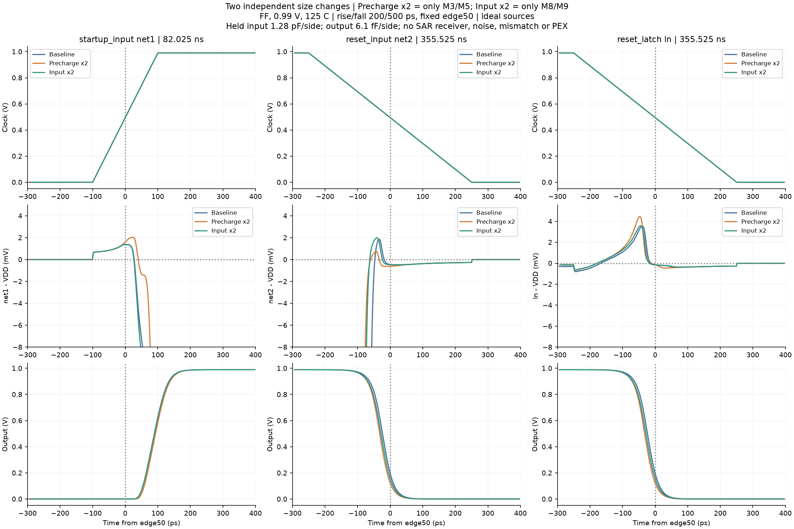
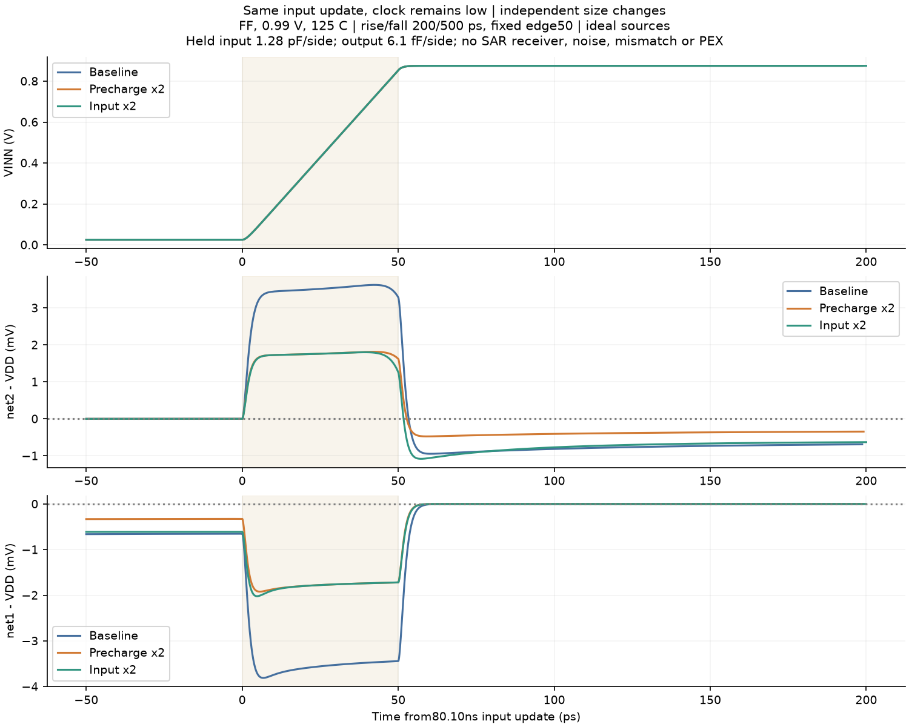

# 固定200/500 ps：预充加倍与输入对减半

两组独立对照均完成。**M3/M5加倍确实改善net1/net2回拉，但使启动和LP/LN复位上冲恶化；输入对减半降低输入更新过冲和输入反冲，却几乎没有改善全程最坏端压。两者均未消除超限。**

## 条件与尺寸

FF、0.99 V、125°C、400 ns。上升200 ps、下降500 ps，所有50%交叉时刻、外部输入及跟踪控制完全不变。低阻/保持输入各32次判决；保持电容1.28 pF/侧、输出等效负载6.1 fF/侧。供电、输入、时钟理想；无真实SAR接收器、瞬态噪声、失配或PEX。

| 组别 | M3/M5 | M8/M9 | M2/M4 | 其余 |
|---|---:|---:|---:|---:|
| 基线 | 1倍 | 4倍 | 4倍 | 1倍 |
| A：预充加倍 | **2倍** | 4倍 | 4倍 | 1倍 |
| B：输入对减半 | 1倍 | **2倍** | 4倍 | 1倍 |

每份W100 nm、L30 nm、nf1，其他几何参数保持。两实验分别相对基线改变一个对称组，没有将两项同时修改。为保持测量和源文件一致，内部实例名仍为A4，实际候选身份由run ID和冻结DUT确定。

## 全程测量

下表为保持输入模式。上冲为超出0.99 V的幅值；主脉宽为最大峰值所在单次连续越限区间。各项取全程最坏，可能来自不同事件；独立最长尾波另存JSON。

| 指标 | 基线 | A：M3/M5×2 | B：M8/M9×2 |
|---|---:|---:|---:|
| 输入更新net1/net2上冲，mV | 3.623 | **1.814** | **1.800** |
| 对应主脉宽，ps | 53.32 | 52.72 | 51.70 |
| 启动net1/net2上冲，mV | 1.389 | **2.034** | 1.361 |
| 对应主脉宽，ps | 127.57 | 139.91 | 126.73 |
| 启动LP/LN上冲，mV | 1.301 | 1.844 | 1.321 |
| 复位net1/net2上冲，mV | 1.865 | **0.742** | **2.000** |
| 对应主脉宽，ps | 29.53 | 26.20 | 38.82 |
| 复位LP/LN上冲，mV | 3.548 | **4.457** | 3.575 |
| 对应主脉宽，ps | 155.30 | 164.87 | 161.46 |
| 最慢判决，从上升50%起，ps | 147.99 | 152.52 | 156.94 |
| 最慢输出复位，从下降开始起，ps | 250.69 | 241.72 | 246.47 |
| 输入差模反冲，mV | 0.14281 | 0.14442 | **0.07186** |
| 输入共模反冲，mV | 0.16839 | 0.16809 | **0.08335** |
| 比较器平均供电功率，µW | 2.210 | 2.310 | 2.147 |
| 全程最大器件端差，V | 0.993623 | **0.994457** | **0.993575** |

每组64次判决与输出复位均通过，现有速度/残差/功耗诊断通过，端压筛查均失败。输入反冲是在输入断开、比较阶段测量；它与跟踪接通后下一输入更新造成的内部net1/net2上冲是不同指标。

输出复位相对下降50%的报告值为+0.69/−8.28/−3.53 ps；负值表示输出在50%之前已经复位，不能解释为负的物理复位时间，因此表中使用从边沿开始起算。平均功率仅比较器供电，不包含理想时钟/输入源的供能，不是ADC总功耗。

## 波形与结论

左列启动、中列net2复位、右列LN复位。每列三组使用相同事件和50%时刻对齐，图例Precharge x2=A、Input x2=B。全程最坏指标来自上表，不能把图示单个事件当成全部事件。

**A验证了回拉增强有效，也暴露了另一侧代价。** 输入更新上冲降低约50%，net1/net2复位上冲降低约60%；但启动输入漏端上冲增加约46%，LP/LN复位上冲增加约26%。全程最坏变为355.477889 ns的LN=0.9944568 V，涉及M14.GB/GS、M6.GB、M7.DB。它比原最大端差还高约0.834 mV，不能选为整体改进版。当前数据证明尺寸变化的因果效果，但本轮没有新增支路电流分解，不将LP/LN恶化进一步分配到未经测量的电容项。

**B有效削弱输入馈通，代价是略慢和复位峰值增加。** 输入更新上冲、差模/共模反冲约减半；最慢判决增加约8.95 ps。net1/net2复位上冲升至2.000 mV，主脉宽增加至38.82 ps；LP/LN复位基本不变。全程最坏为371.480192 ns的LN=0.9935745 V，涉及M14.GB/GS、M6.GB、M7.DB。与原全程最大仅改善约0.048 mV，主要是瓶颈从输入更新转到锁存节点复位。

80.10–80.15 ns输入更新时，CLK保持低。两种独立修改都将net2峰值从3.623 mV降到约1.8 mV，但宽度仍约52 ps，输入变化持续期间仍存在过冲。这与上轮确定的动态注入/有限回拉竞争一致。

本轮不组合两项、不采用新基线。A没有改善全程风险；B可作为较低输入反冲的候选保留，但必须进一步验证SS速度、噪声/失配精度，不能仅凭当前确定性64次判决正确认可输入对减半。后续若继续处理端压，应集中看LP/LN复位瓶颈，并结合节点到轨后缺少上冲余量这一结构性条件，不再以局部峰值下降代替整体改善。

## 运行与核验

- 基线只读复用：`cmpdesign-r200-f500-a4-ff-hot-v1`。
- A：`cmpdesign-edge-b2-ff-hot-v1`；B：`cmpdesign-edge-i2-ff-hot-v1`。两者均完成仿真、分析、回收，无在途任务。
- [全部数值](results/edge_sizes_comparison.json) · [独立核验](results/edge_sizes_validation.json)。各run目录保留原生日志及证据。
- 实际Spectre21.1 X CX，申请单线程；reltol1e-7、vabstol10 nV、iabstol10 fA、maxstep20 ps、gear2only，两组相同。400 ns原生零错误，CMI-2752…2756和SFE-1131保留，无SPECTRE-16780。
- DUT仅两条指定multi改变，test.scs/models.scs字节一致，事件定义一致；实际上下沿50%、主峰/最长脉冲、全程最大端差、稳定输出复位和64次功能检查通过。输入更新64个节点窗口均在原生不抽点导出区内，脉冲未截断。两图已目视核对。
- 新仿真24.24/24.79 s，RSS290.31/286.13 MiB，分析9.13/9.17 MiB，回收9.31/9.39 MB，符合双槽managed资源限制。原OA、PDK、旧实验及其他任务未改，没有commit/push。
