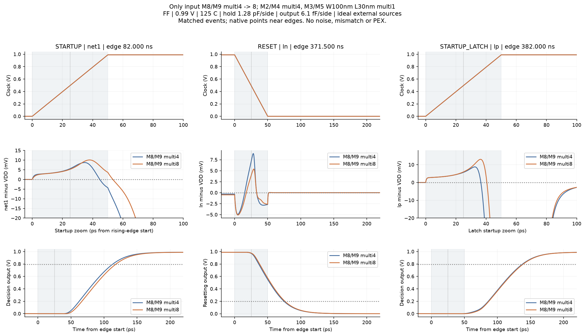
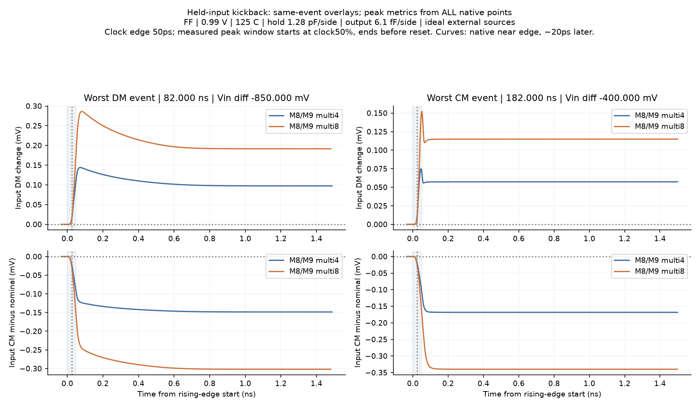

# 输入对4倍与8倍对比

**本轮不采用8倍输入对。** 它降低了LP/LN复位上冲，但启动过冲、输入反冲更大，判决没有加快。功能检查通过，端压筛查仍失败。

## 条件与唯一变量

FF、0.99V、125°C，400ns；理想外部电源、输入源和时钟。每100ns安排8次比较，时钟高1.5ns、正常低2.5ns、边沿50ps。输出等效负载6.1fF/侧。低阻驱动与断源保持两种输入模式各32次；保持电容1.28pF/侧。没有瞬态噪声、失配、PEX或真实SAR接收接口。

- A4：M8/M9并联4份；A4I8：并联8份。每份W=100nm、L=30nm、nf=1，等效并联宽度0.4→0.8µm。
- M2/M4固定4份，M3/M5固定W=100nm、L=30nm、1份，其余器件与激励不变。
- 新运行：`cmpdesign-input-a4i8-ff-hot-v1`。A4复用已完成的`cmpdesign-precharge-a4-ff-hot-v1`及其原生重分析，没有重跑基线。

## 实测结果

下表为保持输入模式；过冲以0.99V为基准，各项取整个32次比较中的最坏值。

| 指标 | 输入对4倍 | 输入对8倍 |
|---|---:|---:|
| net1/net2启动上冲 | 8.753mV | 10.095mV |
| LP/LN启动上冲 | 8.817mV | 13.021mV |
| LP/LN复位上冲 | 8.908mV | 5.615mV |
| 复位保持期间、下一输入更新引起的net1/net2上冲 | 3.623mV | 7.280mV |
| 全程最大器件端差 | 0.998908V | 1.003021V |
| 最慢稳定判决 | 112.98ps | 114.02ps |
| 最慢输出复位 | 50.87ps | 52.18ps |
| 输入差模反冲峰值 | 0.1440mV | 0.2861mV |
| 输入共模反冲峰值 | 0.1684mV | 0.3399mV |
| 比较结束、复位前输入差模残余扰动 | 0.0974mV | 0.1916mV |
| 复位沿后0.5ns内部节点最大残差 | 0.6426mV | 0.7104mV |
| 比较器供电平均功耗 | 1.503µW | 1.566µW |

判决/输出复位时间从对应时钟50%交点起算，采用原生样点的稳定通过上界；约1ps的判决差异不应解读为显著速度变化。内部固定时刻残差不是建立时间。功耗只计比较器供电，不含理想时钟/输入源或接收电路。

输入差模反冲以实际比较前差模为基准，共模反冲以名义共模为基准；峰值窗口为时钟上升50%至下降沿开始前。低阻输入被理想源钳住，不能用其近零电压扰动证明没有反冲。8倍的复位前差模残差约0.0273LSB，仍在本台0.1LSB暂定预算内；这不抵消端压失败。

## 过冲发生在哪里

1. **82ns启动、net1**：输入为VINP=0.025V、VINN=0.875V，net1对应低输入侧M8。4倍峰值在82.034693ns、8倍在82.037922ns，分别为0.998753V和1.000095V。加宽低输入侧管并未消除启动上冲，符合“缺少导通条件时不能靠加宽保证恢复电流”的判断。
2. **371.5ns复位、LN**：同一事件峰值由0.998908V降至0.995377V。8倍全程最坏复位点转至79.529022ns、0.995615V，所以表中采用这个更坏值。
3. **382ns启动、LP**：8倍的新全程最坏点在382.036312ns，达到1.003021V。对应M12的GS/GB、M6的DB和M7的GB等端差超限。问题不只留在net1/net2，也反映到再生节点LP。

下一输入更新引起的net2上冲位于约80.1–80.15ns，此时时钟已保持低电平，应与时钟边沿启动/复位事件分开描述。

差模与共模反冲均接近翻倍，表明扩大输入对确实增加了对保持输入的动态扰动。它同时改变内部电容及导电过程；本轮没有提取独立Cin/Cgd或分解纯沟道电流，因此不能据此声称某个寄生电容精确翻倍。当前证据支持保留4倍作下一轮对照，不支持采用8倍，也尚不能称4倍已经合格。

## 证据与限制

新仿真完成400ns、原生零错误；两种输入模式共64次判决和输出复位全部通过。原生CMI-2751至2756告警及SFE-1131保留。另有364.15ns、372.15ns输入更新处的SPECTRE-16780：为跨越IP信号不连续，局部LTE容差暂时放宽；未追加收敛资格验证，不能称全程无数值告警。

Spectre21.1.0.509、X CX，实际reltol=1e-7、vabstol=10nV、iabstol=10fA、maxstep=20ps、gear2only，与A4配置一致。新仿真耗时25.29s、RSS287.82MiB，分析RSS8.84MiB，流式回收9.58MiB。观察端口KCL残差约1.1e-16A。网表核对仅M8/M9的multi改变；未改OA、PDK、时序或基线，未commit/push。

- [完整比较数据](results/input_a4i8_comparison.json)
- [验证与原生告警记录](results/input_a4i8_validation.json)
- [新运行结果](results/cmpdesign-input-a4i8-ff-hot-v1/result.json)
- [原生日志](results/cmpdesign-input-a4i8-ff-hot-v1/spectre.out)
