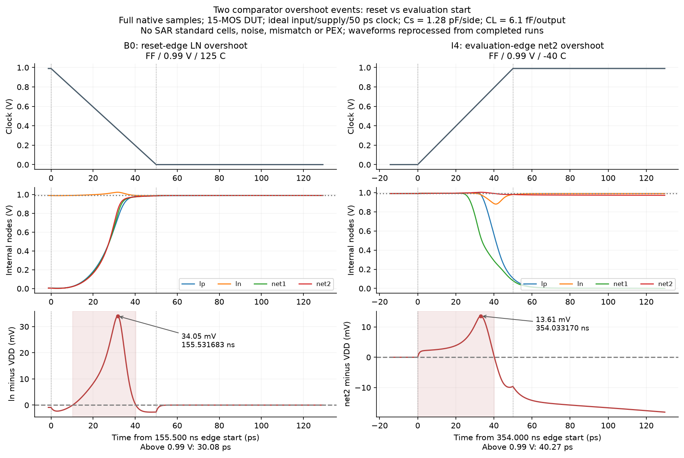

# 过冲节点与时间定位

过冲在Spectre原始瞬态波形中存在，不只是告警文字。此次复用已完成FF冷/热角波形，没有重跑仿真或修改电路。尖峰图保留窗口内全部原生点，并与原始全程扫描峰值一致。

## 两类事件

| 条件与尺寸 | 节点 | 峰值 | 峰值时刻 | 所在时序阶段 | 本次连续高于0.99V |
|---|---|---:|---:|---|---:|
| FF、0.99V、125°C，B0原尺寸 | XB0_held.LN | 1.024053V | 155.531683ns | 时钟下降，进入复位 | 约30.08ps |
| FF、0.99V、−40°C，I4输入对4倍 | XI4_held.net2 | 1.003607V | 354.033170ns | 时钟上升，启动比较 | 约40.27ps |

第一类最大；同一FF热角原尺寸的LP也在159.531679ns达到1.024053V，是相反输入极性下的对称事件。第二类net1也有对称现象，I4/FF冷角在378.033171ns达到1.003607V。

左图复位下降沿为155.500–155.550ns。LN在下降开始后31.683ps达到峰值，此时CLK约0.363V；连续越限区间为155.510259–155.540335ns。LP、net1、net2正从低电位向VDD预充。供电节点仍为理想0.99V。

右图比较启动上升沿为354.000–354.050ns。net2在上升开始后33.170ps达到峰值；越限区间为354.000000–354.040272ns。输入差分约+0.8V、共模0.45V，即VINP约0.85V、VINN约0.05V。

持续时间由包围0.99V交点的相邻原生点线性插值，仅统计包含该峰值的一次连续脉冲。原先result.json中time_above_s是整个400ns运行的累计越限时间，不能当成单次尖峰宽度。

## 原因的证据与边界

**复位事件：已确认内部节点预充上升与LN过冲同步。** 原本较高的LN经过M1、M7与正上升的LP/net2相连：M1是漏接LN、栅接LP的交叉耦合PMOS；M7是漏接LN、栅接LP、源接net2的再生NMOS。它们的寄生电容提供注入LN的路径。预充管M4虽将LN接向VDD，导通阻抗有限，不能把瞬时电荷变化完全钳住。这是与波形和拓扑一致的解释，尚未用支路电流分解证明各器件的贡献比例。不能把正向尖峰简单归因于下降的CLK直接正向馈通。

LN同时接输出NMOS M14的栅极、再生NMOS M6的栅极和M7的漏极。因此同一节点过冲会产生多只管、多种端压告警；它们不代表多次互相独立的故障。LP一侧对应M12及对称再生支路。

**启动事件：已确认net2随CLK上升先抬高，再回落。** 此时VINN约0.05V，M9输入支路不能像另一侧一样快速放电；M5预充PMOS正在关断，CLK通过其栅漏寄生耦合到net2是直接的候选路径。尾节点和再生节点同时运动，也会改变net2电荷，尚不能只凭电压波形排除这些贡献。

两类事件在没有SAR标准单元、没有Bootstrap/CDAC晶体管的独立比较器TB中存在；不能都归给SAR数字库。瞬态端压超限已确认，但未量化寿命损伤；判决正确与端压筛查通过是不同事项。

下一步可在相同外部激励下，补M1/M7/M4及M5/M9相关端电流，或做分开的预充强度/再生负载单变量实验，区分耦合注入和恢复能力。当前未改尺寸、时钟或拓扑。

## 数据入口

- [复位事件原生CSV](results/overshoot_location/reset_native.csv)：原生时间列time单位为秒，包含CLK及LP/LN/net1/net2/net3。
- [启动事件原生CSV](results/overshoot_location/start_native.csv)。
- [峰值、交点、事件宽度及全部节点表](results/overshoot_location/measurements.json)。
- 原生源：`cmpdesign-b0-i4-ff-hot-v1`、`cmpdesign-b0-i4-ff-cold-v1`。服务器完整波形位于`/server_local_ssd/chenzc_intern25/sar-adc-t28/runs/<run_id>/raw/`。
- 两个analysis-only窗口：`cmpdesign-worst-terminal-zoom-v1`和`cmpdesign-start-overshoot-zoom-v1`，各自results目录保存源身份、完整性核对和回收回执。
