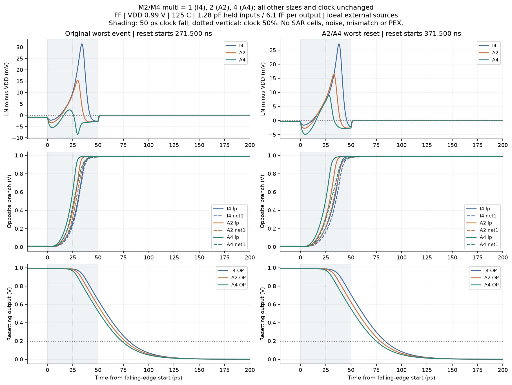

# M2/M4并联数1、2、4：FF热角对比

**4倍继续减小复位过冲、加快输出复位，但仍未通过端压筛查。** 全程最坏超限幅度相对1倍下降71.7%；启动net1/net2过冲略有增加，已成为接近复位事件的限制。当前不能宣布尺寸冻结或电气合格。

## 条件与变量

FF、VDD=0.99V、125°C，8次比较/100ns，共32次/400ns。外部输入、供电、时钟理想，时钟边沿50ps，高电平1.5ns。低阻驱动/1.28pF每侧保持输入两种模式，输出6.1fF每侧代理负载，无SAR接收单元、噪声、失配或PEX。

输入M8/M9保持multi=4，M2/M4分别multi=1、2、4，其余MOS均multi=1。每份W100nm、L30nm、nf1及原几何不变，M2/M4有效宽度依次0.1/0.2/0.4µm。A4与A2完整TB在仅替换候选名称后逐字一致，DUT只有M2/M4的multi=2→4不同；模型与求解设置相同。原1/2倍结果只读复用。

## 全程实测

下表为保持输入模式，端压最大值扫描全部15MOS六类端压和所有原生时刻；不是只挑某一次复位。

| 指标 | 1倍 I4 | 2倍 A2 | 4倍 A4 |
|---|---:|---:|---:|
| 最坏端压 | 1.021465V | 1.006436V | **0.998908V** |
| 超过0.99V的幅度 | 31.465mV | 16.436mV | **8.908mV** |
| 最坏判决时间 | 103.0ps | 106.7ps | **113.0ps** |
| 最坏输出复位时间 | 59.0ps | 54.6ps | **50.9ps** |
| 判决/输出复位 | 32/32、32/32 | 32/32、32/32 | 32/32、32/32 |
| 复位时钟50%后0.5ns内部最大残差 | 0.642668mV | 0.642632mV | 0.642615mV |
| 比较器供电平均功率 | 1.3913µW | 1.4296µW | 1.5034µW |

判决从上升时钟50%到正确输出80%/20%并保持；复位从下降时钟50%到两输出均低于20%并保持。使用原生点的保守时间上界，最坏点的跨越夹区宽度约0.71–1.00ps。均满足当前1ns判决/0.5ns输出复位筛查，但内部预充残差基本没变。功率只含比较器供电，不含理想时钟/输入源或接收电路。

低阻驱动模式也全部正确，4倍点最坏端压0.998907V，时序指标与保持模式相同。A4相对I4判决慢约10ps，供电功率增加约8.1%。

## 相同复位事件的波形

蓝/橙/绿分别为1/2/4倍。上排为LN相对供电的电压，中排为另一支路LP及net1回升，下排为输出复位。阴影表示时钟下降的50ps，竖虚线是时钟50%；各复位窗口保留全部原生点。

| 复位开始时间 | 1倍：峰值/越限宽度 | 2倍：峰值/越限宽度 | 4倍：峰值/越限宽度 |
|---|---|---|---|
| 271.500ns，原最坏事件之一 | 1.021465V / 29.87ps | 1.005322V / 22.22ps | **0.992315V / 9.53ps** |
| 371.500ns，2/4倍最坏事件之一 | 1.017238V / 34.18ps | 1.006436V / 26.50ps | **0.998908V / 18.07ps** |

A4的最坏峰值发生在371.528246ns的LN，379.528246ns的LP几乎对称。此处与2倍是同类复位事件，没有再次转成其他类型。单次宽度通过峰值所属连续越限段的阈值交点插值，未使用全程累计超限时间。

4倍曲线在上冲后还有更明显的短暂VDD下方回落，例如左图约低于VDD8mV；这是接近0.99V处的摆动，不是节点掉到地以下。M2/M4变大同时改变恢复导通能力与节点电荷，不能把过冲降低全部归结为单一Ron变化。

## 仍在增长的启动过冲

全原生点的M8/M9漏-体电压也显示net1/net2启动峰值变化：

| 并联数 | net1/net2最高电压 | 相对0.99V的上冲 |
|---|---:|---:|
| 1 | 0.997305V | 7.305mV |
| 2 | 0.997727V | 7.727mV |
| 4 | 0.998753V | 8.753mV |

A4的net2峰值在78.034693ns（78.000ns时钟上升开始后34.693ps），net1对称峰值在82.034693ns。这两项来自全程原生端压扫描，非稀疏绘图点估计。M3/M5虽未变，但锁存节点电容和动态轨迹改变会影响相连的net1/net2；当前数值证明了这一权衡，尚未重新完成A4启动电荷支路的精细分解。

因此继续单纯增加M2/M4可能受启动过冲限制。建议下一步保留4倍为复位方向候选，独立测试原定M3/M5分组；不能只用FF热角的结果选最终尺寸，尤其此前FF冷角启动更严重。其他角与组合方案另跑，不将不同改动混为单变量结论。

## 证据

- 新运行：`cmpdesign-precharge-a4-ff-hot-v1`；原生成功、完整400ns、两输入模式共64次判决/复位通过。仿真约23.54秒，峰值RSS约294.1MiB；分析峰值约8.8MiB。
- Spectre 21.1.0.509，CX、申请1线程；电路规模小，原生日志显示关闭多线程。实际reltol1e−7、vabstol10nV、iabstol10fA、maxstep20ps、gear2only，和原1/2倍相同。
- 原生CMI-2751…2756及SFE-1131保留，端压筛查仍失败，不因功能正确判为合格。
- [三点数值](results/precharge_a124_comparison.json)、[检查回执](results/precharge_a124_validation.json)、[新点输入核对](testbenches/cmpdesign-precharge-a4-ff-hot-v1/validation.json)。原始波形与运行身份由results内各run的evidence/state文件定位。
- 图像已审阅；旧A2报告与图未替换。无OA改动、新基线采用、commit或push。
