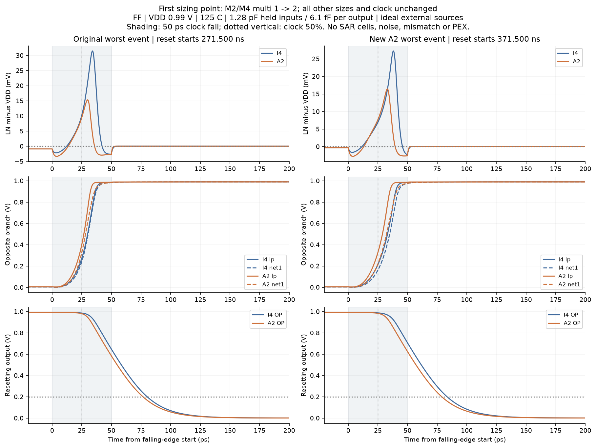

# 预充扫描第一点：M2/M4改为2倍

**方向有效，但过冲未消除。** FF热角全程最坏端压由1.021465V降至1.006436V，超过0.99V的幅度降低约47.8%；判决略慢、输出复位略快，所测极性与复位均正确。

本轮按“先跑一个点、先观察复位”的要求，只新增A2。I4对照来自已经完成的原生波形，没有重复仿真。M2/M4=4倍及M3/M5=2/4倍尚未提交，后续可按两组并行继续。

## 测试与唯一变量

- FF、VDD=0.99V、125°C；32次比较/400ns，8次/100ns，50ps时钟边沿，高电平1.5ns。外部供电、输入与时钟理想。
- 原I4：M8/M9 multi=4，其他MOS multi=1。A2仅M2/M4 multi=2，保持W=100nm、L=30nm、nf=1及原生几何；这两只的有效并联宽度为0.2µm。
- 两种独立输入条件：理想低阻驱动、预充后断源的1.28pF/侧保持输入。每侧输出负载6.1fF，无SAR数字接收电路。
- 网表逐行验证仅指定multi改变；模型、源、时钟、瞬态分析和求解配置相同。Spectre X CX原生完成；实际reltol=1e−7、vabstol=10nV、iabstol=10fA、maxstep=20ps、gear2only，电路较小自动关闭多线程。

## 实测对比

下表为保持输入模式。低阻驱动模式结论相同，其最坏端压分别1.021466V、1.006435V。

| 指标 | I4对照 | A2：M2/M4=2 |
|---|---:|---:|
| 400ns全部15MOS六类端压最大值 | 1.021465V | 1.006436V |
| 超过0.99V的最大幅度 | 31.465mV | 16.436mV |
| 最坏判决时间 | 103.0ps | 106.7ps |
| 最坏输出复位时间 | 59.0ps | 54.6ps |
| 正确判决/输出复位 | 32/32、32/32 | 32/32、32/32 |
| 复位时钟50%后0.5ns的最大内部预充残差 | 0.642668mV | 0.642632mV |
| 比较器供电平均功率 | 1.3913µW | 1.4296µW |

判决时间从时钟上升50%到输出达到正确80%/20%并维持；输出复位从时钟下降50%到两输出均低于20%并维持。采用原生点的保守离散上界；上述最坏点的采样夹区宽约0.71–1.00ps。当前都满足1ns判决、0.5ns输出复位筛查，但不是最短复位窗口或历史误差的完整验收。功率不含理想时钟、输入源和后级。

## 原最坏事件与新最坏事件

蓝色I4，橙色A2。阴影是50ps时钟下降段，竖虚线为时钟50%。上排看LN过冲，中排看相邻LP/net1回升，下排看输出归零。复位窗口内保留全部原生点。

| 相同复位事件 | I4峰值/该次越限宽度 | A2峰值/该次越限宽度 |
|---|---|---|
| 271.500ns开始；原最坏事件之一 | 1.021465V / 29.87ps | 1.005322V / 22.22ps |
| 371.500ns开始；A2的新最坏事件 | 1.017238V / 34.18ps | 1.006436V / 26.50ps |

第一事件是小差分+1LSB比较后的复位，第二事件是+0.8V大差分比较后的复位。A2新最坏峰值在371.532989ns的LN；379.532989ns的对称LP事件几乎相同。不能只报告原最坏事件改善约51.3%，忽略最坏点已转移。表中宽度是围绕该峰值的单次连续越限，未用全程累计越限时间代替。

从图上可见，A2的相邻低电位支路回升反而更快，LN上冲却更小、恢复更早。这支持“改善回拉及节点动态阻抗可以压低过冲”，而不支持简单地认为低电位支路复位越慢才越安全。改变M2/M4同时改变导电恢复和电容，单点实验尚不能把改善全部归给Ron；之前支路电流已确认M4在这段过程总体抽取电荷。

内部预充残差几乎不变，说明输出复位更快不等于全部内部节点的建立裕量同步改善。下一点优先M2/M4=4；另一组M3/M5的扫描仍需独立观察，不能与本组同时改来混淆归因。

## 运行证据与尚未完成项

- 新仿真：`cmpdesign-precharge-a2-ff-hot-v1`。原生成功，RSS峰值约286.6MiB，仿真约23.5秒；完整400ns，32次×两种输入模式共64次判决/复位。
- 原基线：`cmpdesign-b0-i4-ff-hot-v1`；窗口重分析：`cmpdesign-i4-ffhot-reset-review-v1`，只读绑定完成源。与新仿真使用两个managed槽并行。
- [数值汇总](results/precharge_a2_comparison.json)，[单变量核对](testbenches/cmpdesign-precharge-a2-ff-hot-v1/validation.json)；精确运行身份、资源、回收路径见两个results子目录的state/evidence文件。
- CMI-2751…2756和SFE-1131保留，端压筛查仍失败；没有宣布过冲已修好。A2的FF冷、SS、TT、噪声、失配、真实接口和PEX均未在本轮验证。
- 无OA修改，无新基线采用，无commit/push。
