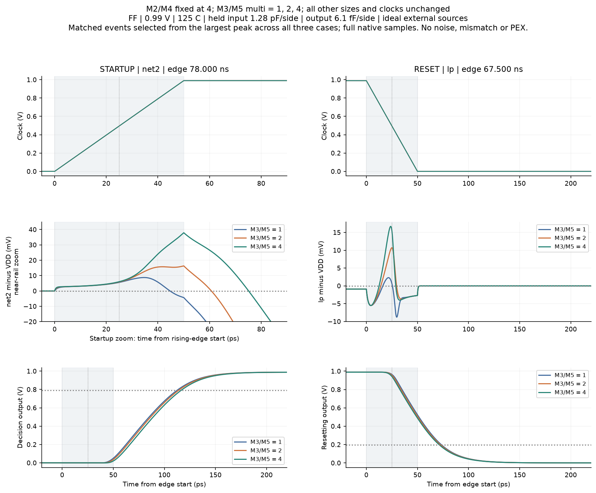

# 固定M2/M4四倍，扫描M3/M5一、二、四倍

**本次FF热角结果不支持放大M3/M5：启动与复位过冲均恶化，判决略慢。** 输出复位略快、固定时刻内部电压更接近VDD，但不足以抵消过冲代价。三组中保留M3/M5=1倍更合适；这一组自身仍越限，尚未合格或冻结。

## 唯一变量与测试条件

FF、0.99V、125°C；M2/M4固定multi=4，M8/M9输入管固定multi=4，其余MOS multi=1。M3/M5分别multi=1、2、4，单份W=100nm、L=30nm、nf=1和原几何不变，有效并联宽度为0.1/0.2/0.4µm。两候选相对A4仅这两只管的multi不同。

完整TB除候选名与新增电流保存外，与A4一致：理想外部电源/输入/时钟，50ps边沿、高1.5ns，8次比较/100ns，共32次/400ns。每侧6.1fF输出代理负载；低阻输入与断源后1.28pF/侧保持输入独立测试。无SAR接收单元、噪声、失配、PEX；模型、求解容差、时序不变。

## 结果

以下为保持输入模式，阶段峰值统计覆盖全部32次比较的所有原生点。启动项明确指net1/net2；复位项指LP/LN。另行扫描全部15MOS六类端压，避免遗漏其他事件。

| 指标 | M3/M5=1（A4） | =2（A4B2） | =4（A4B4） |
|---|---:|---:|---:|
| 启动net1/net2最高电压 | 0.998753V | 1.006351V | **1.027941V** |
| 启动net1/net2超出0.99V | 8.753mV | 16.351mV | **37.941mV** |
| 复位LP/LN最高电压 | 0.998908V | 1.000852V | **1.006696V** |
| 复位LP/LN超出0.99V | 8.908mV | 10.852mV | **16.696mV** |
| 全程全部端压最大值 | 0.998908V | 1.006351V | 1.027941V |
| 最坏判决时间 | 113.0ps | 115.5ps | 120.2ps |
| 最坏输出复位时间 | 50.9ps | 49.5ps | 48.6ps |
| 判决/输出复位正确 | 32/32、32/32 | 32/32、32/32 | 32/32、32/32 |
| 复位时钟50%后0.5ns内部最大残差 | 0.642615mV | 0.321339mV | 0.160681mV |
| 比较器供电平均功率 | 1.5034µW | 1.5626µW | 1.6714µW |

启动时LP/LN自身也有上冲，最高电压依次0.998817/1.002571/1.009059V，不应把启动超限仅限于net1/net2。低阻驱动模式结论相同：全程最大端压0.998907/1.006354/1.027943V，功能和复位均正确。

判决从时钟上升50%到正确80%/20%输出并维持；复位从下降50%到两输出都低于20%并维持。原生点时间夹区约0.88–0.92ps，报告保守上界。所测时间均在1ns/0.5ns筛查内，但端压三组均失败。内部残差是规定时刻相对VDD的误差，尚未区分稳态压降和动态未建立；不能把残差减半直接等同为建立时间减半。功率不包含理想输入/时钟源和后级。

## 波形与时机

蓝/橙/绿代表M3/M5=1/2/4，M2/M4均为4。左侧是78.000ns开始的比较启动，右侧是67.500ns开始的复位；每列对比同一次事件。阴影为50ps时钟边沿，竖虚线为时钟50%。启动中间面板放大近VDD区域，横轴范围与底部判决面板不同。

启动net2同一事件的峰值依次0.998753/1.006351/1.027941V；单次连续越限宽度44.70/60.72/75.13ps。1倍峰值在78.034693ns，2/4倍接近78.050ns，即时钟上升沿结束处。net1在82ns附近为对称事件。B2净全局最大值出现在net1，B4出现在net2，差异很小，均属同类启动过冲。

复位图显示的是三组中最高的A4B4复位事件：67.523802ns，LP=1.006696V。A4和A4B2各自的最坏复位分别在371.528246ns的LN、71.525041ns的LN，所以表格统计全程最坏值，而不把右图这个匹配事件当作每组的最坏事件。两种统计用途不同。

## 解释与选择

增大M3/M5确实改善了固定时刻的内部预充残差，并稍微加快输出复位，但启动上冲幅度和持续时间明显增加，判决也变慢。与此前M5动态电荷注入的证据一致，这次结果提示更大的预充器件带来的动态负担超过了恢复收益；当前尚未把电容馈通、沟道电荷变化和导电恢复分别做定量分解，不宣称只由一个寄生电容决定。

结论限于同一FF热角条件：不采用M3/M5=2或4作为过冲修复方案，保留A4（M2/M4=4、M3/M5=1）作为继续定位的对照。下一步应针对剩余启动/复位耦合选择手段，避免继续全组放大；FF冷角和其他PVT仍需后续验证。本轮没有改时序、添加器件或采用新基线。

## 证据与资源

- 新仿真`cmpdesign-precharge-a4b2-ff-hot-v1`、`cmpdesign-precharge-a4b4-ff-hot-v1`实际双槽并行重叠23.66秒；均原生完成400ns并回收。仿真各约24秒，峰值RSS约284.1/285.7MiB。
- 基线通过`cmpdesign-a4-start-reset-review-v1`只读分析原A4完成源，补所有启动/复位原生窗口；旧的功能、端压、功耗等全部指标逐字段一致，没有重跑基线。
- 原生Spectre21.1.0.509 CX，实际reltol1e−7、vabstol10nV、iabstol10fA、maxstep20ps、gear2only；申请1线程，原生日志显示小电路关闭多线程。CMI-2751…2756与SFE-1131完整保留。
- 两候选LN/net2完整相连端流KCL检查通过。图已调整纵轴放大启动过冲并目视审核。
- [三点数值](results/precharge_a4b124_comparison.json)、[验证回执](results/precharge_a4b124_validation.json)。原始波形/运行身份由各results/run目录evidence/state定位。无OA改动、commit或push。
