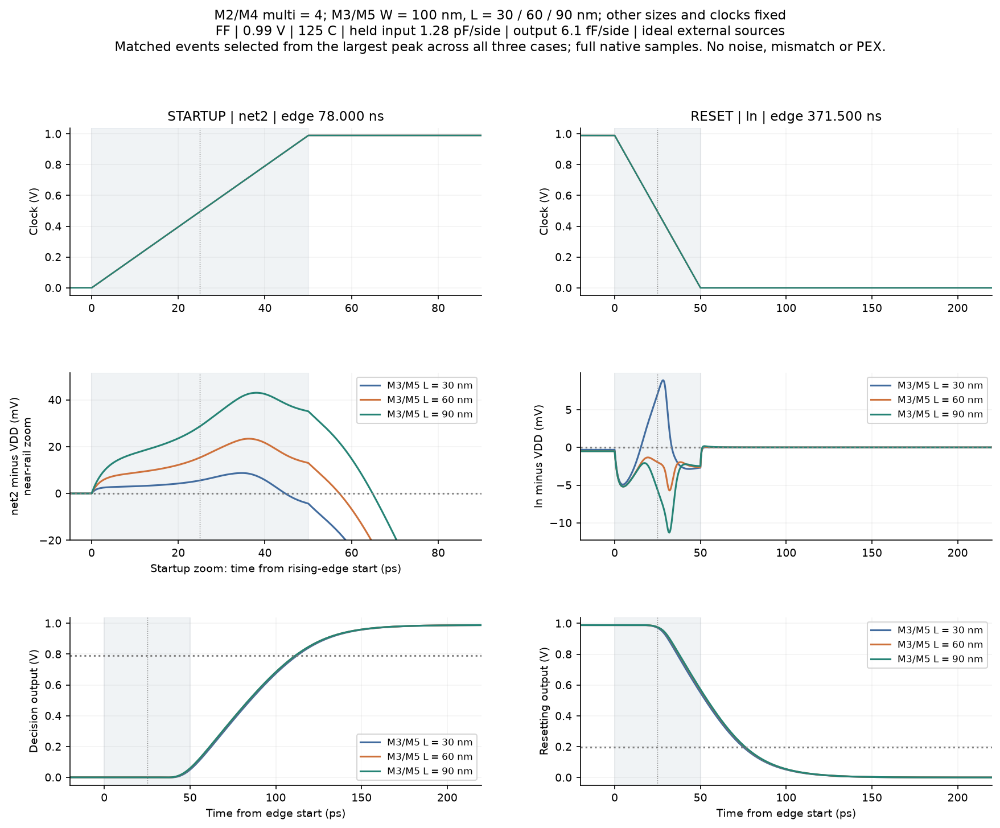
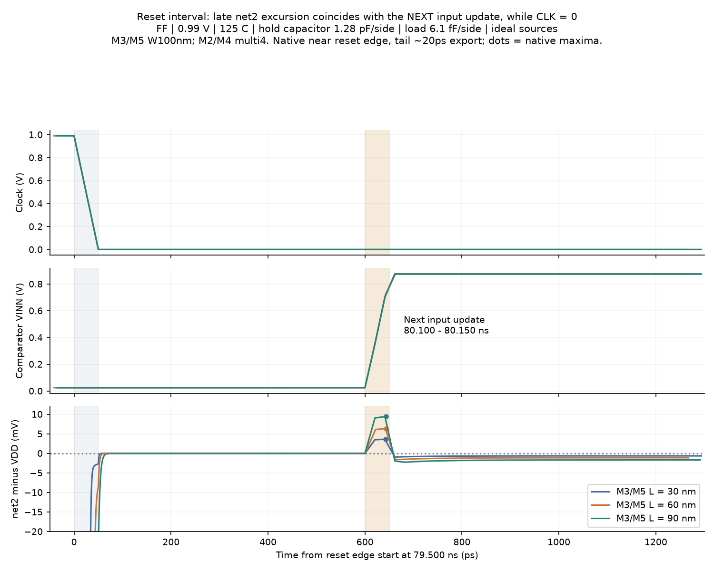

# M3/M5固定W100nm，L30/60/90nm对比

**加长L明显压低LP/LN复位上冲，但使net1/net2启动上冲更大，也降低了对复位期间下一输入更新的抑制能力。本轮不采用60/90nm作为修复方案。** 判决与输出复位功能保持正确，端压三组仍失败。

## 条件与唯一变量

FF、VDD0.99V、125°C；M2/M4 multi4、M8/M9 multi4，其他原尺寸。M3/M5 W100nm、nf1、multi1，只有L取30/60/90nm。理想外部电源/输入/时钟，50ps边沿、高1.5ns、每100ns八次比较；完整400ns。输出负载6.1fF/侧；独立低阻驱动与1.28pF/侧采样保持两种输入模式。无SAR接收管级负载、噪声、失配或PEX。

PDK短沟道长度表包含30/60/90nm，实际scale0.9后W90nm、L27/54/81nm均匹配pch模型bin。仅验证模型域，未执行PCell或DRC。原导出扩散/LDE参数全部冻结，隔离电气L变量；不是重新生成版图后的寄生比较。

30nm直接复用`cmpdesign-a4-start-reset-review-v1`绑定的A4既有数据，没有重跑。新运行：`cmpdesign-precharge-a4l60-ff-hot-v1`、`cmpdesign-precharge-a4l90-ff-hot-v1`。

## 结果

以下为保持输入模式，各阶段峰值覆盖32次比较的全原生点；“上冲”指节点超过0.99V的幅度。

| 指标 | L30nm | L60nm | L90nm |
|---|---:|---:|---:|
| 启动net1/net2上冲 | 8.753mV | 23.418mV | 43.062mV |
| 复位区间LP/LN最大上冲 | 8.908mV | 0.068mV | 0.180mV |
| 复位区间net1/net2最大上冲，发生于下一输入更新 | 3.623mV | 6.329mV | 9.421mV |
| 全程全部端压最大值 | 0.998908V | 1.013418V | 1.033062V |
| 最坏判决时间 | 113.0ps | 111.6ps | 111.4ps |
| 最坏输出复位时间 | 50.9ps | 51.8ps | 51.9ps |
| 下降沿50%后0.5ns内部最大残差 | 0.643mV | 1.127mV | 1.684mV |
| 比较器平均供电功率 | 1.503µW | 1.451µW | 1.449µW |
| 判决/输出复位 | 32/32、32/32 | 32/32、32/32 | 32/32、32/32 |
| 端压筛查 | 失败 | 失败 | 失败 |

低阻驱动模式结论相同：60/90nm全部端压最大值分别1.013420/1.033065V，32次判决和输出复位均正确。两新候选总计128次比较，各次判决和输出复位检查通过。

判决仍按上升沿50%至正确80%/20%输出并保持计算；输出复位按下降沿50%至两输出低于20%并保持计算。最坏时间的原生采样夹区约0.84–0.92ps，所以1–2ps差别不应解读为显著速度收益。内部残差可能含稳态压降与动态未建立，不能直接换算为复位建立时间。比较器供电功率不包含理想时钟/输入源和接收器供能。

## 同事件波形

左侧固定78.000ns启动事件，net2峰值为0.998753/1.013418/1.033062V，分别在78.034693/78.036272/78.038016ns；对应连续越限脉冲44.70/57.20/64.85ps。该事件输入VINP=0.875V、VINN=0.025V，峰值均位于时钟上升沿内。net1在82ns具有对称事件。

右侧固定原30nm最坏的371.500ns复位事件，显示LP/LN复位上冲已被抑制；60/90nm各自全程最大LP/LN复位峰值转至183.552602ns的LP、179.552279ns的LN，幅度仍仅约0.068/0.180mV。表格给全程最大值，不能把右图一个事件代替全部事件。

这里79.500ns开始复位；80.100–80.150ns测试台准备下一次输入，VINN由0.025V升至0.875V，VINP反向。net2上冲在80.142185/80.143168/80.143255ns，与输入更新重合，此时CLK=0。**它属于复位低电平区间里的输入扰动，不能称为时钟下降沿残留振铃。** 复位统计窗口包含这段，因此单列，避免只观察LP/LN后误判内部节点全部正常。此图复位沿附近为原生点，后段曲线约20ps抽点；圆点峰值来自全原生统计，不由抽点图估算。

## 判断

延长M3/M5会改变导通恢复能力及关断电荷过程。实测说明它改善了锁存节点复位扰动，却恶化了启动和输入更新时net1/net2的电压约束；“加长L即可减小GD馈通”不成立。本轮没有单独提取Cgd，也没有对三长度做完整id/qd分解，不能仅凭电压曲线断言是哪一项寄生增加。

继续保留30nm A4作为比较基准，尚未修复或冻结。结论限于上述FF热角；没有扩展PVT或改时钟、输入范围、拓扑、OA。

## 验证与证据

- 两新仿真实际并行24.385秒，原生完整400ns、零错误结束；RSS约287.9/294.7MiB，分析约8.8MiB，回收各约9MiB。没有在途比较器任务。
- 原生Spectre21.1.0.509 CX，申请1线程，日志显示小电路禁用多线程；实际reltol1e-7、vabstol10nV、iabstol10fA、maxstep20ps、gear2only，与30nm一致。CMI-2751…2756与SFE-1131原文保留。
- DUT逐行检查仅M3/M5的L改变；其余几何、模型、刺激和求解设置一致。两候选LN/net2相连端口KCL最大误差约1.1e-16A（导出精度范围）。两图已目视检查。
- 冻结measure.json中的未参与计算的`candidates.precharge`标签误继承为2；实际DUT、single_variable元数据均为multi1，分析器不读取此标签。保留冻结文件，另附勘误与网表核对，不为标签重跑或覆盖证据；生成脚本已纠正。
- [模型域核对](results/precharge_length_legality.json)、[数值](results/precharge_a4_l306090_comparison.json)、[验证](results/precharge_length_validation.json)、[标签勘误](results/precharge_length_metadata_note.json)。无commit/push、OA或基线变更。
