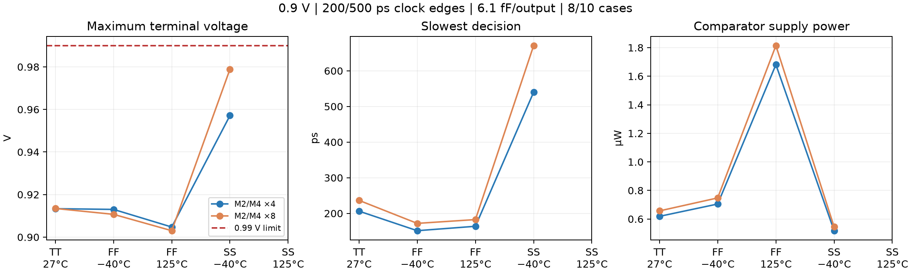

# 比较器：0.9 V 下的 PT 验证

已回收 **8/10** 个案例。其余为SS/125°C两组：4倍已入队、8倍待其结束。七槽位已生效，但账号内存准入要求暂未满足；以下仅列已完成证据。

两版 M2/M4 分别为4/8份，M3/M5、M8/M9均为2份，其余1份；每份W100nm、L30nm、nf1。
输入历史、输出6.1fF/侧、保持电容1.28pF/侧、时钟上升200ps/下降500ps不变。每点400ns，直接驱动/保持输入各32次判决。外部源理想。

| PT | 倍数 | 最坏端差 V | 正确判决/复位 | 最慢判决 ps | 输出复位 ps | 功率 µW | 筛查 |
|---|---:|---:|---|---:|---:|---:|---|
|TT / 27°C|4|0.913357|64/64；64/64|206.27|319.10|0.619|通过|
|TT / 27°C|8|0.913458|64/64；64/64|236.50|306.76|0.657|通过|
|FF / -40°C|4|0.913018|64/64；64/64|151.40|283.98|0.705|通过|
|FF / -40°C|8|0.910699|64/64；64/64|171.93|272.31|0.748|通过|
|FF / 125°C|4|0.904734|64/64；64/64|163.77|250.98|1.681|通过|
|FF / 125°C|8|0.903016|64/64；64/64|182.58|229.03|1.814|通过|
|SS / -40°C|4|0.957118|64/64；64/64|540.12|398.54|0.518|通过|
|SS / -40°C|8|0.978891|64/64；64/64|670.80|389.46|0.545|通过|

端压上限仍为0.99V；判决≤1ns，输出复位按50%下降沿后0.5ns、保持差模残差≤0.703125mV、供电功率≤100µW。表中判决相对上升50%，复位相对实际下降开始。功率仅保持输入比较器的供电积分平均，不含理想输入/时钟或ADC其他模块。

| PT | 倍数 | 内部上冲 mV（相对0.9V） | 差模反冲 mV | 共模反冲 mV | 内部复位残差 mV | 超限端对数 |
|---|---:|---:|---:|---:|---:|---:|
|TT / 27°C|4|13.357|0.0646|0.0715|0.0479|0|
|TT / 27°C|8|13.458|0.0646|0.0715|0.0479|0|
|FF / -40°C|4|13.017|0.0658|0.0750|0.0265|0|
|FF / -40°C|8|10.698|0.0657|0.0750|0.0265|0|
|FF / 125°C|4|4.734|0.0702|0.0803|0.3211|0|
|FF / 125°C|8|3.016|0.0699|0.0801|0.3210|0|
|SS / -40°C|4|57.118|0.0565|0.0587|0.0422|0|
|SS / -40°C|8|78.891|0.0565|0.0587|0.0420|0|

内部上冲取既有评估/复位事件窗口；所有MOS六种端差的电气筛查覆盖全程原生采样。反冲覆盖整个时钟上升至复位开始；内部复位残差测于下降50%后0.5ns。

## 核验与范围

每项均检查原生零错误退出、400ns终点、180个端对（15管×6端对×2输入模式）。CMI/SFE日志仍保留，原生日志通过不等于电气合格。
Spectre 21.1 X CX；实际单线程、reltol=1e−7、vabstol=10nV、iabstol=10fA、maxstep=20ps、gear2only。各运行精确设置保存在结构化汇总。
候选不是整机/OA基线；原0.81–0.99V供电要求不变。未包含噪声、失配、PEX，也未接真实SAR接收器。本批通过不能覆盖全部输入共模、最短复位历史或整机PVT。

首个4倍TT的冻结measure.json保留了旧candidates描述字段；实际DUT与来源字节一致，pt09_provenance及recipe准确标识本次组合尺寸，分析器不读取该旧字段。其余案例注册前已纠正该描述。

[结构化指标及原生设置](results/cmpdesign-pt09-summary/summary.json) · [原4倍FF/0.99V](EDGE_COMBO.md) · [原8倍FF/0.99V](COMBO_A8.md)

- `cmpdesign-pt09-a4-tt-v1`：[原生结果](results/cmpdesign-pt09-a4-tt-v1/result.json)，告警 SFE-1131。
- `cmpdesign-pt09-a8-tt-v1`：[原生结果](results/cmpdesign-pt09-a8-tt-v1/result.json)，告警 SFE-1131。
- `cmpdesign-pt09-a4-ff-cold-v1`：[原生结果](results/cmpdesign-pt09-a4-ff-cold-v1/result.json)，告警 SFE-1131。
- `cmpdesign-pt09-a8-ff-cold-v1`：[原生结果](results/cmpdesign-pt09-a8-ff-cold-v1/result.json)，告警 SFE-1131。
- `cmpdesign-pt09-a4-ff-hot-v1`：[原生结果](results/cmpdesign-pt09-a4-ff-hot-v1/result.json)，告警 SFE-1131。
- `cmpdesign-pt09-a8-ff-hot-v1`：[原生结果](results/cmpdesign-pt09-a8-ff-hot-v1/result.json)，告警 SFE-1131。
- `cmpdesign-pt09-a4-ss-cold-v1`：[原生结果](results/cmpdesign-pt09-a4-ss-cold-v1/result.json)，告警 SFE-1131。
- `cmpdesign-pt09-a8-ss-cold-v1`：[原生结果](results/cmpdesign-pt09-a8-ss-cold-v1/result.json)，告警 SFE-1131。
