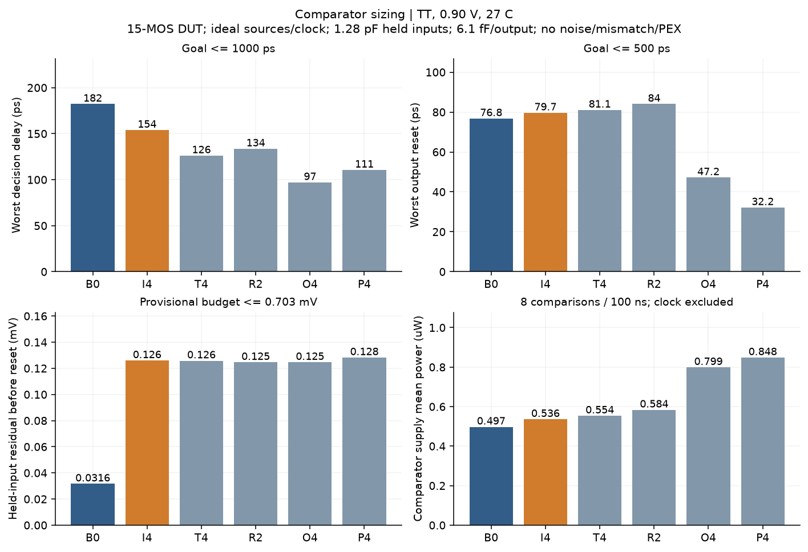
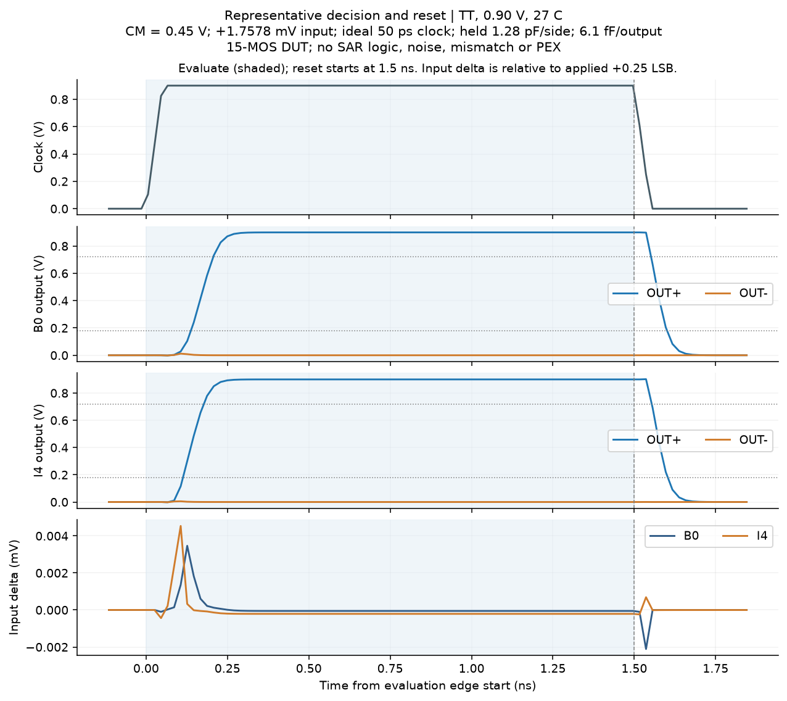
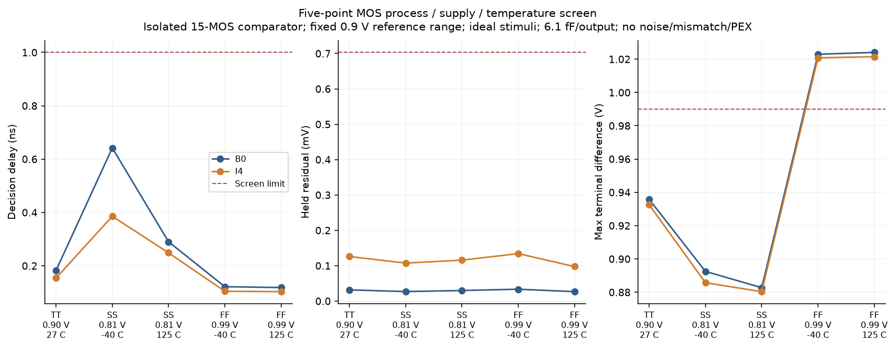
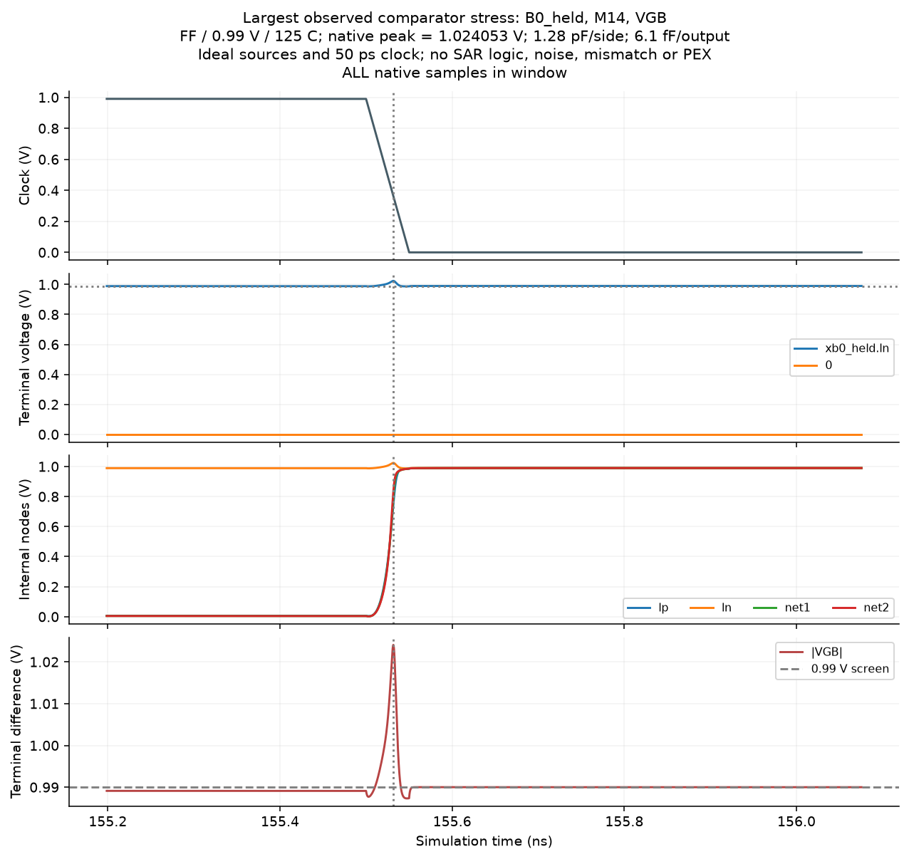

# 比较器首轮尺寸与风险点测试

工作目录：`comparator_design/`。拓扑沿用用户手搭15MOS比较器，OA未改。当前结果只属于独立比较器；尚未选定最终尺寸。

## 测试条件

- 比较器晶体管级；外部电源、输入、时钟均理想；SAR、Bootstrap和真实CDAC未实例化。
- 输出每侧6.1fF，来自TT下8个DFQD1 D端加OR2D4输入的动态Q/ΔV测量（6.012–6.049fF）；这是负载代理，不是全PVT上界。
- 输入分低阻直接驱动和1.28pF/侧预充后断源两类。每类32次比较，CM=0.45/0.675/0.453516V；差分含±0.25/0.5/1LSB和大信号历史，LSB=7.03125mV。
- 每100ns安排8次比较；高电平1.5ns，组内低电平约2.5ns，时钟边沿50ps。输出正确80%/20%的时限1ns，输出复位低于20%的时限0.5ns。
- 下面表格为保持输入结果；直接驱动结果另存各run的result.json。残余扰动在下降沿开始前测量，峰值在评价阶段计算；复位反冲另见波形，未混入残余预算。
- 模型、网表、激励、候选尺寸、保存节点和运行身份均在testbenches/、recipes/与results/。Spectre 21.1.0.509，CX、gear2only，实际reltol=1e-7、vabstol=10nV、iabstol=10fA、maxstep=20ps；小电路原生禁用多线程。

## TT尺寸对比

W/L参数保留100nm/30nm、nf=1，通过multi并联调宽；输入对4倍即等效总W=0.4µm。完整分组表见README.md。

| 候选 | 最慢判决 / ps | 最慢输出复位 / ps | 最大残余差模 / mV | 最大端压差 / V | 比较器供电均值 / µW |
|---|---:|---:|---:|---:|---:|
| B0 | 182.19 | 76.78 | 0.03164 | 0.935771 | 0.497 |
| I4 | 153.94 | 79.66 | 0.12595 | 0.932565 | 0.536 |
| T4 | 126.16 | 81.07 | 0.12582 | 0.932473 | 0.554 |
| R2 | 133.63 | 84.02 | 0.12461 | 0.946755 | 0.584 |
| O4 | 97.05 | 47.18 | 0.12462 | 0.928438 | 0.799 |
| P4 | 110.56 | 32.17 | 0.12825 | 0.936138 | 0.848 |

TT六组在本轮32次判决及所列筛查中通过。原尺寸已经满足速度目标；增加输入对提高速度，也使残余输入扰动增大。暂以B0与I4作后续对照，没有证据支持直接选择最大尺寸。

功耗是比较器自身电源在400ns内的平均供能，不含接收逻辑及输入源。TT测试台12个比较器共用理想时钟源的净供能均值为 0.0596µW；不是单个比较器时钟功耗。

## 五风险点

已回收 5/5 个条件；每个条件比较B0/I4、直接/保持两种输入。MOS工艺角变化，理想R/C不带工艺变化。

| 条件 | 候选 | 最慢判决 / ns | 最慢复位 / ns | 残余差模 / mV | 最大端压差 / V | 筛查结果 |
|---|---|---:|---:|---:|---:|---|
| TT / 0.90 V / 27 C | B0 | 0.1822 | 0.0768 | 0.03164 | 0.935771 | 本轮筛查通过 |
| TT / 0.90 V / 27 C | I4 | 0.1539 | 0.0797 | 0.12595 | 0.932565 | 本轮筛查通过 |
| SS / 0.81 V / -40 C | B0 | 0.6418 | 0.1207 | 0.02681 | 0.892504 | 本轮筛查通过 |
| SS / 0.81 V / -40 C | I4 | 0.3856 | 0.1233 | 0.10735 | 0.885682 | 本轮筛查通过 |
| SS / 0.81 V / 125 C | B0 | 0.2900 | 0.1194 | 0.02979 | 0.882728 | 本轮筛查通过 |
| SS / 0.81 V / 125 C | I4 | 0.2486 | 0.1237 | 0.11569 | 0.880330 | 本轮筛查通过 |
| FF / 0.99 V / -40 C | B0 | 0.1216 | 0.0532 | 0.03348 | 1.022919 | terminal |
| FF / 0.99 V / -40 C | I4 | 0.1044 | 0.0559 | 0.13416 | 1.020790 | terminal |
| FF / 0.99 V / 125 C | B0 | 0.1184 | 0.0556 | 0.02657 | 1.024053 | terminal |
| FF / 0.99 V / 125 C | I4 | 0.1030 | 0.0590 | 0.09762 | 1.021465 | terminal |

**端压仍有未通过项，不能宣布比较器PVT合格。** FF冷、热角的原尺寸和I4都未通过端压筛查，功能、速度、输出复位和本轮残余预算通过。

最大事件发生在比较时钟下降、进入复位的阶段：原先较高的LP/LN短暂高于0.99V，影响输出N管M12/M14的栅体/栅源端压，以及共用该节点的再生N管。输入对放大4倍仅稍降峰值，没有消除这一问题。

原生日志和逐点端压确认这是独立比较器自身也能复现的问题，无须SAR标准单元存在。相邻内部节点复位上升与过冲同时发生，符合器件寄生电容耦合的解释；具体各支路贡献仍需电流或单变量实验区分，尚不能唯一归因于某一只晶体管。

最坏端压图由独立analysis-only导出窗口内全部原生点，并核对峰值与完整扫描一致；其他展示图为约20ps抽点。

## 原生日志与证据

- `cmpdesign-sizing-tt-measure-v2`：原生告警 `SFE-1131`；全部端压差与超限持续时间保存在result.json。
- `cmpdesign-b0-i4-ss-cold-v1`：原生告警 `SFE-1131`；全部端压差与超限持续时间保存在result.json。
- `cmpdesign-b0-i4-ss-hot-v1`：原生告警 `SFE-1131`；全部端压差与超限持续时间保存在result.json。
- `cmpdesign-b0-i4-ff-cold-v1`：原生告警 `CMI-2751, CMI-2752, CMI-2753, CMI-2754, CMI-2755, CMI-2756, SFE-1131`；全部端压差与超限持续时间保存在result.json。
- `cmpdesign-b0-i4-ff-hot-v1`：原生告警 `CMI-2751, CMI-2752, CMI-2753, CMI-2754, CMI-2755, CMI-2756, SFE-1131`；全部端压差与超限持续时间保存在result.json。

`cmpdesign-load-tt-v1`真实接收器负载测量仍有CMI-2751，属于接收标准单元内部端压；本轮等效电容测试没有解决它。SFE-1131是模型scalefactor重复设置告警，日志原样保留。

TT测量采用`cmpdesign-sizing-tt-measure-v2`，绑定已经完成的`cmpdesign-sizing-tt-v1`原始波形；只修正测量窗口和时间上界，没有重复仿真。原始v1测量保留，以v2为本报告依据。

判决时间从时钟50%上升到最后一次不满足阈值之后的第一个持续正确原生点；评价窗口在下降沿开始前结束。复位按同样方式统计。按15个器件外部D/G/S/B引脚的六对端压逐原生点检查，0.99V为当前诊断筛查阈值；原生CMI补充模型内部端压检查，日志原样保留并另报越限时间。

## 仍需完成

1. 结合FF超限的具体节点与阶段决定下一项单变量修改，功能正确不能替代端压通过。
2. 补短复位时间、细小输入门限扫描与全共模轨迹。当前正负大信号历史测试不等于已证明0.05LSB记忆误差。
3. 噪声、随机失配和失调预算尚未验证；小尺寸是否够用，必须由这些结果判断。
4. 接回真实标准单元接收接口，再与理想其他模块组成闭环；本轮没有包含数字逻辑的反向耦合或CDAC逐位电荷重分配。

不采用新整机基线，不改OA，不commit/push。后续继续在本目录工作。
