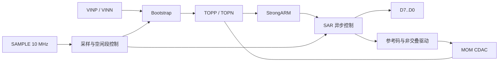

# B 版电路

8 bit、10 MS/s、全差分异步 SAR ADC。本聊天的 FFT、TT 全码和失配任务使用 B 版，数字逻辑采用原生标准单元。

先打开 [top/adc_top.scs](top/adc_top.scs)。完整 include 入口为 [dut.scs](dut.scs)，冻结源为 [原始 dut.scs](../../netlist/sar8_l90_mmain2_stdcell_v1/dut.scs)。

| 顶层实例 | 电路文件 | 作用 |
| --- | --- | --- |
| `XBOOTN`、`XBOOTP` | [blocks/bootstrap.scs](blocks/bootstrap.scs) | 两侧 Bootstrap 输入采样 |
| `XCDAC` | [blocks/cdac.scs](blocks/cdac.scs) | 18 个原生 MOM 实例和分位参考开关，8 bit 二进制权重 |
| `XCOMP` | [blocks/comparator.scs](blocks/comparator.scs) | 11 MOS StrongARM 比较器 |
| `XCTRL` | [blocks/sar_logic.scs](blocks/sar_logic.scs) | 判决接收、逐位 token、结果寄存与异步握手 |
| `XREF` | [blocks/reference.scs](blocks/reference.scs) | 参考码保存、非交叠控制、栅极驱动与分步复位 |
| `XSAMPLE`、模块内部数字门 | [blocks/standard_cells.scs](blocks/standard_cells.scs) | 标准单元的端口包装与门组合 |
| `XSEQ`、模块内部延时 | [blocks/delays.scs](blocks/delays.scs) | 采样关闭沿与 RC 延时电路 |
| `XIDLE` | [blocks/reference.scs](blocks/reference.scs) | 空闲段复位与采样协调 |



顶层 master 沿用 `sar_adc8_join_r4`。这是冻结 B 的子电路名，历史 R4 的同名电路需要用文件路径和散列区分。B 的源 SHA256 为 `f31b66c8fb35003bf7e8ad1a23d9c230b39f1f9651ccc469953e5e52ecf493ea`。

| 端口 | 说明 |
| --- | --- |
| `D0..D7` | 并行输出码，D7 为 MSB |
| `SAMPLE` | 外部 100 ns 周期，先低 60 ns、高 40 ns |
| `VINN`、`VINP` | 差分模拟输入 |
| `VREFN`、`VREFP` | 测试台提供 0 V 和 0.9 V 参考 |
| `VDD!`、`0` | 核心供电和地；角测试核心电源为 0.81–0.99 V |

MOS 模型由各测试的 `test.scs` 引用，标准单元由 [library_include.scs](../../netlist/sar8_l90_mmain2_stdcell_v1/library_include.scs) 引用。PDK 和标准单元库位于服务器。实际输入/参考阻抗、旁路电容与输出负载在 [TB 清单](../../tb/sar8_b/README.md)中查找。

本目录由 `scripts/sar8_entry.py build` 从冻结源生成。49 个 subckt 的端口、器件、参数和连线逐段保持一致，完整映射见 [manifest.json](manifest.json)。顶层可达 46 个 subckt，另外 3 个辅助定义保留源身份。实际信号路径从顶层实例往下读。

```powershell
.venv/Scripts/python.exe scripts/sar8_entry.py check
```

已完成的 Spectre 证据绑定原冻结源。分文件视图已通过静态逐段一致性检查，尚未作为独立输入包重跑 Spectre。B 为本轮网表验证对象，OA 的同步和可靠性资格仍按原记录管理。
