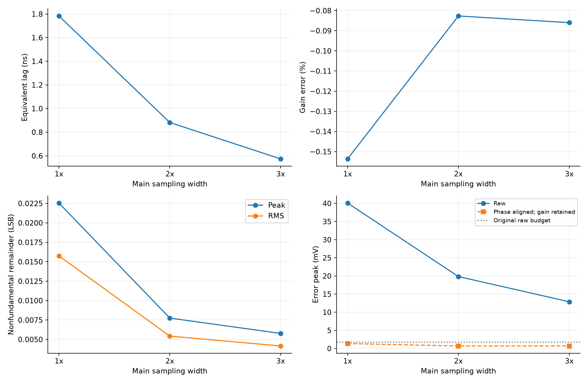
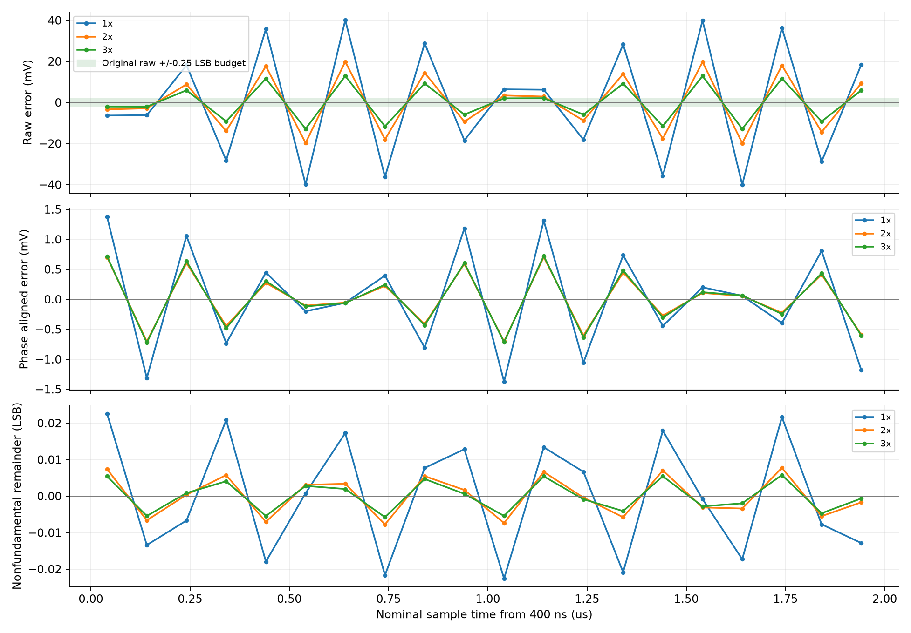
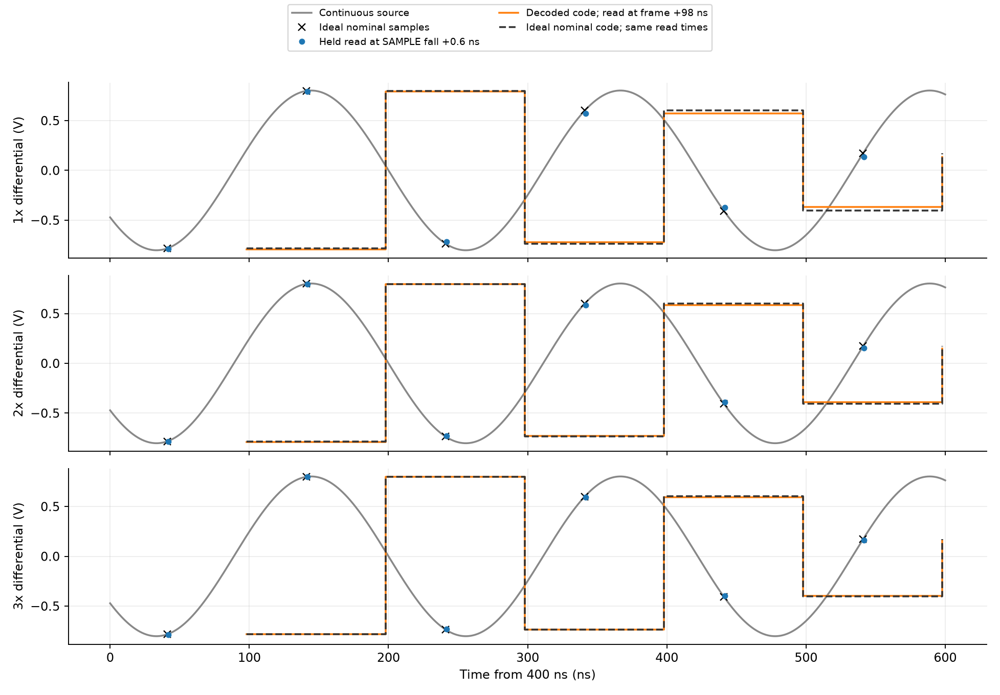
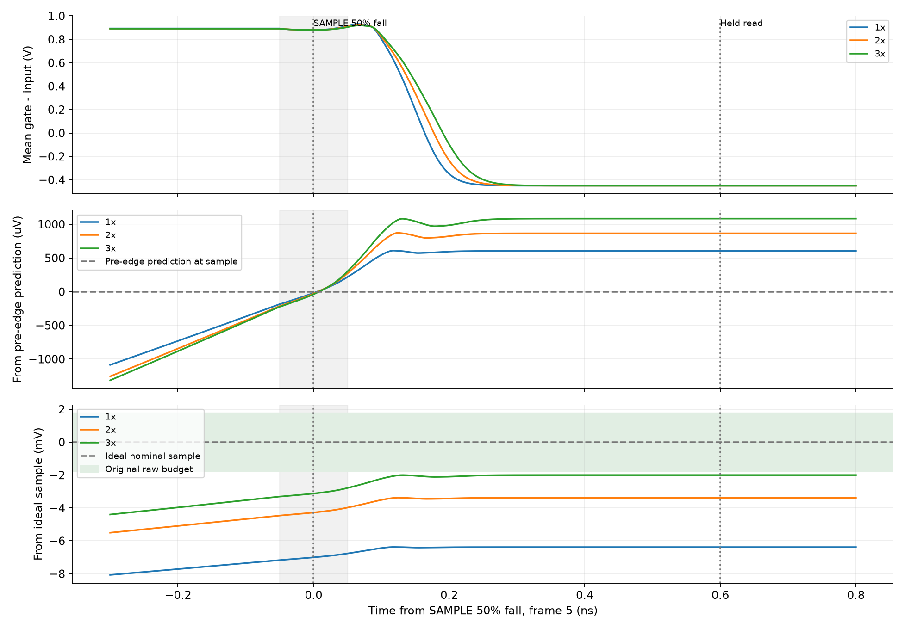

# B版本4.5 MHz主采样管宽度短测

本次在同一原生B整机中比较主采样管W=1、2、3 µm，L=150 nm。
拓扑、CDAC、其他尺寸、外部时序和求解精度不变。三组已完成原生计算、
解析及误差分离。建议下一阶段采用2×作为折中候选，不采用3×；1×在
本次非基波残差量级上也有余量，不能称为8-bit必然不可用。
本轮没有修改OA或原始保持误差门限，正式原理图仍为1×。

## 测试条件

输入恰为4.5 MHz、−1 dBFS的连续差分正弦，差分峰值
`0.9 × 10^(−1/20) = 0.8021258443 V`，每侧峰值约0.401063 V，
共模0.45 V，P/N相位仍为−72°／108°。10 MS/s下先预热4帧，
再观察20帧，实际总时长2.4 µs；观察段包含9个输入周期，
不是单个4.5 MHz周期。三组均为新的原生仿真。

保留0.9 V、TT、27 °C，无随机失配或瞬态噪声。采用T28
`nch_18_mac`主管，nf=1、multi=1；AD/AS/PD/PS随W一致改变，
其余Bootstrap管、1 pF自举电容、18组MOM／512等效单位、
参考MOS、StrongARM和原生异步SAR均不变。参考栅控仍为已验证B模型。
输入每侧50 Ω，参考每轨50 Ω＋4 pF，未理想化这些阻抗。

Spectre 21.1、APS4、conservative、maxstep10 ps、gear2only，
请求reltol=1e−5、vabstol=10 nV、iabstol=100 fA；与既有B原生
报告逐项核对有效参数。声明stop=51.6 µs及2.4 µs的被动正常结束
观察器都保留，同样保存44路连续信号，不改为strobeonly。

## 测量定义

以SAMPLE的50%下降沿作为名义采样时刻，+0.6 ns读取差分保持值。
在4.5 MHz下对源端及保持值分别拟合直流加sin/cos，提取单频等效
相位／滞后、增益和非基波残差。它不是整个频带的纯固定延迟证明。

原始保持误差、只对齐相位而保留增益的诊断误差、完全去直流／基波
后的残差分别记录。8-bit LSB=7.03125 mV，原始门限仍为
0.25 LSB=1.7578125 mV；不会用校正后的残差取代原始门限。
相位对齐采用拟合正弦的完整时间平移，不只是减去一阶斜率项。
相位与增益分离是离线诊断，不表示已经实现数字校准或更改采样时刻。

最终码分别与名义输入、实际保持值对应的理想码比较。前者可能受
输入相位滞后影响，不能直接当作SAR逻辑故障；后者也包含整个
转换过程的影响，不是单独的比较器精度测试。

关断相关增量沿用关断前−5至−0.15 ns三次外推，但另外检查
3／5／8 ns窗口及二至五次阶数。高频曲率使这项外推更敏感，
因此它只是辅助定位，不是纯电荷注入的唯一测量。

与500 kHz旧结果对照时保留幅度差别：旧测试差分峰值为0.8 V，
并非精确−1 dBFS。这不影响本轮三种W的同条件比较，但两频率
对照不是严格只改变频率的宽带传递函数测量。

## 完整结果

三组各24帧，统计相同的20个观察点。下表非基波项已去除直流和基波，
仅相位对齐项仍保留增益偏差，原始项不作任何校正。

| 指标 | 1×／1 µm | 2×／2 µm | 3×／3 µm |
| --- | ---: | ---: | ---: |
| 单频等效滞后／ns | 1.783592 | 0.882235 | 0.574250 |
| 基波相位／° | −2.889420 | −1.429221 | −0.930286 |
| 增益偏差／% | −0.153617 | −0.082646 | −0.085977 |
| 仅相位对齐后的误差峰值／LSB | 0.195338 | 0.100217 | 0.102888 |
| 保持非基波残差峰值／µV | 158.561 | 54.505 | 40.619 |
| 保持非基波残差RMS／µV | 110.741 | 38.200 | 29.250 |
| 保持非基波残差峰值／LSB | 0.022551 | 0.007752 | 0.005777 |
| 保持非基波残差RMS／LSB | 0.015750 | 0.005433 | 0.004160 |
| 原始保持误差峰值／mV | 40.091849 | 19.834526 | 12.889723 |
| 原始保持误差RMS／mV | 28.591744 | 14.149906 | 9.218077 |
| 超原始0.25 LSB门限点数 | 20/20 | 20/20 | 20/20 |

固定相位项不能按同向共模电压抵消，但也不能全部叫作非线性失真。
三组的原始误差主要包含相位滞后，所以三组都没有通过原始门限。
这一事实与后面的幅值／非基波诊断建议并列保留，不能改写成原始验收通过。

上图从上到下分别是原始误差、仅相位对齐后的误差、去直流和基波后的
残差。折线连接20个实际样点，反映4.5 MHz在10 MS/s下的采样序列，
不是额外仿真的连续误差波形；单个频率、20点也不能唯一分离所有高阶
谐波、历史效应或数值成分。

## W选型判断

建议2×作为下一阶段折中候选，理由不是“1×一定不够8-bit”，而是：

- 1×到2×：不校准增益、只分离相位时，误差峰值由0.195降至0.100 LSB；
  非基波RMS由110.7降至38.2 µV。4.5 MHz下跟踪线性度与幅值裕量确有收益。
- 2×到3×：增益偏差由−0.08265%变为−0.08598%，仅相位对齐误差略变差；
  非基波峰值只再减少13.886 µV，约0.001975 LSB，RMS只减少约8.950 µV。
  额外速度收益不能直接当成8-bit精度收益，不足以要求再加宽。
- 1×本次非基波RMS为0.01575 LSB，低于当前0.15 LSB失真余量；
  2×／3×为0.00543／0.00416 LSB。三者均不是明显的标称失真瓶颈。
  1×是可保留的较小尺寸选项，2×是保留未校准幅值裕量的工程选择，
  不是由现有ENOB指标推导出的唯一必需尺寸。尚未测出尺寸间的功耗差异。

按本次单频拟合增益换算到±0.9 V端点，增益项约为
0.197／0.106／0.110 LSB；这是拟合项的量纲换算，不是满幅端点实测。
因此不需要假设增益已经校准，2×相对3×仍具有略小的幅值偏差。

这次判断修正了500 kHz短测下“1×残差最小”的外推：到了4.5 MHz，
1×的跟踪残差明显变大，加宽到2×有实测收益。固定滞后依旧仅为单频
等效量，并未证明整个频带都是相同纯延迟。

如果“相对名义SAMPLE时刻的未经校正误差＜0.25 LSB”仍是不可分拆的
硬门限，则本轮没有任何合格候选，不能冻结为通过。2×建议是将相位、
幅值和非基波分别审视后的尺寸判断，不是擅自变更这个门限。
没有把2×写回原理图，也没有宣布PVT、全码或整机性能合格。

## 转换时序与误差定位

三组24帧均有8次实际比较／写入／更新，90 ns与98 ns最终码稳定。
相对名义输入的理想码最大分别差6／3／2码，相对实际保持值的理想码
均最多差1码。名义输入码差包含采样相位影响，不能全部认定为SAR
决策错误；差1码也不等于已经证明DNL、INL或无缺码。

上图显示400～1000 ns的相同时段。黑叉为名义采样时刻理想源值，
蓝点放在实际保持读取时刻（名义时刻＋0.6 ns）；橙色实际码与黑色
虚线理想码都放在每帧＋98 ns读码时刻，已显式保留读码延迟。
灰色为连续输入，没有把理想输入平移来掩盖原始误差。

| 关断前后非基波峰值／µV | 1× | 2× | 3× |
| --- | ---: | ---: | ---: |
| 关断前跟踪预测 | 156.309 | 42.335 | 20.205 |
| 关断相关增量 | 17.095 | 18.399 | 22.942 |
| 最终保持值 | 158.561 | 54.505 | 40.619 |

峰值不能直接算术相加，三条曲线的相位不相同。1×在高频下较大的
残差已主要出现在跟踪阶段，不能继续套用低频时的关断主导解释。
关断总增量峰值则为2.485／2.591／2.690 mV，其中含大量基波／孔径
相关分量，不能将这些mV全部作为不可校正失真再与保持残差重复相加。

边沿统一使用第5帧（零基frame=4）。灰带为SAMPLE下降过程，
0为50%下降，+0.6 ns为保持读点。中图使用各自关断前的预测零点；
底图使用同一个名义源值和原始预算。该帧不是各组全周期的最坏帧。

高频下二次外推的3／5／8 ns窗口差异约90 µV，不能当作稳定估计；
三次窗口变化约1.34 µV。后者仍使关断项仅适合辅助定位。
首表的保持值、相位、增益和非基波指标不依赖这项关断前外推。

## 验证与局限

三组原生`result.ok=true`，均零错误、7条既有warning；无CMI-2754或
SPECTRE-16780 LTE放宽。有效求解参数与B基准逐项一致。每组约132.6～
132.7万个自适应时域点，均覆盖0～2.4 µs、同样44路连续信号。

输入网表差异、模型快照哈希、24帧日志与波形、解析结果、输入解析式、
实际SAMPLE时刻、三组相同源历史、事件计数、拟合正交性与分解重建
均经核对。4.5 MHz合成数据恢复相位／增益／DC／H2／H3通过，且新数学
实现复现了原500 kHz三组结果。四张图按基准、单位、图例和时间点审核。

保存的比较器输入对端电压最大绝对值分别为
0.897741／0.899580／0.900352 V，均低于现用0.99 V筛查线；
这不是所有器件或PDK可靠性的签核。主管仍为1.8 V IO MOS，不能
把核心器件的0.99 V线错误套用到主管启动波形。

仅缺失的可选`.ic/.fc`附加文件被跳过，完整主波形和日志均已下载，
本次三个远端临时任务目录清理均返回成功。没有中断或重启Spectre，
没有通过删减保存信号、放宽精度或替换管级模块加速。

配置：[b_hf_main_w.yaml](../config/b_hf_main_w.yaml)。
计划：[本轮计划](../plan/2026-10-21-b-hf-main-w/plan.md)。
原始网表、日志、精确远端PID绑定及连续波形保存在
`output/b_hf_main_w/`，不覆盖旧500 kHz测试。

本轮是标称短测，无随机噪声／失配／PVT，不输出DNL、INL、SNDR、ENOB
或功耗签核值；当前整机目标仍为8-bit、ENOB≥7，而不是由本次模拟残差
直接换算出一个整机ENOB。推荐2×不意味着1×已被证明无法达到该目标。
