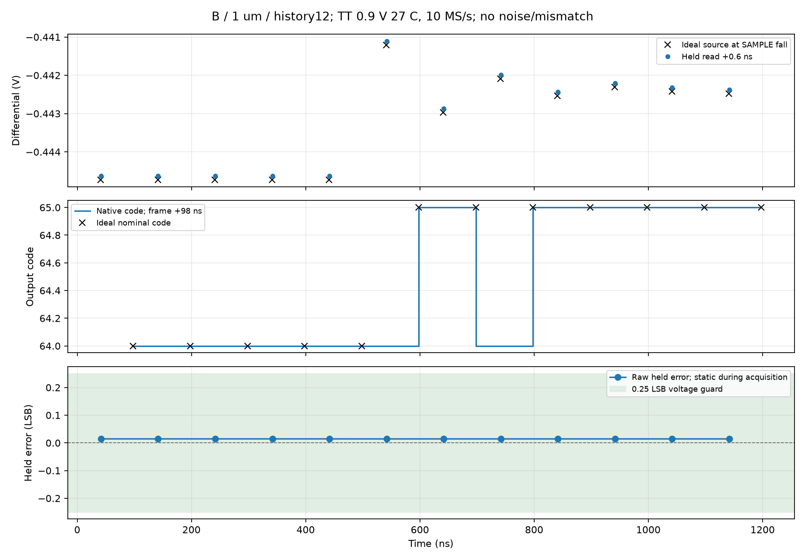
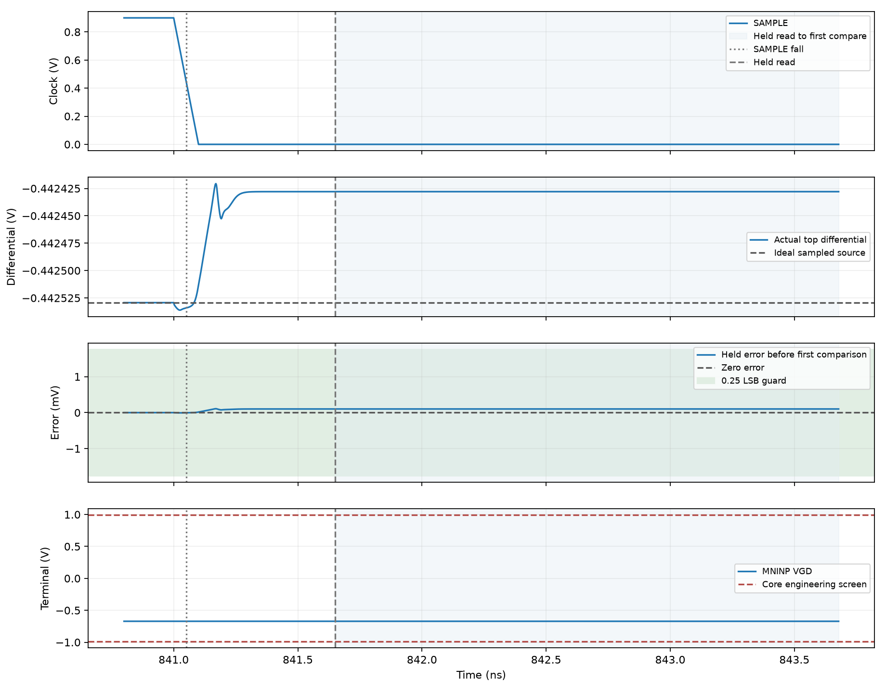
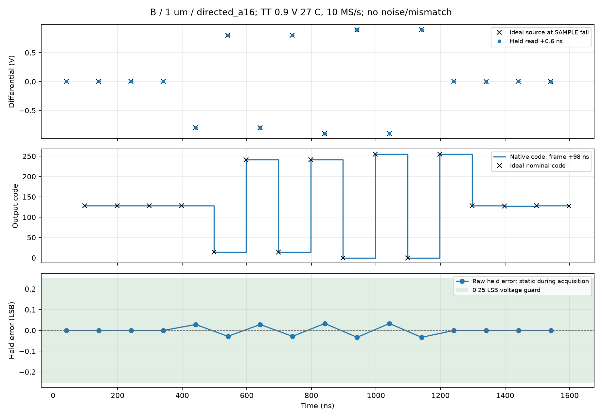
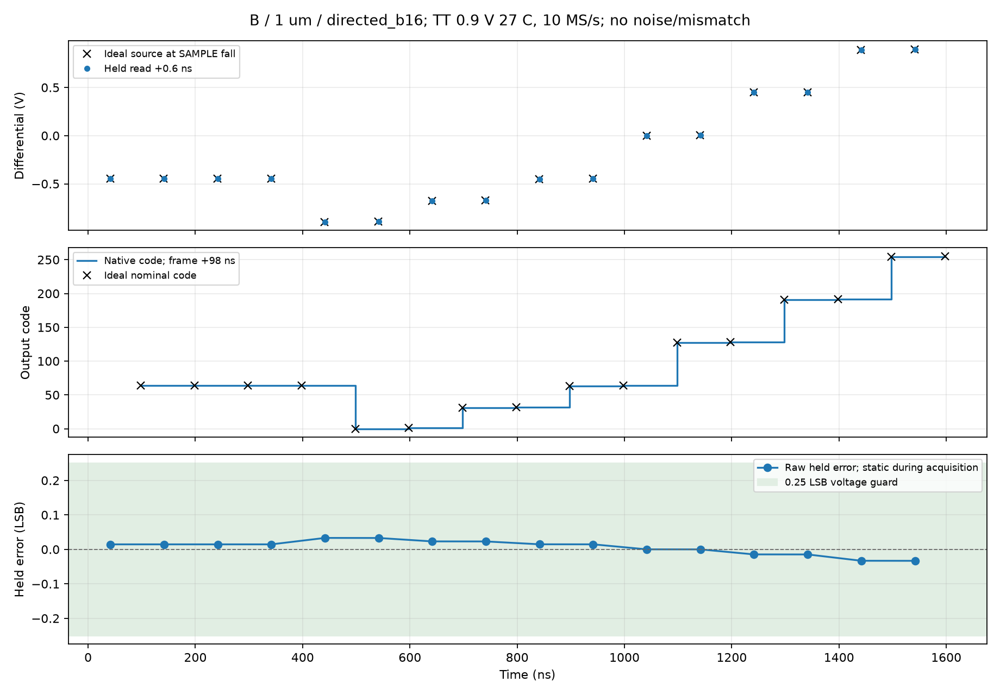
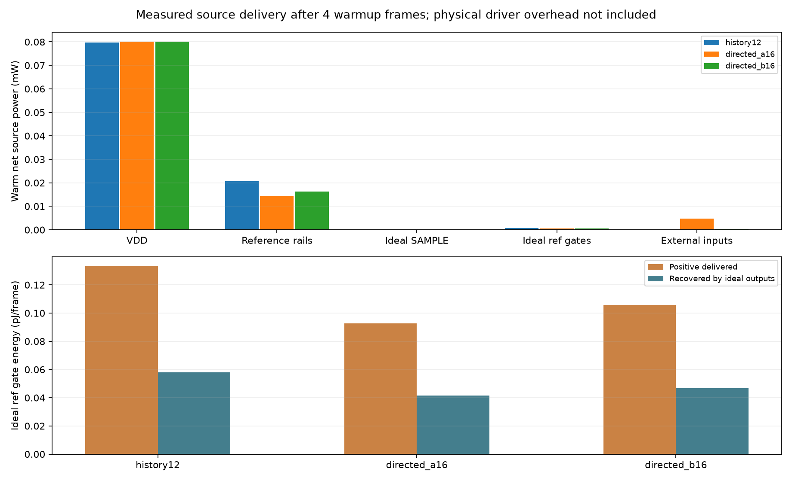

# B版本1倍主管的整机短验收

本轮只执行离线基准核对与定向短瞬态，不运行全码、长正弦、PVT、失配或噪声。
第0、1步已完成：三组共44帧原生瞬态，功能、时序与已声明的模拟端电压
工程筛查全部通过；真实物理整机功耗及完整ADC性能尚未签核。
主管仍为W=1 µm、L=150 nm，未改变原理图或任何DUT拓扑、尺寸、时序。
四帧预热也不等同于物理上电顺序验收；VDD仍是原台架的恒定理想供电源。

## 基准与输入

当前`SAR_ADC_T28/sar_adc8_join_r3`已采用B参考栅控修复；Bootstrap、MOM、
3倍参考开关、StrongARM和原生异步SAR保持原样。SAMPLE、参考栅控及提交
机制仍有理想源，参考网络仍为每轨50 Ω加4 pF，输入每侧50 Ω。

T28 TT、0.9 V、27 °C、10 MS/s；Spectre21.1 APS4、conservative、
maxstep10 ps、gear2only，请求reltol1e−5，实际有效reltol按旧B日志1e−6核对，
vabstol10 nV、iabstol100 fA。保持声明stop51.6 µs及被动正常结束方法，
不以截短stop或strobeonly改变精度／时间网格。每组保存136路连续波形。

| 测试 | 帧数 | 输入覆盖 |
| --- | ---: | --- |
| 原异常历史 | 12 | 从t=0完整求解原12帧；冻结刺激源与原输入历史逐字节／逐值一致 |
| 正负及端点 | 16 | 4帧预热，正负0.8 V翻转、0／255码中心附近、127／128码中心交替 |
| 进位边界 | 16 | 4帧预热，k=1、32、64、128、192、255边界两侧各±0.25 LSB |

历史输入沿用原Verilog-A刺激源及100 ps transition。新定向输入使用100 ps
PWL，在前一帧结束后的100.8–100.9 ns更新；没有把它冒充历史刺激波形。
实际采样命令仍在每帧41.05 ns关闭，保持值读取在+0.6 ns，最终码读取在98 ns。

只读OA接口已确认top、testbench和36个依赖与B快照一致；当前VA字节哈希
与已验证B相同。生成网表的全部原生子电路、SAMPLE声明、源／参考阻抗和
精度参数与基准一致。初始断开的tunnel只做一次恢复，未修改OA。

## 检查口径

每帧核对8次比较／写入／更新、MSB到LSB令牌顺序、90／98 ns码字稳定、
60 ns转换预算、中点恢复以及输出相对源／实际保持值的码差。边界附近的
相邻码与跨几十码的异常分别报告。定向输入在获取期间已经恒定，保持误差
直接使用0.25 LSB电压筛查，不做正弦相位拟合来隐藏建立误差。

比较前检查的是相对理想逐位CDAC电压的建立误差，而不是要求比较器输入
电压差本身小于0.25 LSB。全程检查32只参考MOS、11只比较器MOS和24只
Bootstrap IO MOS的六组两两端电压；逻辑MOS结合原生CMI告警检查，未保存
所有逻辑内部端电压。核心0.99 V和IO1.98 V是分别使用的工程筛查线，
不是全器件寿命可靠性签核。

## 功耗如何计算

按每个源正端流入电流为正，供给功率取`Pdelivered=−V×I`，不取电流绝对值。
分别统计VDD、正负参考轨、理想SAMPLE、32个理想参考栅控输出及外部输入源。
每项均保留正向供能、回收能量、净能量和平均净功率；启动首帧、预热及
观察区间分开，并按获取／转换／其他时间分解每帧净能量。
能量分区用SAMPLE上升到下降作为获取窗，下降到98 ns读码作为转换统计窗；
后者包含实际完成后的等待，不与约30 ns的实际转换耗时混淆，其余归为其他。

量纲为`平均功率(mW)=能量(pJ)/时间(ns)`。四帧预热后的数字是当前输入
序列下的短测平均值，不是所有输入的最坏功耗。源端净供能还可能包含储能
变化，不能全部称为电路内部耗散。

理想栅控可以回收电荷，其净能量接近零不表示真实驱动器功耗为零。
理想COMMIT事件通知本身也不是一个已实现的物理驱动器；本轮没有把它的
计算视为硬件功耗。实际时钟／栅控驱动器和参考缓冲器的自身开销尚未实现，因此即使VDD低于
1 mW，也不能据此宣布真实整机功耗目标闭合。外部输入源供能另列，不自动
算作ADC核心供电功耗。

电流保存使用已有元件端口，不插入额外DUT电流表；保存原理参考
[Cadence APS元件电流说明](https://community.cadence.com/cadence_blogs_8/b/cic/posts/spectre-tech-tips-spectre-aps-save-overview---part-2)。

## 结果

原异常历史已完成全12帧、从0到1200 ns连续求解与保存，共663230个时间点。
输出为`64,64,64,64,64,65,64,65,65,65,65,65`，与此前B验证一致；第9帧
为65码，不再是修复前R3的1码。第7帧输入恰在64/65理想边界，实际为64，
按理想floor定义为65；这是相邻1码差，不是原先相差64码的异常。

历史组保持误差最大0.101890 mV（0.014491 LSB），比较前建立误差最大
0.065683 LSB；12帧均8次比较／写入／更新，顺序及90/98 ns输出稳定和
逻辑电平通过。参考／比较器／Bootstrap端电压峰值为0.941519／0.951813／
1.604692 V，均在各自工程筛查线以内。后三者不是同一耐压器件。

正负及端点组16帧均与理想码一致，观察区码为
`14,241,14,241,0,255,0,255,128,127,128,127`。保持误差最大0.234215 mV
（0.033311 LSB），比较前建立误差最大0.118364 LSB；转换完成时间
29.460006–29.712947 ns。参考／比较器／Bootstrap峰值分别为
0.942795／0.952012／1.790505 V，所有已声明功能和模拟端电压筛查通过。

进位边界组16帧也全部与理想码一致，12个观察点依次输出
`0,1,31,32,63,64,127,128,191,192,254,255`。

| 测试 | 观察区保持误差峰值(mV) | 比较前建立误差峰值(LSB) | 全帧转换完成时间(ns) |
| --- | ---: | ---: | ---: |
| 原异常12帧历史 | 0.101890 | 0.065683 | 29.705704–29.928026 |
| 正负／端点16帧 | 0.234215 | 0.118364 | 29.460006–29.712947 |
| 进位边界16帧 | 0.233571 | 0.118632 | 29.489528–29.699071 |

44帧合计352次比较、352次写入、352次更新，逐位顺序均为
`compare < write < update < 下一次compare`，令牌从MSB到LSB。
90/98 ns输出码与逻辑电平均稳定；1408条相位事件和704条恢复事件完整。
16组参考栅控没有检测到高低轨导通命令重叠，采样结束前均回到规定中点字。
这不等于已测得零模拟穿通电流。

全程六组两两端电压筛查（包括预热及获取恢复瞬间）的最差项如下。

| 类别／覆盖数量 | 最差器件／端对 | 峰值(V) | 时刻(ns) | 工程筛查线(V) |
| --- | --- | ---: | ---: | ---: |
| 参考core／32只 | `XDUT.XCDAC.XSP0.MP_HIGH`／VDB | 0.947124 | 601.282326 | 0.99 |
| 比较器core／11只 | `XDUT.XCOMP.MNLATN`／VSB | 0.952012 | 1047.325133 | 0.99 |
| Bootstrap IO／24只 | `XDUT.XBOOTN.Mmain`／VGB | 1.790505 | 817.840000 | 1.98 |

参考最差发生在进位组，后两项发生在正负／端点组。未覆盖全部逻辑内部端电压，
也未用这两条工程线代替PDK可靠性规则或PVT签核。

四帧预热后的平均**净供能功率**如下，单位µW；历史组取400–1200 ns，
两组定向测试取400–1600 ns。

| 测试 | VDD | 参考轨合计 | 理想SAMPLE | 理想参考栅控输出 | 外部输入源 |
| --- | ---: | ---: | ---: | ---: | ---: |
| 原异常历史 | 79.727 | 20.743 | 0.033 | 0.752 | 0.066 |
| 正负／端点 | 80.071 | 14.247 | 0.033 | 0.512 | 4.709 |
| 进位边界 | 80.004 | 16.287 | 0.033 | 0.590 | 0.398 |

38路目标电流全部保存成功。VDD约7.97–8.01 pJ/帧；理想参考栅控每帧
正向供能约0.093–0.133 pJ、回收0.041–0.058 pJ，净值较小不等于真实驱动器
免费。零伏低参考源即便功率为零，仍保留其电流统计；实际低轨驱动开销另议。
当前VDD加参考轨约0.094–0.100 mW，但缺少物理时钟／参考驱动与参考缓冲器
自身功耗，不能宣布真实整机≤1 mW已通过。

各组原生结束均为0 errors／7 warnings。保留的提示为VACOMP-2435一条
（旧编译环境变量）、SFE-2453两条（全局节点与子电路端口同名）和
SFE-1131四条（模型scalefactor重复设置、以后者为准），不是声称零warning。
本轮没有CMI-2754应力、SPECTRE-16780 LTE放宽或收敛失败。
另外保留初始DC的GminDC提示：1 pS可能影响浮置顶板的DC解（历史组TOPN
约47.09 mV、正负／端点组TOPP约14.44 mV、进位组TOPN约47.23 mV）。
两组定向测试还保留初始DC bad-pivot提示；旧B正弦基准也有Gmin/pivot提示。
它们是初始浮置状态／数值条件的风险提示，不是转换后的保持误差，也不是
声称零notice；本次实际获取／预热后的检查通过。
没有为了消掉提示改变gmin或重跑，也不据此宣告物理上电瞬态合格。

## 波形

图中黑叉为理想输入／理想码，蓝线或蓝点为实际结果。输入保持值标在采样
下降沿后0.6 ns，输出码标在帧内98 ns；两者不是同一时刻。阶梯仅表示各帧
最终读码的零阶保持，不是SAR内部逐位变化。

第9帧局部图仅画到第一次比较之前；浅蓝区域是保持读取到首次比较的区间，
没有把后续正常CDAC逐位电压变化算作保持误差。

## 数据与复核

计划为`plan/2026-10-21-b-short-acceptance/plan.md`，冻结输入、精确远端
PID／log绑定、原始PSF和本地结果位于`output/b_short_acceptance/`。
历史报告、波形和PDK均保持只读，没有重启原R3长任务。
冻结准备提交`1fe7174`，本轮原生输入总计44帧，未修改OA或任何DUT尺寸。
小型审计数据见`verification/integration/b_short_acceptance_results.json`；
其中保存各帧事件、逐管端电压、供能账本、精度及来源哈希。

136路保存会使旧整文件PSF解析占用过大内存，本轮采用本地流式float64
解析，保留全部原始样点和delta carry-forward语义；已对照原解析器及实际
电流TRACE属性验证。该调整只影响本地读取，不修改Spectre求解或原始数据。
未运行新的全码、FFT、噪声、PVT、失配或版图寄生测试；本轮通过不代表已经
获得DNL、INL、SNDR、ENOB或全部器件寿命的合格结论。
