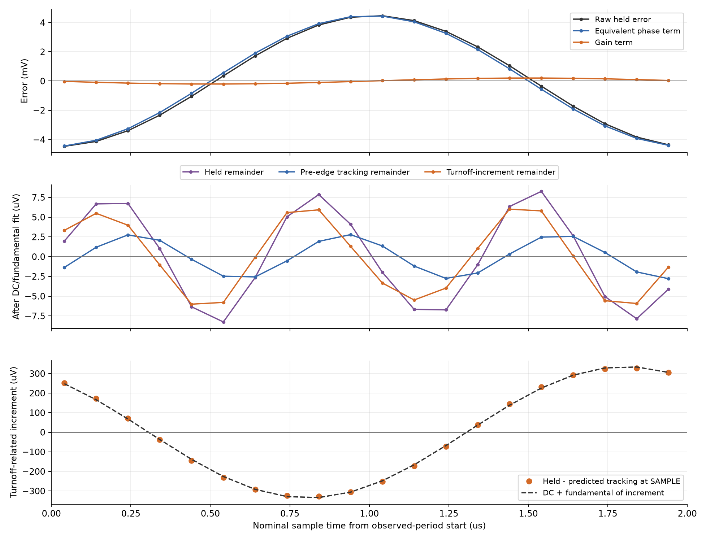
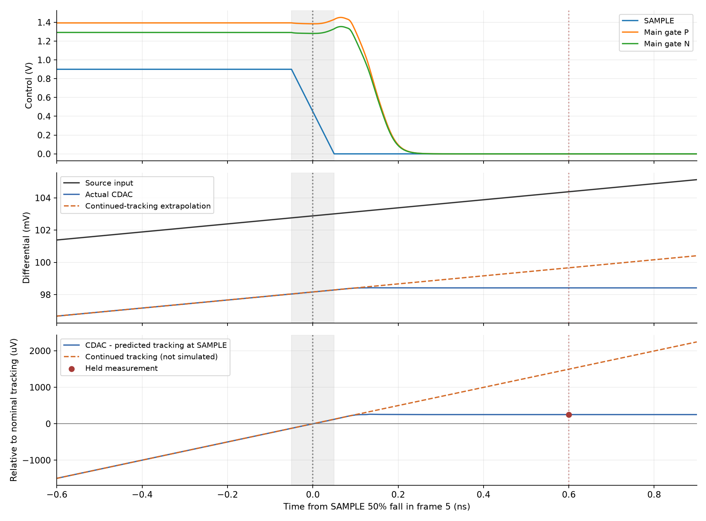

# B版本正弦采样误差分离

仅对已完成的 500 kHz 正弦波形做后处理，原始最大 4.465 mV 误差可主要
归入 1.781 ns 的等效滞后和 −0.0258% 的增益偏差。扣除直流与基波后，
20 个保持值的非基波残差为 8.26 µV 峰值、5.60 µV RMS。关断相关增量
最大约 0.328 mV，其中非基波残差约 6.01 µV 峰值。

这些是单频、单幅值下的数学分离，不是已经测得纯通道电荷注入；原始
相对名义采样时刻的 0.25 LSB 预算仍未通过。未改变电路、尺寸、时钟、
仿真精度或原始数据，也没有启动新仿真。

## 数据和基准

来源为 [B单周期时域测试](b_sine_period.md)，结果提交 `61dcdb4`：
T28 TT、0.9 V、27 °C、差分正弦峰值 ±0.8 V、共模 0.45 V、500 kHz，
采样 10 MS/s。原生 Bootstrap、flat MOM CDAC、3×参考 MOS、StrongARM
和异步 SAR 均保持原实现，采样激励与参考栅控仍为既有理想控制。

原来 24 帧中的前 4 帧不参与拟合，使用 frame=4–23 的 20 个观察点。
基准仍是保存波形中 SAMPLE 的 50% 下降沿，保持值仍在其后 0.6 ns
读取，不移动原始采样或验收时刻。本次没有拟合 ADC 量化输出码。

原始 result.ok、完整记录以及 waveform、deck、includes、日志均经核对。
大文件使用流式 SHA256；原始 ASCII、pickle 和其他来源文件在分析前后
哈希完全一致。本次结果独立保存，不覆盖此前的失败预算或分析报告。

## 延迟增益和直流如何分开

在已知输入频率下，用最小二乘拟合：

```text
held(t) = c + a sin(theta) + b cos(theta) + r(t)
theta   = 2 pi × 500 kHz × (t - 400 ns)
```

源端输入也做同样拟合，以其振幅与相位为基准。将保持值的基波写为
`offset + G × source_fit(t - tau)`，即可得到等效增益 G、近零分支的
相位延迟 tau，以及不能用直流与该频点基波表示的残差 r。

| 分量 | 这 20 个观察点的结果 |
| --- | --- |
| 等效滞后 | 1.781261 ns，相位约 −0.320627° |
| 增益 | 0.999741846，即 −258.154 ppm，约 −0.025815% |
| 直流项 | 拟合值绝对值小于 0.01 µV，低于本次数值精度量级 |
| 相位项样点峰值 | 4.441210 mV |
| 增益项样点峰值 | 0.204954 mV |
| 原始误差样点峰值 | 4.464649 mV，RMS 3.168533 mV |
| 拟合后非基波残差 | 峰值 8.259512 µV，RMS 5.604440 µV |

各项峰值出现的相位不一定相同，不能把峰值直接相加或按独立随机噪声
RSS。程序逐点验证“原始误差＝相位项＋增益项＋直流项＋残差＋源拟合
微小修正”，最大重建差小于 1e-12 V。

因此此前仅扣除斜率项后约 0.225 mV 的剩余量，主要还包含增益偏差；
它不能全部当作非线性。再扣除增益和直流后，剩余量才降到上述微伏级。
观察样点的 3 次谐波投影约 7.893 µV，5 次约 0.720 µV，显示主要是
确定性的奇次分量，而不是本次未开启的随机瞬态噪声。

单频相位既可能来自跟踪 RC，也可能包含孔径和切换作用；不能据此认定
一个适用于所有频率的物理延迟。20 个点的非基波残差还可能包含建立、
历史、混叠和数值成分，不是完整静态非线性或全 ADC SNDR。

## 关断相关增量如何取得

每帧只取 SAMPLE 下降沿前 −5 至 −0.15 ns 的实际顶板波形，以 10 ps
均匀时间权重拟合三次多项式，外推到名义采样时刻 t=0。该窗口内
SAMPLE 均为 0.9 V，末端两侧主栅极减输入电压为 0.8923–0.8935 V。
它表示“若延续关断前的跟踪趋势，在名义采样时刻应达到多少”。

定义 `关断相关增量 = held(t+0.6 ns) − tracking_extrapolated(t)`。
它包含关断过程的有效孔径变化、通道电荷、时钟穿通及相连电容网络响应，
不是把关断前后两个不同时刻的输入变化误当成注入，也不是新仿真的结果。

| 分量 | 峰值 | RMS |
| --- | --- | --- |
| 关断前跟踪值扣除直流与基波后的残差 | 2.789366 µV | 1.992175 µV |
| 关断相关总增量 | 327.692875 µV | 237.389345 µV |
| 关断增量再扣除直流与基波后的残差 | 6.009549 µV | 4.421882 µV |
| 最终保持值的非基波残差 | 8.259512 µV | 5.604440 µV |

三种残差同样按相位逐点相加，不能将峰值或 RMS 简单相加。换用 3、5、
8 ns 窗口和二次、三次拟合，外推值最大差约 0.122 µV；三次拟合之间
最大差小于 0.001 µV，明显小于观察到的约 6 µV 关断非基波量。
改变均匀插值步长到 5/20 ps 也不改变上述结论。

关断前跟踪的等效滞后约 1.890315 ns，最终保持值为 1.781261 ns，
相差约 109 ps。这与主栅极在 SAMPLE 命令之后才下降的现象一致，
但不是唯一测得的物理孔径。跟踪增益约 −15.873 ppm，最终为
−258.154 ppm，说明关断相关增量的大部分仍可表成增益与相位项。

差分量小不表示两个顶板完全没有共同变化：关断相关共模增量约
−0.447 至 −0.464 mV。已保存的 4 路 MSB 参考栅控在该窗口内不变，
但两侧 MSB 底板仍有约 0.10 mV 的电气扰动，所以应把该增量理解为
相连采样网络的响应，不能全归给某一只 MOS。

在 SAMPLE 下降沿后 +0.6 至 +2.0 ns、首次实际比较之前，差分保持值
相对 +0.6 ns 的最大变化约 0.015 µV，与本次数值精度同量级。这只覆盖
一个 1.4 ns 安静窗口，不能作为完整转换期间的漏电或 kickback 指标。

## 波形



从上到下：原始误差与相位、增益项；去除直流和基波后的保持、跟踪、
关断残差；关断相关总增量及其直流加基波拟合。注意第二幅单位为 µV，
不是第一幅的 mV。没有把修正后的曲线冒充未经校准的电路输出。



边沿图仍取原始保持误差最大的第 5 帧。灰区为 SAMPLE 从高到低的
100 ps 边沿，t=0 为 50% 下降沿；红竖线为 +0.6 ns 的保持读点。
末幅相对 t=0 的跟踪预测值作图，显示该帧约 +251.48 µV 的关断相关
增量。橙色虚线是数学外推，不是新增的“持续导通”仿真。

## 结论与限制

在这组波形覆盖的输入条件下，可观察到的非基波剩余量为约 8.26 µV
峰值，其中关断相关部分约 6.01 µV 峰值；原先 mV 级的主要部分是
等效相位滞后，随后是约 0.026% 增益偏差。现阶段不应把 4.465 mV
全部算成失真或随机噪声，也不应以拟合后残差替代原验收结果。

纯电荷注入仍不能唯一分离：若注入恰好表现成常数、与输入成比例或与
输入斜率成比例，它会落在直流、增益或相位项中，不留在非基波残差里。
本次仅一个频率、一个幅度、一个周期，不据此宣告采样器或整机已合格。

复现脚本：[b_sine_decompose.py](../scripts/integration/b_sine_decompose.py)。
受控数值：[b_sine_decomposition_results.json](../verification/integration/b_sine_decomposition_results.json)。
完整生成结果在 `output/b_sine_decomposition/`，原始数据仍位于
`output/b_sine_period/`。脚本只做本地后处理：

```powershell
.venv/Scripts/python.exe scripts/integration/b_sine_decompose.py
```
