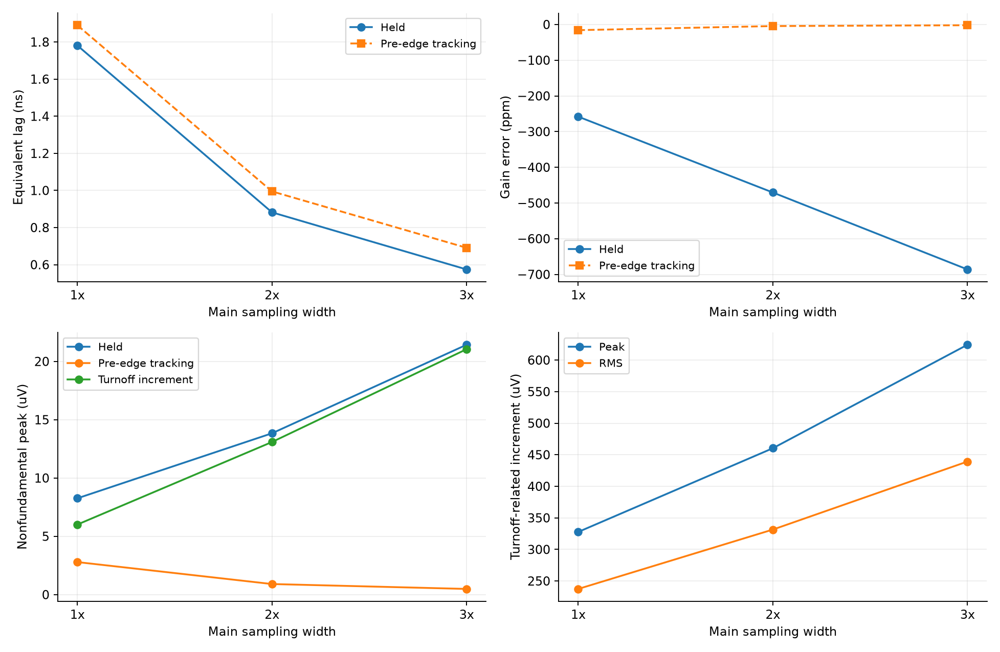
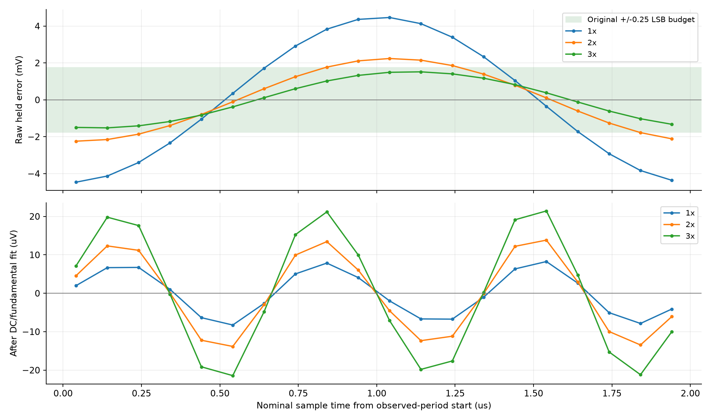
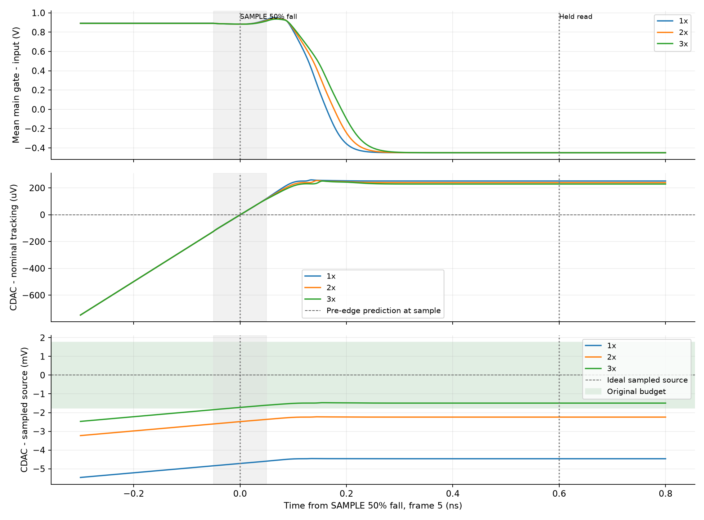

# B版本主采样管宽度短正弦对比

本次只比较主采样管宽度 1×、2×、3×，不调整拓扑、L、CDAC、时序参数
或仿真精度。1×复用已核对的原生单周期结果，2×、3×为独立网表候选；
Virtuoso OA 仍保持原基准，没有采用候选宽度。

结果：3×是本轮原始保持误差最小的候选，20 个观察点均低于原预算；
代价是增益偏差、关断相关增量和非基波残差增加。三组均完成 24 帧，
未把拟合后的残差当成原始误差，也没有自动采用候选宽度。

## 固定条件与唯一尺寸变量

基准为已采用 B 参考栅控修复的 `sar_adc8_join_r3` 原生整机，源端
500 kHz 连续差分正弦、峰值 ±0.8 V、共模 0.45 V，采样 10 MS/s。
每组 4 帧启动加 20 帧观察，共 24 帧、实际 2.4 µs。
T28 TT、0.9 V、27 °C，无随机失配、瞬态噪声或 PVT 扫描。

两侧 `XDUT.XBOOTP.Mmain`、`XDUT.XBOOTN.Mmain` 共用
`sar_bootstrap_canvas_flat_8b.Mmain`，均为 T28 `nch_18_mac`，
L=150 nm、nf=1、multi=1。其余 Bootstrap MOS 和 1 pF 自举电容不动，
CDAC 的 18 组 MOM 声明、参考 MOS、StrongARM、原生异步 SAR 不动。
实际整机网表用 multi 实现每侧 256 个等效单位，两侧共 512 个；
不是独立失配测试台中逐个声明的 512 只器件。
输入每侧 50 Ω，参考每轨 50 Ω 加 4 pF，未改成理想源。

| 候选 | 主管 W | AD 和 AS | PD 和 PS |
| --- | --- | --- | --- |
| 1× | 1 µm | 1.55e-13 m² | 2.31 µm |
| 2× | 2 µm | 3.10e-13 m² | 4.31 µm |
| 3× | 3 µm | 4.65e-13 m² | 6.31 µm |

面积和周长是 W 的派生量，不是额外尺寸自由度。按已有 PDK 导出的
320 nm、500 nm、1 µm、2 µm 同类单指器件交叉核对，扩散长度为 155 nm，
`AD=AS=W×155 nm`、`PD=PS=2×(W+155 nm)`；其余间距和应力参数保持不变。
没有通过修改 multi 来冒充单管加宽，也没有保留旧宽度的源漏寄生。

当前 B 顶层、测试台和 36 个原生或历史依赖经只读核对，与基准快照一致。
1×输入 deck 与原测试逐字节相同；2×、3×恢复 Mmain 语句后，整个输入
网表与基准一致。被动观察器、B 参考栅控和 commit 模型快照的哈希相同。

## 精度和时序边界

每个新任务保持 Spectre 21.1、APS 4 线程、conservative、maxstep 10 ps、
gear2only，请求 reltol=1e-5、vabstol=10 nV、iabstol=100 fA。
声明 stop=51.6 µs 与既有 2.4 µs 正常结束观察器同时保留，以维持原默认
求解参数。保存同样 44 路连续信号，不用 strobeonly 替代边沿波形。

SAMPLE、参考恢复、非交叠和边沿参数均不调整；因 W 增大而产生的真实
栅极负载、边沿响应或自定时比较时刻变化，是电路结果，不人为补偿。
两组原生计算独立并行，本地大 ASCII 波形依次解析，避免同时出现两个
约 14 GB 的解析内存峰值。原生命令与成功分类沿用桥接 0.8.0 的同一实现。

两组原生日志均以零错误完成，2×为 8 条 warning，3×为 7 条；共同的
7 条为既有 AHDLCMI 环境、全局端口和重复 scalefactor 提示。2×额外在
1759.41 ns 出现一次 `SPECTRE-16780`：求解器临时放宽 LTE 来跨越原生 SAR
节点 `XDUT.XCTRL.XBPN.XB2.XD_ON1.AB` 的不连续。该事件在第 18 帧保持值
读取之后约 17.76 ns，不能倒过来改变已读到的本帧值，但也不能据此证明
后续电路完全不受影响。精度配置未改，实际局部放宽必须作为数值局限保留。

主波形和日志下载完整后，若干可选 `.ic/.fc` 的 SFTP 及远端临时目录清理
会话停滞。本次只中断已核对的这些本地传输／清理子会话，让原有流程继续；
没有中断 Spectre、重复计算或改动原始波形。附加文件未齐、临时目录清理
未确认，不影响已下载波形的解析；精确任务路径保存在本次生成记录中。

## 测量口径

采用 [已有误差分离方法](b_sine_decomposition.md)，未修正原始输入时刻：

- 名义采样为 SAMPLE 50% 下降沿，保持值在其后 0.6 ns 读取。
- 用 20 个观察值拟合直流加 500 kHz 的 sin/cos，得到单频等效滞后和增益。
- 非基波残差取去除直流、基波后的样点峰值与 RMS，不是随机噪声统计。
- 关断相关增量为保持值减去关断前 −5 至 −0.15 ns 跟踪曲线在名义采样
  时刻的三次外推值，再分别报告总增量和其非基波残差。
- 三组用同一输入历史、采样相位和外推规则，并检查窗口和阶数敏感性。
- 原始预算仍是 ±0.25 LSB=±1.7578125 mV；不能用拟合后的残差替代它。

新的提取脚本已复现 1×原有滞后、增益、非基波和关断残差。
关断增量包含孔径、通道电荷、时钟穿通及相连网络的响应，不是纯通道
注入。线性相关注入可能进入增益或相位项；单频单幅值不足以唯一归因。

## 实际结果

以下为连续波形提取结果，统计范围为相同的 20 个观察点。
非基波残差已去除直流和 500 kHz 基波；关断总增量仍保留这些分量。

| 指标 | 1× / 1 µm | 2× / 2 µm | 3× / 3 µm |
| --- | ---: | ---: | ---: |
| 保持值等效滞后 / ns | 1.781261 | 0.881995 | 0.574213 |
| 保持值增益偏差 / % | −0.025815 | −0.047062 | −0.068613 |
| 原始保持误差峰值 / mV | 4.464649 | 2.241513 | 1.518989 |
| 原始保持误差 RMS / mV | 3.168533 | 1.589553 | 1.091568 |
| 超过 ±1.7578125 mV 的点数 | 14/20 | 10/20 | 0/20 |
| 保持非基波残差峰值 / µV | 8.260 | 13.835 | 21.430 |
| 保持非基波残差 RMS / µV | 5.604 | 9.817 | 15.437 |
| 关断总增量峰值 / mV | 0.327693 | 0.460335 | 0.624287 |
| 关断总增量 RMS / mV | 0.237389 | 0.331447 | 0.439223 |
| 关断非基波残差峰值 / µV | 6.010 | 13.088 | 21.048 |
| 关断非基波残差 RMS / µV | 4.422 | 9.484 | 15.273 |

3×相对 1×，等效滞后下降约 68%，原始保持误差峰值下降约 66%；
在本次离散观察点中，距原预算尚有 0.239 mV 余量。与此同时，关断总
增量峰值约为原来的 1.91 倍，保持非基波残差峰值约为原来的 2.59 倍。
因此，3×是本轮优先候选，不是“所有误差同时减小”或最终最佳尺寸。

上图上半部绿色区域是原始 ±0.25 LSB 预算，横轴仍采用同一名义采样
时刻；下半部才是拟合后的残差。连线连接 20 个真实测量样点，不是
额外仿真的连续误差曲线，也没有按候选分别平移采样时刻。

### 收益与代价发生在哪里

关断前的跟踪外推也采用相同的分解：

| 关断前跟踪指标 | 1× | 2× | 3× |
| --- | ---: | ---: | ---: |
| 等效滞后 / ns | 1.890315 | 0.994868 | 0.690905 |
| 增益偏差 / ppm | −15.873 | −4.427 | −2.148 |
| 非基波残差峰值 / µV | 2.789 | 0.907 | 0.487 |

加宽后的跟踪速度和跟踪残差都改善；但关断后，保持增益的衰减及残差
反而加大。关断非基波残差与最终保持残差接近，表明本次加宽带来的
新增残差主要出现在关断相关过程。这是由前后波形支持的定位，不是
把所有增量都唯一归因于通道注入。

在外部时序不变的情况下，主管负载变大也使实际栅压下降变慢。
20 帧、两侧的栅压 90%→10% 平均下降时间为 88.17 / 101.48 / 114.85 ps；
栅压 50% 下降相对 SAMPLE 50% 下降的平均延后为
148.40 / 160.01 / 171.33 ps。这是绝对栅压相对关断前电平的测量，
不等同于精确的导电截止或孔径时刻。没有为了补偿它重新调整时序。

关断共模增量的最大绝对值也由 0.464 增至 0.927、1.400 mV。
差分对称性抵消了部分共模扰动，但不能据此忽略共模或器件负载变化。
降低导通阻抗与增加寄生／关断扰动的取舍已经在同一次 W 扫描中出现。

上图统一选第 5 帧（零基 frame=4），而不是每组各挑最好或最差帧。
灰带为 SAMPLE 下降过程，0 为其 50% 时刻，+0.6 ns 为保持值读点。
从上到下依次是平均主管栅压减输入、相对关断前名义时刻预测值的变化、
相对理想采样源的原始误差。中图每组使用自己的关断前预测零点，
只比较关断增量；底图使用同一个理想采样基准，比较完整误差。
该帧不是各候选的关断最差点，所以局部曲线排序不必等于全周期峰值排序。

### 验证结果及边界

三组原生 `result.ok=true`，均有 24 帧、每帧 8 次实际比较／写入／更新，
90 ns 与 98 ns 的最终码稳定。观察点相对未校正理想码最多差 1 码，
没有大幅跳码；这不是 DNL/INL 或完整量化准确性的证明。
原生报告的求解参数与 B 基准逐项一致，三组均无 CMI-2754；
2×的 LTE 局部放宽按前文保留，不能称为完全无数值告警。

每组保留同样 44 路信号，约 132.7 万个自适应时域点，完整覆盖 2.4 µs。
1×重现已提交的误差分离；新数据的哈希、24 帧日志观察值与波形、
输入历史、实际采样时刻、8 次事件计数、分解重建和正交性检查通过。
3/5/8 ns、二次／三次外推的最大差异均不超过 0.123 µV。
该敏感性检查不替代更高精度仿真，也不能消除 2×的 LTE 局限。

保存到的比较器输入对 VGS/VGD/VDS 最大绝对值分别为
0.898006 / 0.898241 / 0.898562 V，均低于现用 0.99 V 筛查线。
主管是 1.8 V IO MOS，启动阶段记录到的主管端电压峰值约为
1.244 / 1.203 / 1.167 V，不能错套 0.9 V 核心 MOS 的 0.99 V 线；
本次并未做完整 PDK 可靠性、所有器件或全角签核。

结论限于 TT、500 kHz、单幅值、单周期的短验证。没有证明高频输入、
SS 角、失配、噪声或全码性能。单频拟合可能把信号线性相关的注入
吸收到增益／相位项；非基波残差也含动态历史及数值成分，并非纯静态
非线性。下一步若采用 3×，仍需用户确认；本次 OA 保持 1×不变。

## 复核入口

配置：[b_sine_main_w.yaml](../config/b_sine_main_w.yaml)。
运行和进度：[b_sine_main_w.py](../scripts/integration/b_sine_main_w.py)。
分析：[b_sine_main_w_analyze.py](../scripts/integration/b_sine_main_w_analyze.py)。
本机运行、网表、PSF、日志、精确远端进程记录和结果在
`output/b_sine_main_w/`。原来的 `output/b_sine_period/` 和受控报告不改写。
没有运行全码静态或 FFT，不给出 DNL、INL、SNDR、ENOB 或全角签核结论。
