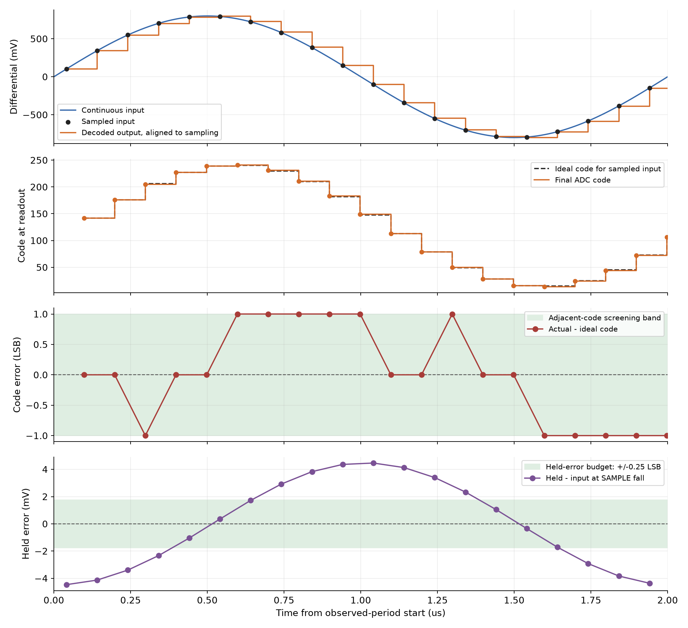
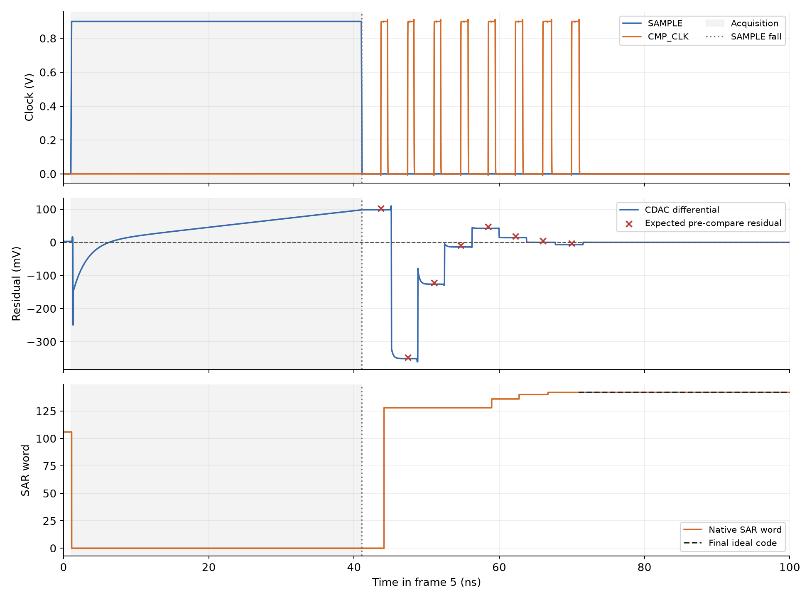

# B版本单周期正弦时域验证

当前 B 整机在 500 kHz 连续正弦下完成全部 24 帧转换，未出现此前的
大幅跳码或参考恢复事件丢失迹象；但采样保持误差未达到原分配预算。
20 个观察点的最大误差为 4.464649 mV，14 点超过 1.7578125 mV。
关断前的连续波形已存在同量级跟踪误差，下一阶段应优先检查采样带宽，
不能把这次结果称为整机性能通过。

## 电路与测试条件

基准是已同步 B 参考栅控事件修复的 `SAR_ADC_T28/sar_adc8_join_r3/schematic`，
测试台为 `tb_sar_adc8_join_r3/schematic`。源基准提交 `f115f7f`，本次启动
提交 `87cbeb2`。新 OA 导出与采用 B 时的原生子电路逐段一致，36 个依赖
表面核对通过；B 与 commit 模型从 OA 下载并校验。此次没有修改 OA。

Bootstrap、512 个独立 MOM 单元、3×参考 pass MOS、StrongARM 与原生异步
SAR 的拓扑和 W/L 均未改变。采样时钟与参考栅控仍使用既有理想激励，
并非已经实现管级时钟或参考驱动。

| 项目 | 本次条件 |
| --- | --- |
| 输入 | 500 kHz 连续差分正弦，峰值 ±0.8 V，共模 0.45 V |
| 采样 | 10 MS/s，100 ns 一帧，4 帧启动加 20 帧观察 |
| 时间 | 实际 0–2400 ns；观察窗 400–2400 ns，恰好一个正弦周期 |
| 原生模型 | T28 TT MOS、MOM 等原导出模型 sections；0.9 V、27 °C |
| 输入与参考 | 每侧输入 50 Ω；每条参考轨 50 Ω 加 4 pF，未理想化 |
| 求解 | Spectre 21.1，APS 4 线程，conservative，maxstep 10 ps，gear2only |
| 精度 | 请求 reltol 1e-5，原生报告 1e-6；vabstol 10 nV，iabstol 100 fA |
| 随机效应 | 没有开启瞬态噪声、随机失配或 PVT 扫描 |

沿用此前 B 的声明 stop 51.6 µs，以保持依赖 stop 的求解默认值；既有被动
结束观察器在 2.4 µs 正常终止分析。原生报告的求解参数与此前 B 完全一致，
只有保存起点从 800 ns 改为 0，以保留启动波形。

## 测量基准和转换时序

每帧 SAMPLE 的实际保存波形在下降沿穿越 0.45 V，时刻为
`100 × frame + 41.05 ns`，作为本次名义采样基准，而非宣称它等于物理
MOS 的精确孔径。源端差分输入在这个时刻取值，CDAC 差分电压在其后
0.6 ns 取值，两者之差定义为本次采样保持误差。它包含跟踪滞后和切换
影响，不是单独测得的保持漏电或电荷注入。

每帧 98 ns 读取最终 SAR 码，并检查 90 ns 与 98 ns 一致。
因此图中的读码时间比名义采样晚 56.95 ns；最后一次原生 update 触发
约在帧内 70.7–70.9 ns。没有增加输出寄存器或用理想码替代真实结果。
被动日志和保存波形的 24 组源电压、保持电压、误差在 0.1 µV 内一致。

理想码使用原电压映射：`floor((Vin_diff + 0.9) / (1.8/256))`，限幅
到 0–255。一个 LSB 是 7.03125 mV，0.25 LSB 是 1.7578125 mV。
码差 ±1 仅作粗大错误筛查，不是 DNL、INL 或 ENOB 合格线。

## 完整结果

| 检查项 | 结果 |
| --- | --- |
| 原生执行 | result.ok；0 errors、7 warnings、7 notices |
| 转换时序 | 24/24 帧均为 8 次比较、8 次写入、8 次更新，最终读码稳定 |
| 20 个观察点码差 | 实际减理想为 −1、0 或 +1；没有绝对码差大于 1 的点 |
| 采样保持误差范围 | −4.464649 至 +4.464647 mV，最大绝对值约 0.635 LSB |
| 采样保持预算 | 14/20 点超过 0.25 LSB，未通过 |
| 比较器输入对端电压 | VGS/VGD/VDS 最大绝对值 0.898006 V，低于本次 0.99 V 筛查线 |
| 数值与应力告警 | 无 CMI-2754、无 SPECTRE-16780 LTE 放宽信息 |

保留的 7 个警告为原有的 1 个 AHDL 环境变量提示、2 个全局节点与子电路
端口重名提示、4 个 PDK scalefactor 重复设置提示。最后一项沿用原模型
设置，未修改或复制 foundry 模型。输入对检查与无 CMI 告警不等于全芯片
所有器件、所有角落的可靠性签核。

原生求解日志耗时 26 分 43 秒；桥接记录下载约 76.4 秒，解析约 211.6 秒，
桥接总耗时约 31 分 39 秒，不含后续画图审核。保存 44 路连续信号，
1,326,793 个时间点；原始 ASCII 波形约 2.01 GB。

## 波形如何看



从上到下：连续输入、采样点与解码电压；理想码和实际最终码；码差；
采样保持误差及 ±0.25 LSB 预算。第一幅为比较幅度，将最终码映射的
bin 中心电压放回对应采样时刻；第二、三幅使用真实 98 ns 读码时刻。
图中的延迟处理只是显示对齐，没有移动验收采样基准。



细节图选择最大保持误差的第 5 帧，原始索引 frame=4，绝对时间
400–500 ns，而非挑选最干净的一帧。灰区为采集段，竖虚线为 SAMPLE
下降沿。中幅蓝线为 CDAC 实际差分电压，红叉为每次实际试探码对应的
理想比较前残差；末幅为真实 SAR 寄存器逐位结果，虚线为最终理想码。
该帧理想和实际最终码都为 142，但这不消除 4.465 mV 的模拟采样误差。

## 误差在关断前已经存在

同一最差帧在 440.05 ns，即名义关断前 1 ns：SAMPLE 仍为 0.9 V，
两侧主开关栅极减输入电压约 0.8928/0.8929 V，电路仍处于跟踪状态。

| 差分电压或差值 | 440.05 ns 的值 |
| --- | --- |
| 源端输入 | 100.391258 mV |
| 输入引脚 | 100.262587 mV |
| CDAC 顶板 | 95.673304 mV |
| 输入引脚减源端 | −0.128672 mV |
| CDAC 减输入引脚 | −4.589283 mV |
| CDAC 减源端 | −4.717954 mV |

到 441.05 ns，名义采样输入为 102.884166 mV；441.65 ns 保持电压为
98.419517 mV，误差 −4.464649 mV。因此不能把全部误差解释成关断瞬间
才产生的注入，也不能说 B 的参考恢复修复把动态采样带宽一并解决了。

误差随输入斜率改变符号，接近峰谷时较小。用这一个频点的 20 个数据
拟合 `error ≈ −tau × dVin/dt`，等效 tau 为 1.780792 ns，拟合剩余误差
峰值约 0.225487 mV。这是跟踪滞后或孔径效应的诊断，不是已测得的
唯一物理 RC，也不是校准参数；所有预算和理想码仍按未平移的输入评价。

后续宜先用有界短测试区分 Bootstrap 有效 Ron、输入负载和关断时序的
贡献，再决定尺寸或时序是否需要调整。本轮没有新增这些实验。
此前近似定值采集的 B 历史重放与连续正弦测试条件不同，其约 0.1 mV
误差不能外推为动态跟踪误差。

## 结果入口与复核

- 配置：[r3_b_sine_period.yaml](../config/r3_b_sine_period.yaml)。
- 小型受控结果：[b_sine_period_results.json](../verification/integration/b_sine_period_results.json)。
- 分析和画图：[b_sine_analyze.py](../scripts/integration/b_sine_analyze.py)。
- 本机原始证据：`output/b_sine_period/` 中的 result、context、summary、
  waveform receipt、pickle、原生日志、PSF 以及不可变 deck/includes 快照。
- 完整逐帧、逐比较记录保存在生成的 `summary.json`；受控结果保存配置、
  24 帧核心数值、应力、全部警告、波形与图像哈希，不提交大型原始波形。

原始波形在本机可用时，可仅重做分析和画图，不启动 Spectre：

```powershell
.venv/Scripts/python.exe scripts/integration/b_sine_analyze.py
```

`--curate` 只在流程的 `awaiting_visual_review` 阶段完成图像审核后执行，
用于本次受控结果的整理；最终流程完成后不会自动覆盖受控报告。

本次只验证一个周期的时域转换，不产生 DNL、INL、SNDR 或 ENOB；也不把
执行成功、码差有限或单频等效滞后拟合当作整机性能合格。
