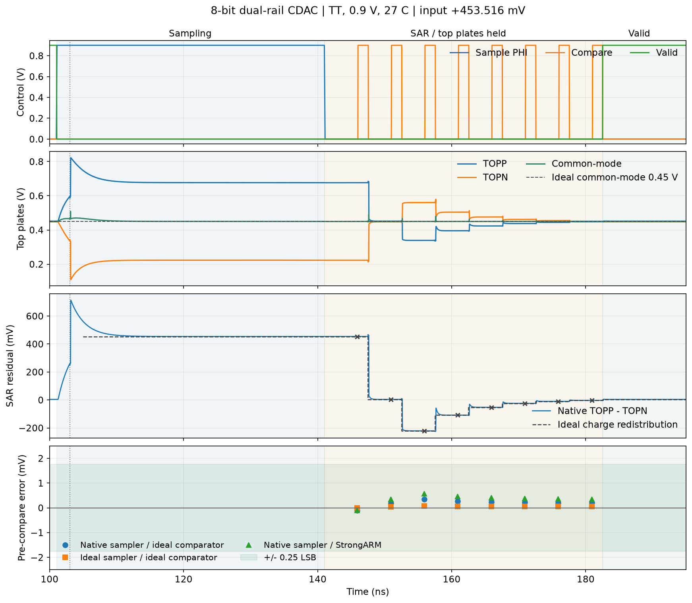
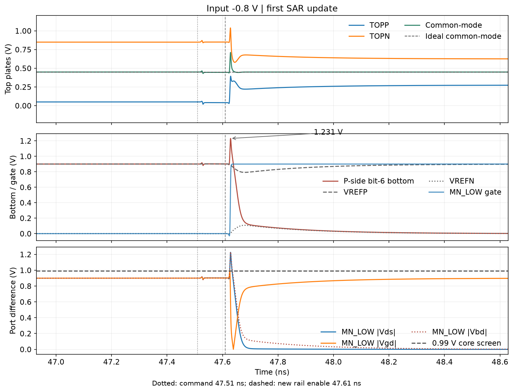
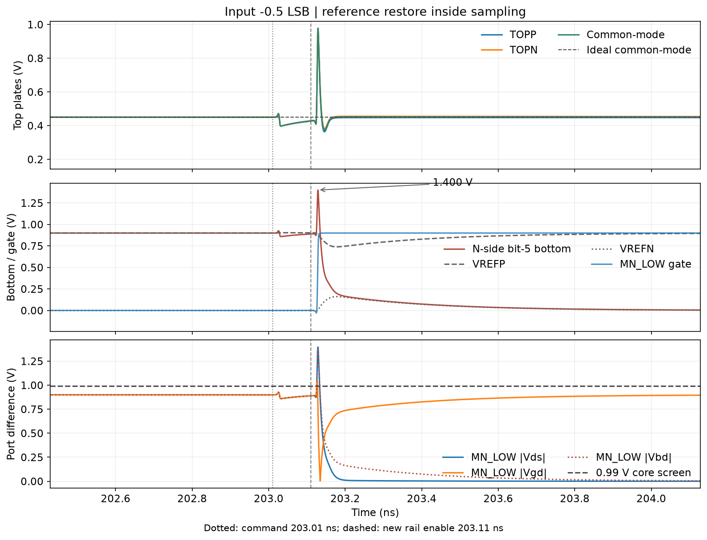
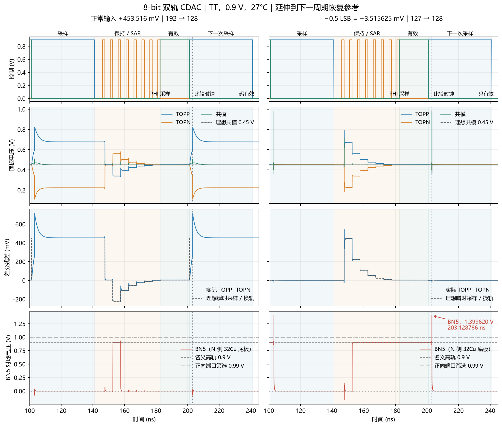
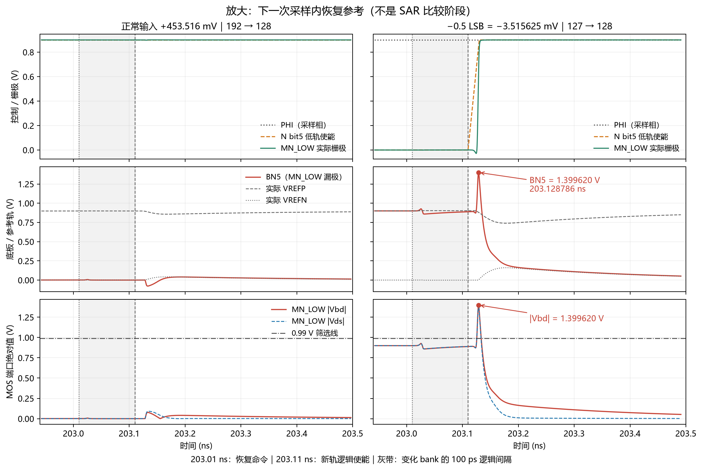
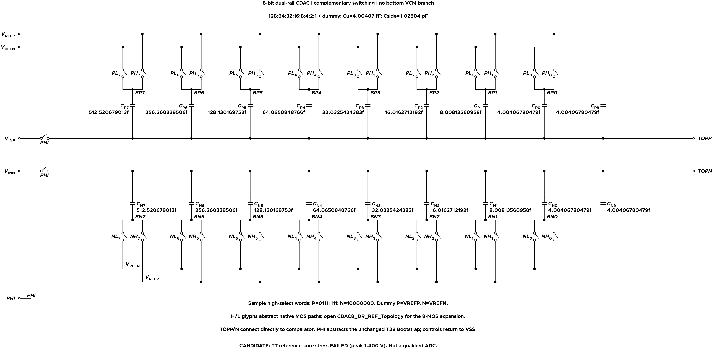
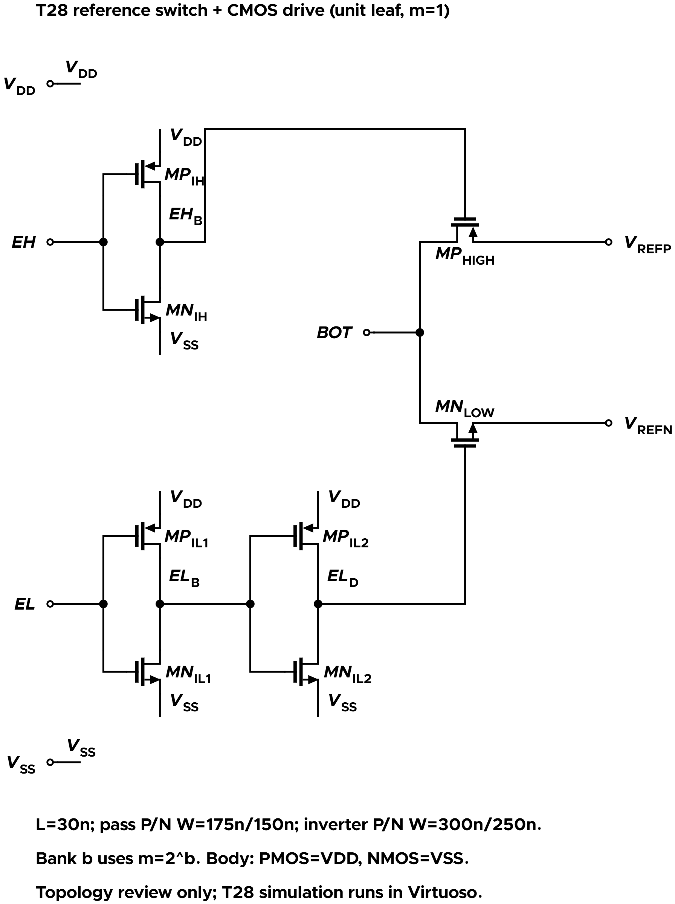

# 8-bit 双轨互补 CDAC：独立器件级候选

## 这次实际改变了什么

这是 **8-bit**，不是 Canvas 参考图的 10/11-bit。保留顶板 Bootstrap 采样，
保留原来的 T28 MOM 单元和 `128:64:32:16:8:4:2:1 + dummy` flat 阵列；
移除底板第三条 VCM 选择支路，使用 VREFP/VREFN 两条轨。

采用互补二进制 SAR，而不是严格的单边单调下切：该选择回应了“初态
01111111、稳定共模”的要求，不能称为已经验证的严格单调算法。
本轮固定 5 ns 的 bit 时序仅用于隔离 CDAC 实验，**不替代项目选定的异步
SAR 架构**，没有实现异步 completion/guard/deadline 电路。

原有 8-bit 器件基线、Bootstrap、StrongARM 和用户 Canvas 原图不变。
这是待审核候选，未冻结尺寸、未替换主基线、未宣布完整 ADC 达标。

## 本轮结论：稳态误差小，但跨输入端口应力失败

最终源码完成 **13 次 result.ok** 原生 APS 瞬态：四个 bench 对照和九个
跨输入；加上初版 smoke/quick 共 18 次成功运行。`result.ok` 只证明仿真完成，
不代表电路通过。全部为 TT MOS/TT MOM、0.9 V、27°C；无物理 transient noise。

主测试 +453.515625 mV 的结果：

| 配置 | 输出码 | 比较前原始残差最大误差 | 参考/驱动最坏端口 |
| --- | ---: | ---: | ---: |
| 原生 Bootstrap + nominal MOM + 理想比较器 | 192，正确 | 0.340652 mV | 0.977787 V |
| 512 独立 MOM 单元，其余相同 | 192，正确 | 0.340652 mV | 0.977787 V |
| 理想采样开关，其余仍原生 T28 | 192，正确 | 0.071996 mV | 0.975475 V |
| 原生 Bootstrap + 原生 StrongARM | 192，正确 | 0.570838 mV | 0.977736 V |

StrongARM 锁存前最小输出差分约 0.899926 V，八次锁存均已解析；仅这一
测试点的接口检查。nominal/literal 对照数值一致，不代表已做电容 mismatch。
主测试最终比较共模约 0.449555 V；误差图的点只表示比较前测量，不暗示
切换尖峰期间也满足误差上限。



九点均为静态差分输入，不是满幅输入阶跃或满带宽动态采样验收。
最终码全部正确，最大原始残差误差 0.358645 mV，小于
1.7578125 mV（0.25 LSB）；但 **九点的参考 core 端口筛选全部失败**：

| 差分输入 | 输出码 | 比较前误差最大值 (mV) | 全程最坏端口 (V) | 恢复窗口最坏端口 (V) |
| --- | ---: | ---: | ---: | ---: |
| −0.8 V | 14 | 0.358645 | 1.231041 | 1.204602 |
| −0.4 V | 71 | 0.205470 | 1.298572 | 1.298572 |
| −0.05 V | 120 | 0.285145 | 1.389319 | 1.389319 |
| −0.5 LSB | 127 | 0.295737 | **1.399620** | **1.399620** |
| 0 V（码边界） | 128 | 0.296435 | 1.008875 | 0.900000 |
| +0.5 LSB | 128 | 0.295633 | 1.008875 | 0.900000 |
| +0.05 V | 135 | 0.285042 | 1.008876 | 0.940102 |
| +0.4 V | 184 | 0.205364 | 1.008884 | 0.965189 |
| +0.8 V | 241 | 0.358643 | 1.101295 | 1.101295 |

这些失败有实际 CMI 警告，不是只由脚本重建的峰值推断。例如 −0.8 V
有 15 条已打印 CMI、18425 条通用抑制计数；−0.5 LSB 有 15 条 CMI、
19945 条抑制计数。不能把通用抑制计数精确等同于独立超限事件数。
所有已完成运行均未见 SPECTRE-16780 LTE relaxation。

### 两种失败时刻

1. **SAR 换轨尖峰**：−0.8 V，第一次比较锁存 47.51 ns 后，新参考选择
   约 47.61 ns 生效；P bit-6 底板于 47.628927 ns 达 1.231041 V，
   `XCDAC.XSP6.MN_LOW |Vbd|` 超限。247.628908 ns 仍为 1.230996 V，
   不是仅上电一次的假象。
2. **下一周期参考恢复尖峰（全局最坏）**：−0.5 LSB，最终 code=127，
   下一采样将码恢复到 128，即 `01111111 → 10000000`。203.128786 ns，
   `XCDAC.XSN5.MN_LOW |Vbd|` 达 1.399620 V。此时 Bootstrap 已处在采样相，
   所以“先打开采样、后恢复参考”并没有自动保证瞬间安全。





图中点线是命令时刻，虚线是 100 ps blanking 后的新参考使能时刻。
时序/门极/顶板波形与“多 bit 反向翻转、有限驱动不同步，使暂时浮置的底板
被顶板重分配与门极耦合推离参考轨”相符。这是机制推断，尚未定量分离
每个电荷分量；不能把整个 1.4 V 峰值归因于单一 Cgd 或 Bootstrap 漏电。

恢复结束后的底板误差仅约 0.003811 mV，**最终建立好不等于途中安全**。
去掉 VCM 支路、维持最终共模都没有消除瞬态问题；本轮不能据此认定双轨
比原三轨在应力上更好。尤其不能把此二进制多 bit 翻转的结果，冒充用户
提出的“先上后单调下切”算法已经验证。

### 硬失败后的停止边界

原计划的 26.02 us 全码中心/256 点相干正弦长瞬态已启动，发现上述 TT 硬
失败后仅中断这两项精确核实归属的 Spectre 进程，保存原始日志与部分 PSF。
静态在 8.08253 us、动态在 7.95263 us 报 SPECTRE-25 中止；这不是 license
失败，也不是正常完成。**不报告完整原生静态通过、SNDR 或 ENOB**，不继续
PVT/MC。三个纯理想 oracle 测试全通过，只说明算法/理想电荷关系正确。

下一步应先审核切换算法和恢复路径：严格单调策略与比较器共模要求、
127→128 的多 bit 恢复次序、原生门极有效换轨先后与 slew/blanking。
再评估需要耐压器件还是更温和的时序/驱动；不应只盲目增大 W/L。
修好 TT 硬门限后，才重启完整静态、动态和 PVT。Bootstrap 仍保持独立问题线。

精确小型汇总及 case/source/deck/VA hashes：
[metrics.json](figures/cdac8_dualrail/metrics.json)。

### 正常输入与 −0.5 LSB：同一时间轴对照

下面两图直接重画已完成的 `final_nominal` 与 `clean_va_input_-3516`，没有
修改电路或重新仿真。两组为同一原生 OA DUT、相同 VA hashes/PVT/时序，
只有静态输入不同；均是原生 T28 Bootstrap/参考 MOS/MOM + 理想比较器，
不是另外的 StrongARM 或异步控制器结果。

原时序图截止 195 ns；新增总览延伸到 245 ns，覆盖下一次采样与参考恢复。
左列正常输入 +453.515625 mV，恢复 `192→128`，只变 bit6；右列
−3.515625 mV（−0.5 LSB），恢复 `127→128`，8 bit 全部翻转。
两列使用相同坐标尺度，保留原始采样点，不平滑掉尖峰。





重点是右列 203.128786 ns：**BN5 = 1.399620 V**。BN5 是 N 侧 bit5
（32Cu）电容组底板，也是 `XCDAC.XSN5.MN_LOW` 的漏极；其 bulk 接 0 V，
因此该刻 `Vbd = −1.399620 V`、`|Vbd| = 1.399620 V`，不是 1.4 V 差分
采样误差。`|Vds|` 同时约 1.396209 V，并非只有命名/符号造成超限。

阶段定位：上一周期约 182.53 ns 码已有效；201.05 ns 新采样相开始，
203.01 ns 发恢复命令，变化 bank 在 100 ps 逻辑间隔后，于 203.11 ns
开始新轨使能边沿；尖峰发生在其后约 18.8 ps。灰带只表示变化 bank 的
逻辑 blanking，不表示所有原生 MOS 已完全关断或下一开关已完全导通。
尖峰处 PHI=0.9 V、BUSY=VALID=0：属于**下一次采样内的参考恢复**，
不是 SAR 比较阶段。正常列 BN5 的 bit5 选择保持不变，不能把该器件的
小应力值误当成正常输入下“所有参考 MOS 的最大值”。

逐点/来源核对记录：[restore_compare_metrics.json](figures/cdac8_dualrail/restore_compare_metrics.json)。
复现：`.venv/Scripts/python.exe scripts/cdac8_dualrail/compare_restore.py`。

## 电气结构与初态

- VDD/VREFP=0.9 V，VREFN=0 V；输入共模=0.45 V；10 MS/s。
- 每侧 256 Cu，Cu=4.004067805 fF（既有提取的名义值，不是全 PVT 常数），
  总电容约 1.025041 pF。
- 实体版共 512 个独立 `tsmcN28/cfmom_2t` 单元；nominal 版以 m 聚合。
- P dummy 永久接 VREFP，N dummy 永久接 VREFN。
- 采样时 active code=128；按 b7→b0，P 高轨选择 `01111111`，
  N 高轨选择 `10000000`；低轨选择取反。
- 每次试探码 k：P 高轨权重和为 255−k，加 dummy 后为 256−k；
  N 高轨权重和为 k。因此两侧加权底板电压和不变。

理想电荷守恒给出：

`VTOPP − VTOPN = VINDIFF + 0.9 − k × 1.8/256`

`(VTOPP + VTOPN)/2 = 0.45 V`

第一比较已经是 k=128，因此直接比较采样输入；之后以比较器实际输出决定
保留/丢弃当前位，再直接建立下一试探码。实际寄生、驱动延迟、参考阻抗和
比较器 kickback 仍会破坏理想值。移除 VCM **支路**不等于不需要输入共模。

每个底板参考单元有八只原生 T28 core MOS：一只 PMOS 选高轨、一只 NMOS
选低轨，高轨一路反相器、低轨两级反相器。L=30 nm；pass P/N W=175/150 nm，
inverter P/N W=300/250 nm；bit b 的乘数为 2^b。16 组共 128 只 MOS。
每次改变选择先同时关断，100 ps 后接入目标轨；控制器本身仍是 Verilog-A。

## 时序

以下为每个 100 ns 周期内的相对时间；图中展示第二周期，整体加 100 ns。

| 事件 | 时间 |
| --- | ---: |
| Bootstrap 开始采样（PHI 50%） | 1.05 ns |
| 恢复底板初态 k=128 | 3.01 ns，采样开关已经导通 |
| Bootstrap 结束采样 | 41.05 ns |
| SAR 控制进入 busy | 43.01 ns |
| 第一次比较 / 锁存 | 46.01 / 47.51 ns |
| 后续比较周期 | 5 ns |
| 第八次锁存 / valid | 82.51 ns 左右 |
| 下一周期重新采样 / 恢复参考 | 101.05 / 103.01 ns |

顶板从约 41.05 ns 起保持隔离，但 SAR 期间允许底板重分配，使顶板电压
按试探码变化；“保持”不是要求 TOPP/TOPN 电压恒定。参考恢复安排在下一次
采样已经打开之后，不在悬浮顶板阶段进行全阵列复位。

## 原理图、模型和证据边界

库 `SAR_ADC_T28`，技术 `tsmcN28`：

- `cdac8_dr_sw_b0..b7`：原生参考 MOS/驱动。
- `cdac8_dr_nominal` / `cdac8_dr_literal`：聚合/512 独立单元阵列。
- `tb_cdac8_dr_nominal` / `tb_cdac8_dr_literal`：原生 Bootstrap、参考开关和
  MOM；理想符号比较器（无噪声、offset、再生时间、共模限制、kickback）。
- `tb_cdac8_dr_strongarm`：不改尺寸的真实 StrongARM 接口对照。
- `tb_cdac8_dr_ideal_sample`：只把 Bootstrap 替换为 150-ohm 理想采样开关，
  参考 MOS 和 MOM 仍为 T28；这不是全电路理想模型。

参考源是 50-ohm + 4-pF 外部边界，不是已完成的 reference buffer。
时钟、控制和输入激励是明确声明的行为模型。

四个 bench 均从保存的 OA 原理图导出；仿真 wrapper 只设参数、corner、温度、
精度、分析和 saves，所有 DUT subckt 逐字保持一致。最终重新导出与运行版本
除注释时间外一致；三个远端 VA 文件 SHA256 与本地一致。14 个新 schematic
均零 marker；12 个既有只读依赖前后 API 读回完全相等。

初版 smoke 因 transition 内包含连续 VDD，触发 VACOMP-1116。已把 VDD 乘法
移到 transition 外，并重跑最终验证；初版 VA 快照和结果保存在 va_v1，
不得把初版结果冒充最终源码结果。继承的模型 SFE-1131 / AHDL 环境提示与
真实 CMI 电压警告分开统计。

## Canvas 审核入口

原 `CDAC/dut` 保持 revision 266，top-Cell 指定也未改变。

- `CDAC8_DR_Review`：完整阵列连线；H/L 符号抽象实际 MOS 路径，PHI 符号
  抽象原有 Bootstrap；TOPP/TOPN 是比较器连接接口，不伪造比较器细节。
- `CDAC8_DR_REF_Topology`：展开八只 MOS 的 D/G/S/B 与驱动连接，unit m=1，
  b 组按 2^b 放大。器件模型名/尺寸与原生 leaf 对应，没有上传 PDK 模型正文。

两图均零错误/零警告；与明确编写的预期逻辑网表拓扑比对 equal。Canvas 是
审核示意图，不是拿 Sky130 模型代替 T28 仿真的结果，也不是完整 OA 文件导入。





## 运行方法与原始证据

本地 `output/cdac8_dualrail/` 保存原始 OA exports、deck、VA 快照、case/hash、
Spectre log/PSF、波形、metrics、Canvas snapshots/verification、final audit。
这些是生成证据，不提交 PDK/OA 数据。小型汇总和图提交在本文目录。

```powershell
# bridge venv / 原生 Spectre；final 不覆盖已有运行，重复实验需新命名
$env:VB_DISABLE_CONTROL_MASTER='1'
$env:PYTHONIOENCODING='utf-8'
& E:/bridge-Agent-T28/virtuoso-bridge-lite/.venv/Scripts/python.exe scripts/cdac8_dualrail/run.py final

# 本地数值分析与绘图
.venv/Scripts/python.exe scripts/cdac8_dualrail/analyze.py
.venv/Scripts/python.exe scripts/cdac8_dualrail/figures.py
.venv/Scripts/python.exe verification/cdac8_dualrail/test_oracle.py -v
```

0.99 V 是本轮 core MOS 端口差筛选线（Vds/Vgs/Vgd/Vbs/Vbd），不是 foundry
reliability signoff。静态码中心检查不等于 DNL/INL；确定性正弦指标不包含
transient noise / offset / mismatch。原有 Bootstrap SS 冷角阶跃问题、比较器
噪声/随机失调和后续布局寄生仍未解决。不能因单个 StrongARM 对照码正确，
宣布完整 8-bit 管级 ADC 已完成。
