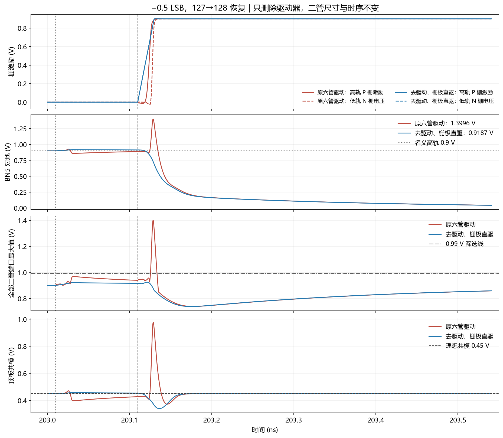
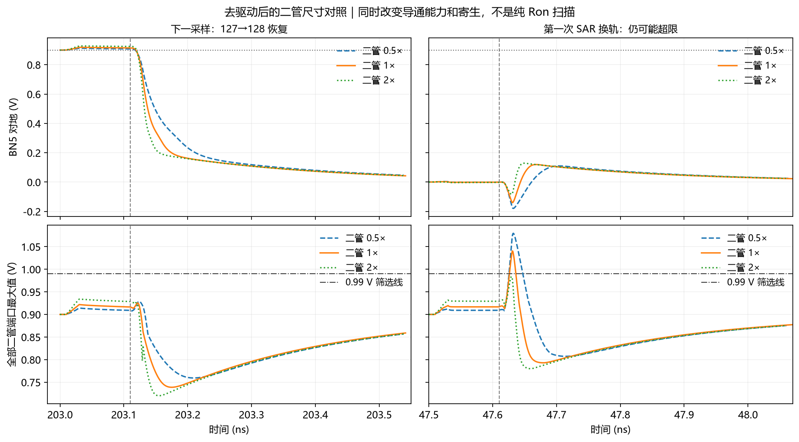

# CDAC 二管选轨：去掉驱动器的网表级对照

2026-10-20。本轮响应“去掉驱动器，只剩二管开关”的实验要求。
**1.4 V 恢复尖峰在理想栅极直驱下消失，但原尺寸仍有 SAR 换轨超限。**
没有改原理图/Canvas、Bootstrap、主基线或当前异步控制器。

## 实际做法与边界

从之前完成的 OA 原生导出 deck 派生独立诊断版；每个参考单元删除六只
驱动 MOS，只留下原有 `MP_HIGH/pch_mac` 和 `MN_LOW/nch_mac`。1× 版本
的两只 pass 管实例声明逐字不变，其他原生 subckt 也不变。
参考/驱动 MOS 实例数由 128 减到 32（未按并联倍率展开计数）。

栅极由测试台理想受控电压源施加：

```text
G_PMOS = VDD − EH
G_NMOS = EL
```

保留原来的 EH/EL 控制、100 ps 逻辑先断后通、20 ps 命令边沿；这不是把
P/N 任意同时打开，也没有取消 127→128 的全 bit 恢复。这里保留的是 PMOS
选高轨、NMOS 选低轨的二管结构，不是每条参考支路一组 CMOS 传输门。

理想源具有零输出阻抗，**去驱动不等于弱驱动**，它消除了原驱动器的
延迟/非线性边沿、有限输出阻抗及其寄生交互。此版仅用于定位问题，不能
作为真实可实现的无驱动电路，也不能把全部改善唯一归因于某一个延迟。

另扫 `MULT_R=0.5/1/2`，同时缩放两只 pass 管的并联乘数，不改单位
W/L（P=175/30 nm，N=150/30 nm）。该扫描同时改变导通能力及寄生；
0.5× 有分数 multiplicity，仅为敏感度诊断，不是冻结的可布局尺寸。
2× 为整数并联倍率，但本轮也未建立对应的新 OA。

所有实验保留原生 T28 Bootstrap、MOM、电源/参考阻抗边界以及固定周期
VA SAR 控制器和理想符号比较器；TT MOS/TT MOM，0.9 V，27°C，300 ns，
无 physical transient noise。不是全管级 ADC、真实 StrongARM 或异步实现验收。

## 六次完成的原生 Spectre APS 结果

前五组加一组 10-ps 最大步长复核，全部 `result.ok`、有限且完整到 300 ns。
下面四行均为输入 −0.5 LSB、最终 code=127（正确），恢复字码保持 127→128。

| 栅极驱动 / 二管倍率 | BN5 恢复峰值 (V) | 恢复最坏端口 (V) | SAR 最坏端口 (V) | 全程筛选 |
| --- | ---: | ---: | ---: | --- |
| 原六管驱动 / 1× | 1.399620 | 1.399620 | 1.231142 | 失败 |
| 理想直驱 / 0.5× | 0.912762 | 0.928971 | 1.079517 | 失败 |
| 理想直驱 / 1× | **0.918698** | **0.925287** | **1.040451** | 失败，剩 SAR |
| 理想直驱 / 2× | 0.927756 | 0.933910 | **0.983908** | 仅此 TT 输入点通过 |

主问题不是只有 BN5：脚本仍重建全部原生参考/驱动 MOS 的
Vds/Vgs/Vgd/Vbs/Vbd，统计所有 16 个底板，而不是用单个底板代替全电路验收。
图中“全部二管端口最大值”仅取两只 pass 管，方便原驱动/直驱同范围比较；
表格是该版本所有剩余参考/驱动 MOS 的最坏值，不包含 Bootstrap 内全部 MOS。

恢复共模正峰从 0.976439 V 降至 0.458983 V（直驱 1×），但仍有短暂
负向共模扰动；没有声称换轨期间共模完全不动。比较前最大残差误差分别
约 0.295737/0.273981/0.295731/0.339178 mV，均低于 1.7578125 mV 的本轮
确定性预算；这些是静态输入的比较前值，不是切换尖峰指标。



## 剩余失败发生在哪里？

直驱 1× 的全程最坏点变为 **47.630952 ns**、
`XCDAC.XSN5.MP_HIGH Vgd = 1.040451 V`。该刻：

- BN5 = −0.140451 V；PMOS gate = 0.9 V。
- 因而 Vgd = 0.9 − (−0.140451) = 1.040451 V。
- 这是第一次 SAR 换轨时的底板负向下冲，不是下一采样参考恢复的正尖峰。

尺寸减半使该类全程应力更差；放大 2× 则降低。与此同时，恢复窗口 BN5 的
小正峰随倍率增加略升，说明不同阶段的导通建立、耦合/注入不能混为一谈。
这组结果**不支持把总体问题简单解释成“开关导通太强”**，但倍率同时改变
寄生，尚不能把改善定量地全部归因于 Ron。



## 驱动延迟证据与精度复核

在原驱动版，N 侧 bit7 高轨 PMOS gate 的下降 50% 时刻为
203.124017 ns，bit5 低轨 NMOS gate 的上升 50% 时刻为 203.128114 ns，
差约 **4.097 ps**；理想直驱两者均为 203.120000 ns。50% 电压时刻不是
精确沟道开启时刻。去驱动也改变输出阻抗/寄生，不能只用这个时间差解释
全部 1.4 V 尖峰，但它提供了后续匹配真实驱动器的明确观察量。

原驱动重跑完全复现保留的 1.399620349965 V 峰值；不是只复用旧图。
2× 直驱从 maxstep=100 ps 收紧到 10 ps 后，最坏端口为
**0.983907774 V**，差 −0.511 µV；比较前误差最大值变化 +0.129 µV。
复核码仍为 127，CMI/抑制/LTE 警告均为零。但距 0.99 V 只约 **6.09 mV**，
没有跨输入/PVT/MC/版图裕量资格。

额外的 +453.515625 mV、直驱 1× 对照输出 code=192，比较前误差最大
0.340646 mV，全程参考端口最大 0.973632 V，零 CMI/抑制/LTE。
原驱动、直驱 0.5×、直驱 1× 仍有真实 CMI，已打印各 15 条，通用抑制
计数分别 19945、10789、6664；未把这些运行误标为应力通过。

## 本轮判断

1. 相同的 127→128 全 bit 恢复，在理想直驱下不再产生 1.4 V。
   **全 bit 翻转本身不必然导致这个幅度；原驱动实现是重要影响因素。**
2. “把驱动变弱”不等同于本实验。直驱源更硬；二管减半也没有改善总体
   应力。应分别检查实际 P/N 栅极先后、输出阻抗、换轨负向下冲和寄生电荷。
3. 下一步应把理想直驱作为诊断基准，设计匹配的真实驱动并重跑跨输入；
   不能直接宣布删除驱动可用于最终 ADC，也不据单点 2× 结果冻结尺寸。

没有修改现有 OA/Canvas 或替换主基线。原始 deck/result/log/PSF、来源
及 staged VA hashes 在 `output/cdac8_no_driver/`；无 PDK 模型正文提交。
0.99 V 只是本轮 core 端口筛选线，不是 foundry 可靠性签核。
小型结果：[metrics.json](figures/cdac8_no_driver/metrics.json)。

```powershell
# 新输出名才可重复运行；脚本拒绝覆盖已存在的 case/deck/result
$env:VB_DISABLE_CONTROL_MASTER='1'
$env:PYTHONIOENCODING='utf-8'
& E:/bridge-Agent-T28/virtuoso-bridge-lite/.venv/Scripts/python.exe scripts/cdac8_dualrail/no_driver_experiment.py prepare
& E:/bridge-Agent-T28/virtuoso-bridge-lite/.venv/Scripts/python.exe scripts/cdac8_dualrail/no_driver_experiment.py run
.venv/Scripts/python.exe scripts/cdac8_dualrail/no_driver_results.py
```
