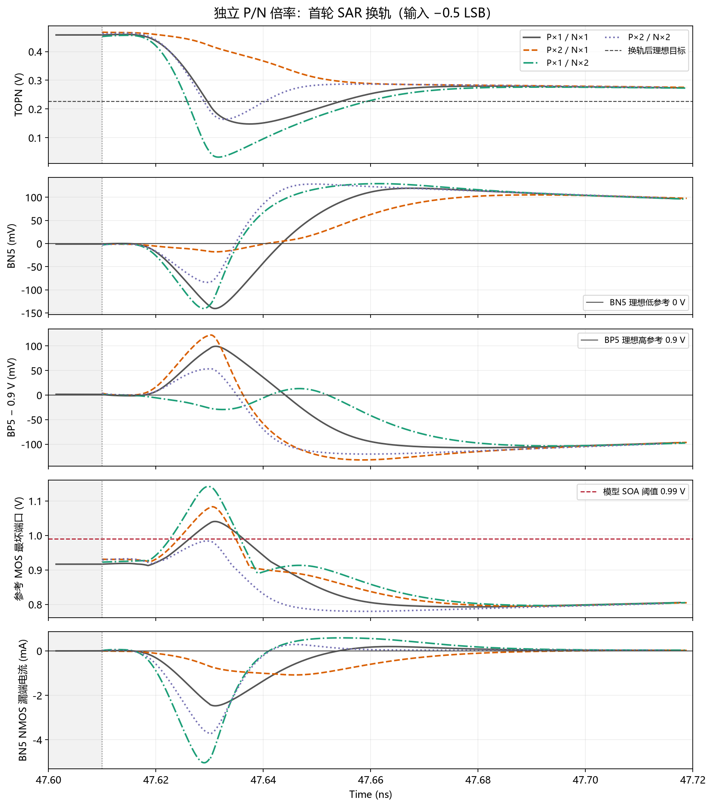
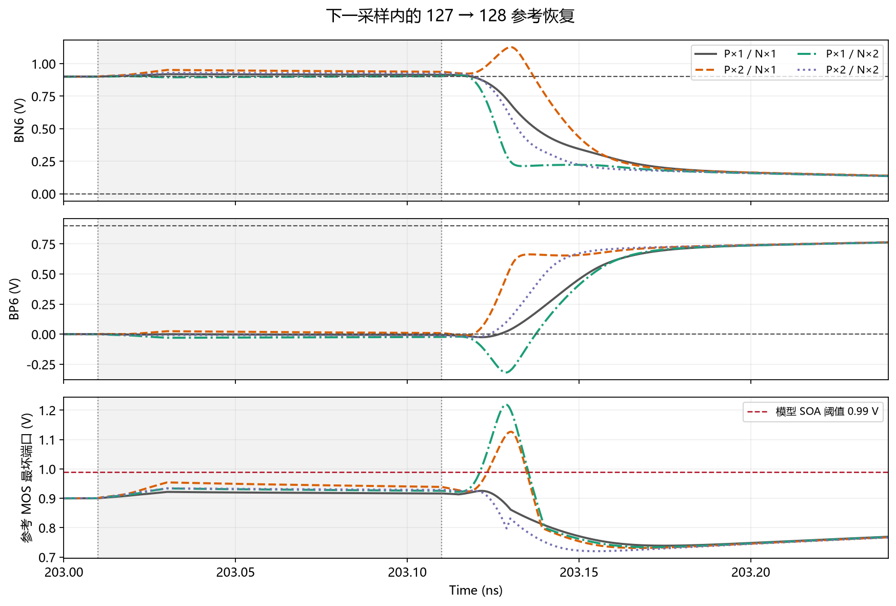
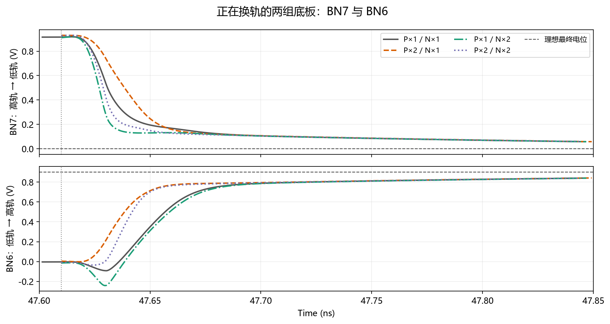

# CDAC 二管选轨：独立 P/N 尺寸对照

2026-10-20。响应“P 相对弱 / N 相对强是否造成负尖峰”的实验要求。
本轮是独立网表级原生 Spectre 诊断，不修改 OA/Canvas、Bootstrap、
异步控制器、已安装 VA 或主基线。

## 条件与变量

- T28 `pch_mac` / `nch_mac`，单位 W/L 分别为 175/30 nm、150/30 nm。
- 只改变 P/N 的整数并联倍率：P1N1、P2N1、P1N2、P2N2。
  对应等效总宽度比为 1.167、2.333、0.583、1.167；各 bank 的 2^bit
  负载缩放不变。不是直接改 PCell 的单指 W/L，也不据此冻结布局尺寸。
- 原生 Bootstrap、MOM、参考 R=50ohm/C=4pF 与输入边界不变。
- 理想栅极直驱，20ps 边沿、100ps 先断后通；理想符号比较器，固定周期
  VA SAR 仅作 CDAC 表征，不是原生异步控制器或完整管级 ADC 验收。
- TT、0.9V、27C、300ns，无 physical transient noise。
- 两个静态差分输入：-0.5LSB=-3.515625mV、+453.515625mV；预期输出127、192。

从完成的 direct_bad/direct_control 派生，各叶单元仅把 P 的 multi
乘以 MP_RATIO、N 的 multi 乘以 MN_RATIO。逆向移除新增倍率/参数和保存
指令后必须逐字恢复源 deck。其他原生模块、VA、控制边沿、参考网络均不变。
补存 P/N 两侧 bit5/6/7 的 P/N 管第一端（漏端）电流；按 Spectre 定义，
正电流进入漏端。它包含位移/结电流，不能直接用瞬时 V/I 当作纯 Ron。

## 观察与边界

检查所有32只参考 MOS 的 Vds/Vgs/Vgd/Vbs/Vbd，而不只看 BN5；分别统计
全程、启动后、SAR、参考恢复窗口。保留 CMI、抑制告警和 LTE 信息。
0.99V 与当前模型运行时报告的 SOA 阈值一致（CMI-2754/2751/2755）；
不是已验证的击穿电压，也没有短脉冲寿命豁免或可靠性签核结论。

比较前8个点以理想电荷重分配为基准，预算0.25LSB=1.7578125mV。
首轮负输入128->64换轨重点观察 BN7下降、BN6上升、TOPN、BN5以及BN5的
低轨NMOS电流。BN5自身栅极在此窗口恒定：P关断，N导通。

本扫描同时改变导通能力、寄生与电荷，结果能判断尺寸选择的敏感性，
不能单独证明某一迁移率、Ron、注入或位移电流是唯一根因。
没有全输入、PVT、噪声、MC、真实比较器/驱动、布局或寿命验证。

## 结果

**比例确实影响尖峰方向，但“只增大 P”不是全局解。** P2N1 显著改善
BN5 负下冲，却把首轮 SAR 的最坏点移到 P 侧，并重新产生参考恢复超限。
P1N2 更差；P2N2 在这两个 TT 输入点是唯一没有 CMI 的组，仍不是全输入或
可靠性合格结论。所有八组原生 APS 已完成 result.ok，输出码均正确，
比较前误差均低于预算；另作 P2N2 的 maxstep10ps 独立复核。

### 负输入：全局与局部必须同时看

以下均为 -0.5LSB，code=127。BN5 最低点只取首轮 SAR 47.5..47.85ns；
SAR/恢复最坏端口分别取三次转换和恢复窗口，不把单节点当作全局。

| P/N 倍率 | 首轮 BN5 最低 (mV) | SAR 最坏端口 (V) | 恢复最坏端口 (V) | 比较前最大误差 (mV) |
| --- | ---: | ---: | ---: | ---: |
| P1N1 | -140.452 | 1.040452 | 0.925287 | 0.295577 |
| P2N1 | **-17.866** | **1.083153** | **1.126315** | 0.316519 |
| P1N2 | -140.340 | **1.141965** | **1.218550** | 0.320225 |
| P2N2 | -83.908 | **0.983908** | 0.933910 | 0.339193 |

- P1N1：首轮 BN5=-0.140452V，关断 PMOS 的 gate=.9V，故
  |Vgd|=1.040452V。BN5 的两只栅极在整个观察窗口不变。
- P2N1：BN5 下冲减小约87%，但 SAR 最坏为
  XCDAC.XSP6.MN_LOW |Vbd|=1.083153V；恢复最坏为
  XCDAC.XSN6.MN_LOW |Vbd|=1.126315V（103.130184ns）。
  首轮静态高轨 BP5 也冲到1.022295V，不能只看 BN5。
- P1N2：SAR 最坏为 XCDAC.XSN6.MP_HIGH |Vbd|=1.141965V；
  恢复最坏为 XCDAC.XSP6.MP_HIGH |Vbd|=1.218550V（203.128749ns）。
  后者对应 BP6 约-0.318550V、PMOS bulk=.9V；1.218550V是端口差，
  不是底板节点电压。
- P2N2：全程最坏仍是首轮 SAR 的 |Vgd|，距当前模型 .99V 约6.09mV。



前两类单独加强分别带来不同极性的瞬态问题；恢复阶段不能遗漏。



### 换轨速度和电流证据

所有组命令与理想栅极边沿相同，表中为实际底板穿越0.45V的时刻差：
BN6上升时刻减BN7下降时刻。它不是时钟/栅极延迟，也不是要求必须为零
的设计目标；两组电容权重不同，且参考轨本身有动态扰动。

| P/N 倍率 | BN6上升减BN7下降 50%差 (ps) |
| --- | ---: |
| P1N1 | +22.316 |
| P2N1 | -3.622 |
| P1N2 | +28.641 |
| P2N2 | +10.991 |

P2N1使N侧上升/下降动作的相对先后明显改变，支持比例对瞬态有重要影响。
但它并未同时保证另一侧钳位和下一次恢复安全。
原尺寸 BN5 最低点，低轨 NMOS 漏端电流约-2.471mA，P2N1 对应最低点
约-0.773mA；负号表示电流从器件流向底板。它是总端口电流，含位移分量，
不能简单用 V/I 解释成纯沟道 Ron，也不能跨不同时刻等同于强弱比。



图中0/.9V和最终TOPN目标为理想参考；有阻抗的本地参考轨会短时扰动，
因此换轨瞬态的几十/上百mV并不是比较时还剩同样大小的误差。

### 正输入对照

以下均为 +453.515625mV，code=192；四组均零 CMI/抑制/LTE告警。

| P/N 倍率 | 全程最坏端口 (V) | 比较前最大误差 (mV) |
| --- | ---: | ---: |
| P1N1 | 0.973632 | 0.340649 |
| P2N1 | 0.962095 | 0.371779 |
| P1N2 | 0.972204 | 0.377337 |
| P2N2 | 0.956943 | 0.405704 |

这说明只看之前的正输入点会漏掉负输入全位恢复风险。最大比较前误差
0.405704mV约0.058LSB，低于0.25LSB；不代表已经覆盖噪声、失配和全输入。

### 复现与数值边界

新加端口电流观测的 P1N1/P2N2 负输入及 P1N1 正输入，与之前保留的
全程最坏端口分别相差 +1.459/-0.052/+0.001uV；没有用不同电路替换对照。
本轮负输入 P1N1/P2N1/P1N2各打印15条 CMI，抑制计数分别6780/5666/8465；
P2N2和全部正输入为零。八组均无 LTE relaxation。

P2N2 负输入把 maxstep 从100ps收紧到10ps后，全程最坏端口为
**0.983907740V**，变化-0.493uV；比较前最大误差变化+0.112uV。
输出仍127，零 CMI/抑制/LTE。九次运行均有限且完整到300ns，32只参考MOS、
16组理想栅压方程、12条漏端电流、源deck及三份VA哈希均校验通过。
这些小步长/观测一致性证据不等于工艺寿命或全输入资格。

本轮没有改任何已安装的原理图；OA仍是带真实驱动的原候选。图中结果来自
明确标记的独立网表诊断，不把它冒充为已回写的 schematic。

## 判断与后续

1. 用户的比例假设被局部波形支持：加P确实大幅减轻BN5负下冲；不能因此
   宣布问题全解决，也不能说比例完全无关。
2. 目前更准确的设计问题是“在所有关键换轨与恢复方向下，同时保证相对
   响应和各底板参考钳位”。本轮支持保留 P2N2 作为临时表征起点，不冻结
   尺寸、也不替换已保存 OA 或主基线。
3. 如果继续优化比例，应围绕这个起点作更细 P/N 扫描，并同时检查全输入、
   两侧32只开关与所有阶段；不是只围绕BN5或只取一个正输入。

原始来源、deck、VA、原生日志/PSF 和波形保存在
`output/cdac8_pn_ratio/`；小型结果与图保存在 `docs/figures/cdac8_pn_ratio/`。

## 复现

```powershell
$env:VB_DISABLE_CONTROL_MASTER='1'
$env:PYTHONIOENCODING='utf-8'
E:/bridge-Agent-T28/virtuoso-bridge-lite/.venv/Scripts/python.exe scripts/cdac8_dualrail/pn_ratio_experiment.py prepare
E:/bridge-Agent-T28/virtuoso-bridge-lite/.venv/Scripts/python.exe scripts/cdac8_dualrail/pn_ratio_experiment.py run
.venv/Scripts/python.exe scripts/cdac8_dualrail/pn_ratio_results.py
```

生成器拒绝覆盖已有 case/deck/result；复跑必须使用新的拥有权范围和输出名。
