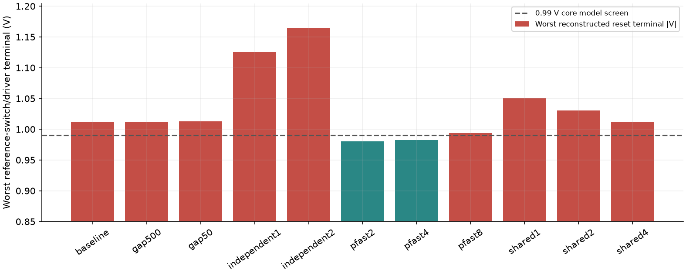
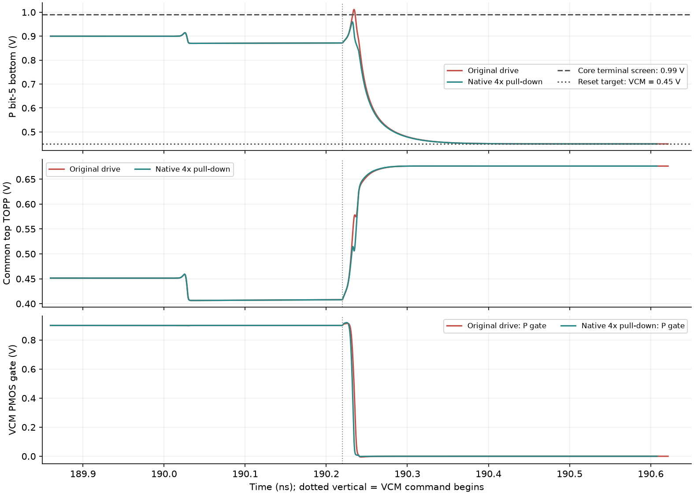
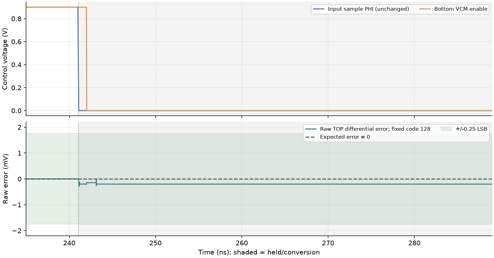
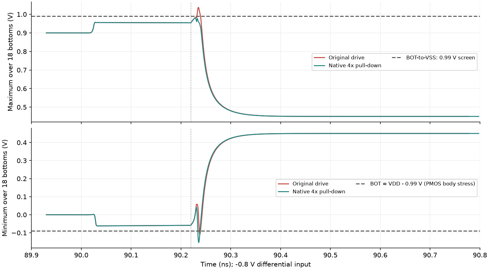

# 8 bit CDAC 复位时序与驱动：第二轮实验

2026-10-20。基于 665594d 的独立实验；**尚未找到跨输入安全的替代方案**。
Bootstrap 的尺寸、拓扑、泵和 PHI 均未修改，冷 SS 满幅采样失败明确暂缓。

## 本轮改动与证据性质

保持顶板采样、每侧 256 Cu、Cu=4.004 fF、每侧约 1.025 pF、
VDD=0.9 V、VCM=0.45 V、10 MS/s。参考通路 MOS 的尺寸也不变。
扫描的是：

- 参考释放到 VCM 重接的间隔：50/200/500 ps。
- VCM PMOS 栅极反相器的**下拉 NMOS**：2/3/4/8 倍并联强度。
  不是把 VCM 通路 PMOS、采样主管或所有驱动器一起加宽。
- 给 VCM NMOS 增加真实晶体管缓冲：共用前级或独立两级，末级 1/2/4 倍。
- 2 倍下拉与 100/300 ps VCM 重接边沿的联合实验。
  保持采样结束时的快速 VCM 释放边沿、SAR 判决时刻与输入 PHI 不变。

共 **24 次 result.ok 原生 Spectre APS 瞬态**：18 次明确标注的网表级诊断，
6 次保存后原理图的精确导出验证。全部为 TT MOS、TT MOM、27°C、0.9 V，
无物理瞬态噪声；本轮没有开展 PVT/MC/FFT/版图签核。

网表级诊断只修改原始 OA 导出的副本；它们不冒充已存在的最终 schematic。
4 倍候选另外建立了独立 OA，名义聚合电容版、512 独立单元版和真实
StrongARM 接口均由各自 OA 原生导出仿真。2 倍在原单点的最坏端口指标
略好于 4 倍；选择 4 倍建立 OA 是验证样本，不代表它已最优或被正式采用。

## 验收方法

不只看底板最大正电压：根据实际网表连接重建全部 18 组参考开关/驱动的
216 个 MOS（增加缓冲的诊断为 252 或 288 个）的 Vds/Vgs/Vgd/Vbs/Vbd。
同时保留实际 CMI 日志与抑制警告计数，区分全程和每周期 89.9～99 ns
的复位窗口。0.99 V 是本轮 core 模型端口筛选边界，不是 foundry 可靠性签核。
数值比较容差 1 µV，不用于豁免实际 CMI 警告。

检查比较前原始残差、最终码、98 ns 时的底板复位误差，以及固定 code=128
的保持误差。静态输入测试不能冒充满幅输入动态采样测试。

## 首轮筛选：输入 +453.515625 mV

表中数值是复位窗口内所有相关端口的最大绝对电压，不是保持误差。
每组 300 ns，包含上电及后续重复周期。

| 驱动/时序 | 最坏端口绝对电压 | 0.99 V 筛选 |
| --- | ---: | --- |
| 原基线，200 ps 间隔 | 1.012168 V | 失败 |
| 原驱动，50 ps 间隔 | 1.012883 V | 失败 |
| 原驱动，500 ps 间隔 | 1.011650 V | 失败 |
| PMOS 栅极下拉 2 倍 | 0.980651 V | 此输入点通过 |
| PMOS 栅极下拉 4 倍 | 0.982106 V | 此输入点通过 |
| PMOS 栅极下拉 8 倍 | 0.993721 V | 失败 |
| 共用前级 NMOS 缓冲，末级 1/2/4 倍 | 1.051033 / 1.030729 / 1.012410 V | 均失败 |
| 独立 NMOS 两级缓冲，末级 1/2 倍 | 1.126230 / 1.164674 V | 均失败 |



间隔变化没有消除主要尖峰。适度提前 PMOS 通路的有效导通有帮助；
驱动过强或把 NMOS 显著延后，则会加重另一极性的瞬态。
这与共用顶板耦合、两类底板复位不同步及门极馈通共同参与相符，
但本轮没有定量分离各物理电荷项。

## 独立 OA 的 4 倍候选

新增 `cdac8_reset_sw_b0`～`b7`：MN_IS 的并联倍率由 `weight*MULT_D`
变为 `4*weight*MULT_D`；MP_IS、MP_CM、MN_CM、MP_HIGH、MN_LOW 不变。
参考释放命令仍在 90 ns，VCM 重接约 90.22 ns；实际互补门极仍由原生
晶体管产生，不用理想反相信号冒充驱动。



在 +453.516 mV 测试点，P 侧 bit-5 底板的正尖峰从约 1.0115 V 降低；
所有底板复位最大值约 0.95981 V。但最坏端口在另一极性，为约 0.98211 V。
不能只拿正尖峰改善作验收。

| OA 原生导出测试 | 最坏参考开关/驱动端口 | 其他结果 |
| --- | ---: | --- |
| 聚合电容，闭环 +453.516 mV | 0.982106 V | code=192，比较前误差最大 0.386133 mV |
| 512 独立单元，同一闭环输入 | 0.982106 V | code=192，同名义聚合版一致 |
| 聚合电容，固定 code=128、+0.8 V | 0.947581 V | 保持误差 −0.201700 mV |
| 512 独立单元，同一固定码 | 0.947581 V | 保持结果与聚合版一致 |
| 原生 StrongARM，+453.516 mV | 0.981967 V | code=192，比较前误差最大 0.583577 mV |
| 聚合电容，闭环 −0.8 V | **复位 1.055154 V** | 全程 1.072526 V，失败 |

前五组无 CMI/抑制警告；最后一组有。表中端口重建范围是 CDAC 参考
开关与驱动，不声称已逐项重建 StrongARM、Bootstrap 所有器件应力。
StrongARM 只有该输入点的接口检查，不是完整 ADC 管级验收。

所有 24 组检查码均正确；98 ns 的最终底板复位最大误差约 0.002442 mV。
这再次表明“最终建立正确”和“途中器件安全”是两个独立门限。



## 跨输入失败与旧问题的隔离

| TT 诊断条件 | 复位最坏端口 | 结论 |
| --- | ---: | --- |
| 原驱动，−0.8 V | 1.038347 V | 原基线已失败 |
| 下拉 2 倍，−0.8 V | 1.038863 V | 未改善到安全范围 |
| 下拉 2 倍，+0.8 V | 1.037143 V | 未通过 |
| 下拉 3 倍，−0.8 V | 1.049513 V | 未通过 |
| 下拉 4 倍，−0.8 V，精确 OA | 1.055154 V | 正峰降低但负峰加重 |
| 下拉 2 倍、100 ps 重接，−0.8 / +0.8 V | 1.055419 / 1.054076 V | 均失败 |
| 下拉 2 倍、300 ps 重接，−0.8 V | 1.012028 V | 有改善，但仍失败 |

最后三项联合边沿测试仅一个完整周期，作为筛选，不是多周期接受。



上图是 18 个底板的逐时刻最大/最小包络，不是一只 MOS 的端口电压。
下图 −0.09 V 线来自该测试 PMOS 体端 0.9 V 与 0.99 V 端口边界之差，
不是所有节点统一的“最低允许电压”。复位过压不能靠仅压正峰解决。

此外，原基线在 −0.8 V 时，约 **47.63578 ns** 的参考转换就已有
`XCDAC.XSN5.MP_CM` 的 |Vbd|≈**1.072523 V**。4 倍 OA 约 1.072526 V，
差约 2.9 µV。该非复位应力不是本轮新发现波形就能归因为本轮新增；
它在未修改的对照中已存在。也不应错误归因给尚未改动的 Bootstrap。

## 本轮决定与下一步边界

保留 4 倍 OA 作为实验分支，**不替换主 CDAC、不冻结开关或驱动尺寸**。
没有候选通过 TT 跨输入门限，因此没有消耗一轮宽泛 PVT 以制造接受感。
原 Bootstrap 冷 SS 动态问题保持原状，不纳入本轮修复声明。

下一步应针对完整参考网络的两类底板轨迹，评估受控分组/分阶段复位，
或转换后专用顶板复位通路等结构性选择，并单独处理原有转换阶段应力。
这些是后续设计方向，不是本轮已经实现的电路；单纯继续加大反相器没有
得到跨输入稳健性证据。任何方案都需检查参考争用电流、全部正负端口、
下一次采样初态及 PVT，不改模型限值。

## 原理图一致性与复现

13 个新增 schematic 最终均零标记；14 个旧依赖前后 API 读回完全一致。
3 个测试台最终新导出与对应已仿真的原始导出除生成时间外一致。
两个远端控制/激励 VA 文件的 SHA-256 与本地保持一致。

名义共同时间网格比较：诊断 pfast4 与其 OA 实现差为 0；独立单元与
聚合电容闭环差约 3.87e−9 mV，固定码差约 2.16e−11 mV。这只是所检验
名义确定性轨迹的相关性，不是 MC/PVT 等效证明。

原始导出、诊断副本、模型路径/section、逐例参数、结果路径、完整日志、
波形、端口极值、来源与网表哈希均保留在忽略目录 `output/cdac8_reset/`。
不得把含 PDK 参数的导出网表或原始 OA 提交 Git。

分析使用项目 Python；桥接/仿真使用 bridge 虚拟环境：

```powershell
.venv/Scripts/python.exe scripts/cdac8_reset/analyze.py screen
.venv/Scripts/python.exe scripts/cdac8_reset/analyze.py extra
.venv/Scripts/python.exe scripts/cdac8_reset/analyze.py ab
.venv/Scripts/python.exe scripts/cdac8_reset/analyze.py joint
.venv/Scripts/python.exe scripts/cdac8_reset/analyze.py nominal
.venv/Scripts/python.exe scripts/cdac8_reset/analyze.py integration
.venv/Scripts/python.exe scripts/cdac8_reset/summarize.py
.venv/Scripts/python.exe scripts/cdac8_reset/figures.py
.venv/Scripts/python.exe verification/cdac8_reset/test_decks.py -v
```

初建入口 `preflight.py` 会拒绝覆盖同名已有候选；`oa_candidate.py` 只创建
计划列出的新对象。诊断生成器也拒绝覆盖旧实验。若要再跑一轮，应使用新
命名/导出标签并更新计划，不能直接抹掉本轮证据。审计已存在的原生导出
同样需要新标签，或只读比较已有的 `primary` 与 `final_audit`。
