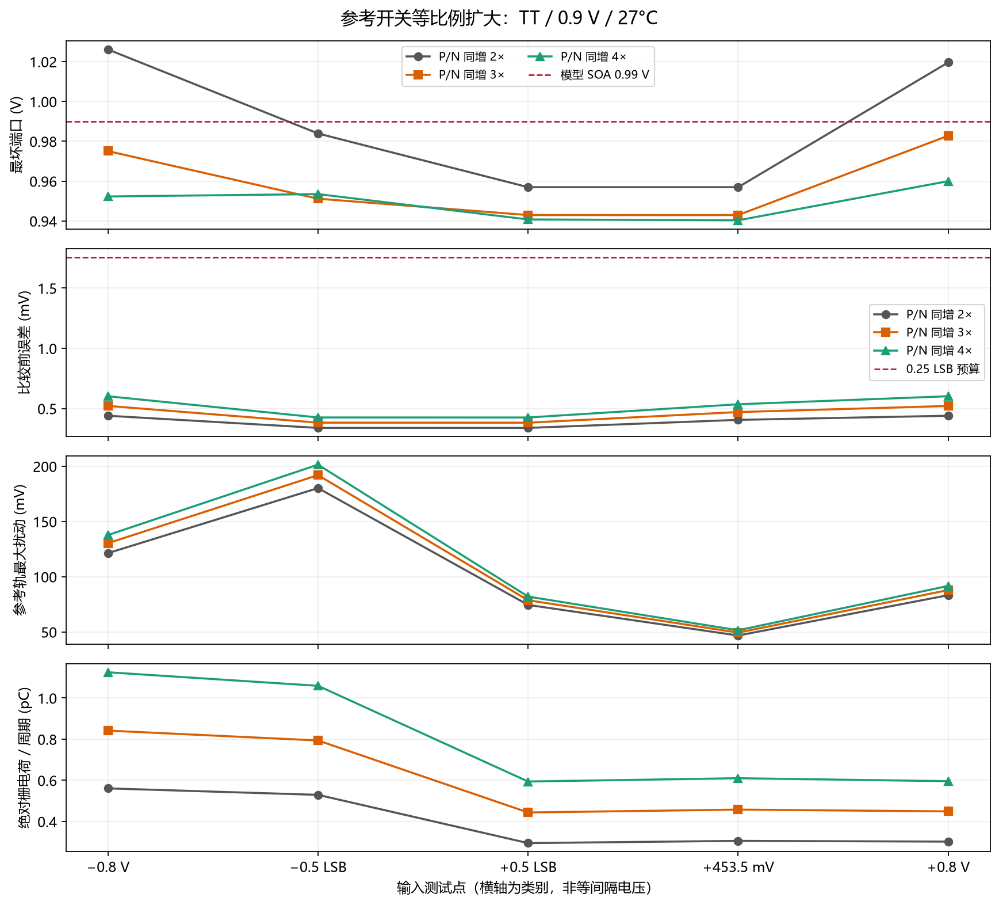
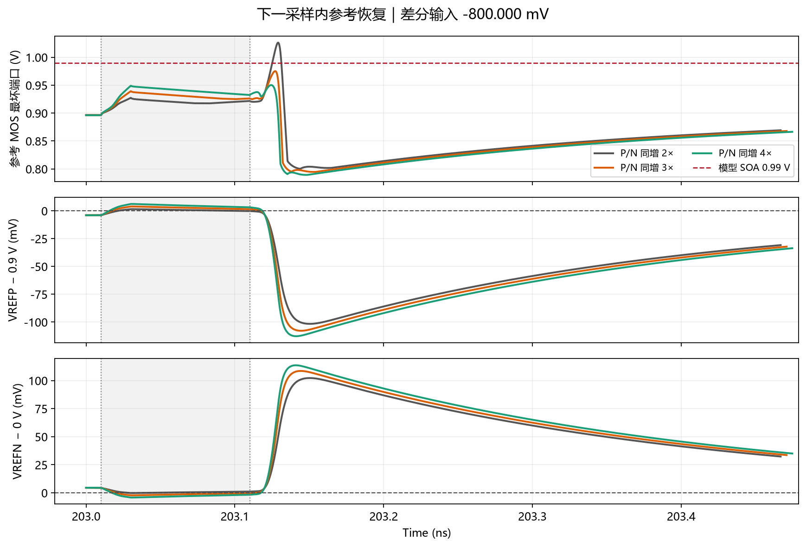

# CDAC 参考开关等比例扩大：2x / 3x / 4x

2026-10-20。继续理想栅压、无真实驱动器的独立网表实验。
目标不是提高 MOS 耐压，而是观察扩大尺寸能否降低实际端口尖峰，以及
精度、参考源和理想驱动负载的代价。没有修改 OA/Canvas、Bootstrap、
已安装 VA 或主基线；不替换另外一条原生异步 SAR 实现。

## 实验边界

- T28 `pch_mac` / `nch_mac`，单位管 W/L 固定为175/30nm、150/30nm。
  P/N 同时乘2/3/4的整数并联倍率，不是直接改变单指PCell几何。
- 完全保留原生Bootstrap/MOM、参考50ohm/4pF、输入50ohm以及控制/比较器
  行为模型。时钟/控制边沿20ps、先断后通100ps不变。
- TT MOS/MOM、0.9V、27C、300ns，不注入物理瞬态噪声。
- 五个差分静态输入：-0.8V、-0.5LSB、+0.5LSB、+453.515625mV、+0.8V。
  对应理想码14/127/128/192/241。不是全256码、动态频谱或PVT资格。
- 当前模型SOA阈值0.99V，确定性比较前误差预算0.25LSB=1.7578125mV。
  不把这个阈值视为击穿电压，也没有短脉冲寿命豁免结论。

所有deck从完成的 `pn_ratio/neg_p2n2` 派生，仅改变顶层两个并联倍率和
静态输入参数，增加栅端电流保存指令。所有subckt块必须逐字不变，逆向
恢复这些修改后必须与保留源文本相同。三份VA、源deck和各结果均保留哈希。

## 测量口径

1. 对全部32只参考MOS重建Vds/Vgs/Vgd/Vbs/Vbd，分别统计全程、启动后、
   SAR与参考恢复窗口，保留最坏实例/端口/时间和原生CMI/抑制/LTE计数。
2. 最后一次转换的8个比较前点，按实际控制码与理想电荷重分配对比；
   分别报告码正确性、误差预算和SOA是否通过，不丢弃失败候选。
3. 本地VREFP/VREFN相对0.9/0V的最大扰动取启动后100..300ns。
   参考源电流是理想参考源通过50ohm供给的电流，不是每只开关瞬时漏流，
   也不是已实现的管级reference buffer输出电流资格。
4. 补存全部32只参考MOS的第二端（G）电流，保留12条已有漏端电流。
   `sum(integral(abs(Igate)))` 使用最后完整200..300ns周期，插值补齐精确
   积分端点。它是理想驱动的绝对栅电荷负载代理，包含端口位移/漏电，
   **不是实际时钟驱动功耗**。理想电压源没有体现真实驱动的输出阻抗与延迟。

## 结果

**扩大到3x/4x，能解决本轮五个输入点中2x的端口超限，但不是无代价。**
以下是15次300ns原生APS结果，均result.ok、码正确、比较前误差低于预算。
两个最坏点另作maxstep10ps复核，见数值检查。

### 五个输入中的最坏值

表中为100ps最大步长主扫描。各列是五个输入分别取最大值，不一定来自同一个输入/同一个时刻。
“通过点”同时要求码正确、残差预算、参考MOS SOA和无CMI/LTE问题。

| P/N 同增倍率 | 通过点 | 最坏端口 (V) | 距0.99V (mV) | 最大比较前误差 (mV) | 最大绝对栅电荷 (pC/周期) |
| --- | ---: | ---: | ---: | ---: | ---: |
| 2x | **3/5** | **1.026090** | **-36.090** | 0.439913 | 0.560739 |
| 3x | 5/5 | 0.982771 | **+7.229** | 0.521631 | 0.841598 |
| 4x | 5/5 | **0.959974** | **+30.026** | 0.601917 | 1.125214 |

2x在原先两个点表现正常，但新增正/负大输入暴露了参考恢复问题。
3x已过这五点，不过在+0.8V只有约7.2mV模型阈值余量；4x增加约22.8mV
最坏余量。这里是当前模型/条件下的余量，不是PVT或寿命资格。



### 端口电压的逐点结果

| 差分输入 | 2x 最坏端口 (V) | 3x 最坏端口 (V) | 4x 最坏端口 (V) | 输出码 |
| --- | ---: | ---: | ---: | ---: |
| -0.8V | **1.026090** | 0.975057 | 0.952276 | 14 |
| -0.5LSB | 0.983908 | 0.951155 | 0.953468 | 127 |
| +0.5LSB | 0.956939 | 0.942945 | 0.940739 | 128 |
| +453.515625mV | 0.956943 | 0.942948 | 0.940311 | 192 |
| +0.8V | **1.019582** | 0.982771 | 0.959974 | 241 |

因此不存在“所有节点/所有输入都随着W严格单调变好”：在负半LSB点，4x的
全程最大值略高于3x，最坏位置也由SAR下冲转到恢复边沿。扩大是否合适要
看全部输入、阶段与端口，而不是只看原来的BN5。

2x的失败有真实模型告警，不是仅由脚本阈值判定：

- -0.8V：XCDAC.XSP2.MP_HIGH |Vbd|=1.026090V，203.129050ns，
  下一采样内参考恢复。PMOS bulk=.9V，所以此刻BP2约-0.126090V。
- +0.8V：XCDAC.XSN1.MP_HIGH |Vgd|=1.019582V，103.130169ns，
  参考恢复。所有参考MOS都被检查；这些不是顶板电压或电源电压。
- 两点分别打印5/10条CMI，抑制322/1961条；3x/4x全部五点无CMI或抑制。
  本轮所有完成结果无LTE relaxation。



灰色区为参考命令后100ps先断后通窗口，结束后新参考支路开始接通。
图示4x减轻最坏端口尖峰，但本地参考轨的瞬态扰动更大。0/.9V虚线是
理想轨，0.99V是端口模型检查线；不能将参考轨扰动直接当作比较前残差。

### 扩大的代价

| P/N 倍率 | 最大参考轨扰动 (mV) | 最大参考源电流 (mA) | 最大比较前误差 (LSB) |
| --- | ---: | ---: | ---: |
| 2x | 180.231 | 3.605 | 0.0626 |
| 3x | 191.986 | 3.840 | 0.0742 |
| 4x | 201.455 | 4.029 | 0.0856 |

4x相较2x，最大绝对栅电荷约增加一倍；相较3x约增加34%。参考源峰值和
轨扰动也增大。比较前残差上升但本轮仍在预算内。上述电荷/电流代理说明
后续真实控制输出/缓冲器需要承担更大负载，不能拿理想栅驱的通过来证明
真实驱动也会通过。没有据此计算或宣布真实时钟功耗。

这些变化同时涉及Ron、寄生和注入，不能仅用“Ron降低”唯一解释。

### 数值和证据检查

增加32路栅电流保存后，负半LSB和原正输入2x对照的最坏端口相对保留结果
分别只差-0.0016/-0.0007uV；未因观察方式改变而得到虚假的尺寸改善。

最坏正大输入把最大步长从100ps收紧到10ps：

| 倍率 | 10ps复核最坏端口 (V) | 相对100ps变化 (uV) | 比较前误差变化 (uV) | 栅电荷相对变化 |
| --- | ---: | ---: | ---: | ---: |
| 3x | 0.982777430 | +6.134 | +0.000912 | -0.000644% |
| 4x | 0.959968403 | -5.621 | -0.012373 | +0.000274% |

两次码仍241，CMI/抑制/LTE均为零。两个精度设置的峰值差小于10uV，
残差差小于0.1uV，栅电荷积分相对差小于0.1%；这些是数值一致性，不是
器件寿命保证。共17次原生仿真均result.ok、完整有限到300ns，全部码/残差
检查通过；2x的两点SOA失败明确保留，没有把17次执行成功写成17次电路合格。

源文本逆变换、全部subckt不变、32只参考MOS、16组理想栅压方程、
32路栅电流与12路漏端电流、三份VA及deck/波形哈希均校验通过。没有放宽
容差或修改PDK/SOA阈值以取得通过，也没有接回真实驱动。

## 当前判断

在保持参考网络、时序和理想驱动不变的条件下，2x不够覆盖本轮输入集合。
**建议4x作为下一轮临时表征候选，3x保留为较低驱动负载对照**，不冻结
尺寸、不回写原理图，也不替换主基线。对应LSB bank等效总W：4x的P=.7um、
N=.6um；大bank再乘2^bit，单位管L仍30nm。

尚需更密输入/码转换覆盖、PVT、实际驱动、真实比较器接口、噪声/失配和
布局验证；本轮也没有验证整个Bootstrap内部的所有器件应力。

原始deck、result、日志、PSF、波形与来源位于 `output/cdac8_uniform_scale/`；
小型指标和图位于 `docs/figures/cdac8_uniform_scale/`。

## 复现

```powershell
$env:VB_DISABLE_CONTROL_MASTER='1'
$env:PYTHONIOENCODING='utf-8'
E:/bridge-Agent-T28/virtuoso-bridge-lite/.venv/Scripts/python.exe scripts/cdac8_dualrail/uniform_scale_experiment.py prepare
E:/bridge-Agent-T28/virtuoso-bridge-lite/.venv/Scripts/python.exe scripts/cdac8_dualrail/uniform_scale_experiment.py run
.venv/Scripts/python.exe scripts/cdac8_dualrail/uniform_scale_results.py
```

生成器拒绝覆盖已有case/deck/result，不能原地覆盖重跑。新实验必须有新名字。
