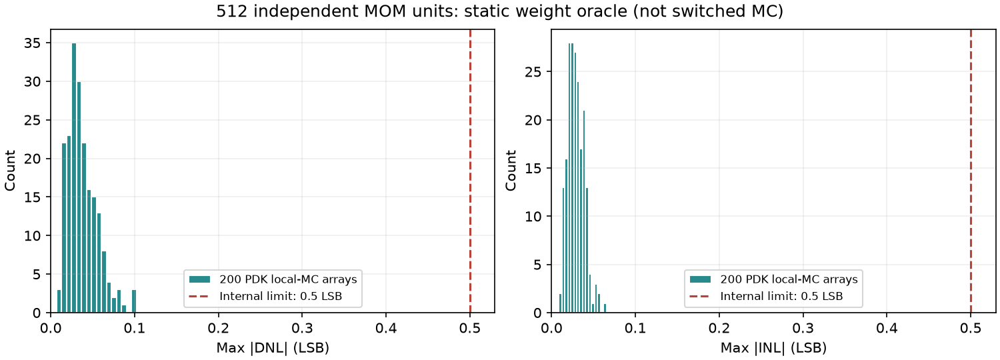
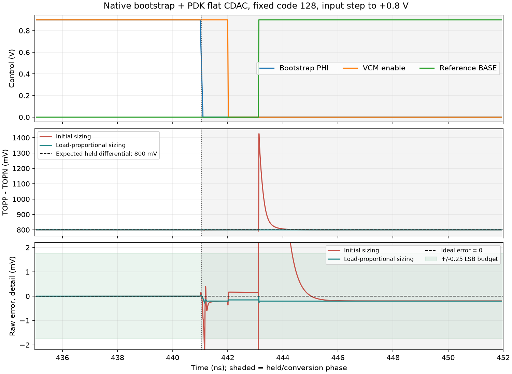
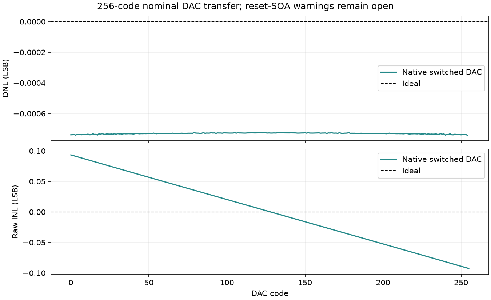
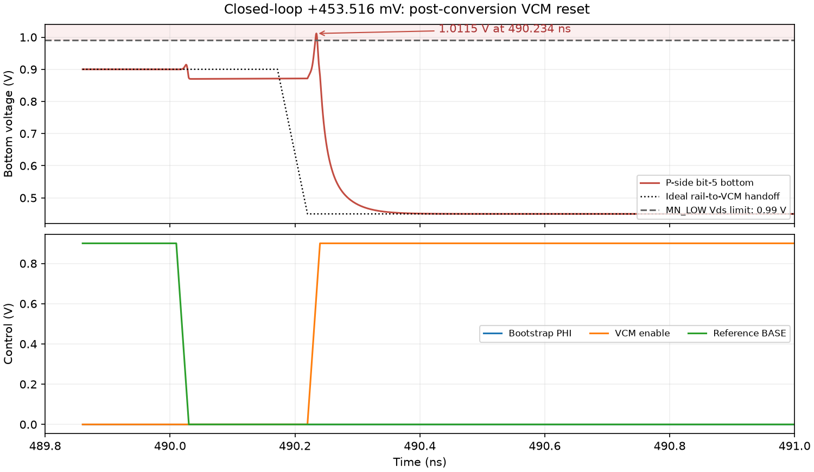
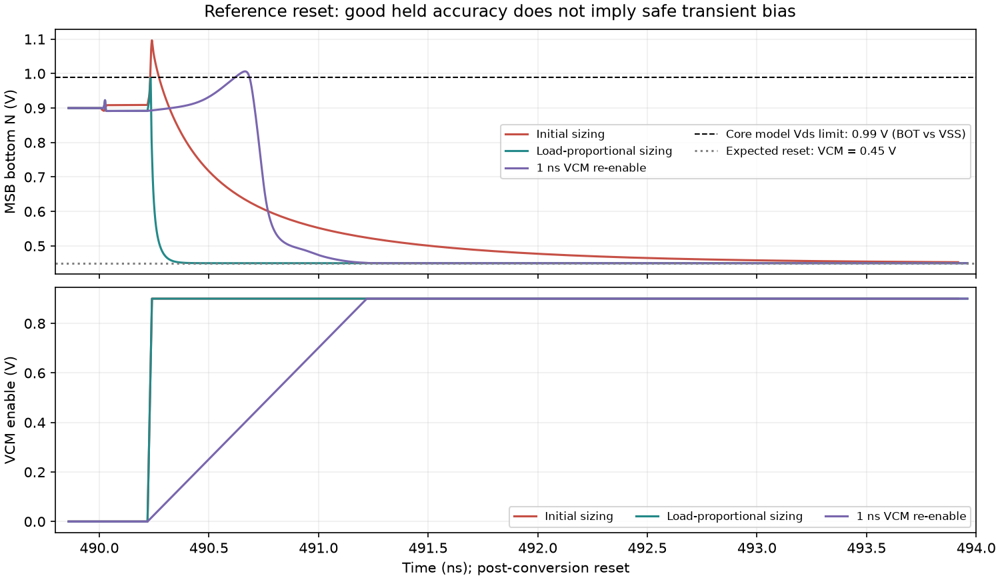
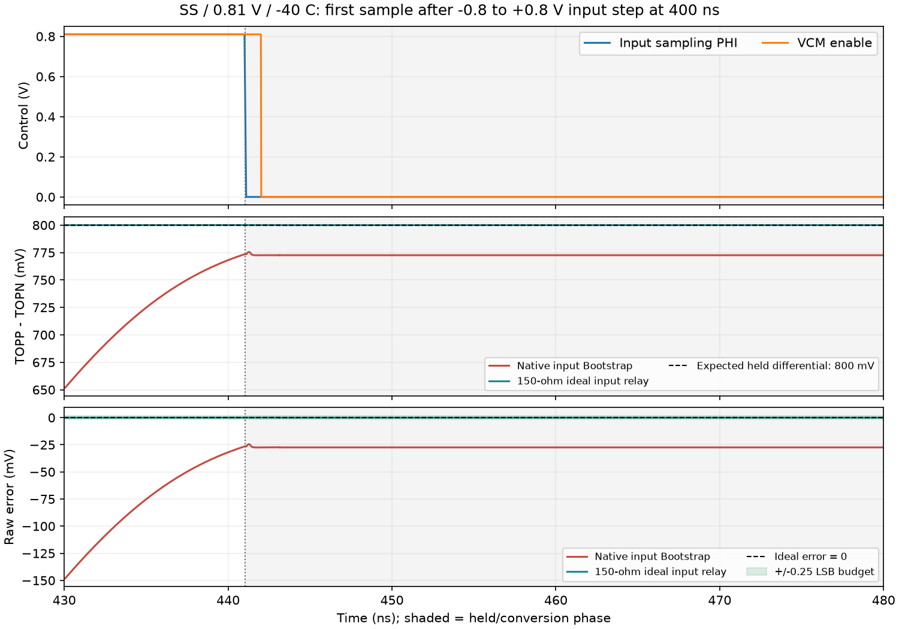
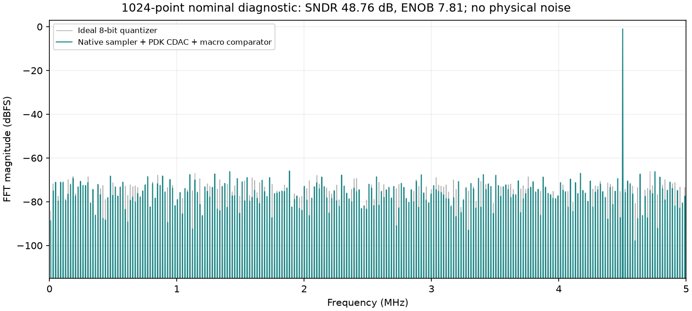

# 8-bit flat CDAC 器件级首轮实现

日期：2026-10-19～20。分支：`exp/cdac-flat8-device`。

## 结论与使用边界

已从理想电容/理想参考开关，推进到 T28 MOM 阵列、原生 MOS 参考
开关及实际门极反相器，并接入原有 T28 Bootstrap。**这是已建立并做
系统验证的器件级候选，不是已经通过全部指标的最终 CDAC。** 电容选型和
局部匹配有依据；参考切换过程的器件应力仍是硬性未通过项。

后续[复位时序与驱动实验](cdac8_reset.md)已完成：适度增强 PMOS 栅极驱动
可消除原名义输入点的超限，但跨输入仍未通过。独立候选没有替换本页基线，
Bootstrap 冷 SS 动态问题按用户要求暂缓处理。

SAR 控制和输入激励用 Verilog-A；系统大扫描用原有电气比较器宏模型。
真实 StrongARM 另做闭环接口诊断，不能用宏比较器结果替代其验收。
Reference 仍是有限输出阻抗/去耦电容的理想源，不是已设计的晶体管 buffer。
闭环控制读取比较器的实际输出符号，逐 bit 更新参考选择；没有从 Vin
直接预先算好 ADC 输出码。强制码仅用于明确标识的开环 DAC/保持诊断。
常规瞬态没有开启物理 transient-noise；没有把上一阶段的 RMS 预算作为
随机数再次叠加。电容局部 Monte Carlo 也不等于全 ADC 失配/噪声仿真。

## 1. 保留的架构与新 OA 层次

8 bit、10 MS/s、VDD=0.9 V、VCM=0.45 V、差分范围 ±0.9 V。
顶板采样，128:64:32:16:8:4:2:1 加一个 dummy，每侧 256 个 Cu。
LSB=7.03125 mV，确定性误差门限 0.25 LSB=1.7578125 mV。

```text
SAR_ADC_T28
├─ cdac8_unit                      1 个 tsmcN28/cfmom_2t
├─ cdac8_bank_{1,2,...,128}         数量对应的独立 unit 实例
├─ cdac8_caps_ideal_switch         真实电容 + analogLib 理想参考继电器
├─ cdac8_ref_switch_b{0..7}        三路原生参考开关 + 原生门极反相器
├─ cdac8_device                   512 独立电容 + 18 个参考开关组
├─ cdac8_device_nominal           同尺寸/同模型，电容按组用 m 并联
├─ cdac8_controller               symbol/veriloga，无浮空 schematic 占位
├─ cdac8_device_sequence          仅测试用输入激励
├─ tb_cdac8_device                电容/理想继电器隔离验证
├─ tb_cdac8_sampling              独立阵列 + 原生 Bootstrap + 宏比较器
├─ tb_cdac8_nominal               并联等效阵列 + 同一 Bootstrap/宏比较器
├─ tb_cdac8_sar / nominal_sar     真实 StrongARM 闭环诊断
├─ tb_cdac8_safephase             复位顺序实验，未通过应力门限
└─ cdac8_ref18_b7 / ref18_char    1.8 V 通路候选，仅 MSB 表征，未推广
```

电容表征 TB：`tb_cdac8_unit_char`、`tb_cdac8_caps`；参考开关 DC TB：
`tb_cdac8_switch_char`。所有新对象都在项目库，不修改 PDK 和原有 8/10-bit
基线。Bootstrap 沿用 `sar_bootstrap_canvas_flat_8b` 的原拓扑与主管
W/L=1 µm/150 nm，本轮没有重新创造 Bootstrap。

独立阵列用于匹配；并联倍率视图仅用于确定性大扫描。固定中点码、输入
跳变的瞬态对照，两者 TOP 差分在公共时间网格上的最大差约
1.1e-8 mV，保持点差约 4.7e-9 µV。这是这组名义实验的数值相关性，
不是对全部 PVT/失配的等效证明。后者绝不用于声称有 512 个独立随机变量。
另外完成实际逐 bit 闭环对照：公共网格最大差约 6.8e-9 mV，输出码一致。

## 2. 单位电容选型与失配验证

器件为 `tsmcN28/cfmom_2t`，金属 M1～M3，Wfinger/Sfinger=50/50 nm。

| 候选 | Lfinger / Nfinger | 实测 Cu | 每侧 256 Cu | 单元局部 σ/均值，200 次 |
| --- | --- | --- | --- | --- |
| a，选中 | 2 µm / 8 | 4.00407 fF | 1.02504 pF | 0.3393% |
| b | 3 µm / 8 | 5.94729 fF | 1.52251 pF | 0.2854% |
| c | 3 µm / 16 | 12.91297 fF | 3.30572 pF | 0.1880% |

这些是 AC 支路电流计算得到的电容，不把 CDF 显示值冒充仿真值。
扫描 1 kHz～1 GHz，偏置覆盖 0、±0.45、±0.9 V；表中是低频名义值。
选中单元在这些偏置下低频电容变化约 8 ppm。没有由这个偏置测试推导
版图寄生、介质可靠性或版图匹配已经通过。

第一次用默认 `mismatch=Model` 虽有随机变量计数，电容值却没有实际散布。
该组不能作为匹配证据。经 PDK 模型开关核对，将器件 CDF `mismatch`
显式设为 `1`，原生网表输出 `mismatchflag=1`；短样本证实电容变化后，
才运行 200 次单元及 200 次完整独立阵列抽样。

完整阵列每次确认为 **512 个局部随机变量**，每组从真实 PDK AC 电流
取得权重，再用电荷守恒计算静态转移。200 次中：

- 最坏 |DNL|=0.10243 LSB，|INL|=0.06555 LSB；全部单调。
- 200/200 通过内部 0.5 LSB 权重线性度门限。
- 这是实际电容失配加解析静态 oracle，**不是 200 次完整开关瞬态**，
  也不包含梯度、布线、版图边缘效应或生产良率保证。

按理想差分 `sqrt(2kT/Cside)`，室温约 90 µV RMS；只是采样热噪声下界，
不包含开关、参考、比较器的物理带宽/相关噪声。



## 3. 参考开关结构与 W/L 迭代

每组底板可连接 VREFP、VREFN 或 VCM：高参考用 PMOS，低参考用 NMOS，
VCM 用 NMOS+PMOS transmission gate。PMOS 体接 VDD，NMOS 体接 VSS。
高参考 PMOS 门极经反相器；低参考 NMOS 经两级反相器；VCM PMOS 经
反相器，VCM NMOS 由采样控制驱动。控制/非交叠仍为 VA，不是完整数字时钟树。

初版按 `sqrt(weight)` 缩放开关，归一化 RC 随 bit 不一致；中点码切换和
复位时大、小电容组速度不同，出现明显暂态及过压。
保留版本改用相同叶器件尺寸，`multi=weight`，使 R 约反比于权重、C 正比于
权重；同时给低参考补实际门极缓冲。dummy 使用最低位尺寸。

| 叶器件 | W / L | bit b 的倍率 |
| --- | --- | --- |
| 高参考 PMOS，pch_mac | 0.175 µm / 30 nm | 2^b |
| 低参考 NMOS，nch_mac | 0.15 µm / 30 nm | 2^b |
| VCM NMOS / PMOS | 0.25 / 0.30 µm，L=30 nm | 2^b |
| 各反相器 NMOS / PMOS | 0.25 / 0.30 µm，L=30 nm | 2^b |

MSB 的有效总宽度因此不是上表的叶宽。例如高参考约 22.4 µm，低参考
19.2 µm，VCM N/P 为 32/38.4 µm。12 个 MOS 网表语句/开关组不等于
12 个单指物理晶体管；倍率必须计入。MOS 的并联倍率也没有在本轮用于
声称独立的开关失配样本。

27 点 MOS DC 表征：SS/TT/FF × 0.81/0.9/0.99 V × −40/27/125°C。
名义 MSB Ron：高/低/VCM 约 16.1/17.2/50.6 Ω；27 点最大约
25.2/42.4/1027 Ω。VCM Ron 的变化体现中点栅压裕量，不能只用典型导通阻值。
该 DC 测试是小压差局部 Ron，不代表大信号全过程的固定电阻。
原高参考 +1 mV 探针在最高电压下会超出参考轨，不能用它作为系统 SOA 证据；
新增 1.8 V 表征已使用轨内 −1 mV 探针。

关断探针是三路全部关闭时的合成泄漏，H/L/S 的重复列不是三项可相加的
独立漏电。参考切换期间底板通常仍由另一条通路驱动，因此也不能简单把
这股底板漏电乘保持时间、除 TOP 电容，作为顶板保持误差。

## 4. 相位、名义精度与尚未通过的应力

周期 100 ns，首周期的关键时间约为：

| 事件 | 时刻 |
| --- | --- |
| Bootstrap 接通 | 1.05 ns |
| Bootstrap 关断/顶板进入保持 | 41.05 ns |
| VCM 底板钳位释放 | 42.01 ns |
| 首次参考试探命令 | 43.01 ns，另有 100 ps 非交叠 |
| 每 bit 比较/锁存 | 46 / 47.5 ns 起，每 5 ns 一次 |
| 最后锁存/VALID | 约 82.52 ns |
| 后转换参考释放、VCM 复位 | 90 / 90.22 ns 起 |

保持区间为 41.05 ns 后，直到下一周期重新采样；其间参考切换是 SAR
转换的一部分。图中固定 code=128 的 DAC 差分贡献为零，所以保持预期
仍是 +0.8 V；不能把这个预期套用到正在逐 bit 转换的闭环 TOP 残差。

固定中点码、输入从 −0.8 跳到 +0.8 V 的测试，保留版本最终原始差分误差
约 −0.201704 mV，明显小于 ±1.7578 mV。这个特定测试没有 CMI 应力警告。
**但不能从这个单一输入/参考码推广到所有切换轨迹。**



中图保留完整瞬态幅度；底图仅放大 ±2.2 mV 的误差细节，不能把超出
底图范围的切换尖峰当作不存在。

256 码开环、零差分采样输入、真实 Bootstrap/参考开关的名义转移结果：

- DNL=0.000741 LSB，未经校正的最大 INL=0.093465 LSB，单调。
- 线性拟合 gain error=−0.07286%，offset=+0.65577 mV。
- 拟合后 INL 约 0.000200 LSB 仅用于辨识误差性质，不能替代原始指标。

真实电容、理想输入/参考继电器的 256 码隔离基线：DNL≈0.0000506 LSB，
原始 INL≈0.00624 LSB，无 CMI 警告。它保留有限参考 R/C 和电气比较器，
不是数学直接输出 DAC 码，因此能与后续原生开关候选作分层参考。

增益/offset 与 TOP 端寄生和切换电荷相符，但本轮没有逐项隔离证明其占比。
256 个输入码中心的闭环测试全部输出对应码；这是中心点一致性，**不是**
精确的 ADC 阈值、missing-code 或 histogram DNL 验收。



完整参考轨迹仍有 CMI-2751/2754/2755 等警告：底板切回 VCM 的瞬态会使
某些 core MOS 的 Vds/Vgd/Vbd 超过模型报告的 0.99 V 限值。
报错器件不只 MSB，也包括低位参考 NMOS/VCM NMOS。单独观察 MSB 或
只看稳定差分误差都会漏掉问题。模型未报错本身也不能等价于 foundry
可靠性签核。

独立密集保存的闭环诊断（输入 +453.515625 mV）中，P 侧 bit-5 底板
在 490.234 ns 达到约 1.01151 V；这是后转换 VCM 复位的尖峰，不是
“最后稳定残差为 1.011 V”。同一测试的 8 个比较前 TOP 差分原始误差
最大约 0.3861 mV，低于 1.7578 mV 门限。两项结论可以同时成立。





本轮另外保留两项失败实验：

1. 转换后先重新打开 Bootstrap，再释放参考/重接 VCM。单独使用未消除警告；
   该独立 fixture 的初始时钟高电平也使上电状态与保留基线不同，不能作严格
   一变量 A/B 或推广为上电安全方案。
2. VCM 重接边沿由 20 ps 放缓到 1 ns，仍有警告，没有因为误差合格而晋级。

最终 OA 已恢复为完整表征的保留基线，失败的原始导出/波形均保留。
真实 StrongARM 闭环可输出正确测试码，但仍有器件应力警告，因此该接口
不算完成；更不能声称完整晶体管 ADC 已通过。

还做了声明倍率 `MULT_S=0.5/0.25/0.125` 的 VCM 尺寸敏感性诊断。
0.5 的最高底板约 0.9924 V；0.25 的正峰降到约 0.9849 V，但 PMOS
方向出现负压应力，仍有 CMI；0.125 也未通过。降低一个正峰并不是
所有 Vgs/Vgd/Vds/Vbd 都合格。最低位的分数倍率不代表已落实的物理尺寸，
这些诊断没有直接晋级/回填成版图候选。

## 5. 耐压器件候选为何没有直接替换

另建 MSB `cdac8_ref18_b7`，保持相同三路拓扑和 core 反相器，只把
通路换为 `nch_18_mac/pch_18_mac`、L=150 nm。高参考叶宽 1 µm，
低参考 0.5 µm，VCM N/P 各 1 µm，倍率 128。

| MOS corner / supply / temperature | 高参考 Ron | 低参考 Ron | VCM Ron |
| --- | --- | --- | --- |
| TT / 0.9 V / 27°C | 33.2 Ω | 23.4 Ω | 1.56 kΩ |
| SS / 0.81 V / −40°C | 62.7 Ω | 65.8 Ω | **4.54 MΩ** |
| FF / 0.99 V / 125°C | 26.3 Ω | 17.6 Ω | 43.5 Ω |

直接以 0～VDD 控制 1.8 V TG 时，VCM≈VDD/2，低压/冷角栅源裕量
不足。光靠耐压等级或把 W 放大几倍不构成可行解。这项候选在 MSB
表征门限即停止，没有推广成一个看起来完整、实则已知不能建立的阵列。

后续要联合比较：core 通路的门极驱动/顺序与注入补偿、耐压 rail 通路与
具足够栅压的 VCM 通路组合、或专用 VCM bootstrap/钳位驱动。
新增升压、隔离井或保护结构涉及明确的新设计，不能拿理想升压电源
冒充已经完成的原生控制，也不先冻结本轮的开关尺寸。

## 6. 系统、角落与验证覆盖

13 组 PVT/输入跳变瞬态已完成：5 个 TT 输入点（±0.8、±0.4、0 V），
以及 SS/FF × 0.81/0.99 V × −40/125°C 的 8 组 +0.8 V 跳变。
每组先保持相反输入，400 ns 时改变输入，检查第一次和下一次采样；
固定 DAC code=128，所以参考 DAC 的差分贡献为零。

| 条件 | 首次保持误差 | 下一次保持误差 | 模型应力 |
| --- | --- | --- | --- |
| TT、0.9 V、27°C，五输入点 | 最大约 0.202 mV | 最大约 0.202 mV | 该固定码测试无 CMI |
| SS、0.81 V、−40°C，±0.8 V 翻转 | **−27.406 mV** | −0.186 mV | 无 CMI，但精度失败 |
| SS、0.81 V、125°C | −0.831 mV | −0.148 mV | 无 CMI |
| FF、0.81 V、−40/125°C | 最大约 0.247 mV | 最大约 0.247 mV | 无 CMI |
| SS/FF、0.99 V、−40/125°C | 最大约 0.269 mV | 最大约 0.268 mV | 四组均有 CMI，含门极反相器 |

精度上 12/13 通过首、次采样的 0.25 LSB 检查；应力零警告仅 9/13。
不能将两种门限相互替代。以上是固定中点码的采样/保持 PVT，不是全部
参考码和完整闭环 FFT 的 PVT 认证。

针对 SS/0.81 V/−40°C，另建**同一独立原生 CDAC，仅将输入 Bootstrap
替换为 150 Ω 理想继电器**的 OA fixture：第一次保持误差降到
−0.001734 mV，无 CMI。这把该大步进失败隔离到原生输入采样路径，
而不是凭现象归因于 CDAC 电容选错。稳定 DC 下一次恢复也不能掩盖第一次
采样路径动态不足。下一轮应对 Bootstrap 两侧的泵启动/切换轨迹、主管 W/L 和实际
40 ns 窗口重新验证；本轮没有修改那个只读 Bootstrap 基线。

密集波形还表明不能把问题简单描述为“高输入侧没跟上”：此方向跳变中，
440.8 ns 时 TOPP≈0.80287 V（目标 0.805 V），TOPN≈0.03042 V
（目标 0.005 V），误差主要在正在向低电平放电的一侧。
405 ns 后，两侧 `G−VIN` 已约为 0.804～0.805 V，接近 0.81 V 供电。
TOPN 在 410～420 ns 仍从约 0.575 V 缓慢降到 0.342 V；结合 1.025 pF
名义负载，等效放电电流约 24 µA。这与低压/冷角下有限过驱动的大信号
电流限制相符，而不是一个已经抽取并证明的恒定 Ron 模型。
需要同时考虑初始泵建立时间、饱和区搬移电荷、末段线性建立与关断注入。
后续 W/L 或负载优化应在这类实际跳变下验证，不只做 DC Ron 或小信号 AC。



MOS 角落扫描保留 TT MOM，不是同时覆盖电容全局 SS/FF、MOS 局部失配
及版图梯度的联合统计。全码名义扫描用宏比较器，Rref=50 Ω、Cref=4 pF。
1024 点连续正弦、461 bin、约 4.50195 MHz、−1 dBFS；采样率 10 MS/s。

原生 APS 完整运行：**SNDR=48.7595 dB，ENOB=7.8072 bit，
SFDR=64.9367 dB**，通过本轮名义、无物理噪声的 7-bit 动态目标。
瞬态耗时约 58 分钟，0 errors；仍有记录/抑制的 CMI 应力警告，不能
据此晋级为可靠性合格的器件 ADC。



相对逻辑 41.05 ns 时刻的理想量化器，原始码比较有 974/1024 不同，
不能直接称为 974 次错误转换：连续输入前端存在相位响应。基波拟合的
等效延迟约 1.807 ns，幅度比约 0.99910。它包含该频率下前端/采样响应，
不是 jitter 或通用精确孔径。拟合只作诊断，**没有**修正码后再算 SNDR。

Spectre X AX 另作加速对照：两次正弦输出码与 APS 一致，8 个比较前
残差最大差约 6.61 µV。AX 会忽略/重定义 reltol、vabstol、iabstol、
errpreset、maxstep，由 preset 管理精度，不能把原 deck 字段照搬为
“AX 实际设置”。本报告主要性能和尖峰应力仍取完整 APS；加速试验
不是细时间步应力签核的替代。

大扫描采用 APS、`reltol=1e-5`、moderate、maxstep=250 ps。
单一 DC 输入的 conservative/100 ps 对照中，两次输出码一致，8 个比较前
差分残差的最大差约 9.3 nV。这个局部数值对照不代替所有动态输入的
精度收敛签核。

在 +453.516 mV 的一个完整周期内，混合模型的命名电源交付能量约为：
VDD 0.893 pJ、VREFP 1.080 pJ、VCM 0.0125 pJ。未计入输入源、理想
控制源及宏比较器的真实实现功耗，**不能把它们相加称为 ADC 总功耗**。
同一周期 VREFP 暂态范围约 0.811～0.904 V，VREFN 约 −1.81～91.15 mV；
峰值 droop 与比较时刻已建立的残差不是一项指标。真实 reference buffer
仍需实现这些充放电电流/恢复速度，而不只是标一个 50 Ω。

物理 transient-noise、比较器 offset/noise MC、参考 buffer、实际 SAR
时钟驱动、版图 DRC/LVS/PEX 尚未完成。本机/远端能发现相关 EDA 安装，
但没有在本项目验证到可直接使用的规则 runset/提取流程。不能将“工具存在”
说成签核已就绪，也不把未完成的应力电路推进到伪完成的版图。

## 7. 可复现入口与证据

本地：`E:/bridge-Agent-T28/projects/sar-adc-t28`。远端库：
`/home/chenzc_intern25/TSMC28/llm_IO/SAR_ADC_T28`，tech=`tsmcN28`。
bridge 0.8.0，Spectre 21.1.0.509.isr12，原生 Spectre/APS 均实际运行。
没有用 EVAS 替代 MOS/KCL 仿真。

最终本轮读回为 35 个 schematic 零 marker，2 个行为 cell 仅有
symbol/veriloga；11 组重新导出与对应已仿真源除生成日期外一致。
6 个历史只读依赖读回一致，远端 VA 与本地源字节一致。图与数值均源自
对应结果，不用零 marker、API 无异常或 `result.ok` 替代电气验收。

收尾连接说明：上述是本轮已成功保存的审计。2026-10-20 早间再做
handoff 复核时，RAMIC/CIW bridge 的 127.0.0.1:65490 拒绝连接；
这次复核在读取 library 时即停止，没有修改 OA 或强行重启会话。
因此不能宣称此刻仍然在线或已重新核实远端现状。继续优化前需恢复
CIW bridge，再运行 `audit.py --export-tag <新的唯一标签>`；已有原始
APS/MC/静态/PVT 结果及前次成功审计不受此连接中断影响。

主要源：

- `config/cdac_flat_8b_device.yaml`：器件尺寸、目标、阶段边界。
- `scripts/cdac8_device/oa.py`：原生 OA 创建与 CDF 设置；已存在目标默认拒绝覆盖。
- `run.py`：原生导出网表上的设计变量/激励/分析/保存设置。
- `analyze.py`、`analyze_system.py`：PSF、电容权重、时序/静态/频谱计算。
- `audit.py`：新对象读回、零 marker、只读依赖一致性、VA 字节一致、全新原生导出对照。
- `figures.py`：带预期基准和保持区间的真实结果图。
- `verification/cdac8_device/check_evidence.py`：分别输出 pass/fail/not-run；
  默认退出 0 仅指证据自洽，`--require-qualified` 对当前候选会失败。

不要对已存在库盲目重跑全部 OA 创建。模拟重跑命令例如：

```powershell
$env:PYTHONIOENCODING='utf-8'
$env:VB_DISABLE_CONTROL_MASTER='1'
$bridgePython='E:/bridge-Agent-T28/virtuoso-bridge-lite/.venv/Scripts/python.exe'
& $bridgePython scripts/cdac8_device/run.py bank-mc --runs 200
& $bridgePython scripts/cdac8_device/analyze.py banks --runs 200
& $bridgePython scripts/cdac8_device/run.py switches --tag balanced
& $bridgePython scripts/cdac8_device/run.py static
& $bridgePython scripts/cdac8_device/run.py dynamic
& .venv/Scripts/python.exe scripts/cdac8_device/analyze_system.py dynamic
& .venv/Scripts/python.exe verification/cdac8_device/test_contracts.py -v
```

每次仿真用唯一结果目录；导出原文不修改，run 另存工作 deck；每个 case
记录 OA/hash、VA/hash、模型 section、变量、温度、模式、原始日志/PSF 路径。
大型结果留在忽略目录 `output/cdac8_device/`。失败实验及默认失配未激活的
实验没有删除，也没有混入选中统计。

原生导出曾因子单元修改后的父层抽取时间戳失效报 OSSHNL-109。通过对
自有层次自底向上 Check & Save 后重新导出解决，没有关闭检查或修补
最终 DUT 网表。CDF 导入参数也做了实际读回和网表确认，不以 API 返回
无异常替代参数已经生效。

## 8. 本轮验收与下一轮优先级

| 门限/交付 | 本轮状态 |
| --- | --- |
| 原生阵列/参考开关/OA 对齐 | 已实现、读回验证 |
| 电容 200 次局部匹配、名义 DAC 全码 | 通过已述子项门限 |
| ADC 256 码中心、1024 点名义无物理噪声 FFT | 通过相应诊断门限 |
| 完整参考切换的端口应力 | **失败，未冻结开关尺寸** |
| SS/0.81 V/−40°C 第一次满幅跳变采样 | **失败，已隔离到输入采样路径** |
| 真实 StrongARM 整合 fixture 的应力 | **未通过** |
| 物理噪声、MOS MC、精确 ADC 阈值 DNL | 未执行，不假定通过 |
| Reference buffer/时钟树管级、DRC/LVS/PEX | 未实现/未签核 |

完成的是**首版器件实现与完整首轮验证/定位**，不是“最终电路全部达标”。
当前先处理两件事：

1. 对全部底板和相关端口，在 PVT 下联合优化 VCM 驱动、互补门极时序、
   注入和器件等级。不能只压一个正峰或改模型限值；新升压/隔离井/保护
   结构需要明确的新设计目标。
2. 原 Bootstrap 基线不动，在新候选扫描主管 W/L、泵建立及 CDAC 负载；
   重跑双向满幅跳变、连续高频输入、保持误差和应力。不能只放大 W，
   却漏验增加的关断电荷与寄生。

电气硬门限关闭之后再冻结尺寸，推进真实比较器/参考驱动与版图。
