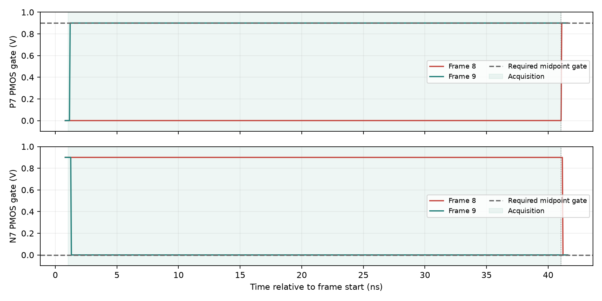
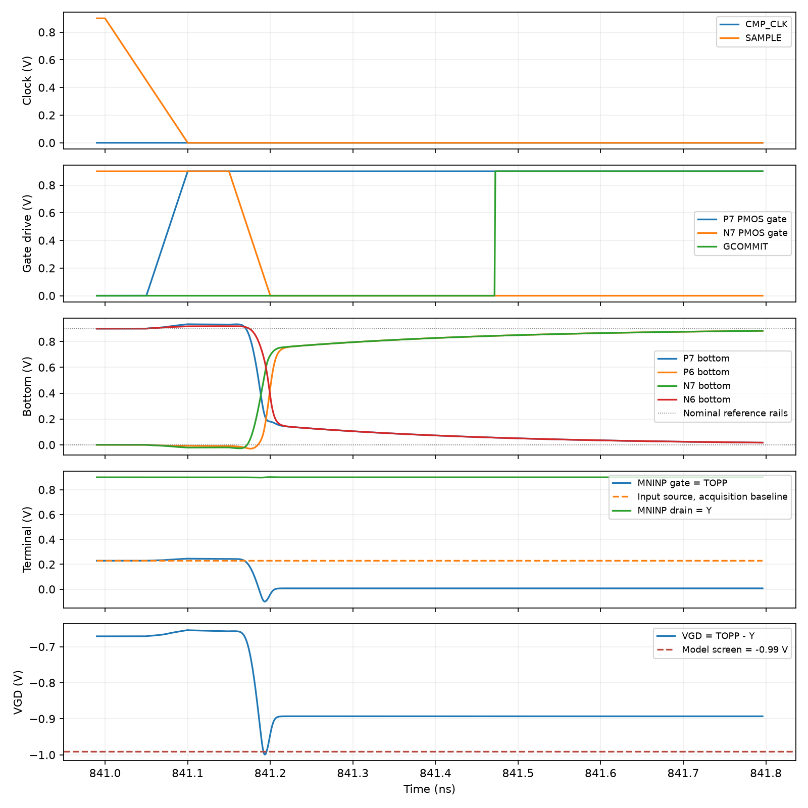
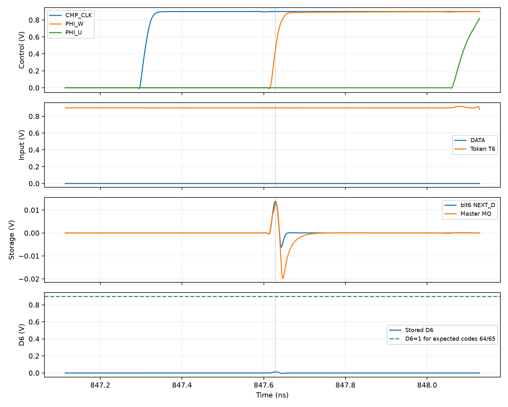
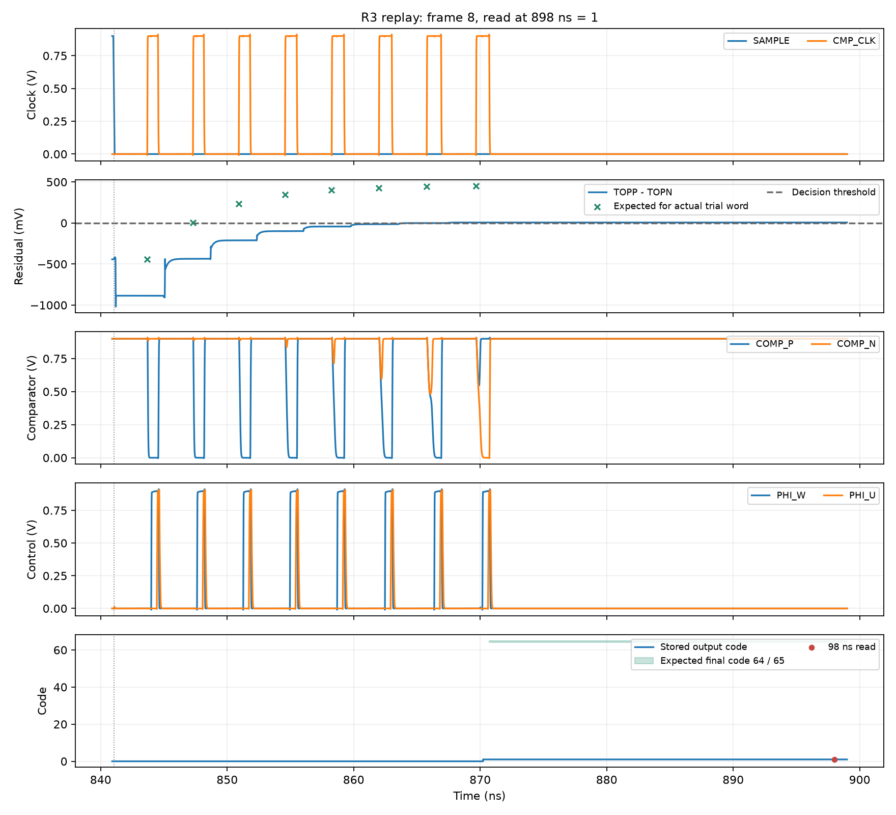

# R3 异常点重放与时序分析

12 帧重放成功复现了原静态任务的异常：输入历史、12 帧输出码和比较次数均与
原批次一致，841.192 ns 再现比较器过压，898 ns 再次读到 1 码。R3 电路、尺寸、
模型、时钟和求解精度未改，远端原理图未修改。

已确认的电气故障是：**异常帧采样期间没有完成参考中点恢复，采样结束后才
切回中点，搬动了已保持的电荷。** 比较器过压和后续错码是同一次错误切换的
后果；bit6 不是先正确写入再丢失。理想参考栅控的具体内部漏事件路径仍需记录
状态变量确认，本轮没有实施修复。

本文 frame8 沿用日志从 0 开始的编号，即第 9 个采样周期。

## 原条件和复现证据

基准为 `SAR_ADC_T28/sar_adc8_join_r3`，父任务 `static_065_128`。复用原来的
输入二分搜索器和监测器快照，不换成理想 ADC，不重建输入起始状态。条件为
TT、0.9 V、27°C，无失配、无瞬态噪声。全部 DUT 子电路和测试台电气语句逐字
核对；只改变波形保存、输出起点，并增加无电气驱动的结束计时器。

APS 4 线程，maxstep 10 ps，conservative；options reltol 1e-5，原生日志中的
有效 reltol 为 1e-6，电压／电流绝对容差为 10 nV／100 fA。积分方法 gear2only、
lteratio 10 等原生日志参数全部与父任务相同，只有 outputstart 不同。

保留父任务的 `stop=51.6 us`，在 1.2 us 用 Cadence 文档支持的
`$cds_finish_current_analysis(0)` 正常结束分析。这样不改变依赖 stop 的默认参数。
此前直接截短到 1.2 us 的对照，即使显式填写原 step，APS 仍报告 step=1.2 ns，
而父任务是 51.6 ns；该对照出现不同帧错误，不能作为本次主要复现证据。

12 帧读码为 `64,64,64,64,64,65,64,65,1,65,65,65`，逐帧与父任务一致。
各帧监测到 8 次比较；完整求解点波形保存 800–1200 ns，覆盖的四帧各有 8 次
写入和更新。原生运行 `result.ok=true`，0 errors、12 warnings、7 notices；
保留 5 条打印的 CMI-2754 及后续抑制提示，未发现 LTE 放宽。**仿真正常结束不
等于 R3 电路通过。** 此例已经违反正确性和端电压筛查要求。

## 采样期间没有恢复中点

frame8 的获取阶段是 801.05–841.05 ns。在 840.95 ns，顶板已经准确跟踪源端：
TOPP 约 0.228735 V，TOPN 约 0.671265 V，差分约 −0.442529 V，关断前跟踪误差
小于 1 µV。但参考开关状态不正确：

| PMOS 栅极 | 中点要求 | frame8 实际 | 下一正常帧实际 |
| --- | ---: | ---: | ---: |
| P7 `GPP7` | 0.9 V | 0 V | 0.9 V |
| N7 `GNP7` | 0 V | 0.9 V | 0 V |
| P6 `GPP6` | 0 V | 0.9 V | 0 V |
| N6 `GNP6` | 0.9 V | 0 V | 0.9 V |

PMOS 栅极为低表示高参考轨导通。异常帧的 P7 底板仍高、N7 仍低，P6／N6
同样与规定中点相反；下一帧在获取期间正常恢复。这里直接观察了 bit7、bit6
的物理底板和栅压，没有保存全部 16 个 bank 的物理波形。



红色 frame8 在整个获取期间保持错误状态，直到右端采样关闭才变化；绿色
frame9 在获取开始后恢复到虚线基准。横轴是相对各帧起点的时间。

## 841 ns 过压从哪里来

| 时刻 | 实测事件 |
| --- | --- |
| 841.050 ns | SAMPLE 下降越过 50%，获取结束 |
| 841.075 ns | P7／N6 旧高轨 PMOS 栅极上升越过 50%，开始关断 |
| 841.175 ns | N7／P6 新高轨 PMOS 栅极下降越过 50%，开始接通 |
| 841.193394 ns | MNINP VGD 达到约 −0.999150 V |
| 843.698366 ns | 第一轮比较时钟上升越过 50% |

采样开关关闭过程中，底板却由旧状态切回中点，电容耦合把 TOPP 拉低、TOPN
抬高。VGD 峰值时 MNINP 栅极 TOPP 为 **−99.607 mV**，漏端 Y 为 **899.543 mV**，
所以 `VGD=TOPP−Y≈−0.999150 V`。此时 CMP_CLK 仅约 39.5 µV，比较器尚未开始
第一轮判决：**不是漏端先升到异常高电压，而是输入栅极被 CDAC 拉到地以下。**
保存点中越过 −0.99 V 筛查线的范围约为 841.191764–841.195489 ns；这不是
寿命可靠性结论，也不应把过压警告本身当作仿真器制造错码的机制。



保持开始后 0.6 ns，差分保持偏移约 **−442.8505 mV＝−62.9832 LSB**。上帧
输出为 65，若底板沿用上帧状态，关断后才恢复到 128 中点，一阶电荷关系给出
`(65−128)×7.03125 mV=−442.96875 mV`，与观测的符号和量级吻合。
完整参考字仍是结合已保存 MSB 状态与上帧码字的推断，不冒充全部 bank 的直接测量；
最终输出也不能仅凭这个理想电荷估算精确预测，仍有后续动态误差。

## bit6 为什么写成零

首次比较前，实际差分已经约 −885.383 mV，而不是源端对应的 −442.529 mV。
此时错误已经形成，比 bit6 写入更早。

| 时刻 | bit6 的证据 |
| --- | --- |
| 847.309593 ns | 试探码 64；按源输入计算应有 +7.4707 mV，实际残差为 −435.9496 mV |
| 847.628557 ns | PHI_W 写入，DATA 约 0 V，NEXT_D／主锁存节点也为低 |
| 写入之后 | D6 仍低，没有先变高再掉下来的过程 |
| 870.186903 ns | 最后 bit0 写入 1 |
| 898 ns | 稳定读码为 1，而不是附近应有的 64／65 |

比较器对已经偏移的负残差作出负判决，寄存器记录该结果。波形不支持
“比较器原本正确判为 1，但 bit6 保存失效”这一解释。





残差图中的绿色叉号按实际试探码和源输入计算，是电荷模型对照，不是对输出
做了校正。最终码基准只在转换结束后显示；转换中的部分 SAR 寄存器字不当作
最终输出码评价。898 ns 红点只是读取时刻，不是误差产生时刻。

## 代码层触发原因与下一步

直接故障已定位到理想参考栅控的采样相位／中点恢复处理，而不是先归因于
Bootstrap 导通电阻、比较器尺寸或 PDK 失配。
[`sar8j_aligned_refgate.va`](../models/veriloga/sar8_join_r2/sar8j_aligned_refgate.va)
把 SAMPLE 的两个方向交叉事件放在同一个处理块中，再用瞬时电平
`sample_now = V(SAMPLE)>0.5*VDD` 推断相位。交叉点附近的严格大于判断是本次
数值敏感性的重点嫌疑；截短时长后异常帧改变也支持需要检查事件处理。
但本轮没有保存 `sampling/restored/overridden` 内部状态，尚不能把具体漏事件
分支称为已逐条验证。

下一轮应先加被动状态记录，确认 SAMPLE 上升是否可靠进入采样态、恢复计时
是否被触发／取消，再验证显式区分上升沿和下降沿的处理方式。验收要同时要求
获取期间中点到位、关断后无额外中点搬移、相同历史正确读码及过压消失。
这些属于后续修改，本轮只诊断，未改共享模型或原理图，也没有调整 W/L。

原全码和正弦长任务未停止或改动。含此跳码的统计只能作为故障诊断，不能
作为合格 DNL／INL／SNDR／ENOB；应在控制模型修复并复验后重新测量。

## 文件与复查

脚本为 `scripts/integration/r3_anomaly_replay.py`、`r3_anomaly_analyze.py`；
小型证据清单为 `verification/integration/r3_anomaly_replay_results.json`。
原始父日志／PSF、两份独立网表、日志、波形与解析记录保存在忽略目录
`output/r3_anomaly_replay/`；主要复现位于其 `original_stop/` 子目录。

既有 case 禁止覆盖。离线复查可重复执行：

```powershell
.venv/Scripts/python.exe scripts/integration/r3_anomaly_analyze.py --original-stop --probe --figures --curate
.venv/Scripts/python.exe -m unittest verification.integration.test_r3_anomaly_replay -v
```

主要复现 Spectre 计算约 1149 s，下载约 33 s、解析约 78 s。高分辨率数据约
535 MB，保存 217838 个求解点／66 条信号。此前 0–800 ns 仍完整求解，未使用
跳过启动状态或放宽精度来加速。
