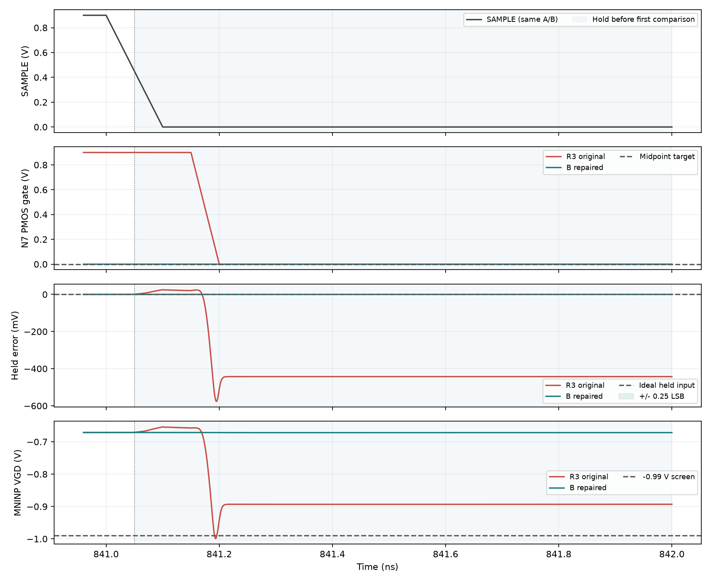
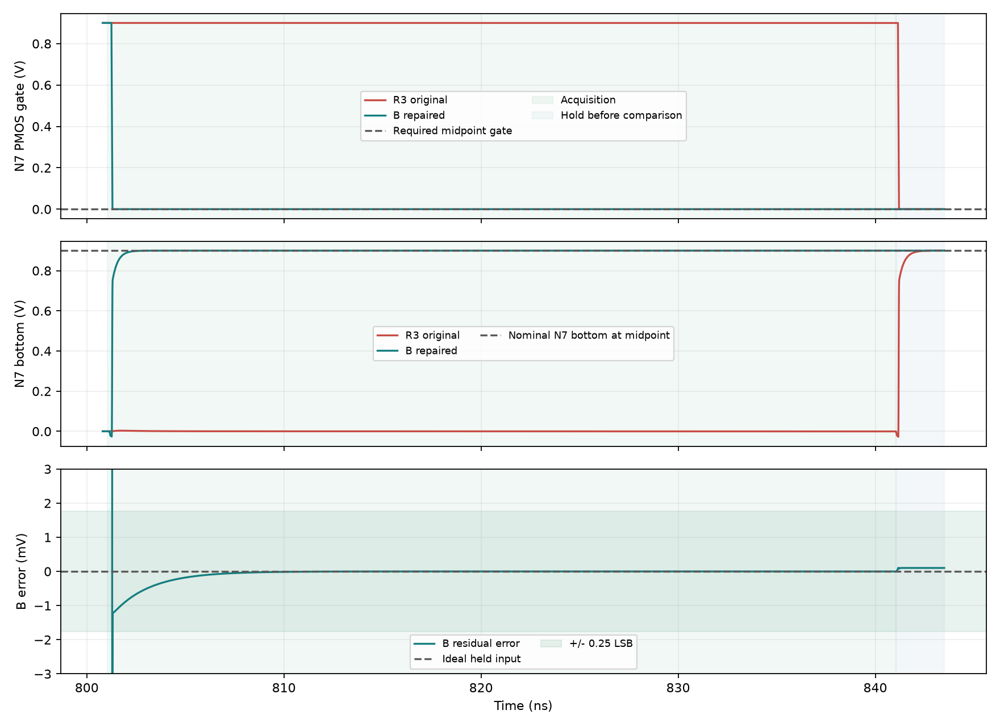
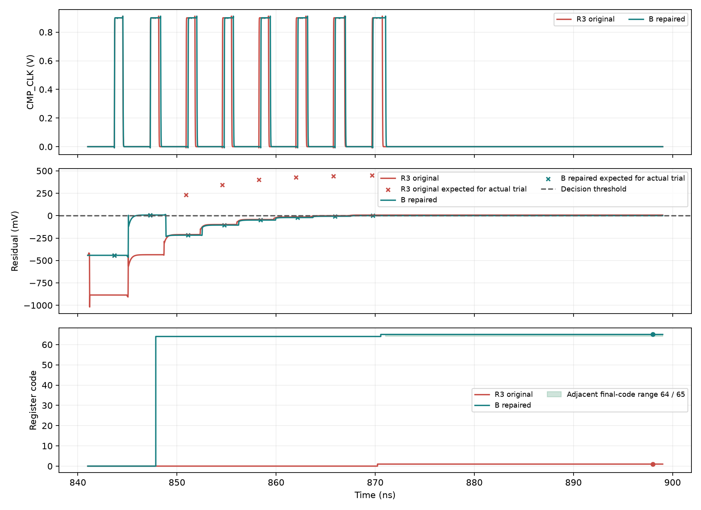

# R3 参考栅控事件处理核实与修复

R3 的采样后过压和大幅错码已定位到理想参考栅控的 **timer 回调被二次时间
比较拒绝**，不是采样上升沿没有到达，也不是管级 SAR 门延迟或晶体管尺寸
不足。只改 SAMPLE 上升和下降沿识别的中间版本仍然失败。

候选 B 将恢复与换轨接通交给各自的 timer 回调推进，不再要求回调时刻与
预约时间满足近乎严格的浮点比较。原来的 100 ps 恢复 guard、100 ps 先断后通
间隔和 50 ps 栅压边沿保留；管级 SAR、Bootstrap、比较器、CDAC、参考开关、
连接和全部尺寸不变。相同原输入历史的完整 12 帧验证通过：第 9 帧由 1 码恢复为
65 码，保持误差由 −442.8505 mV 降为 +0.10136 mV，原比较器过压不再出现。

## 对照结果

被动记录状态的 A 与前次原 R3 重放使用完全相同的时间网格；49 条共同保存的
模拟／数字波形逐点完全一致，最大差值为零，12 帧码字也完全一致。因此不是
通过改输入、改精度或观察器扰动换来了另一种原版结果。

按实际时间顺序，12 帧稳定读码为：

```text
R3 A: 64 64 64 64 64 65 64 65  1 65 65 65
B:    64 64 64 64 64 65 64 65 65 65 65 65
```

每帧均有 8 次比较；高分辨率窗口内每帧也都是 8 次写入和 8 次更新。
两版的输入历史、原生子电路和全部原生日志求解参数均一致。

| 第 9 帧检查项 | 原 R3 A | 修复 B |
| --- | ---: | ---: |
| 获取结束前中点状态 | 仍有错误 bank | 16 个 bank 全部正确 |
| 841.65 ns 差分保持误差 | −442.850497 mV | +0.101355 mV |
| 上述误差折算 | −62.983182 LSB | +0.014415 LSB |
| 841 ns 换接附近 MNINP 最大绝对 VGD | 0.999150 V | 0.671722 V |
| 898 ns 最终码 | 1 | 65 |

保持误差统一定义为采样关闭命令的 50% 时刻后 0.6 ns，`TOPP−TOPN` 减去当帧
真实源差分输入；此时尚未开始比较。相位标记采用外部 SAMPLE 的 50% 时刻，
不把它冒充主开关已经瞬间完全断开的物理时刻。8 位 LSB 为 7.03125 mV，
0.25 LSB 为 1.7578125 mV，没有沿用旧 10 位的 0.439 mV 门槛。

| 物理帧序号 | 原 R3 保持误差 mV | B 保持误差 mV | 原码到 B 码 |
| --- | ---: | ---: | --- |
| 9 | −442.850497 | +0.101355 | 1 → 65 |
| 10 | +0.101390 | +0.101302 | 65 → 65 |
| 11 | +0.101329 | +0.101329 | 65 → 65 |
| 12 | +0.101342 | +0.101342 | 65 → 65 |

B 在这四帧的 32 个栅极控制点和 16 个底板均符合中点要求；底板相对所接实际
参考轨的最大偏差约 0.00380 mV。12 帧所有 384 次采样边沿事件、192 次恢复
timer 均被正确处理，包含 32 次略早于浮点 deadline 的有效恢复回调。

原版 `result.ok=true` 仍然有 CMI-2754 和跳码，不能判通过。B 原生 Spectre 为
0 errors、7 warnings、6 notices，`result.ok=true`；没有 CMI-2754 或 LTE 放宽。
7 条 warning 为 1 条旧 AHDL 环境变量提示、2 条全局／子电路端子同名提示、
4 条原 PDK scalefactor 重复声明提示，均与本次事件修复无关。保存的 800–1200 ns
波形中，比较器两侧输入管 VGS／VGD／VDS 的最大绝对值为 0.886745 V，未越过
0.99 V 筛查线；这不是整颗 ADC 全器件寿命签核。

### 采样关断附近



从上到下为公共 SAMPLE、N7 高轨 PMOS 栅压、原始差分保持误差、MNINP VGD。
竖线为 SAMPLE 50% 关闭命令，蓝色为比较开始前的保持区；虚线和绿色带分别
提供理想保持基准、端电压筛查线和误差预算。B 没有在采样关闭后再恢复中点。

### 获取期间的中点恢复



从上到下为 N7 PMOS 栅压、实际底板、B 的误差放大图。获取初期仍有参考恢复
瞬态，但它在采样开关接通期间收敛；不能把获取初期峰值当作保持误差。
保持后仍有约 +0.101 mV 的小误差，没有把波形人为校零。

### 实际转换与读码



从上到下为管级生成的 CMP_CLK、实际差分残差、原生 SAR 寄存器字。叉号按
真实源输入和各自实际试探字计算，不是理想 ADC 替代。最终码基准带只在实际
转换结束之后显示；898 ns 的点是读取时刻，不是误差产生时刻。

## 已确认的漏事件路径

以下为原版 A 的实际内部记录。frame8 为从零编号的第 9 个周期。

| 时间 | 实际行为 |
| --- | --- |
| 801.050000250055 ns | SAMPLE 上升事件到达，`sampling` 从 0 变为 1，`restored=0` |
| 同一事件 | 正确预约 `restore_at=801.150000250056 ns` |
| 801.150000090759 ns | 恢复 timer 实际回调，距离预约时刻约早 0.159297 fs |
| 回调内部 | `$abstime >= restore_at - 1e-18` 为假，`restored` 仍为 0，deadline 未清除 |
| 获取阶段剩余时间 | 没有后续请求事件重新处理恢复；参考 bank 保持上帧状态 |
| 约 841.05 ns | 采样关闭后才切回中点，搬动已保持电荷，随后过压和错码 |

这里的 `1e-18 s` 只有 0.001 fs。问题不是这 0.159 fs 的物理偏差会损坏 ADC，
而是代码把一次已经发生的 timer 回调误认为尚未到时，导致约 40 ns 的整个获取
阶段没有执行恢复。已保存 bit7 两侧以及其他 bank 的状态记录支持这一路径。
日志中额外打印的模拟电平是 `$strobe` 时读数，不把它冒充事件处理瞬间的电平。

安装的 Cadence Spectre 21.1 Verilog-A Reference 第 8 章给出了动态 `timer`
事件接口及其时间容差语义。此次通过只读 SSH 查询本机文档，没有在 CIW 中运行
帮助进程，也没有通过放宽 Spectre 精度解决模型状态机错误。

## 修复方式

最终候选保存在
[`b3/sar8j_aligned_refgate.va`](../models/veriloga/r3_refgate_events/b3/sar8j_aligned_refgate.va)。
`b3` 是本次局部候选编号，不是另一个 ADC 拓扑或已采用的 R4。

- SAMPLE 上升和下降分别处理，边沿方向直接决定采样相位。
- 恢复 timer 收到有效待处理事件即置 `restored=1`，清除待处理标志，选择中点。
- 接通 timer 收到有效待处理事件即接通预约目标，不再用严格绝对时间拒绝回调。
- COMMIT 的两个方向都是通知事件；仅从真实管级 SAR 请求读取目标，不计算理想码。
- 保留采样下降时初始参考字的互锁释放，以及未改变 bank 保持接通的行为。

调度“现在接通还是预约稍后接通”仍使用实际关断时刻和 100 ps 死区计算。
这与在 timer 回调内再次判断是否精确到点不同；没有增加新的模拟电压源、
旁路参考阻抗、修改 W/L 或替代理想比较器。

中间版本及原始结果均保留。仅修采样边沿的版本在整机第 9 帧仍错为 2 码，
并未消除过压。扩展小单元检查到转换请求后，还发现拆分事件时漏掉了采样下降
沿的初始字互锁释放；最终候选已恢复该行为，中间版本没有作为基准采用。

## 公平对照条件

两组复用原 R3 原生子电路，DUT 和非观测测试台语句逐字比较一致。TT、0.9 V、
27°C，无失配、无瞬态噪声；输入每侧 50 Ω，参考每轨 50 Ω 加 4 pF。APS 四线程、
conservative、maxstep 10 ps，容差和积分方法保持原设置，原生日志参数逐项一致。
有效 reltol 为 1e-6，电压／电流容差为 10 nV／100 fA，gear2only、lteratio 10。

原输入是输出反馈驱动的二分搜索。修复后的真实输出不同会改变后续搜索，因此
本次把原 12 帧的历史决策只用于测试台生成原输入序列。真实比较器、管级 SAR
判决和输出码没有被历史码替代；`R3SEARCH` 与监测器打印的仍是真实输出。
这些冻结历史的搜索日志不能当作新测得的 DNL／INL。

声明 `stop=51.6 us` 不变，用原来的无电气贡献结束计时器在 1.2 us 正常结束，
避免截短 stop 改变求解默认参数。12 帧从初始状态完整求解；0–11 帧记录码字和
内部事件，模拟波形沿用原异常重放的 800–1200 ns 窗口，定量比较第 9–12 帧。

单元测试覆盖四种边沿时间偏移、两种初始参考极性。原版与最终候选都通过
96 个获取检查点、96 个转换请求检查点，高低轨驱动命令无重叠；最终候选识别
96 次上升与 96 次下降。两者整份单元波形 SHA256 一致。该单元是正常功能回归，
没有独立复现整机的浮点时间漏事件。

## 文件与复查

源文件、冻结历史、独立网表和原始结果在 `output/r3_refgate_events/` 对应目录，
完整原始数据不进入 Git。旧 R3 共享模型、OA 原理图和原全码／正弦长任务未改。

```powershell
.venv/Scripts/python.exe -m unittest verification.integration.test_r3_refgate_events -v
.venv/Scripts/python.exe scripts/integration/r3_refgate_analyze.py --unit
.venv/Scripts/python.exe scripts/integration/r3_refgate_analyze.py --figures --curate
```

脚本为 `scripts/integration/r3_refgate_events.py` 与 `r3_refgate_analyze.py`；小型
证据清单为 `verification/integration/r3_refgate_events_results.json`，包含源码、
网表、包含文件、日志、波形和结果图的哈希。A、只改相位的失败版和最终 B 的
原生计算分别约 1248、1260、1154 s；最终 B 下载约 27 s、解析约 95 s。

本轮通过的是这组原输入历史的参考恢复修复验证，不是全码静态或正弦动态、
PVT、失配、噪声或寿命合格声明。B 仍是独立网表／VA 候选，未覆盖 R3 OA，
没有自动推送。原 R3 全码／正弦长任务保留；其含漏事件的结果不能作为修复后
性能使用，采用新基准后需重新测量。
