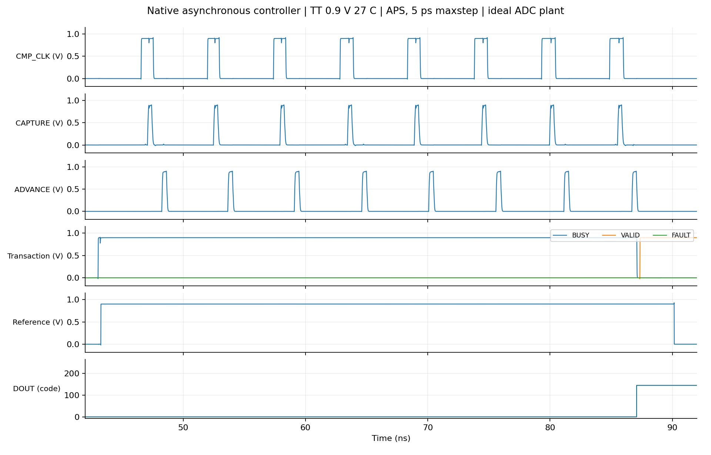
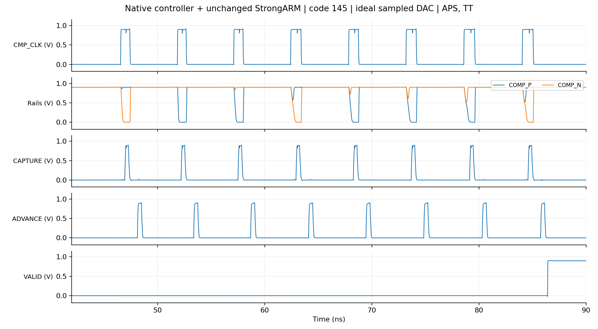
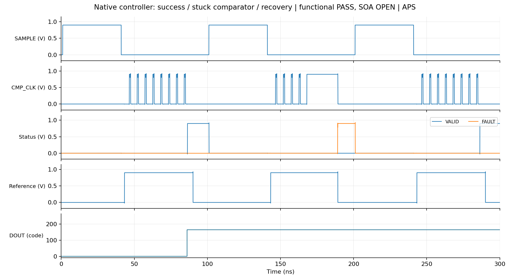

# 异步 SAR：可运行模型与 Virtuoso 门级原型

> 后续方案已按用户要求改为[采样初始化的精简异步控制器](sar8_simple_async.md)
> `sar_logic_8b_async_simple`。本文的26-cell握手/截止/输出银行方案及其结果
> 作为历史对照保留，不是当前选定控制接口。

2026-10-20。当前对象是 **8 bit、10 MS/s、0.9 V、全差分 flat CDAC**，
不是历史 10 bit 5+5。本次已落地事件模型、模块化原生门级原理图和 Spectre
仿真。结论是**典型点功能跑通的原型，尚未通过全角时序与器件安全门槛**。
不能把行为模型 ENOB 或正确码字当成完整晶体管 ADC 的验收。

当前合同：[sar8_async_impl.yaml](../config/sar8_async_impl.yaml)。初始
[架构提案](sar8_async_logic.md)及 88-ns 预算作为历史保留，不是实测合同。

## 1. 模型究竟怎样异步

外部 10-MHz 帧给 SAMPLE、HOLD_START、DEADLINE、PREPARE；帧内没有
200-MHz 位时钟，也没有自由振荡环。每位按下面的因果链推进：

```text
TRIAL / 改变试探码
  → 原生 BBM + DAC guard，且 RESET_OK
  → EVAL / CMP_CLK↑
  → 本轮 P,N 为 10/01，持续满足资格保护
  → CAPTURE↑ / 写工作位，token 不动
  → CAPTURE↓ → CMP_CLK↓ / 比较器复位
  → P,N=11 且复位 guard 满足
  → ADVANCE / token 移位
  → 下一位 TRIAL，或末位 PUBLISH 请求
  → COMMIT / 锁存输出字 → 输出稳定保护 → VALID↑
```

这是 **bundled-data 异步**：比较完成自定时，但模拟 CDAC 建立、轨道资格、
锁存和复位依赖有界保护延时，不是 delay-insensitive 电路。P XOR N 只是
轨道分类，不能直接当寄存器时钟。11 是 StrongARM 复位态；00 持续到资格
窗口后触发 FAULT。它不构成模拟亚稳态检测或形式化无竞争证明。

Python 参考在 [sar_async.py](../models/behavioral/sar_async.py)：事件队列、
输入相关比较延迟、分开的 capture/reset/advance、工作字/输出字、截止优先、
过期事件和重复完成事件处理。它使用预算延时，**未用晶体管结果拟合**。
VA [plant](../models/veriloga/sar8a_plant.va)仅提供理想采样/DAC、可变延时
比较器轨道和故障刺激；[observer](../models/veriloga/sar8a_monitor.va)只计数实际边沿。
真正的电气控制器是下面的原生层级，内部没有 VA、理想逻辑门或理想 DFF。

## 2. Virtuoso cell 分层

库：`SAR_ADC_T28`；顶层：`sar_logic_8b_async`。共 26 个原生 cell，均有
schematic/symbol；另有 3 个测试台 schematic，以及 plant 的 veriloga/symbol。

| 层级 | Cell | 职责 |
| --- | --- | --- |
| 帧与所有权 | `sar8a_frame` | 接收外部帧命令，启动去重，参考 HOLD/KILL |
| 比较器接口 | `sar8a_cmp_if` | 轨道接收、DATA、合格完成、复位确认、非法状态 |
| 握手时序 | `sar8a_seq` | TRIAL/EVAL/CAPTURE/RESET/ADVANCE、比较器本地时钟 |
| 位序 | `sar8a_token8` | MSB→LSB one-hot，CAPTURE 后再 ADVANCE |
| 工作位 | `sar8a_bit` ×8 | token 选位写入，生成 WORK OR TOKEN 试探码 |
| 输出字 | `sar8a_out8` | 独立 COMMIT 锁存；故障不覆盖旧结果 |
| 状态与发布 | `sar8a_status` | BUSY、FAULT、COMMIT、延迟 VALID、采样阶段恢复 |
| 参考选择 | `sar8a_bbm` | SEL0/SEL1 break-before-make；BASE 参考使能 |
| 组合门 | `sar8a_inv/nand2/nor2/and2/or2/xor2/buf/mux2` | T28 静态 CMOS；NOR/OR 用 DeMorgan 分解 |
| 存储 | `sar8a_sr`、`sar8a_dffr` | 复位优先 SR；24-MOS 静态传输门主从 DFF |
| 保护延时 | `sar8a_delay_{dac,valid,capture,reset,advance,publish,bbm}` | 两段 RC + MOS 反相器 + 快速复位钳位 |

源拓扑在 [circuit.py](../scripts/sar8_async/circuit.py)，OA 创建/读回在
[oa.py](../scripts/sar8_async/oa.py)。原生顶层展开为 **1742 MOS、316 个理想
电容、55 个理想电阻**；不是标准单元库或已优化低功耗实现。
MOS 为 `tsmcN28/nch_mac,pch_mac`，L=30 nm。延时/显式稳定负载仍是
analogLib R/C，没有把它们伪称为 PDK 无源器件或提取寄生。

每段延时 R=10 kΩ；DAC/valid/capture/reset/advance/publish/BBM 的 C 分别为
200/5/8/33/8/12/5 fF。每个 NAND 栈中点额外 10 fF，SR 的 QB 额外 5 fF，
DFF 两个存储节点各 5 fF；它们都是可见的电路元件，不是隐藏 cmin。
它们的面积、功耗、R/C 容差和版图成本尚未优化/验证。

## 3. 帧合同及测试负载

命令以每帧开始为零：SAMPLE 1–41 ns；HOLD_START 43 ns；COMMIT 截止
89 ns；PREPARE/reference release 90 ns；下一帧采样 101 ns。
依据原生延时把原提案截止 88 ns 调整至 89 ns；这不是改变 100-ns 采样周期。
外部帧发生器仍是测试源，尚未实现为原生 clock/reset 模块。

PUBLISH 是请求；只有合格 COMMIT 时钟能写输出字。BUSY 在 COMMIT/FAULT
后撤销，VALID 等输出稳定后才拉高。已 COMMIT 的帧不会被后续截止信号撤销，
参考保持到 PREPARE；未提交的故障帧保留旧 DOUT、VALID=0。系统 reset 清零
DOUT，新采样只清工作状态/VALID/旧 FAULT，不清最后成功输出。
模型定义截止与 COMMIT 同时到达时截止优先；原生电路不承诺零余量仲裁，
仍需保护窗口与模拟亚稳态表征。

测试台明确加载：DOUT/状态标志各 5 fF，SEL0/SEL1、比较器两轨和 CMP_CLK
各 10 fF；BASE 只有 1-TΩ 观测电阻。不能外推到任意外部负载。
CODE/SEL 是待对接的控制接口，不意味着已经接入任何实际 MOM/CDAC 或
新的 dual-rail 候选；历史 Bootstrap/CDAC/StrongARM 均未被修改。

## 4. 行为模型结果

使用 ADCToolbox 做码密度/频谱分析，不照搬其内部 ADC 控制器。
零误差 ramp 2048 点、每码 8 点：缺码 0，DNL/INL=0。
4096 点相干正弦，bin=1843，fin=4.49951171875 MHz，幅度 -1 dBFS：

| 条件 | SNDR | ENOB |
| --- | --- | --- |
| 理想事件模型 | 48.7529 dB | 7.8061 bit |
| 顶层噪声分配敏感性 | 45.9121 dB | 7.3342 bit |

第二行独立高斯假设：采样/比较器/参考分别 0.18/0.18/0.12 LSB RMS，
采样抖动 20 ps RMS，seed=271828。抖动改变输入采样时刻，不重复计为位时钟
噪声。偏置、有效位权误差、DAC 一阶建立等参数可单独开启，默认全关；
weight_error[0] 对应 LSB。未把未建模失真伪造成随机噪声，也未做物理噪声/MC。
理想模型完成时间 77.17–77.69 ns 仅反映参考预算，不代表原生电路速度。

## 5. 原生 Spectre 结果与失败边界

使用 Spectre 21.1.0.509.isr12、PDK 对应 tt/ff/ss MOS section。APS 是主要
时序依据；AX 200-ps maxstep 作有界筛选，另以 APS 5-ps maxstep 控制典型角。
每个结果都要求 result.ok、所有显式保存的物理轨迹完整且有限；功能判断与
器件 SOA 判断独立。解析器多出的 NaN `units` 元数据被显式排除，真实波形
不删除、不填值；原始 PSF/日志保留。

典型角 0.9 V / 27°C：理想 plant 参考输入 0.123 V 得到 code145，8 次有序
比较/锁存/推进；VALID 约 87.35 ns。token 在锁存期 one-hot，比较器在 CAPTURE
下降后约 95 ps 才复位，避免提前破坏锁存。实际 TRIAL→EVAL 约 3.44 ns。
名义点无打印 CMI 或 suppressed 告警，但这不代表其他输入/多帧也安全。
APS 与 AX 典型角 CMP_CLK/CAPTURE/ADVANCE/VALID 的最大边沿差为 17.611 ps，
小于预设 20-ps 数值控制限。成功帧 BASE 在 89.7 ns 仍保持高，在 90.5 ns 已低；
拉长比较器的超时帧约在 89.202 ns 关断 BASE，保留下一阶段前的释放余量。
这些只是本负载的测量，不是全 PVT 时序保证。



把比较器换成**未改动的真实 StrongARM**、保留理想采样/DAC：代表输入
0.123046875 / -0.798046875 / +0.798046875 V 分别得到 145/14/241。
正小输入 APS 在约 86.419 ns 给出 VALID；这不是全输入范围性能扫描。



| 场景 | 功能结果 | 仍需关注 |
| --- | --- | --- |
| 比较器卡住、非法 00、提前 PREPARE | 旧码保持、VALID=0；下帧恢复 | 多帧门节点过冲，SOA 不通过 |
| 运行中系统 reset | DOUT 清零；下帧恢复 | 多帧 SOA 不通过 |
| 同帧重复 START | 不多转换，仍为 8 次 | 只覆盖本测试脉冲/负载 |
| 故意拉长比较器延迟 | 超时撤参考、FAULT=1、不提交残缺字 | 属于保护测试通过，不是速度通过 |
| FF / 0.99 V / -40°C | 输出码正确 | 器件 SOA 不通过，不能接收为安全角 |
| SS / 0.81 V / 125°C | 截止前仅完成 7 位；FAULT=1 | **10 MS/s 时序失败**，不是误码可接受 |
| 大负残差 + 真实 StrongARM | 码正确 | 比较器输入管超过 0.99-V 端差限；AX 曾打印约 1.074 V，APS 也确认告警 |



曾发现真实恢复竞争：只在 ACCEPT 清 FAULT，旧 FAULT 同时复位 HOLD，导致
短启动脉冲结束后无法重启。已改为采样 WORK_RST 阶段提前清旧 FAULT，
保留修正前失败波形，再跑多帧恢复；没有改 PDK 或屏蔽安全告警。
多帧 AX/APS 波形均可见 CAPTURE 约 -0.111-V 下冲；APS 确认相关器件端差告警。
因此正确的保持/恢复功能仍不能使这组多帧结果通过 SOA。

**全 256 码覆盖的层次必须区分**：Python 参考和实际 OA 导出网表的事件级
功能解释器均覆盖 256 码/重复启动、16 个卡住或非法位位置、保持与恢复。
网表解释器审计原生 INV/NAND 的 MOS 开关真值，但 SR/DFF/延时仍是状态抽象，
不验证建立保持、亚稳态、SOA 或 PVT。未完成 256 帧全原生 Spectre 扫描。

目前不应冻结延时尺寸、宣称 1-mW 功耗达标或开始签核。下一轮应先修多帧
驱动/过冲和慢角时序，再映射物理 R/C、对接实际 CDAC/采样接口；之后才有
意义进行完整原生静态/动态、噪声、失配、版图/PEX 验证。

本轮最终层级共有 17 个集成场景数值运行，另有 4 个不变原生单元运行，
均成功执行且轨迹完整；其中 SS 的 AX/APS 两次均未通过转换时序，
多帧/FF/负输入等 SOA 失败单列于结果 JSON，不能统计为“21 次全部通过”。
用户选择先完成当前验证，未启动小时级全原生 256 码回归。

## 6. 审核入口、证据与复现

已在 Virtuoso 留下顶层、`sar8a_seq`、`sar8a_dffr` 三个审核窗口；层级全览
文字需缩放查看，连接使用具名网络。29 个 schematic 全部零 markers、端口/
实例/连接/参数逐项读回。新鲜保存态导出与仿真 recovery 层级一致，plant
远端/本地 SHA256 一致，真实 StrongARM 前后读回相同。

小型可跟踪结果：[summary.json](../verification/sar8_async/summary.json)。
新增[两个完整采样周期与 88 个关键节点时序](sar8_async_two_cycles.md)，
包含两次正常转换、位级展开及跨帧下冲放大；不改变本页的未通过项。
原始网表、PSF、告警、各版本与 GUI 截图在 `output/sar8_async_impl/`，不入 Git。
原生 unit 结果取 tgdff 版本；recovery 只改 status，已审计 unit 定义未改变。

```powershell
# 在 projects/sar-adc-t28；行为模型用项目 Python
.venv/Scripts/python.exe verification/sar8_async/test_model.py -v
.venv/Scripts/python.exe scripts/sar8_async/model.py
# bridge 环境；已有导出/单位延时证据时运行
../../.venv/Scripts/python.exe scripts/sar8_async/netlist_logic.py
../../.venv/Scripts/python.exe scripts/sar8_async/audit.py
# 新模拟必须用唯一名称，保留旧结果；此命令不是全码扫描
../../.venv/Scripts/python.exe scripts/sar8_async/suite.py tt --tag recovery --name review_tt_new --mode aps
```

OA 重建不是上面的普通复现步骤：已有 cell 必须先核对所有权、保存态/窗口
和计划，再显式使用 owned rebuild；不能覆盖历史 ADC 或用户正在编辑的 cell。
