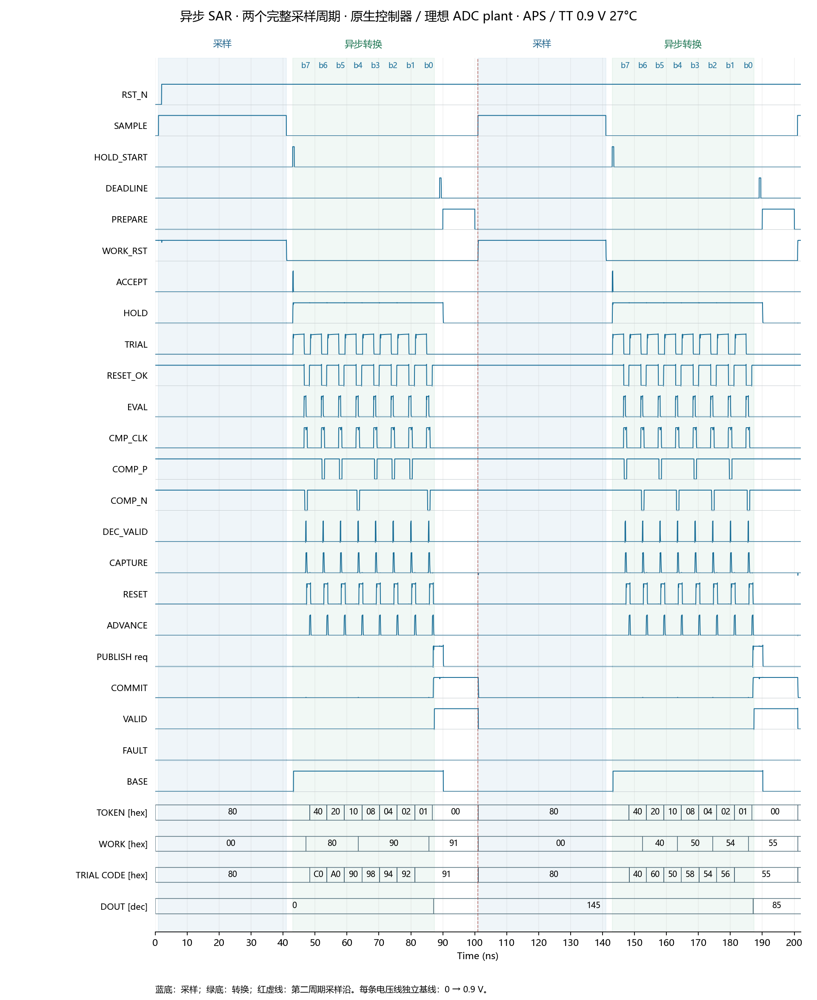
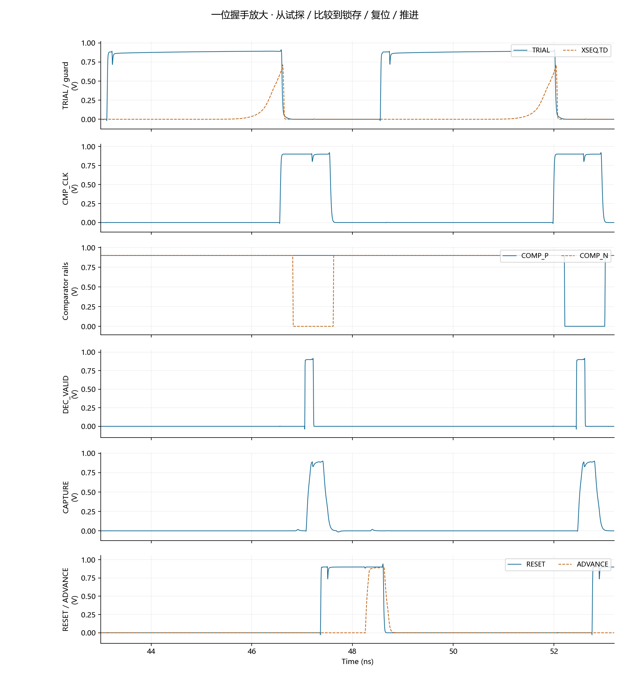
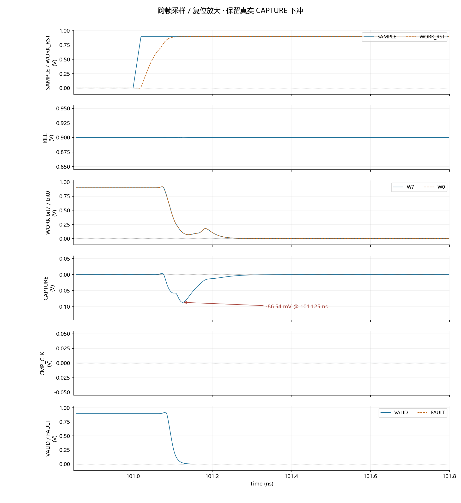

# 两个完整采样周期：异步 SAR 关键节点时序

图来自不改电路的原生 T28 控制器 Spectre APS 观测仿真，而不是手绘理想矩形。
模拟部分仍为理想采样 / 二进制 DAC / 可变延时比较器 plant，**不是完整管级 ADC，
也不是本次真实 StrongARM 联测**。条件：TT、0.9 V、27°C、conservative、
maxstep=200 ps；器件边沿由自适应时间步解析。既有 PVT/SOA 未通过项保持不变。

两个采样周期由 SAMPLE 的三个上升沿界定，约为 **1.01→101.01→201.01 ns**，
每个周期 100 ns。图显示 0–202 ns，额外保留首次系统复位和末尾边界附近的
少量上下文；首次系统复位只与第一周期采样开头重叠。

差分输入第一帧为 0.123 V；101–102 ns 在第二帧采样阶段改成 −0.3 V。
两次预期输出分别为 **145、85**。这是两次普通转换，没有故意注入卡住故障。
本次两帧都得到正确输出，各有 8 次 EVAL/CAPTURE/ADVANCE；VALID 分别在
87.349605 ns、187.373284 ns 上升。第二帧采样期间 DOUT 保持 145，直到
第二次 COMMIT 才更新为 85。

## 先看总览



[可缩放矢量总览](figures/sar8_async_two_cycles/two_cycles_overview.svg)。
蓝底表示 SAMPLE 高的采样阶段，绿底表示从 HOLD_START 到本帧结果有效的转换
阶段，红虚线是第二周期采样沿。每条电压线有独立基线，0→0.9 V 表示低→高；
下冲保留在低电平基线下方。TOKEN/WORK/TRIAL 总线为十六进制，DOUT 为十进制。
总线以 0.45-V 阈值从实测各位电压解码，不把中间试探字当作 ADC 最终结果。

建议按下面的顺序阅读：

1. **SAMPLE 高**：输入采样；WORK_RST 清工作字与 token 状态，旧 DOUT 不清。
2. **HOLD_START / ACCEPT**：一次启动被接受，HOLD/BASE 取得参考控制权。
3. **TRIAL→EVAL**：先送试探码，等 DAC 保护延时及比较器复位确认。
4. **CMP_CLK→DEC_VALID→CAPTURE**：比较、合格判决、锁存当前位。
5. **RESET→RESET_OK→ADVANCE**：先结束锁存，再复位比较器，再移到下一位。
6. **末位 PUBLISH→COMMIT→VALID**：请求发布、锁存输出、等待输出稳定后宣告有效。
7. **PREPARE**：撤参考；下一 SAMPLE 开始新一帧，但 DOUT 保持到新 COMMIT。

注意：CODE = WORK OR TOKEN，所以采样时 CODE 可能仍显示 0x80；只有 HOLD
及参考选择有效时，它才参与转换。CODE 的中间变化不是额外输出码。
DATA 在比较器预充电期间也可能变为 0，只有合格 CAPTURE 时的值才是判决。

## 88 个关键电压节点，全部按模块展开

“关键节点”指控制器接口、握手状态、主要保护延时及位寄存器/参考选择，
不是每只 MOS 的全部端子。下面各组覆盖保存清单中的所有 88 个电压节点，
没有把未保存节点补画成实测信号。

| 分组 | 实际节点与查看入口 |
| --- | --- |
| 帧命令和工作复位 | [RST_N、SAMPLE、HOLD_START、PREPARE、DEADLINE、WORK_RST](figures/sar8_async_two_cycles/nodes_frame.png) |
| 帧所有权 | [SYS_RST、ACCEPT、HOLD、KILL、BASE、BUSY](figures/sar8_async_two_cycles/nodes_ownership.png) |
| 异步时序器 | [TRIAL、EVAL、CAPTURE、RESET、ADVANCE、PUBLISH](figures/sar8_async_two_cycles/nodes_sequence.png) |
| 比较器接口 | [P、N、CMP_CLK、CMP_RESET、DATA、DEC_VALID](figures/sar8_async_two_cycles/nodes_comparator.png) |
| 确认与保护 | [RESET_OK、BAD、LAST、TD、RV_D、CR_D](figures/sar8_async_two_cycles/nodes_guards.png) |
| 输出发布 | [COMMIT、PUB_D、VALID、FAULT、CAP_D、ADV_D](figures/sar8_async_two_cycles/nodes_publication.png) |
| 模拟 plant | [VIN、TOPP、TOPN、VDD](figures/sar8_async_two_cycles/nodes_analog_plant.png) |
| 位序 token | [T7…T0 原生电压与合成总线](figures/sar8_async_two_cycles/bits_token.svg) |
| 工作寄存器 | [W7…W0](figures/sar8_async_two_cycles/bits_work.svg) |
| 试探字 | [CODE7…CODE0](figures/sar8_async_two_cycles/bits_trial.svg) |
| 输出寄存器 | [D7…D0](figures/sar8_async_two_cycles/bits_output.svg) |
| 低端参考选择 | [SEL0_7…SEL0_0](figures/sar8_async_two_cycles/bits_sel0.svg) |
| 高端参考选择 | [SEL1_7…SEL1_0](figures/sar8_async_two_cycles/bits_sel1.svg) |

## 一位转换放大



重点比较 CAPTURE 下降与 CMP_CLK 下降的先后，以及 RESET 与 ADVANCE 的先后。
这能检查“结果先锁住，再破坏比较器输出”的顺序，不只看最终码是否正确。

## 跨帧下冲放大



将 SAMPLE/WORK_RST、工作位复位、CAPTURE、CMP_CLK 放在同一时间轴，
用于观察下冲与复位翻转的相对时刻。对时间的重合观察仍不是耦合原因的
隔离证明；没有额外逻辑沿也不能豁免器件安全限制。

这里第二周期开始处为 **−86.541 mV @ 101.125 ns**；与此前故障用例
约 −111 mV 的幅度不同，不能混用。第二周期结束后的下一次采样/复位上下文
仍有 **−111.316 mV @ 201.126 ns**，并在约 201.114 ns 开始打印 CMI。
[末尾复位边界放大](figures/sar8_async_two_cycles/closing_frame_detail.png)。
该边界在两个完整周期之后，图中额外显示到 202 ns 正是为保留它。
这说明正常转换后也能出现此类问题，并不意味着已经定位了耦合根因。
该运行有 25 条打印 CMI、15565 条 suppressed warnings，器件安全不通过。

## 原来的故障场景只作对照

[第一周期成功 / 第二周期人为卡住比较器](figures/sar8_async_two_cycles/fault_comparison.png)。
此图来自旧的 `recovery_fault_stuck_aps`，**不是上面的两次正常转换**。
它显示等待比较器完成如何延长 CMP_CLK，以及截止/FAULT 如何撤销参考。
不把不同运行拼接成一个连续实测周期。

## 溯源与复现

新观测 case：`two_cycles_keynodes_aps_01`。原生层级与既有 `recovery` 导出
逐 subcircuit 核对相同，未修改任何 OA、PDK 或电路尺寸。仅改变输入测试源、
保存节点和仿真时长。原始 PSF、日志、全部求解器采样波形在
`output/sar8_async_impl/` 对应 case；
[关键时间、节点清单与结果](../verification/sar8_async/two_cycle_summary.json)
记录仿真来源与哈希。显示做峰值保留抽样：每个显示时间箱只保留原始
first/min/max/last 点，不做平均或电压钳位；分析使用完整原始求解器采样。

```powershell
# 已有该 case 时只重画，不重新跑仿真
../../.venv/Scripts/python.exe scripts/sar8_async/two_cycles.py plot
```

本次只补充时序可视化，不修电路，不做 PVT 或 256 码晶体管回归，也不将这些
图片作为器件安全或完整 ADC 性能验收。
