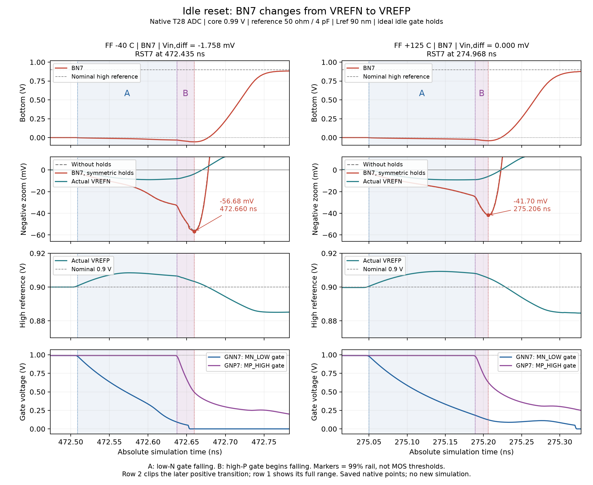
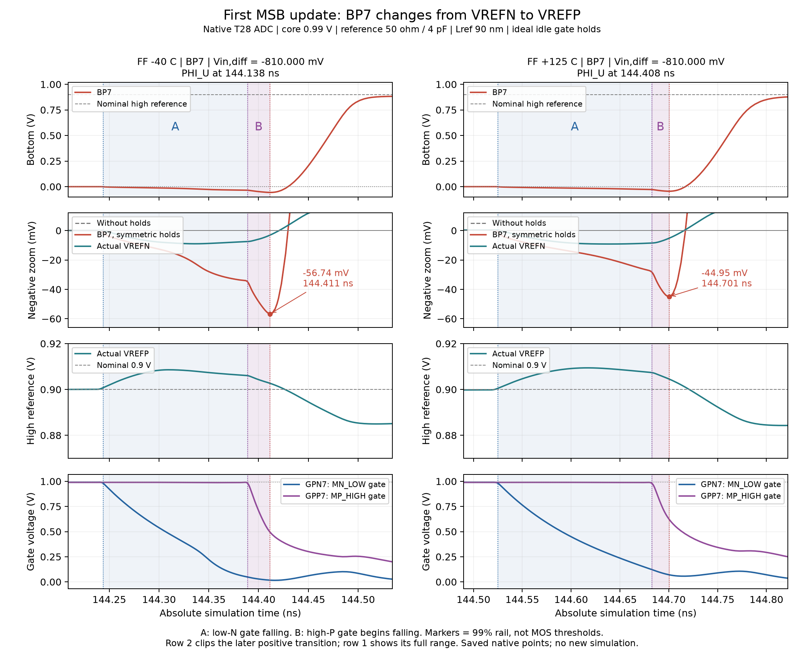

# 底板负向偏移：低参考到高参考交接中的两段下冲

已定位到 MSB 本位的参考切换：先是低参考 NMOS 的栅极下降，随后高参考 PMOS 的栅极下降，底板先负向下冲，再被充向 0.9 V。它同时存在于空闲复位和转换更新，**不是只有参考轨下陷，也不是新增对称保持才引入的问题**。

本轮只分析已保存的 Spectre 波形，没有修改电路、时钟、OA 或重新仿真。波形能确定关联支路和切换顺序，但尚不能分别量出栅漏耦合、沟道电荷、另一半 CDAC 耦合的贡献。

## 测试条件与直接支路

沿用提交 `0e495c0` 的四组 600 ns 原生结果：FF、核心电源 0.99 V、−40°C / +125°C，对照与对称保持各一组。T28 原生 ADC，Mmain=2 µm，参考开关 L=90 nm；VREFP/VREFN 名义值 0.9/0 V，各有 50 Ω 源阻抗和 4 pF 去耦；输入共模 0.45 V。对称保持是仅空闲期启用的有限阻抗理想诊断支路，不是已完成的晶体管 keeper。

| 底板 | 低参考支路：底板 ↔ VREFN | 栅极 | 高参考支路：底板 ↔ VREFP | 栅极 |
| --- | --- | --- | --- | --- |
| BN7 | XSN7.MN_LOW | GNN7 | XSN7.MP_HIGH | GNP7 |
| BP7 | XSP7.MN_LOW | GPN7 | XSP7.MP_HIGH | GPP7 |

器件前缀为 `XDUT.XCDAC`。每侧是一个低参考 NMOS 加一个高参考 PMOS，不是每条参考支路各用一个传输门。MOS 漏端接底板；NMOS bulk 接 0，PMOS bulk 接 0.99 V。两类器件均 L=90 nm、multi=384，单实例 W 分别为 150/175 nm，尺寸未变。

## 1. 空闲复位：BN7 的两段下冲

左冷角、右热角；每列从上到下为完整底板跳变、负压局部与实际 VREFN、实际 VREFP、两条直接支路的栅极。蓝色 A 区间只有低参考 NMOS 栅极显著下降；紫色 B 区间高参考 PMOS 栅极也开始下降。第二行裁掉后续正向跳变，第一行保留完整幅度。灰虚线为无保持对照，几乎与新方案重合。

以冷角为例：

1. **RST7 于 472.435 ns 发出。** 初始 GNN7/GNP7 均约 0.99 V：低侧 NMOS 保持 BN7 在低参考，高侧 PMOS 关闭。
2. **约 472.509～472.637 ns：GNN7 下降。** GNP7 仍接近 0.99 V，BN7 已降到约 −31.68 mV（取高侧栅极开始下降前 5 ps）。下冲不是等高侧开关打开才出现。
3. **约 472.637～472.660 ns：GNP7 也下降。** BN7 再下冲到 **−56.68 mV**；随后才向高参考充电，约 472.678 ns 穿过 0 V。穿过零点不等于已经建立到 0.9 V。

栅极开始下降以 99% 电源交点作时间标记，**不是 MOS 阈值，也不是证明完全截止的边界**。冷角两栅极起始标记相隔约 129 ps，热角约 139 ps，不能直接把它们称作“两管同时关闭时长”。

此时 RST6 尚未触发；冷/热角其他 bit0～6 的栅极在这段下冲中最大变化约 0.43/0.24 mV，没有完整翻转。实际采样控制保持低电平。这次事件属于 **bit7 自身复位交接**，不是后续其他位复位，也不是 Bootstrap 采样关闭沿。

## 2. 转换更新：同一问题在 BP7 重现

两角均取输入差分 −0.81 V 的第一轮 MSB 更新。此时 RST7 为低，由 PHI_U 驱动码位更新；BP7 从低参考切向高参考。GPN7 先下降、GPP7 后下降，仍形成两段下冲。转换期理想空闲保持关闭，因此不能把这一现象归因于保持支路正在动作。

| 阶段 / 温度 | 底板与最低时刻 | 底板最低值 | 同时刻 VREFN | 底板 − VREFN | 高侧栅极下降前底板 |
| --- | --- | ---: | ---: | ---: | ---: |
| 空闲复位 / −40°C | BN7，472.660 ns | −56.68 mV | −3.67 mV | −53.01 mV | −31.68 mV |
| 空闲复位 / +125°C | BN7，275.206 ns | −41.70 mV | −5.96 mV | −35.74 mV | −23.27 mV |
| MSB 更新 / −40°C | BP7，144.411 ns | −56.74 mV | −3.11 mV | −53.63 mV | −33.83 mV |
| MSB 更新 / +125°C | BP7，144.701 ns | −44.95 mV | −5.16 mV | −39.79 mV | −26.79 mV |

“底板 − VREFN”只是同时刻的电压差，不是某条支路的电荷贡献百分比。VREFN 在更早阶段也有下陷；不能仅用峰值同时刻的几 mV 否认参考阻抗对整个动态过程的影响。空闲图选各温度既有最坏 BN7 事件：冷角输入 −¼LSB、热角输入 0，不是同输入温度灵敏度试验。

## 原因判断与证据边界

**目前最符合波形的解释**是：低参考 NMOS 关断时，栅极负向边沿及沟道电荷变化扰动底板，同时低参考的保持能力减弱；高参考 PMOS 栅极随后下降，又通过寄生耦合产生负向扰动，直到它从高参考提供的正向充电占主导，底板才回升。互补底板也同时切换，公共参考和电容网络的反馈不能排除。

这定位到两条直接相关支路，而不是证明“全部电荷只来自某一只管”。既有保存项不含这两只开关的端口电流；也没有用瞬时工作点证明热角低侧 NMOS 在最低点已完全关闭。热角此刻 GNN7 仍约 0.122 V，不能仅凭该电压作截止判断。

对称保持保护的是已到目标电平的栅极；命令切换时会释放，不能继续把待下降的栅极钉在高电平。冷角最低点低侧栅极已重新保持在低电平，高侧仍在切换，并非所有保持此刻都关闭。无保持时冷/热复位最低值为 −55.77/−41.79 mV，加入保持后为 −56.68/−41.70 mV：没有消除本位交接的下冲。

负压也解释了剩余体—漏应力：冷角复位时，XSN7.MP_HIGH 的 bulk 为 0.99 V、drain 为 −0.05668 V，故 **|Vbd|=1.04668 V**。即使栅极不超电源范围，体—漏端电压仍超出本项目 0.99 V 筛查线。这里是短暂参考切换毛刺，不能直接当成最终采样保持误差；码字正确也不等于器件应力合格。

## 修改方案：先分离两段，再调整交接

以下均为待做的单变量实验，本轮未实施；保留采样窗口、关闭沿、W/L、并联数及其他位时序。

| 顺序 | 单变量实验 | 要回答的问题与风险 |
| --- | --- | --- |
| 1 | 给 XSN7/XSP7 的 MN_LOW、MP_HIGH 补存端口电流、工作点及参考供电电流，复核更严格精度 | 分清两段扰动与正向充电；MOS 端口电流含位移电流，不能直接当纯沟道电流 |
| 2 | 单独放缓低侧 NMOS 栅极下降，试原始 / 2× / 4×边沿时间；高侧命令不变 | 看 A 段能否减小；低侧可能拖到高侧开始导通，必须量参考直通峰值与电荷 |
| 3 | 恢复低侧原始边沿，单独将高侧开启交接提前 20/40 ps 作诊断 | 缩短底板保持减弱的阶段，观察 B 段；不能以制造强重叠导通换取表面无负压 |
| 4 | 单独将参考源阻抗 50 Ω 降为 10 Ω，去耦仍为 4 pF | 量出公共参考阻抗的影响，不能预先宣称能消除局部栅极耦合 |

若交接整形不能兼顾负压和直通，再考虑弱辅助钳位或 dummy 电荷补偿，并检查额外负载、失配和 PVT；不建议直接整体放大 W。放大既增加导通能力，也增加寄生与待转移电荷。

筛选必须同时看：所有参考开关端电压、负压幅度/持续时间、直通电流/电荷、全部底板最终建立时间、码字和采样保持误差。最佳诊断方案再实现为真实驱动电路；不能将理想边沿干预直接视作管级闭环完成。

## 可复核性

- [事件、支路映射和采样点](../verification/sar8_bottom_undershoot/events.json)
- [原始数据来源与散列](../verification/sar8_bottom_undershoot/provenance.json)
- [本轮验证](../verification/sar8_bottom_undershoot/validation.json)
- [上一轮完整结果和精度限制](sar8_ref_symmetric_hold.md)

原生 Spectre 21.1 CX；有效 reltol=1e-4、maxstep=6 ns、gear2only，V/I abstol=1 µV/1 pA，并非网表请求的 10 ps 最大步长。四个新方案事件最低点附近的相邻原生步长平均约 1.6～2.3 ps，但这不代替精度收敛验证。图直接连接保存的原生采样点，时间交点用线性插值；数值保留位数不代表物理精度。本轮无新全码、频谱、噪声、失配或 PEX 验证，也没有修复或提升任何电路基线。
