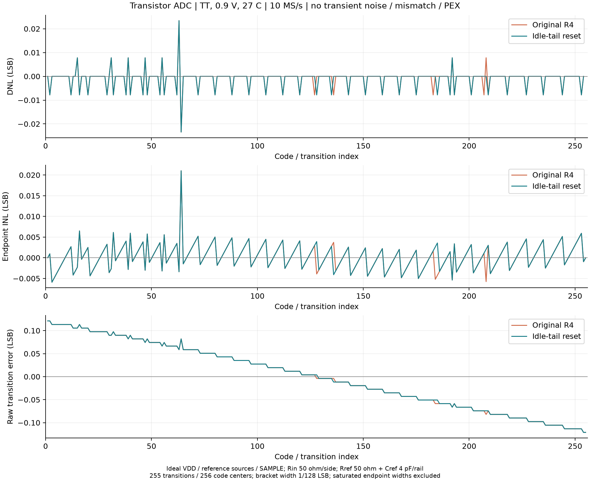
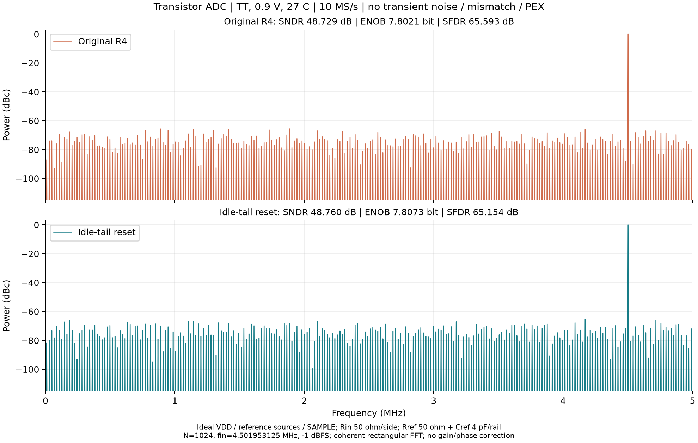
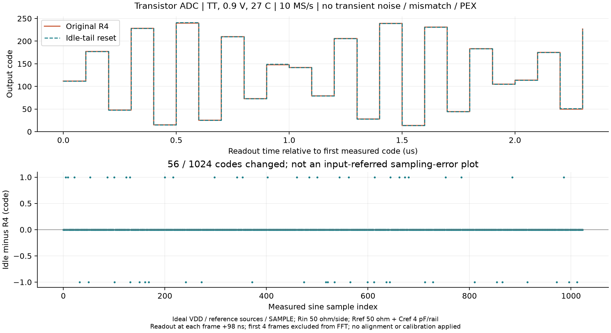

# 空闲段复位版本：全码与频谱对照 R4

本轮固定候选 `027b951`，不调整器件尺寸或连接。TT、0.9 V、27°C、10 MS/s；
不包含 PVT、失配、瞬态噪声及 PEX。测试台沿用 R4：理想电源/参考源/SAMPLE，
输入每侧 50 Ω，参考每轨 50 Ω＋4 pF。候选仍为网表实验，未替换 R4 或 OA。

| 指标 | 原 R4 | 空闲段复位 |
| --- | --- | --- |
| DNL (LSB) | -0.02344 ~ 0.02344 | -0.02344 ~ 0.02344 |
| 最大端点 INL (LSB) | 0.02103 | 0.02103 |
| SNDR (dB) | 48.729 | 48.760 |
| ENOB (bit) | 7.8021 | 7.8073 |
| SFDR (dB) | 65.593 | 65.154 |
| 有原生 CMI 告警的案例数 | 4 | 0 |

全部 255 个转换边界、256 个码中心、1024 个正弦输出已回收；
实际观察码覆盖 256/256。总计 3618 帧（含预热），
逐帧时序通过：True；码中心正确：True。
性能筛选通过：True。这不是整机可靠性签核。

## 静态

同一真实码字反馈二分算法，7 次细化，最大搜索区间 0.0078125 LSB。
DNL 不包含两端饱和码宽。原始转换边界误差和去除端点增益/偏置后的 INL 分开显示；
小于搜索分辨率的差别不能解释为确定的电路改善。
候选端点增益误差 -0.09535%，首边界偏移 0.85144 mV。

## 动态

连续 -1 dBFS 正弦，4 帧预热＋1024 帧测量，fin=4.501953125 MHz、bin=461。
矩形窗相干 FFT，去 DC，SNDR 包含谐波；未校准增益、相位或码字。
直接 FFT 与 ADCToolbox 核对。ENOB=(SNDR−1.76)/6.02，未作 -1 dBFS 满幅补偿。
相对 R4：SNDR +0.0313 dB，ENOB +0.00519 bit，SFDR -0.4389 dB。

56/1024 个输出码不同，最大差 1 code。
这是相同外部激励下的版本差异，不直接等同于采样保持误差。
码字在每帧 98 ns 读取；监测 90–98 ns 无翻转，每帧 8 次比较、8 次写入、8 次更新、16 次捕获。
候选在空闲段复位参考，因此 98 ns 顶板电压不再作为上一轮转换残差。

## 原生日志与边界

- 候选 CMI 案例：无；原 R4 的过压记录保留。
- 瞬态数值诊断筛选通过：True；初始 DC 容差放宽案例：static_cx_001_032, static_cx_097_128, static_cx_161_192。
- 同长度案例实际求解设置相同：True。
  Spectre X CX 实际精度从各原生日志记录，不以网表请求值冒充实际值。
- 长跑仅保存 1 ns 频闪波形，应力依据原生 CMI；没有 CMI 不代表所有内部尖峰均被证明安全。
  上一轮高分辨率应力证据见 [空闲段复位实验](sar8_r4_idle.md)，不能外推为全部码的峰值证明。
- 原 R4 正弦是原生瞬态 PASS / 完整波形回收，缺少进程最终零错误摘要；本轮逐例要求 exit 0、PASS、END、哈希核对。

完整数值/逐例设置/日志哈希：`verification/sar8_idle_performance/results.json`；
原始记录：`output/sar8_idle_performance/`。未推送、未修改 PDK、OA 或原始 R4。
