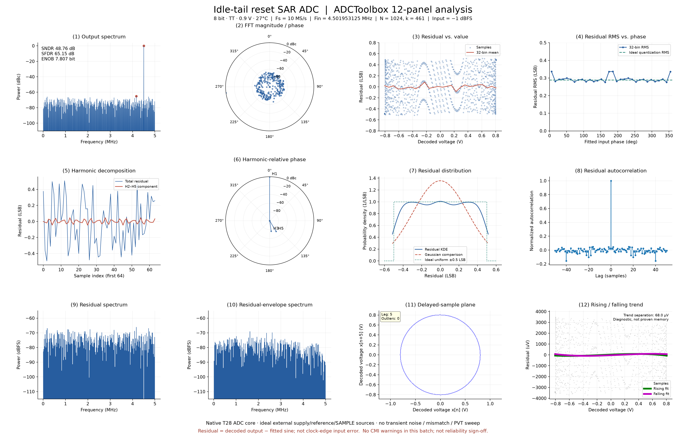
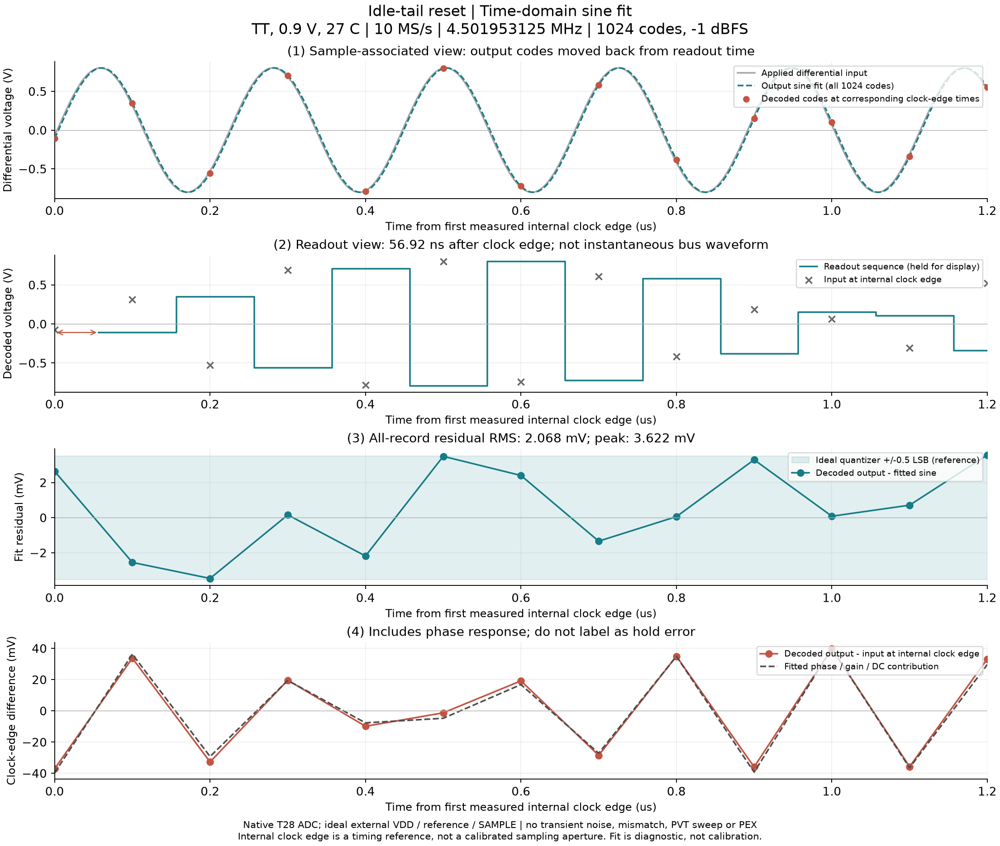
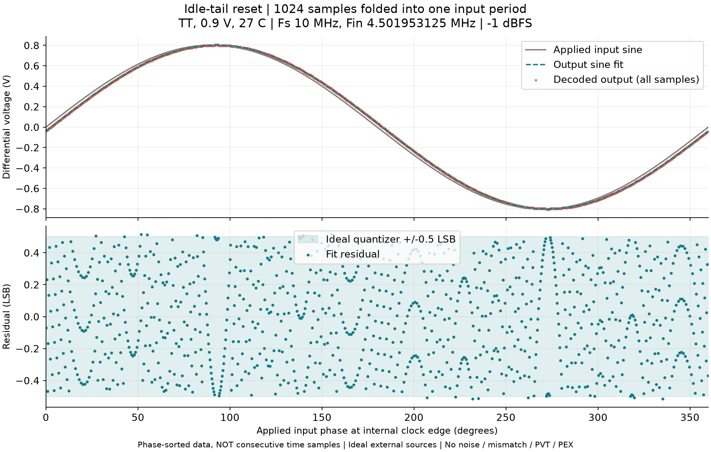

# 空闲段复位版：ADCToolbox 与时域拟合

使用候选 `027b951` 的完整 1024 点，不重跑、不修改码字。
TT、0.9 V、27°C；10 MS/s，4.501953125 MHz，−1 dBFS。
T28 管级 ADC，外部电源、参考源和 SAMPLE 理想；无瞬态噪声、失配、PVT 扫描或 PEX。

## 12 张诊断图

沿用原 R4 的 ADCToolbox 0.9.1 方法：相干矩形窗、去 DC、固定输入频率拟合。
从左到右、从上到下：

1. 输出频谱：SNDR **48.760 dB**，ENOB **7.807 bit**，SFDR **65.154 dB**。
2. FFT 幅相分布：每个频率分量的幅度与记录相位，不是内部时钟相位。
3. 残差随输出电平：检查电平相关偏差，不能当作静态 INL。
4. 残差 RMS 随正弦相位：大多数接近理想量化参考。
5. 残差分解：H2–H5 合计仅 **0.167 mV RMS**，总残差 **2.068 mV RMS**。
6. 谐波相对相位：H3/H5 可见；低于显示下限的谐波不显示。
7. 残差分布：接近均匀量化分布，不能解释为高斯热噪声。
8. 残差自相关：诊断样本相关性；非零相关不直接证明电路记忆。
9. 残差频谱：去除拟合基波后的频率成分。
10. 残差包络频谱：检查幅度调制线索，不等于实测 jitter。
11. 延迟样本平面：相邻延迟码字的几何关系，不是模拟节点相图。
12. 上升/下降趋势：分离约 **68 µV**，仅为诊断，不证明迟滞。

本批次没有原生 CMI 告警，但这些图不构成可靠性签核。

## 时域拟合：明确比较的是哪个时刻

从上到下：

1. 将输出码关联到对应的内部 `SAMPLE_INT` 下降沿，叠加真实输入及输出拟合正弦。
2. 按每帧 98 ns 的读取时刻展示码字阶梯，比内部时钟沿晚 **56.92 ns**。
   阶梯是读取结果的保持展示，不是逐次逼近过程中真实总线波形，也不是转换耗时。
3. 输出减拟合正弦：RMS **2.068 mV = 0.2941 LSB**；峰值 **3.622 mV = 0.5152 LSB**。
   理想量化 RMS 为 **2.030 mV**。阴影 ±0.5 LSB 是参考，不是全电路误差门限。
4. 输出减内部时钟沿输入：RMS **28.402 mV**，峰值 **43.351 mV**。
   虚线说明其中大部分可由拟合的固定相位、增益和 DC 分量解释，不能笼统叫保持误差。

输出拟合相对输入相位 **−2.862°**，单频等效 **1.766 ns 滞后**；
幅度差 **−0.0540%**。这不是识别出的实际 Bootstrap 延迟：内部时钟沿不是校准后的
物理采样孔径，前端频率响应也会贡献相位。拟合用于诊断，没有对输出码做校准，
原始 FFT 指标不变。也不能把拟合去掉的相位/增益差说成完全不存在。

## 单周期折叠

输入接近 Nyquist，每周期仅约 2.22 个采样点。为看清完整正弦，将全部 1024 点
按输入相位排序折叠到一周期；这是相位展示，不是连续时序，也没有插值伪造采样点。

数值：`verification/sar8_idle_performance/toolbox_panel.json`、`toolbox_time_fit.json`。
脚本：`scripts/sar8_idle_performance/toolbox_figures.py`。
与原 R4 的完整对比见 [性能报告](sar8_idle_performance.md)。
