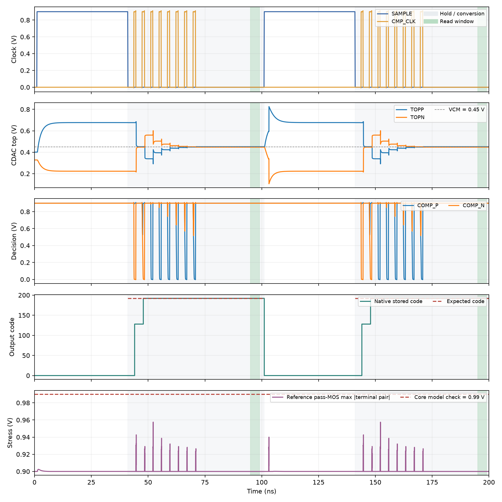
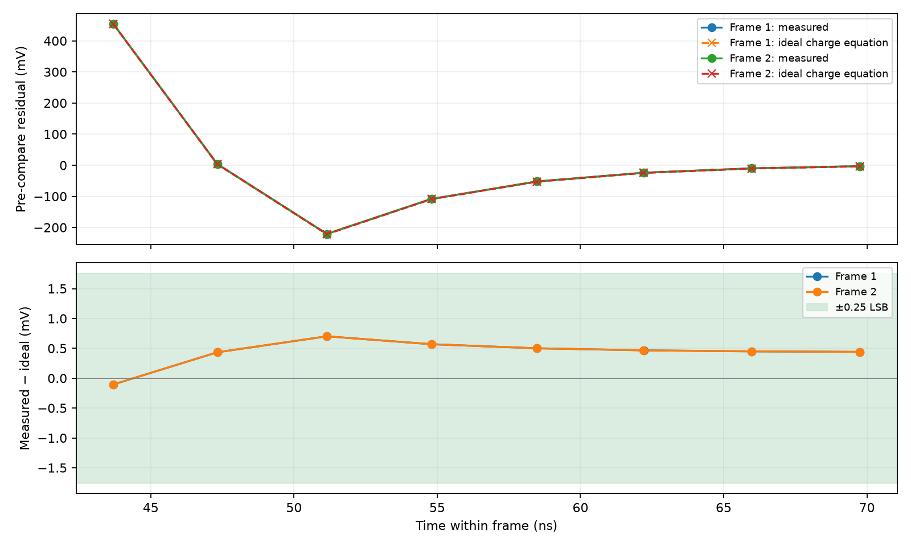
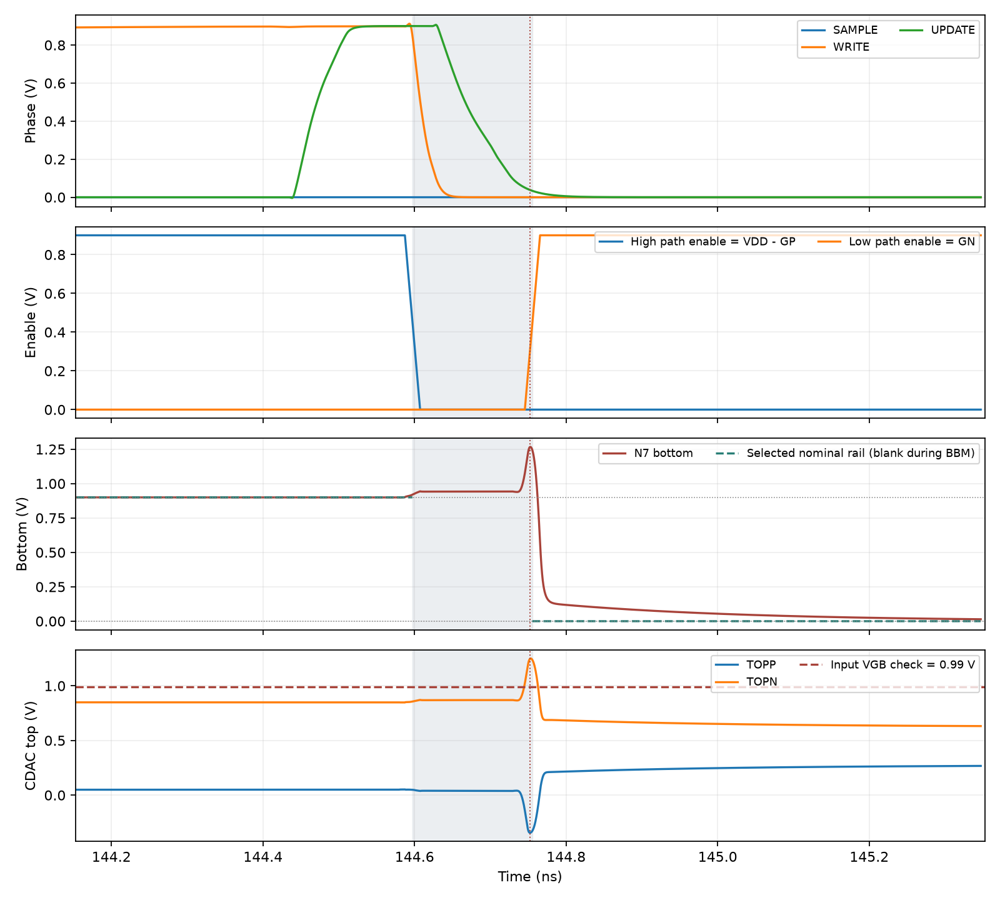

# SAR8 R1 冻结电路与合龙仿真结果

2026-10-20。冻结版本为 `SAR8_JOIN_R1_3X_IDEAL_GATE_NATIVE_ASYNC`。
**统一原理图和联合仿真已完成：11次APS运行、22帧均输出正确，但参考开关和
比较器出现标称条件下的过压，尚未通过器件应力验收。**
冻结表示保存可复现电路，不表示电路已合格。本轮不改Bootstrap拓扑、比较器
尺寸或原生控制器，不展开PVT、失配和噪声。

## 冻结电路和文件入口

| 模块 | 本组选定实现 |
| --- | --- |
| 采样 | 两套 `sar_bootstrap_canvas_flat_8b`；用户Canvas新拓扑，T28 1.8-V器件，主管W/L=1µm/150nm、Cboot=1pF，不变 |
| CDAC | `sar8j_r1_cdac`；8-bit全差分flat，T28 `cfmom_2t`，每侧128…1＋dummy，共256Cu≈1.025pF；名义m聚合版 |
| 参考开关 | `sar8j_r1_sw_b0…b7`；每bank仅P/N两只pass管，P/N均3×，单位W/L分别175/30nm、150/30nm；共32个声明的MOS实例 |
| 参考栅控 | `sar8j_r1_refgate`；理想电压输出，20ps边沿；读取真实原生请求，不从Vin计算码字 |
| 比较器 | `sar_strongarm_t28`，原11管版本，不变 |
| 控制 | `sar_logic_8b_async_simple`，原21种cell、原生MOS及原有理想R/C延时，不变 |

远端Virtuoso库均为 `SAR_ADC_T28`：

- **DUT顶层：`sar_adc8_join_r1/schematic`**，另有symbol。
- **测试台：`tb_sar_adc8_join_r1/schematic`**。
- 新建12个cell：8个开关叶单元、阵列、参考栅控、DUT和测试台。
- 原Bootstrap、StrongARM及21个控制cell保持原连接和尺寸；旧8-bit/10-bit测试台不覆盖。

本地入口：

- [冻结配置](../config/sar8_join_r1.yaml)
- [源指纹和逐帧结果](../verification/integration/join_r1_results.json)
- [原理图构建与检查](../scripts/integration/join_r1.py)
- [仿真封装](../scripts/integration/join_r1_sim.py)及[后处理](../scripts/integration/join_r1_analyze.py)
- 原始导出、读回、日志、PSF和波形：忽略目录 `output/sar8_join_r1/`。

## 连接和时序边界

Bootstrap输出直接接真实CDAC的TOPP/TOPN，再接StrongARM。真实比较结果进入
原生SAR控制器；没有并联理想DAC，也没有理想符号比较器。
参考请求映射为 `PH←BN_H、PL←BN_L、NH←BP_H、NL←BP_L`，不交换模拟输入。

保持顶板采样。采样初态为中点码128，P侧高轨字127、N侧高轨字128；
P侧dummy接VREFP，N侧dummy接VREFN，不增加底板VCM钳位支路。
SAMPLE上升先保持当前物理选择，2ns后经非交叠恢复中点；下降时保持中点，
待原生初始请求有效后交接。转换期间跟随原生请求，已有的关断间隔计入
100ps最小栅控间隔，不机械叠加。下一次采样取消上一周期待执行参考事件。

外部SAMPLE为理想源，周期100ns、边沿100ps，中点穿越之间采集40ns。
**CMP_CLK、写入和更新仍由原生异步逻辑产生**，不是外加200MHz位时钟。
Bootstrap内部泵和反相器保留真实响应。理想参考栅控是测试边界，不代表原生
参考驱动器、reference buffer或时钟树已完成，其实际驱动能耗也不在本轮验收内。

TT、0.9V、27°C；输入50Ω/侧；参考50Ω＋4pF/轨。每周期读取95–99ns。
控制输出、比较器时钟/输出及码字负载与R0合同一致。

## 功能和电气误差

9组主测试覆盖6个静态输入及3种跨帧切换，再对负大输入和负半LSB各做一次
10ps最大步长、全时间点输出复核。合计11次 `result.ok=true`、22帧、176次
实际比较和写入。写入时的位选顺序、比较器已判决状态及实际参考映射均通过。

| 输入或跨帧变化 | 预期及实测码字 | 两帧最大比较前误差 |
| --- | --- | --- |
| +453.515625mV | 192 → 192 | 0.7014mV |
| −800mV | 14 → 14 | 0.8061mV |
| +800mV | 241 → 241 | 0.8064mV |
| −3.515625mV | 127 → 127 | 0.5432mV |
| +3.515625mV | 128 → 128 | 0.5376mV |
| +123mV | 145 → 145 | 0.5111mV |
| 负半LSB → 正半LSB | 127 → 128 | 0.5432mV |
| 正半LSB → 负半LSB | 128 → 127 | 0.5432mV |
| +800mV → −800mV | 241 → 14 | 0.8064mV |

所有帧在读取窗口内码字稳定；末次写入位于周期内约70.280–70.346ns，
距离95ns读取起点约24.65ns。最大比较前误差0.806368mV，低于
0.25LSB=1.7578125mV。该误差是实际TOP差分相对
`VINdiff + 0.9 − trial_code×1.8/256` 的偏差，不是比较器噪声或最终量化残差。



灰色为保持/转换，绿色为读取窗口，红虚线为预期码字。



首组control及两组细步长复核保存全部求解点；其余主测试保存10ps输出采样点。
模型、DUT和容差相同。采样后的显示曲线不能代替完整尖峰包络。

## 未通过的器件应力

11组中只有control同时通过功能、误差和应力门槛。其余组虽码字正确，仍打印
CMI器件检查警告。重复警告被模拟器汇总抑制的记录也保留；没有关闭检查或
放宽限值。没有LTE告警。

| 细步长条件 | 位置和时刻 | 峰值 |
| --- | --- | --- |
| −800mV | N侧MSB参考低轨管 `XCDAC.XSN7.MN_LOW`，144.752751ns，VDB | **1.266776V** |
| 同一条件 | 比较器 `XCOMP.MNINN`，144.753290ns，VGB，即TOPN相对衬底 | **1.250013V** |
| −半LSB | N侧MSB参考低轨管，144.967371ns，VDB | **1.266744V** |



从上到下为采样/写入/更新、该bank高低轨使能、底板实测与选定名义参考、
CDAC顶板。灰色按0.5VDD门限标识两个栅控均未使能的BBM区间，不代表晶体管
电流绝对为零；红竖线为参考管最大端电压时刻。

尖峰位于非交叠末端、新路径栅压拉起附近，并传到顶板及比较器输入。
当时SAMPLE为低，属于转换保持相，不是Bootstrap仍在跟踪输入。
波形支持底板浮置和开关栅耦合参与；栅耦合、跨bank偏斜及参考网络各占多少，
仍需受控对照分离，不能凭一张波形认定唯一原因。

栅控门限检查未发现高低轨同时使能，最小换轨间隔约100ps，原生转换中常见
约150–158ps。**非交叠正确不等于端电压安全。**旧3×报告使用理想比较器和
固定5ns行为控制，本轮是真实比较器及原生异步换轨，不能沿用旧应力通过结论。

没有CMI的control仍有7条配置警告：1条旧AHDL环境变量提示、2条全局电源/地
与子电路端口同名提示、4条PDK作用域设置重复提示。测试台电源/地分别接同一
0.9V/0V网络；这些提示与真实器件过压分开记录，不宣称零warning。

## 冻结和下一轮边界

最终读回11份新schematic及参考VA：连接、参数和字节一致，检查标记为空。
旧23个原生模块前后指纹相同；导出网表的旧模块体及参考MOS的CDF几何与R0来源
一致。仿真只封装参数、激励、include位置、分析和保存项，未改写导出的DUT。
R0保留为历史选型记录，当前实际联合结果以R1配置和结果清单为准。

下一轮应保留R1对照，先围绕理想参考栅控做整字更新对齐、BBM长度和栅边沿的
独立实验，再判断是否需要调整参考开关或比较器保护。本轮不进行该修复，
也不把码字正确当作器件合格。

本次不是256码静态线性度、动态FFT/ENOB、PVT、噪声、失配、真实驱动功耗或
版图后验收。七个定向离线检查、源版本检查和原理图读回通过；应力门槛未通过。

离线查看已有结果：

```powershell
.venv/Scripts/python.exe scripts/integration/join_r1_analyze.py control nfull_fine nhalf_fine
E:/bridge-Agent-T28/virtuoso-bridge-lite/.venv/Scripts/python.exe -m unittest discover -s verification/integration -v
```

重跑应使用新case名称和导出tag，保留本组冻结证据。
