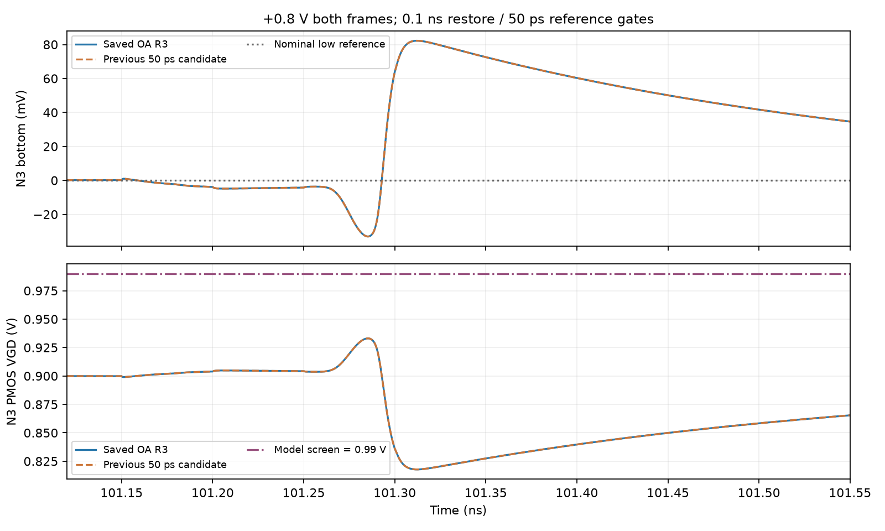

# SAR8 原理图新基准与合龙复验

R3采用0.1 ns采样中点恢复等待、50 ps理想参考栅压边沿。
新顶层为 `SAR_ADC_T28/sar_adc8_join_r3/schematic`，测试台为
`SAR_ADC_T28/tb_sar_adc8_join_r3/schematic`；R1、R2保留为历史对照。
这是对已测试时序的原理图落地，不是更换Bootstrap或重新设计管级驱动器。

## 保存的电路和时序

顶层112个实例，测试台26个实例，读回无检查标记。相对R2，除测试台指向
新顶层外，只在16组 `sar8j_aligned_refgate` 上显式设置
`restore_guard_s=100p`、`edge_s=50p`。逐实例核对其余CDF参数、连接及位置，
并核对全网连接和端口；Bootstrap、MOM、3×参考开关、StrongARM、原生异步
控制器和监测负载均未改动。36个历史电路的连接和尺寸指纹保持一致。

共享参考栅控的CDF新增两个可编辑参数；默认值仍为原模型的2 ns、20 ps，
原有 `initial_high` 及两个Verilog-A文件的字节均未改变。R2未设置新覆盖值，
因此仍保留原来的2 ns／20 ps行为，不会因R3采用候选而暗中改变。

| 时序项 | R3设置 | 作用 |
| --- | ---: | --- |
| 采样中点恢复等待 | 100 ps | 从SAMPLE上升50%门限起等待，再发出恢复命令 |
| 高低参考轨逻辑非交叠 | 100 ps | 换轨bank先关旧轨，后开新轨 |
| 参考栅压边沿 | 50 ps | 同时用于恢复和转换换轨，不改变SAMPLE或原生逻辑尺寸 |
| 请求字稳定提交 | 200 ps | 保留R2共享整字提交机制，未变化bank不被断开 |

在第二帧恢复时，SAMPLE上升门限约101.050 ns，恢复命令约101.150 ns。
50 ps边沿使旧轨关断／新轨开启50%门限分别约101.175／101.275 ns。
这些是理想栅控的门限时刻，不等于晶体管的实际导通阈值。

## 从原理图到仿真的对应关系

原理图先保存和检查，再两次独立导出Spectre网表。导出后的所有原生子电路
与R2一致，R3顶层在归一化版本名后与上一轮50 ps候选电气语句一致。
确认仿真仅设置测试台输入、分析、保存及include路径，不修改导出的DUT。
两次原始导出均保留，不以手改网表代替OA设置。

每组Spectre21.1 APS、TT／0.9 V／27°C、200 ns、maxstep10 ps，保存完整求解点，
无噪声或失配。每侧输入50 Ω，每轨参考50 Ω＋4 pF不变。四组两帧差分输入
为−0.8／−0.8、+0.8／+0.8、−0.8／+0.8、+0.8／−0.8 V；跨帧翻转仍在
100.8–100.9 ns完成，未缩短获取时间。

## 复验结果

四组均 `result.ok`，200 ns数据完整且有限，共8帧、64次原生比较／写入／更新。
码字、位序、判决、物理P/N映射、中点保持字、读码窗口全部通过。

| 两帧差分输入 | 实测码字 | 最大保持采样误差绝对值 | 全程参考管最大端电压 |
| --- | --- | ---: | ---: |
| −0.8／−0.8 V | 14／14 | 0.200474 mV | 0.944611 V |
| +0.8／+0.8 V | 241／241 | 0.200473 mV | 0.936810 V |
| −0.8／+0.8 V | 14／241 | 0.200462 mV | 0.942421 V |
| +0.8／−0.8 V | 241／14 | 0.200463 mV | 0.938626 V |

采样误差以输入源端差分为基准，保持检查在主采样关断后0.5 ns；
首次比较前最大误差为0.200485 mV，全部转换的最大比较前残差为
0.808021 mV，均低于0.25 LSB＝1.7578125 mV。比较器全程最大端电压
为0.950686 V。参考32管和比较器11管均检查六组两两端电压，距离
0.99 V筛查线的最小裕量分别为45.389 mV、39.314 mV。

正大输入N3底板最低−33.042 mV，高轨PMOS最大VGD＝0.933042 V。
四组的新读数与上一轮50 ps候选的关键误差／应力读数完全一致；
两者有独立网表、PSF、波形及指纹，不是复用旧运行作为本次结果。



两条曲线重合。上图为N3底板，下图为N3高轨PMOS VGD；虚线分别为
名义低参考轨及0.99 V筛查线。所有变化bank的实际恢复关断／开启50%门限
为101.175／101.275 ns，同次换轨偏斜为0，50%非交叠为100 ps。
1%栅压门限间隔约51 ps，未见高低使能重叠；这不是贯通电流的直接测量。

四组均0错误、0CMI、0LTE，仍各有7条既有配置警告
（VACOMP-2435×1、SFE-2453×2、SFE-1131×4）。初始DC的GminDC提示保留；
正到负组另有Bad pivoting notice，总notice为6，其余为5。
未改变求解器设置或关闭检查，没有瞬态收敛失败。

## 新基准的验收范围

R3已作为当前开发基准，原理图与确认仿真对应；R2不再作为当前入口。
这是四种输入历史的标称合龙通过，尚不代表全码、FFT性能、PVT、噪声、失配、
完整Bootstrap内部应力、版图或寿命可靠性签核。参考栅压与提交／非交叠机制
仍由理想Verilog-A产生，参考buffer和实际管级时序驱动仍需后续设计。

## 文件与复现

配置为 `config/sar8_join_r3.yaml`；原理图落地、运行、分析分别为
`scripts/integration/join_r3.py`、`join_r3_sim.py`、`join_r3_analyze.py`。
小型结果清单为 `verification/integration/join_r3_results.json`。
原始OA读回、导出、网表、日志、PSF和波形在忽略目录 `output/sar8_join_r3/`。

已有OA/case受归属检查保护，原始case不可覆盖。读回、独立导出和离线分析
可以重复；导出请使用新的tag。首次执行顺序：

```powershell
E:/bridge-Agent-T28/virtuoso-bridge-lite/.venv/Scripts/python.exe scripts/integration/join_r3.py build
E:/bridge-Agent-T28/virtuoso-bridge-lite/.venv/Scripts/python.exe scripts/integration/join_r3.py export
E:/bridge-Agent-T28/virtuoso-bridge-lite/.venv/Scripts/python.exe scripts/integration/join_r3_sim.py prepare
E:/bridge-Agent-T28/virtuoso-bridge-lite/.venv/Scripts/python.exe scripts/integration/join_r3_sim.py run
E:/bridge-Agent-T28/virtuoso-bridge-lite/.venv/Scripts/python.exe scripts/integration/join_r3.py postflight
E:/bridge-Agent-T28/virtuoso-bridge-lite/.venv/Scripts/python.exe scripts/integration/join_r3.py export --tag final
.venv/Scripts/python.exe scripts/integration/join_r3_analyze.py nfull pfull n_to_p p_to_n --curate
E:/bridge-Agent-T28/virtuoso-bridge-lite/.venv/Scripts/python.exe -m unittest verification.integration.test_join_r3 -v
```
