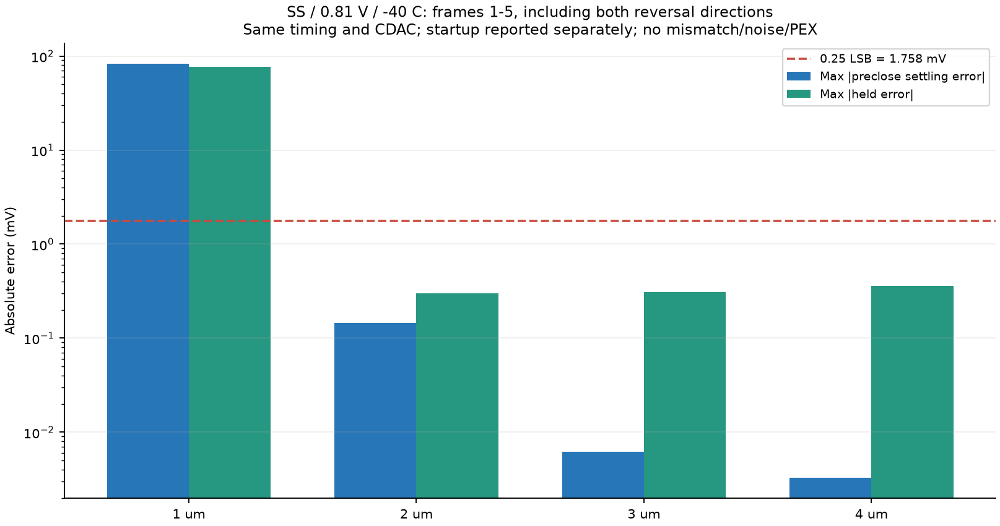
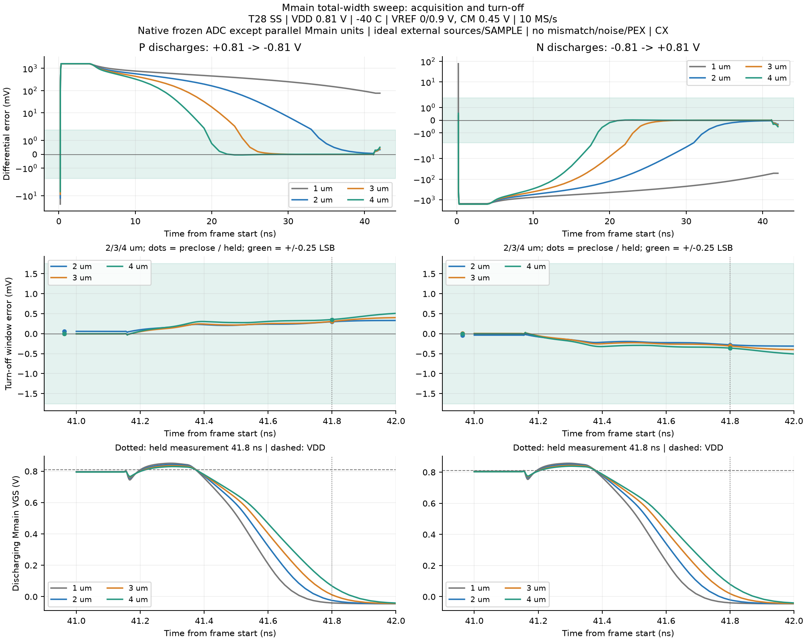

# Mmain 加宽：SS 冷角建立与五点 PVT

**选择有效总宽 2 µm。五点正常周期的静态采样误差均进入预算，但整机 PVT 尚未通过：
FF 过压和 FF 热角码偏差仍在。** 本轮 14 例、84 帧全部完成，未提升为设计基线。

## 宽度扫描结论

下表为正常周期（帧 1–5）最大绝对值，单位 mV；不同列的最大值不一定来自同一帧。

| 有效总宽 | 关断前建立误差 | 净关断变化 | 保持误差 | 后续五帧码字 |
|---|---:|---:|---:|---|
| 1 µm，原版对照 | 82.263 | 5.704 | 76.559 | 不通过 |
| **2 µm** | **0.146** | **0.243** | **0.298** | **通过** |
| 3 µm | 0.006 | 0.314 | 0.307 | 通过 |
| 4 µm | 0.003 | 0.357 | 0.360 | 通过 |

四例时序、空闲段复位、所检查端压及原生 CMI 检查通过。
2 µm 已远低于 1.758 mV 门限；继续加宽改善建立，但增加净关断扰动，保持精度没有收益。
选择它是“满足门限的最小宽度”，不是宣称细微差值已经完成高精度最优搜索。

第一轮大翻转的实际采样窗口，1/2 µm 分别为 37.84024/37.84031 ns；
关断前放电侧 VGS 为 0.79694/0.79622 V，Cboot 电压为 0.79701/0.79623 V。
窗口几乎不变，自举电压略降而非升高，建立却显著改善，支持此前“主管驱动不足”的定位。

上排为全过程误差（对称对数轴）；中排放大关断窗口，只显示 2/3/4 µm，
绿色范围为 ±0.25 LSB，圆点分别是关断前与保持测量。
下排是正在放电侧的主管 VGS：加宽后关断拖尾变长，说明栅负载也参与了权衡。
1 µm 尚未建立，其 −5.704 mV 净变化仍含持续建立的贡献，不能解释为纯关断注入。

启动帧保持误差分别为 −24.041、−12.807、−8.729、−6.603 mV，均未达标；
对应码字 239/241/242/242，理想为 243。该帧缺少完整预充电历史，不能用后续周期通过掩盖。
产品化前仍需定义上电复位及首个有效转换周期。

## 2 µm 五点 PVT 回归

每点使用上一轮相同的六帧静态激励和六帧 4.501953125 MHz、−1 dBFS 正弦。
下表误差为静态帧 1–5 最大绝对保持误差；CMI/端压与时序检查覆盖全部 60 帧，包括启动。

| MOS / VDD / 温度 | 原 1 µm 误差 (mV) | 2 µm 误差 (mV) | 后续静态码字 | CMI / 核心管端压 |
|---|---:|---:|---|---|
| TT / 0.90 V / 27°C | 0.207 | 0.405 | 通过 | 无 / 峰值 0.979 V |
| SS / 0.81 V / −40°C | 76.559 | **0.298** | **23→12，恢复正确** | 无 / 峰值 0.940 V |
| SS / 0.81 V / 125°C | 1.463 | 0.289 | 通过 | 无 / 峰值 0.927 V |
| FF / 0.99 V / −40°C | 0.295 | 0.577 | 通过 | **有 / 1.058 V > 0.99 V** |
| FF / 0.99 V / 125°C | 0.256 | 0.518 | **仍为 10，理想 12** | **有 / 1.049 V > 0.99 V** |

五点正常周期的最大建立误差也全部低于门限，最坏 0.1461 mV。
全部 60 帧的比较/写入/更新/捕获计数、输出保持、空闲段顺序复位和非重叠检查通过；
最大转换时间 41.044 ns，小于 60 ns。**时序通过不等于转换精度或可靠性通过。**

FF 冷角的代表性峰值来自 `XREF.XDRV0.GNNCN` 的 VDS（`GNNDRV` 对地），
静态案例 65.257 ns 为 1.057558 V。FF 热角峰值来自 `XIDLE.XN.MN` 的 VGS
（`ACTIVE` 对地），正弦案例 55.201 ns 为 1.049466 V。
它们是原有核心逻辑/驱动的过压，扩大 I/O 主管没有将其消除。
本轮未重复严格短窗复核，上一轮已有严格设置下仍过压的证据。

FF 热角 −0.81 V 的采样保持误差只有 +0.518 mV（0.074 LSB），输出却仍低 2 码；
该点不再能用“采样未建立”解释，需要另查转换阶段，不能据此认定某一个模块已定位。
短正弦逐码对照保存在 `results.json`，尺寸改变了动态响应，**没有据六点数据声称 ENOB 改善**。

2 µm 五点首帧码字依次为 242/241/242/243/245，理想均为 243；首帧保持误差为
−9.447/−12.807/−13.491/−1.696/+0.481 mV。不能把正常周期改善当作上电行为已经合格。

下一步保留 2 µm 作为采样候选，分别处理 FF 核心管端压和 FF 热角码偏差，
并明确启动有效周期；完成这些问题后再做长频谱/全码回归及失配验证。

## 这次只改什么

冻结 `027b951` idle-reset 候选的时序、辅助管、Cboot、CDAC、参考开关和比较器，
P/N 两侧 Mmain 对称增加到有效总宽 2/3/4 µm，L 始终为 150 nm。
实现是完整原 1 µm 管的显式并联，包含各单元的栅与结寄生；
不是只修改理想 Ron，也不等价于已完成共享扩散版图的单指宽管。
原理图 OA 和正式网表没有改动。

## 怎样分辨建立与关断

SS / 0.81 V / −40°C，固定 VREF=0/0.9 V、输入共模 0.45 V、10 MS/s。
四个宽度使用相同六帧输入：`+0.81, −0.81, +0.81, −0.81, 0, +0.123046875 V`。
首帧启动另列；帧 1–5 用于择优，包含 P/N 两个放电方向。

- 建立误差：内部 `SEQ_SAMPLE` 下降到 50% 前 0.2 ns，
  `Epre = TOPP − TOPN − (VINP_SRC − VINN_SRC)`。
- 保持误差：每帧起点后 41.8 ns，同一定义；逐帧检查该时刻早于首次比较。
- 净关断变化：`Eheld − Epre`。它同时包含继续建立、时钟馈通、电荷注入和参考耦合，
  **不是单独提取的沟道电荷注入**。

两个误差都必须小于 0.25 LSB = 1.7578125 mV，同时满足码字、时序和应力检查。
选择满足条件的最小宽度，不以关断误差恰好抵消建立误差为优化依据。

## 测试边界

原生 Spectre X CX，最多 2 任务并行、每任务 4 线程，每例 600 ns。
14 例实际 transient 设置为 `reltol=1e-4`、`maxstep=6 ns`、
`abstol(V)=1 µV`、`abstol(I)=1 pA`、`gear2only`，与原批次一致。
波形使用原生自适应时间步，不是每 6 ns 才观察一次。
外部电源、参考源、输入源及 SAMPLE 理想，内部 MOS/RC 时序和电路保持原样。
输入源每侧 50 Ω，参考每轨 50 Ω/4 pF，CDAC 每侧名义约 1.025 pF。
五点是 MOS PVT；无源器件使用 TT，没有失配、瞬态噪声或 PEX。
六帧正弦只检查功能、时序与应力，不计算新 FFT、ENOB、DNL 或 INL。

原始 PSF 保留在独立远端任务目录，未覆盖此前案例；本地保存完整时间步的精简节点波形。
445 个原选定 MOS 的六种端压差逐时间步检查；新增并联主管四个端点相同，
不重复计为独立应力节点，原生 CMI 另对整个电路检查。

结果、选择规则和来源核对见 `verification/sar8_main_width/`；
复现脚本位于 `scripts/sar8_main_width/`。
原生波形位于 `/tmp/virtuoso_bridge_chenzc_intern25/90590/sar8_main_width_20261024/`，
这是远端临时结果目录，不是持久项目归档。本轮没有删除任何旧波形。
14 份远端网表与本地哈希一致，反向替换验证只改变主管并联单元；五点激励与原版逐字相同。
PDK/原网表/规格哈希未变。新增本地数据约 0.87 GiB、远端约 16.83 GiB。
