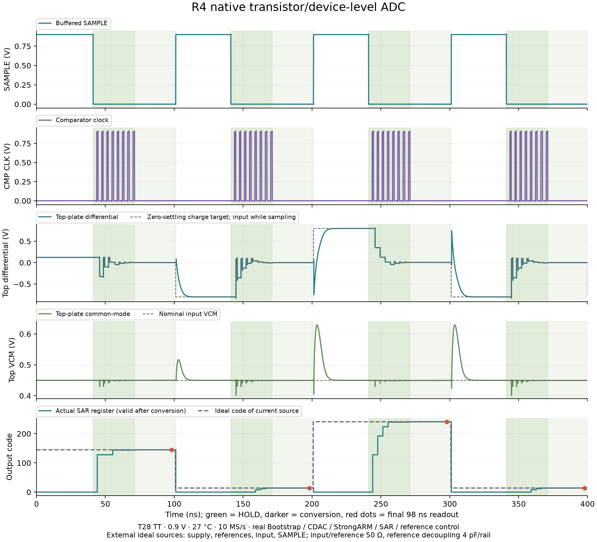
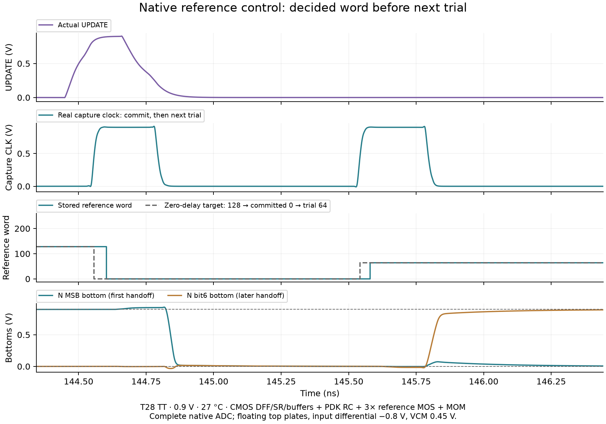

# 8-bit ADC：内部控制的晶体管级实现

本轮范围是**补齐内部参考控制和真实栅驱动，并接回整机**；不是版图或全条件签核。
已完成内部全原生器件候选，并通过下述四帧标称筛查。顶层为 `SAR_ADC_T28/sar_adc8_join_r4`，测试台为
`tb_sar_adc8_join_r4`。旧 R3+B 保留，不据此自动替换基准。

## 电路边界

| 模块 | R4 实现 |
| --- | --- |
| 采样 | 原 12 管 Bootstrap；T28 1.8 V MOS，主管仍为 1 µm/150 nm |
| CDAC | 原 flat MOM 阵列、原 3× PMOS/NMOS 参考开关 |
| 比较器 | 原 11 管 StrongARM |
| SAR | 原生 CMOS token/寄存器环；复制后去掉未使用的请求驱动支路 |
| 参考字 | 8 个 CMOS DFF，SAMPLE 异步初始化为 128；先捕获实际判决 D，再捕获下一试探 CODE |
| 参考栅驱动 | 每 bit 非交叠、CMOS 缓冲、PDK 栅串联电阻，驱动真实加权负载 |
| 内部无源 | MOM 电容与 PDK `rupolym`；无理想内部 RC 或 Verilog-A 控制源 |

电源 0.9 V、参考源 0/0.9 V、差分输入和外部 SAMPLE 仍由测试台提供。
输入每侧 50 Ω；参考每轨 50 Ω＋4 pF；输出每 bit 外接 5 fF。
本轮不实现 PLL、基准源、参考缓冲器或输出 IO。

SAMPLE 高时直接复位八个参考存储位，仅 MSB 反相存储得到初始字 128。
转换时分两相：先捕获实际 SAR 寄存器 D，撤销当前位未保留的试探；建立后，
再捕获 CODE，加入下一位试探。每相最多改变一个 bit，其余参考开关保持连接。
一只真实 SR 锁存请求，PDK RC 产生晚相和清除；不是 Verilog-A 定时器或预测码字。

测试台明确从 SAMPLE 高开始，保持采样/初始化；首帧单独记录启动状态。
完整高低周期后才声明有效转换。任意上电状态、供电斜坡和时钟启动尚未签核。

## 已核对的器件映射

1 MHz 原生 AC 测得小 MOM 单位 **4.97572 fF**、电阻 **9.99390 kΩ**。
Bootstrap 电容使用 200 个小 MOM 单位并联，约 0.995 pF。
寄存器和延迟电容也按整数 MOM 单位实现，不强行认作原来的理想标称值。

栅电阻暂用每路两组、每组五段合法 17.13 µm 电阻串联，再按 `2^bit` 并联。
单组 CDF 约 49.91 kΩ；实际导出确实展开为五段，不绕过 PDK 单段长度上限。
这是电气候选，电阻/驱动面积尚未优化，不能据此冻结布局。

## 迭代证据

测试均为 T28 TT、0.9 V、27 °C、APS4、conservative、maxstep 10 ps。
请求 reltol 1e−6，Spectre 实际收紧至 1e−7；未通过放宽求解器取得通过。

| 版本/测试 | 实际结果 | 结论 |
| --- | --- | --- |
| 直接 CMOS 驱动，200 ns 单元 | 18/18 字正确；参考管端电压峰值 0.99744 V，出现 CMI | 逻辑通过，应力失败 |
| 加 PDK 栅电阻，200 ns 单元 | 18/18 字正确，无门限重叠；峰值 0.95040 V，无 CMI/LTE | 单元通过；当时 UPDATE 为 1 ns |
| 首次整机参数启动 | SUP/VDIFF 未赋值，SFE-1997；未进入瞬态 | 测试台脚本错误，已修复参数顺序处理 |
| 时钟初始化＋RC 捕获，整机 2 帧 | 每帧 8 次比较/写入/更新，但参考字不更新，最终均 255 而非 145 | 实际 208 ps UPDATE 被 RC 滤掉，功能失败 |
| 同一失败整机的启动 | 参考字 252→128；TOPN 最低 −161 mV，比较器输入管峰值 1.06104 V | 启动未通过，不以丢弃首帧消除告警 |
| 异步初始化＋下降沿捕获，20 kΩ 栅电阻，整机 4 帧 | 最终码均正确、建立误差最大 0.1433 LSB；参考管峰值 1.26180 V | 功能通过，应力失败 |
| 同条件栅电阻增至约 100 kΩ，整机 4 帧 | 最终码仍正确；参考管峰值 1.08074 V | 限速改善但不足，仍未通过 |

波形定位到：一次 MSB→下一位试探时，低位新参考早约 22.4 ps 接通，而高位底板
仍浮着，产生大幅耦合。短时钟错峰方案经电气审查未采用：它仍可能让下一个底板
提前浮空。最终改为“先判决、后试探”两相，避免不同方向的底板同时换轨。

失败波形、原始导出和对应脚本运行记录均保留在 `output/sar8_physical/`。

## 最终候选验证

两相 208 ps 单元已通过：18/18 字正确，16 次更新的中间字和最终字均正确；
晚相最大延迟 1.048 ns，参考管峰值 0.92363 V，无门限重叠、CMI 或 LTE。
完整四帧也已通过本轮门限，数据为 `nominal06_two_phase`：

| 检查 | 实测 |
| --- | --- |
| 输入差分 / 最终码 | +0.123、−0.8、+0.8、−0.8 V / 145、14、241、14，均与理想一致 |
| 转换与保持 | 每帧 8 次比较/写入/更新；90–98 ns 码稳定，输出电平有效 |
| 两相参考 | 32 次 UPDATE 的 64 次捕获均正确；每相最多改变 1 bit，两相间隔 0.984–0.985 ns |
| 转换用时 | 29.951–29.995 ns，按采样关闭至末次 UPDATE 上升沿定义；预算 60 ns |
| 恒定输入保持差 | 最大 0.20230 mV；在实际 SAMPLE 关闭后 0.6 ns、参考尚未换字时测量 |
| 比较前建立偏差 | 最大 0.14734 LSB，低于 0.25 LSB；基准使用实际保持值，不重复计入采样差 |
| 参考 / 比较器 / Bootstrap 端电压峰值 | 0.96248 / 0.95066 / 1.75158 V；core/IO 筛查线 0.99/1.98 V |
| 原生日志 | 0 错误、7 条 PDK/全局端口警告、5 条提示；无 CMI、无 LTE 放宽 |

端电压检查覆盖 **67 只模拟 MOS、全部六种端电压组合和所有保存时点**，
不是全逻辑器件或寿命签核。首帧启动观察也列入表中；本轮明确采用 SAMPLE 高电平
初始化条件，原低电平启动失败单独保留，不能据此宣布任意上电时序通过。

绿色覆盖整个保持期，较深部分为转换；红点是每帧 98 ns 最终读码。
差模虚线在采样期是输入，在保持期是“实际保持值＋理想 CDAC 电荷目标”。
转换时顶板本来就应变成残差，不能把它与输入的差直接当成保持误差。

细节图来自**完整 ADC 的 −0.8 V 转换**，顶板真实浮置，没有理想顶板钳位。
参考字先从 128 落到判决字 0，MSB 底板建立后，再加入下一试探字 64。
比较次数仍为 8；灰色字值是零逻辑延迟基准，寄存器和底板都保留真实传播/建立过程。

100–400 ns 指定测试窗口，VDD 净平均供能 **0.1086 mW**，高参考源 **0.01278 mW**；
输入源与时钟的正向、回收、净能量另列在结果 JSON。不是稳态动态功耗或整机 ≤1 mW 签核，
没有包含片上参考缓冲器、供电网络和 IO 实现的开销。

所有 35 个新单元均完成参数/连接回读、零 Check&Save 标记。仿真 DUT 和整理后的
全参数网表均与 OA 导出逐项一致；只在测试台改变激励与运行设置。5 个既有依赖的
完整回读内容不变，未修改旧 R3。新版本仍是独立候选，未自动替换选定基准。

本轮未运行全码 DNL/INL、FFT、PVT、瞬态噪声、Monte Carlo、DRC/LVS/PEX。
比较器已知失配问题没有因为换驱动而消失。外部参考缓冲器开销、面积、
逻辑全器件应力和真实电源启动仍需后续验证。

## 文件与复现

- 设计定义：[circuit.py](../scripts/sar8_physical/circuit.py)，配置：[sar8_physical.yaml](../config/sar8_physical.yaml)。
- OA 创建/回读/导出：[oa.py](../scripts/sar8_physical/oa.py)；只修改本轮新建单元。
- 运行、测量、波形：[simulate.py](../scripts/sar8_physical/simulate.py)、[analyze.py](../scripts/sar8_physical/analyze.py)、[figures.py](../scripts/sar8_physical/figures.py)。
- `sar8p_delay_restore` 是本轮遗留的未使用单元，不在最终 DUT 层次中；旧实验导出不视作冻结版本。
- 计划：[plan.md](../plan/2026-10-21-sar8-transistor-closure/plan.md)。
- 小型结果与源指纹：[results.json](../verification/sar8_physical/results.json)。
- 保留完整 MOS CDF 参数的 [DUT](../netlist/sar8_physical/dut.scs)、[外部测试台](../netlist/sar8_physical/tb.scs)、[TT 四帧运行设置](../netlist/sar8_physical/tt_nominal.scs)；不分发 foundry 模型内容。

桥接/OA 用 `virtuoso-bridge-lite/.venv`；仿真用工作区根目录含 bridge/numpy 的
`.venv`；离线分析/画图用本项目 `.venv`。运行名必须唯一，不能覆盖旧结果。
